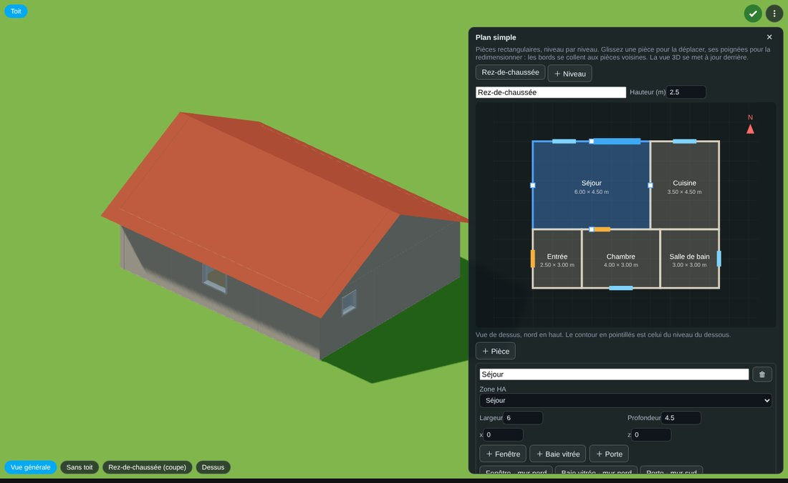
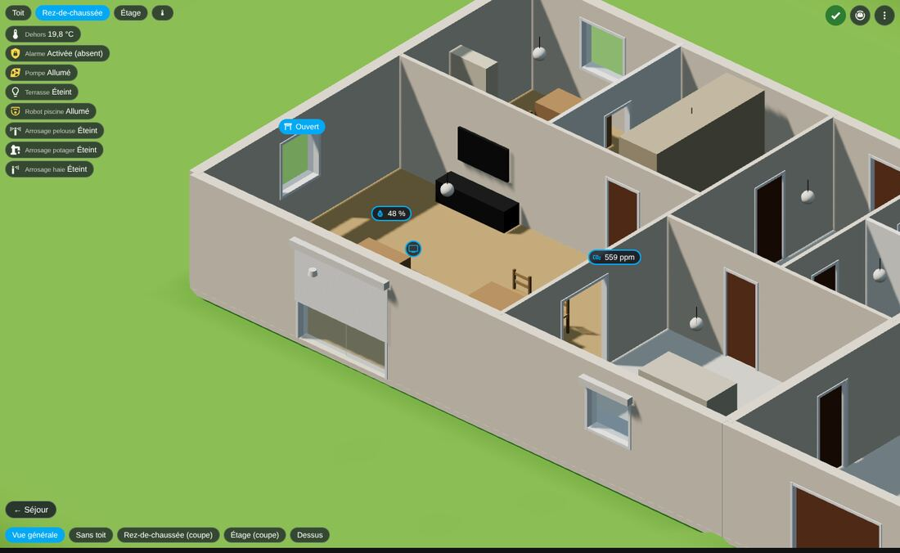
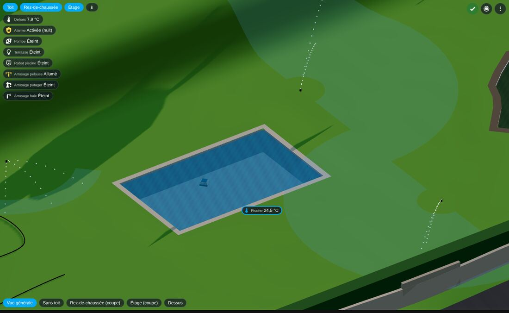
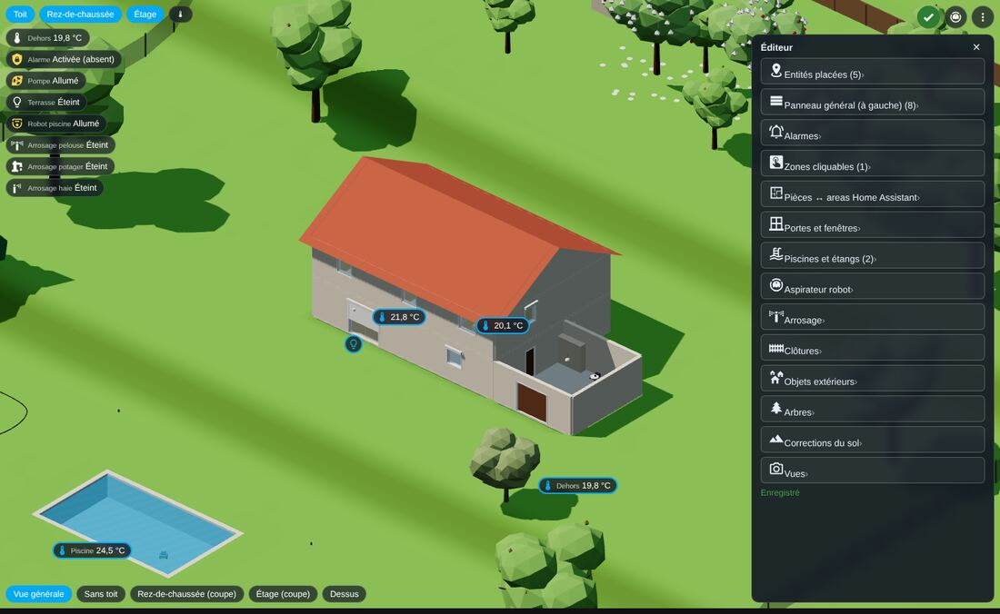
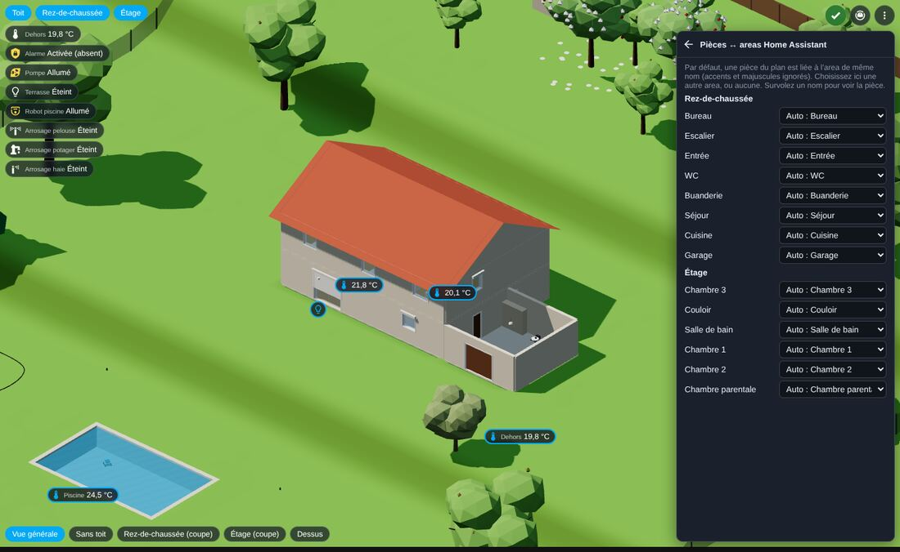
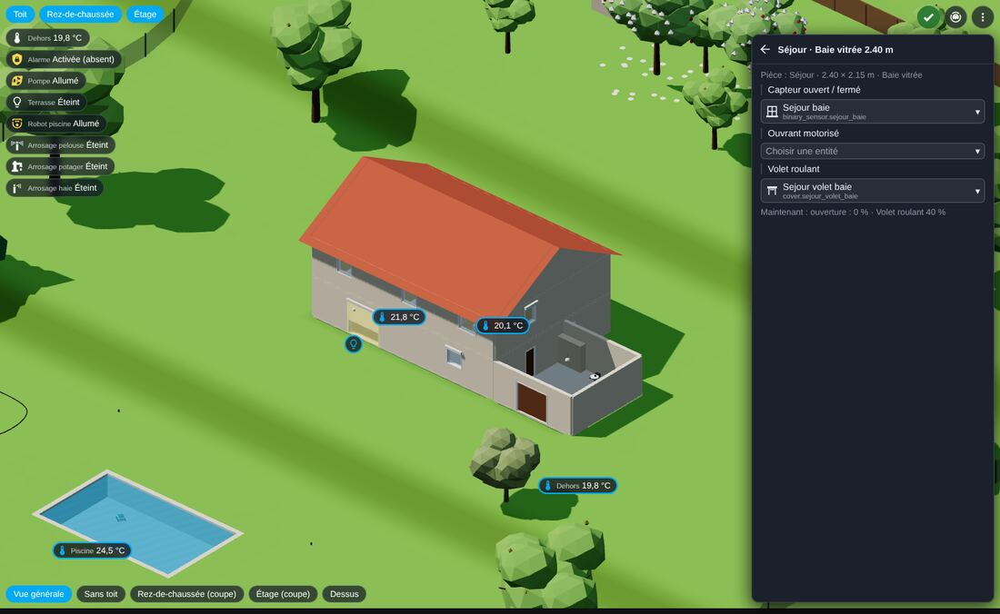
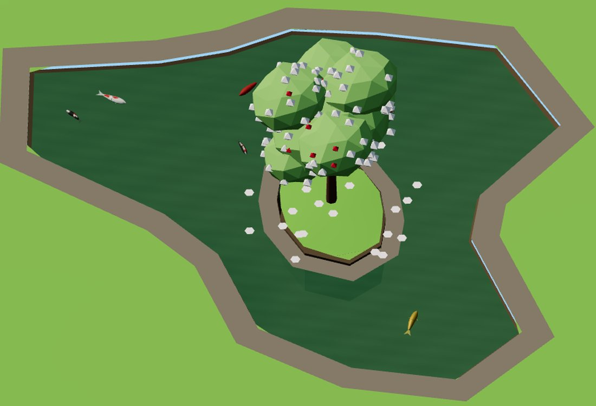

# House View: Anleitung zu Installation, Einrichtung und Bedienung

House View zeigt Ihr Haus in 3D in Home Assistant. Der in Sweet Home 3D gezeichnete Plan liegt auf dem echten Geländerelief und wird von der Sonne des Augenblicks beleuchtet. Die Ansicht zeigt außerdem das Wetter, die Jahreszeiten der Pflanzen, die Lichter jedes Raums und den Zustand Ihrer Geräte (Rollläden, Fenster, Saugroboter, Bewässerung, Pool, Alarme…).

Alle Bilder dieser Anleitung wurden im **Demo-Zuhause** aufgenommen, das mit der Integration geliefert wird: ein erfundenes Haus, Gelände und erfundene Entitäten. Sie zeigen die französische Oberfläche der Karte. Die Karte gibt es auf Französisch und Englisch: die unten zitierten Beschriftungen der Karte sind die der englischen Oberfläche, die von Home Assistant auf Deutsch.


## Inhalt

1. [Was Sie brauchen](#1-was-sie-brauchen)
2. [Installation](#2-installation)
3. [Die Karte zu einem Dashboard hinzufügen](#3-die-karte-zu-einem-dashboard-hinzufügen)
4. [Erste Einrichtung: Plan und Gelände](#4-erste-einrichtung-plan-und-gelände)
5. [Die Ansicht benutzen](#5-die-ansicht-benutzen)
6. [Der Editor](#6-der-editor)
7. [Die Einrichtung (⚙)](#7-die-einrichtung-)
8. [Mehrere Wohnorte](#8-mehrere-wohnorte)
9. [Der Demo-Modus](#9-der-demo-modus)
10. [Optionen der Karte](#10-optionen-der-karte)
11. [Häufige Fragen](#11-häufige-fragen)

---

## 1. Was Sie brauchen

- **Home Assistant 2026.3 oder neuer**. Die Reinigung nach Räumen und das Symbol der Integration brauchen es; der Rest läuft auch mit älteren Versionen.
- **Einen Plan des Hauses**. Am vollständigsten ist ein **Sweet-Home-3D**-Plan (`.sh3d`, gespeichert mit Version 5.3 oder neuer); eine **IFC**-Datei (ArchiCAD, Revit, FreeCAD…) oder ein **SVG**-Plan gehen auch, und ganz ohne Datei zeichnet die Karte einen einfachen ([4.2](#42-einen-einfachen-plan-erstellen)). In einem Sweet-Home-3D-Plan sind wichtig:
  - eine **Ebene pro Geschoss** (Erdgeschoss, Obergeschoss, Keller…);
  - die **Wände**;
  - die **Räume**, gezeichnet mit dem Werkzeug *Räume erstellen*, und **benannt**: über den Namen werden sie mit den Bereichen von Home Assistant verknüpft;
  - die **Türen und Fenster** aus dem Katalog (sie schneiden die Wände aus und lassen sich animieren);
  - der **Kompass**, eingestellt auf Ihren Breitengrad und auf Norden (Sonne und Jahreszeiten hängen davon ab);
  - optional: Möbel, Lichter, Bäume und Gartenobjekte (Gartenhaus, Tor, Pool…).
- **Bereiche in Home Assistant** für Ihre Räume, mit den Lichtern, Sensoren und Rollläden darin: so weiß die Ansicht, was sie wo zeigen soll.

Das Gelände (Relief, Nachbargebäude, Straßen, Kataster, Luftbild) müssen Sie nicht liefern: die Integration lädt es selbst herunter (siehe [4.4](#44-das-gelände-abrufen)).

## 2. Installation

### 2.1 Die Integration installieren

**Mit HACS** (empfohlen):

1. HACS → Menü ⋮ → *Benutzerdefinierte Repositories* → `https://github.com/elwinmage/ha-house-view-component` hinzufügen, Typ *Integration*.
2. In HACS nach **House View** suchen und installieren.
3. Home Assistant neu starten.

**Von Hand**: `house_view.zip` der neuesten Version (es enthält die gebaute Karte) nach `config/custom_components/house_view/` entpacken, dann neu starten.

> Die Karte (die JavaScript-Datei) kommt mit der Integration und wird auf allen Dashboards von selbst geladen: es ist **keine Lovelace-Ressource** von Hand hinzuzufügen.

### 2.2 Das Zuhause hinzufügen

1. *Einstellungen → Geräte & Dienste → Integration hinzufügen →* **House View**.
2. Geben Sie dem Zuhause einen **Namen** (zum Beispiel „Haus“) und prüfen Sie seinen **Standort** auf der Karte: standardmäßig der von Home Assistant. Verschieben Sie die Markierung bei Bedarf auf das Haus: er dient für Sonne, Jahreszeiten und den Abruf des Geländes.
3. Bestätigen.

Jedes Zuhause ist ein Eintrag der Integration; für ein zweites Haus siehe [Mehrere Wohnorte](#8-mehrere-wohnorte).

## 3. Die Karte zu einem Dashboard hinzufügen

1. Ein Dashboard öffnen, in den Bearbeitungsmodus wechseln, *Karte hinzufügen*, dann nach **House View** suchen.
2. Die Optionen werden im visuellen Editor der Karte eingestellt (siehe [Optionen der Karte](#10-optionen-der-karte)). Am Anfang ist nur die Wetter-Entität nützlich.

In YAML genügt:

```yaml
type: custom:house-view-card
weather_entity: weather.haus
```

**Für eine große Darstellung** legen Sie die Karte in eine Ansicht vom Typ **Abschnitte** und stellen sie auf **volle Breite**: im Editor der Karte, Reiter *Layout*, die volle Breite einschalten. Mit der Option `height: fill` (Standard) nimmt sie dann die ganze verfügbare Breite und Höhe ein. Eine Ansicht vom Typ *Panel* (eine einzige Karte) ergibt ebenfalls Vollbild.

Solange kein Plan importiert ist, zeigt die Karte eine Meldung und eine Schaltfläche **⚙ Setup** (nur für Administratoren sichtbar).


## 4. Erste Einrichtung: Plan und Gelände

Öffnen Sie ⚙ **Setup** (Schaltfläche der leeren Karte oder **Menü ⋮ → Setup**).


### 4.1 Den Plan importieren

Klicken Sie unter **Plan of the house** auf *Import a plan* und wählen Sie Ihre Datei: Sweet Home 3D (`.sh3d`), IFC (`.ifc`) oder SVG (`.svg`). Der Plan wird im Browser gelesen (nur die Struktur bleibt: Ebenen, Wände, Räume, Öffnungen, Lichter, Möbel, Pflanzen), und ein **Bericht** listet auf, was gefunden wurde, mit eventuellen Hinweisen (Ebene ohne Räume, Kompass nicht eingestellt…).


Das Haus erscheint sofort auf flachem Boden. Die Möbel werden mit ihren **eigenen 3D-Modellen** aus der Sweet-Home-3D-Datei gezeichnet (verschlankt, eine Farbe pro Material, die mittlere Farbe einer Textur); das Kästchen *Furniture drawn with the 3D models of the plan* kehrt zu einfachen Formen zurück. Ein Möbelstück, dessen Modell nicht im OBJ-Format ist, bleibt ein Kasten oder wird zum gleichnamigen Objekt des Katalogs.

> **Tipp**: hat ein Raum keinen Home-Assistant-Bereich mit demselben Namen, meldet die Einrichtung das. Sie können ihn im Editor von Hand verknüpfen ([6.5](#65-räume--bereiche-von-home-assistant)).

**Die Formate**:

- **Sweet Home 3D**: Ebenen, Wände, Räume, Türen und Fenster, Lichter, Möbel und Pflanzen.
- **IFC** (exportiert von ArchiCAD, Revit, FreeCAD, BlenderBIM…): die Geschosse werden Ebenen und die Räume (`IfcSpace`) Räume, mit den Wänden, Türen und Fenstern. Exportieren Sie die Räume mit: ohne sie gibt es keine Räume, also weder Lichter noch eine Verknüpfung mit den Bereichen.
- **SVG** (für ha-floorplan oder mit Inkscape gezeichneter Plan): jede geschlossene Form mit einem Namen (ihre id, ihr Inkscape-Label oder ein `<title>`) ist ein Raum; die id `area.wohnzimmer` ergibt „Wohnzimmer“. Inkscape-Ebenen mit Räumen werden Geschosse. Korrigieren Sie den **Maßstab** (*Scale: SVG units per meter*), wenn die angegebene Größe nicht stimmt. Ein SVG aus Rechtecken öffnet sich im einfachen Plan, um Türen und Fenster hinzuzufügen.

Bei einem IFC-, SVG- oder einfachen Plan erhält jeder Raum eine Deckenleuchte, die von den Lichtern seines Bereichs geschaltet wird.

### 4.2 Einen einfachen Plan erstellen

Kein Plan? *Create a simple plan* (unter **Plan of the house**) öffnet einen Editor rechteckiger Räume; die 3D-Ansicht aktualisiert sich dahinter.



- **Räume**: *＋ Room* fügt einen neben dem vorigen hinzu, benannt nach einem noch nicht benutzten Home-Assistant-Bereich. Ziehen Sie einen Raum, um ihn zu verschieben, und seine Griffe, um seine Größe zu ändern: die Kanten haften an den Nachbarräumen, die sich dann ihre Wand teilen. Die Felder des gewählten Raums stellen Name, **HA-Bereich**, Breite, Tiefe und Lage ein.
- **Türen und Fenster**: wählen Sie *＋ Window*, *＋ Patio door* oder *＋ Door* und klicken Sie dann auf die Wand des Raums, an die sie kommt. Ziehen Sie sie entlang der Wand und stellen Sie Breite, Höhe und Brüstung ein.
- **Ebenen**: *＋ Level* fügt ein Geschoss hinzu, das den Umriss der Räume darunter übernimmt, zum Umbenennen und neu Aufteilen; die Raumhöhe wird pro Ebene eingestellt. Der Umriss der Ebene darunter bleibt gestrichelt sichtbar.
- **Dach und Ausrichtung**: Dach automatisch, Satteldach oder flach; Winkel von Norden (die Ausrichtung auf das Gelände korrigiert ihn danach).

Der Plan speichert sich selbst und öffnet sich wieder mit *Edit the simple plan*. Ein einfacher Plan ersetzt einen importierten Plan nach einer Bestätigung; platzierte Entitäten, Bewässerung, Zäune… bleiben erhalten.

### 4.3 Von der Karte des Roboters ausgehen

Hat ein Saugroboter das Haus kartiert und liefert ein Kartenextraktor (Xiaomi Cloud Map Extractor, Roborock Custom Map…) seine Räume (Attribut `rooms`), erstellt die Schaltfläche *Plan from the robot's map* einen einfachen Plan mit diesen Räumen, in ihrer Größe und an ihrer Stelle. Es sind grobe Rechtecke, und nur die der Ebene des Roboters: passen Sie sie an und fügen Sie dann Türen, Fenster und weitere Ebenen im einfachen Plan hinzu.

### 4.4 Das Gelände abrufen

Unter **Terrain (DTM)**:

1. **Source**: *Automatic (by country)* wählt in Frankreich die Dienste des IGN, anderswo die weltweiten offenen Daten (Mapterhorn für das Relief, OpenStreetMap für Gebäude und Straßen).
2. **Breite / Länge**: vom Standort des Zuhauses übernommen, also aus der Konfiguration von Home Assistant (*Einstellungen → System → Allgemein*), sofern Sie ihn beim Hinzufügen des Zuhauses nicht geändert haben. Sie können sie hier ändern.
3. **Size**: Größe des Geländes um das Haus (standardmäßig 120 m).
4. Optionen (Frankreich): Oberflächenmodell (Bäume und automatische Ausrichtung), Gebäude, Straßen und Kataster, Luftbild oder IGN-Karte auf dem Boden; Ausrichtung auf das nächste Gebäude (der Standort in Home Assistant ist oft ungenau).
5. Klicken Sie auf **Fetch the terrain**. Die Schritte erscheinen unter dem Formular (Lokalisierung, Relief, Oberfläche, Gebäude und Straßen, Foto).


Am Ende wird der Plan **automatisch auf das Gelände ausgerichtet** (Drehung, Versatz, Höhe), die gefundenen Bäume werden gepflanzt, und Relief, Straßen und Foto erscheinen.

Sie können auch eine Geländedatei laden (*Load a terrain .json*) oder die Ausrichtung im selben Abschnitt von Hand anpassen (Drehung, Versatz, Höhe).

## 5. Die Ansicht benutzen


### 5.1 Sich bewegen

- **Ziehen** zum Drehen, **Mausrad oder Zwei-Finger-Zoom** zum Zoomen, **Rechtsklick / zwei Finger** zum Verschieben.
- Die **Ansichten** unten (General view, Without roof, Ground floor (cut), First floor (cut), Top) setzen die Kamera neu. Eigene speichern Sie im Editor ([6.11](#611-bäume-außenobjekte-und-bodenkorrekturen)).
- Die **Ebenen** oben links (Roof, Ground floor, First floor) blenden das Dach und jedes Geschoss ein oder aus; 🌡 färbt die Räume nach ihrer Temperatur.


| Schnitt durch das Erdgeschoss | Draufsicht |
|---|---|
|  |  |

### 5.2 Die Räume

- Ein **Tippen auf einen Raum** zoomt hinein (das Dach und die Geschosse darüber verschwinden). Ein **zweites Tippen** schaltet seine Lichter ein oder aus. Die Schaltfläche **← Room** kehrt zur vorherigen Ansicht zurück.
- Im Zoom auf einen Raum werden nur **die Entitäten dieses Raums** gezeigt (die der Gesamtansicht verschwinden); der Saugroboter bleibt sichtbar, wenn er dort ist.



### 5.3 Die linke Spalte: das allgemeine Panel

Unter den Ebenen sammelt das **allgemeine Panel** die Sensoren und Schalter des ganzen Hauses (Außentemperatur, Alarm, Pumpe, Bewässerung…). Ein Tippen schaltet um, was sich umschalten lässt, und öffnet bei den anderen den Detaildialog.

### 5.4 Die Leiste und das Menü ⋮

Oben rechts:

- das **Alarm-Abzeichen**: grün, wenn alles in Ordnung ist, rot mit der Zahl der ausgelösten Alarme;
- eine Schaltfläche pro **Saugroboter**;
- das Menü **⋮**, das die gelegentlich genutzten Werkzeuge und die Verwaltung bündelt.


| Eintrag | Zweck |
|---|---|
| Preview | Eine Jahreszeit, ein Wetter oder eine Tageszeit erzwingen |
| Simulate a year | Die Jahreszeiten eines Jahres in wenigen Sekunden abspielen |
| Lock the camera | Die Kamera auf den Ansichten festhalten (Wandbildschirm) |
| Simulation | Einstellungen des Simulationsmodus (wenn die Karte im Simulationsmodus ist) |
| Demo | Panel des Demo-Zuhauses |
| Editor ✎ | Entitäten, Bewässerung, Zäune… platzieren (Administratoren) |
| Setup ⚙ | Plan, Gelände, Sicherung, Schutz (Administratoren) |

Häufig genutzte Werkzeuge können in der Leiste bleiben (Option *Buttons in the toolbar*), und das Menü lässt sich für Nicht-Administratoren ausblenden (Option *Hide the ⋮ menu*).

### 5.5 Die Alarme

Rauch-, Gas-, Kohlenmonoxid-, Wasserleck-, Problem-, Hitze-, Kälte- und Sabotagesensoren sowie ausgelöste Alarmanlagen werden von selbst erkannt. Wird ein Alarm ausgelöst, wird das Abzeichen rot und der **betroffene Raum** zeigt eine rote Glocke mit der Zahl der Alarme. Ein Tippen öffnet die Liste; ein Tippen auf einen Alarm öffnet seinen Detaildialog; die durchgestrichene Glocke ignoriert ihn.


### 5.6 Wetter, Sonne und Jahreszeiten

- Die **Sonne** folgt der Uhrzeit und dem Datum des Zuhauses; die **Schatten** wandern im Lauf des Tages.
- Das **Wetter** kommt von der Wetter-Entität (Regen, Schnee, Gewitter, Nebel, Wolken, Wind). Ein Regenmesser oder eigene Windsensoren können es korrigieren (siehe Optionen).
- Die **Pflanzen** und der **Rasen** folgen den Jahreszeiten des Klimas der Breite: vier Jahreszeiten in gemäßigten Zonen, langer Winter und kurzer Sommer nahe den Polen, Regen- und Trockenzeit zwischen den Wendekreisen. Auf der Südhalbkugel ist alles umgekehrt.
- **Preview** (Menü ⋮): eine Jahreszeit, ein Wetter oder eine Tageszeit erzwingen, kombinierbar; zurück zum Live-Bild mit *Preview… ✕* oder nach 3 Minuten.

| Preview: Winter im Schnee | Simulate a year: der Herbst |
|---|---|
|  |  |

**Simulate a year** spielt ein ganzes Jahr ab (standardmäßig 10 s, 5 bis 60 s), ab dem angezeigten Datum; ein Etikett zeigt das Datum. Am Ende kehrt die Ansicht zum vorherigen Datum zurück.

### 5.7 Lichter, Rollläden und Fenster

Die Lichter jedes Raums beleuchten den Raum und seine Fenster. **Rollläden** fahren bis zu ihrer echten Position herunter, **Fenster** öffnen sich, **Schiebetüren** gleiten, **Türen** schwenken.


### 5.8 Der Saugroboter

Ein Tippen auf die Schaltfläche des Roboters öffnet die Raumauswahl: Räume auf dem Plan wählen, dann *Clean* (außerdem *Start*, *Pause*, *Dock*). Während der Reinigung fährt ein 3D-Roboter, der aktuelle Raum wird mit seinem Prozentsatz eingefärbt, die noch anstehenden Räume werden getönt, ein fertiger Raum funkelt, und ein Ring um die Schaltfläche zeigt den Gesamtfortschritt. Bei einem Fehler blinken Raum und Roboter rot.


### 5.9 Bewässerung, Pool und Teich

Öffnet ein Ventil, leuchten die **Tropfleitungen** blau auf und ein nasser Fleck wächst; die **Regner** zeigen ihren Strahl und ihren Sektor. Der Poolroboter fährt über den Boden, solange seine Entität aktiv ist; das Wasser bewegt sich. Die Lampen des Pools färben abends das Wasser, und die Rollabdeckung rollt über das Wasser; ein Klick öffnet oder schließt sie.

| Regner im Morgengrauen | Pool und Teich |
|---|---|
|  |  |

## 6. Der Editor

Nur für Administratoren: **Menü ⋮ → Editor**. Der Editor ist ein **Menü aus Abschnitten**. Ein Abschnitt öffnet sich in einem eigenen Fenster über dem Menü; ein Element einer Liste (eine Tropfleitung, eine Zone, eine Entität…) öffnet sich über dem Abschnitt. Der Pfeil **←** führt zum Fenster darunter zurück. Alles wird von selbst gespeichert; **Esc** bricht das laufende Zeichnen ab.



### 6.1 Platzierte Entitäten

Um eine Entität in der Ansicht zu platzieren (Temperatur, Licht, Schalter, Rollladen…):

1. *Add an entity*: die Liste bietet zuerst die Entitäten des aktuellen Raums an, nach Gerät gruppiert (das ganze Haus mit einem Tippen, mit Suche).
2. Tippen Sie in der Ansicht auf die gewünschte Stelle. Das Etikett lässt sich danach **durch Ziehen verschieben** (bei geöffnetem Editor).
3. Einstellen: **Mount** (auf dem Boden, an einer Wand, frei in der Höhe), **Display** (Etikett mit Wert oder nur Symbol), Beschriftung, Symbol, Farbe, Aktion beim Tippen (Detaildialog, umschalten, nichts).

Die Entitäten sind in **Ebenen** geordnet:

- **Gesamtansicht**: in der Gesamtansicht gezeigt (oder nur in der Ansicht ihres Geschosses). Mit dem Kästchen *Shown over the roof* lässt sich zum Beispiel die Temperatur eines Raums von Weitem ablesen.
- **Raum**: nur im Zoom auf ihren Raum gezeigt.


Um **die Entitäten eines Raums** zu bearbeiten, tippen Sie bei geöffnetem Editor auf den Raum in der Ansicht: er wird herangezoomt und ein **rotes Band** zeigt, dass Sie diesen Raum bearbeiten. Die dann hinzugefügten Entitäten gehören nur zu diesem Raum; platzieren Sie sie auf dem Boden, an einer Wand oder in der Luft.


> Eine bereits in einem Raum platzierte Entität der Gesamtansicht wechselt mit *Visible → Its room only* in diesen Raum.

Ein platziertes **Licht** wird an dieser Stelle zu einer echten Lichtquelle (Spot, Pendelleuchte, Lampe, Lichtband oder unsichtbar; Höhe und Reichweite einstellbar; an einer Wand: eine Wandleuchte).

### 6.2 Allgemeines Panel

Die Sensoren und Schalter der linken Spalte, in der gewünschten Reihenfolge, mit Beschriftung, Symbol und Aktion beim Tippen (automatisch, umschalten, Detaildialog, nichts).


### 6.3 Alarme

Automatische Erkennung ein oder aus, Glocken in den Räumen, von Hand hinzugefügte Entitäten, ignorierte Entitäten.


### 6.4 Klickbare Zonen

Ein **Mediaplayer** auf einem Möbelstück des Plans (antippen) oder auf einem Rechteck an einer Wand oder auf dem Boden; ein **Aquarium** der Integration [reeftank](https://github.com/Elwinmage/ha-reeftank-component) auf einem Rechteck in der Größe des Beckens. Ein Tippen öffnet den Player oder die Aquariumansicht der Karte [ha-reef-card](https://github.com/Elwinmage/ha-reef-card); das Rechteck eines Aquariums zeigt diese Ansicht live, Fische inklusive, nie verzerrt. Beim Platzieren leuchtet die anvisierte Fläche auf; eine Zone wird durch Ziehen verschoben.


### 6.5 Räume ↔ Bereiche von Home Assistant

Jeder Raum des Plans wird mit dem Home-Assistant-Bereich **gleichen Namens** verknüpft (Akzente und Groß-/Kleinschreibung werden ignoriert). In diesem Abschnitt wählen Sie Raum für Raum einen anderen Bereich oder keinen.



### 6.6 Türen und Fenster

Die Öffnungen des Plans, nach Ebene und Raum; mit **Pick on the view** tippen Sie ein Fenster direkt an (es leuchtet beim Überfahren auf). Jede Öffnung lässt sich verknüpfen mit:

- einem **Offen/Geschlossen-Sensor** (`binary_sensor`);
- einem **motorisierten Öffner** (`cover` des Fensters);
- einem **Rollladen** (`cover`), für Fenster und Schiebetüren.

Ein Raum mit **nur einem Fenster** wird von selbst mit dem Fenstersensor, dem Öffner und dem Rollladen seines Bereichs verknüpft (wenn es von jedem genau einen gibt); ein Raum mit nur einer Tür mit seinem Türsensor. Eine von Hand gewählte Verknüpfung hat Vorrang; eine automatische lässt sich entfernen.



### 6.7 Pools und Teiche

*＋ Pool* oder *＋ Pond*, dann den Umriss von oben gesehen zeichnen: **Rectangle** (zwei gegenüberliegende Ecken) oder **Free shape** (Punkt für Punkt, dann *Finish*). Stellen Sie Namen, Wasserfarbe, Tiefe (0,2 bis 6 m) und, falls vorhanden, den **Reinigungsroboter** ein (`binary_sensor`, `switch`, `input_boolean`, `vacuum`, `light`, `fan` oder `sensor` — und jede andere Entität, indem Sie ihre ID in die Auswahl eintippen; ein Wert über null zählt als aktiv). Das Gelände wird ausgehoben: senkrechte Wände, flacher Boden und Beckenrand beim Pool; abfallender Boden und Kieselufer beim Teich.

**Lampen im Wasser**: *＋ Lamp* fügt einen Scheinwerfer in der Wand der gewählten Seite hinzu (Stelle entlang der Seite und Tiefe einstellbar), verbunden mit einem Licht oder einer Steckdose. Ein farbiges Licht gibt seine eigene Farbe, sonst wird die im Editor gewählte Farbe genommen; eingeschaltete Lampen färben Wasser und Becken, nachts umso mehr.

**Rollabdeckung**: *＋ Roller cover* fügt eine Lamellenabdeckung hinzu, die von der gewählten Seite über das Wasser rollt, mit der Wickelwelle auf dem Beckenrand oder im Wasser versenkt. Eine `cover`-Entität gibt ihre Position (0 bis 100 %), eine `switch`-, `input_boolean`- oder `binary_sensor`-Entität sagt nur offen oder geschlossen (aktiv = geschlossen, *Swap* dreht die Lesart um). Ein Klick auf die Abdeckung in der Ansicht öffnet oder schließt sie. Ein Klick auf eine Lampe schaltet sie ebenso. Im Editor schalten diese Klicks nichts: sie öffnen den betreffenden Pool und umrahmen im Panel die angezielte Lampe oder Abdeckung. Bei aufgerollter Abdeckung antwortet die Wickelwelle auf den Klick.

Für beide zeigt die Schaltfläche 🎯 neben der Seitenliste die Seiten auf dem Boden: die benutzte Seite ist gelb, und der nächste Klick in der Ansicht nimmt die nächstgelegene. *Testen* (💡 für eine Lampe, ▶ für die Abdeckung) zeigt das Ergebnis, ohne die Entitäten anzurühren: die Lampe leuchtet allein, zu jeder Stunde, und die Abdeckung schließt und öffnet sich wieder, in ihrem wirklichen Tempo. Ein zweiter Klick beendet die Vorschau, die auch endet, wenn das Fenster des Pools geschlossen wird.


> Ein in Sweet Home 3D gezeichneter Pool bleibt, wie er ist.

**Inseln** (Teich): *＋ Island (Rectangle)* oder *＋ Island (Free shape)*, dann wie den Umriss ins Wasser zeichnen. Der Boden bleibt dort erhalten, etwas über dem Wasser, mit einem Kieselufer: darauf lässt sich ein Baum pflanzen (Abschnitt **Bäume**) oder eine Entität platzieren.

**Fische** (Teich): die Fische kommen aus dem Hauskatalog (zuerst der Koi-Karpfen). Fügen Sie pro Sorte eine **Gruppe** mit Anzahl und Größe hinzu: für 3 rote Koi, 1 rot-weißen und 2 gelbe sind es drei Gruppen (Benigoi × 3, Kohaku × 1, Yamabuki Ogon × 2). Mit *Colours of my own* wählen Sie die Farbe des Körpers, die der Flecken, das Muster (einfarbig, große, mittlere oder kleine Flecken) und glänzende Schuppen. Jeder Fisch hat seine eigene, immer gleiche Zeichnung; er schwimmt durchs Wasser, weicht Ufern und Inseln aus, nimmt beim Abtauchen die Farbe des Wassers an und bleibt bei Kälte (unter 8 °C) fast reglos am Grund.



### 6.8 Saugroboter

Für jeden Roboter (Liste *Robot*):

- **Place the dock**, dann auf den Boden tippen; seine **Richtung** einstellen (oder *Aim with a tap*);
- **Robot position**: Roborock (offizielle Aktion), Attribute einer Entität (Kartenextraktoren) oder keine (geschätzter Weg);
- **Kalibrierung**: Drehung, Spiegelung, Maßstab; *Calibrate with a tap*, wenn der Roboter seine Station verlassen hat;
- **Karte des Roboters** über dem Plan, um sie auszurichten: mit einem Kartenextraktor (Kalibrierpunkte) legt sie sich selbst; mit der offiziellen Roborock-Integration zeigen Sie die Station mit einem Tippen (*The dock is here on the map*);
- Farben des Roboters und des aktuellen Raums, *Show this robot on the view*, *Test the animation*.


### 6.9 Bewässerung

- **Drip lines** (Tropfleitungen): eine Leitung pro Ventil (`switch`, `valve`, `input_boolean`), Punkt für Punkt gezeichnet, mit Schlauchfarbe, Durchfluss und Tropferabstand.
- **Sprinklers** (Regner): ein Kreis pro Ventil, mit einem oder mehreren Regnern aus dem Katalog (Hunter PSU, SRM, PGJ, PGP, MP Rotator oder generisch), ihrer Reichweite, Richtung und ihrem Winkel (*Aim* mit einem Tippen).
- Ein Ventil kann **mehrere Leitungen oder Kreise** steuern: wählen Sie für jede dieselbe Entität, sie schalten gemeinsam ein.
- **Test the animation**: 30 s beschleunigte Bewässerung, ohne ein Ventil zu öffnen.


### 6.10 Zäune

*Fence from the cadastre* (die Flurstücke des Hauses sind vorausgewählt; **nur in Frankreich**, da das Kataster von den Diensten des IGN kommt: anderswo zeichnen Sie den Zaun von Hand) oder *Draw a fence* Punkt für Punkt. Jede Seite hat ihren Typ (Maschendraht, Holz, Mauer, Hecke oder offen, wo kein Zaun steht; ein Tor wird unter *Gates* hinzugefügt und öffnet den Zaun von selbst) und ihre Höhe; *Edit the sides* ändert eine Seite, teilt sie oder entfernt einen Punkt.


### 6.11 Bäume, Außenobjekte und Bodenkorrekturen

- **Bäume**: fälschlich erkannte löschen, neue pflanzen (Art aus dem Katalog und Höhe), rückgängig machen, alle wiederherstellen.
- **Außenobjekte** (Gartenhaus, Tor…): ausblenden, Höhe, Versatz, Drehung.
- **Bodenkorrekturen**: Mäuerchen, Terrasse, Pinsel (anheben, ausheben, glätten), Geländeschnitt.
- **Ansichten**: die aktuelle Kamera als Ansicht speichern, umbenennen, löschen.


### 6.12 Der Katalog der Bäume und Objekte

Die Baumarten (mit ihrem Aussehen in jeder Jahreszeit), die Gartenobjekte oder Möbel, die statt einfacher Kästen gezeichnet werden, und die Fische der Teiche kommen aus dem [Hauskatalog](https://github.com/Elwinmage/house-catalog). Die Integration aktualisiert ihn von selbst über GitHub (Gerät *House view catalog*: eine Update-Entität pro Abschnitt, ein Schalter für automatische Updates, eine Schaltfläche für ein sofortiges Update) und funktioniert offline mit der mitgelieferten Kopie.

Um **einen eigenen Baum oder ein eigenes Objekt** zu erstellen, benutzen Sie den [Katalog-Editor](https://github.com/Elwinmage/catalog-editor): eine Home-Assistant-Karte, in der Form, Farben und Jahreszeiten mit sichtbarem Ergebnis eingestellt werden. Was Sie speichern, nutzt die Ansicht sofort, und Sie können es danach dem gemeinsamen Katalog vorschlagen (ein Pull Request auf GitHub), damit alle davon profitieren.

## 7. Die Einrichtung (⚙)


- **Demo**: siehe [Der Demo-Modus](#9-der-demo-modus).
- **Plan** und **Gelände**: siehe [die erste Einrichtung](#4-erste-einrichtung-plan-und-gelände).
- **GitHub backup**: richten Sie in den Optionen der Integration ein **privates** Repository ein (*Einstellungen → Geräte & Dienste → House View → Konfigurieren → GitHub-Sicherung*: Repository `besitzer/name`, *fine-grained* Token mit *Contents: read and write*, Branch, Ordner), dann *Back up to GitHub* / *Restore from GitHub*. Ein öffentliches Repository wird abgelehnt: es enthielte den Plan Ihres Hauses. Über den beiden Schaltflächen listet **In Home Assistant gespeichert** auf, was die Integration hält (Plan, Gelände, Änderungen, Luftbild), mit dem Datum des letzten Schreibens: eine Sicherung kann nur senden, was dort steht, und ihre Meldung sagt, was geschrieben wurde, was schon aktuell war, was hier nicht gespeichert ist und was GitHub abgelehnt hat. Noch offene Änderungen werden vor der Sicherung gespeichert.
- **Edit protection**: vor dem Öffnen von Editor und Einrichtung kann ein Passwort verlangt werden (Optionen der Integration → Bearbeitungsschutz). Die Karte fragt nach 10 Minuten ohne Änderung erneut; die Schaltfläche 🔒 sperrt sofort. Ansehen, Zoomen, Lichter oder Sauger steuern bleiben frei.
- **Edits file**: alle Ihre Bearbeitungen (Entitäten, Bewässerung, Zäune…) als JSON-Datei exportieren oder importieren.

## 8. Mehrere Wohnorte

Ein Ferienhaus, ein Chalet… Jedes Zuhause ist ein **Eintrag** der Integration, mit eigenem Plan, Gelände und eigenen Bearbeitungen.

1. *Einstellungen → Geräte & Dienste → House View → Eintrag hinzufügen*.
2. Geben Sie ihm einen Namen (verschieden von den anderen) und seinen Standort.
3. Wählen Sie in der Karte (visueller Editor) das angezeigte **Zuhause**: die Liste erscheint, sobald es zwei gibt. In YAML: `home: <ID des Eintrags>`.
4. Importieren Sie seinen Plan und rufen Sie sein Gelände ab wie in [Kapitel 4](#4-erste-einrichtung-plan-und-gelände).

Das Löschen eines Eintrags löscht seine Dokumente; die anderen Wohnorte bleiben unberührt.

## 9. Der Demo-Modus

Um die Ansicht zu filmen oder vorzuführen, **ohne Ihr Haus oder Ihren Standort zu zeigen**.

Die Demo ist **standardmäßig ausgeblendet**. Schalten Sie sie zuerst ein: *Einstellungen → Geräte & Dienste → House View → Konfigurieren → Demo*, Haken bei *Demo ausblenden* entfernen; der Abschnitt **Demo** erscheint dann in ⚙.

1. ⚙ → **Demo** → *Load the demo*: ein Zuhause „Démo“ wird hinzugefügt, mit einem erfundenen Standort (45° N); Ihre Wohnorte bleiben unberührt. Es beginnt **leer und flach**, damit es von Anfang an gefilmt werden kann.

   

2. Importieren Sie `demo-maison.sh3d` (*Download demo-maison.sh3d* in ⚙) mit *Import a plan*.
3. *Fetch the terrain*: der Abruf durchläuft seine Schritte und bringt ein erfundenes Gelände auf drei Terrassen (Obstgarten, Haus, Garten mit Pool und Teich), ohne jeden Netzzugriff.

Die Entitäten der Demo werden **von der Karte simuliert**: in Home Assistant wird nichts angelegt und nichts von Ihrem Haus erscheint. Ein **Tagesszenario** (1 h alle 2 s) belebt das Haus: Rollläden morgens auf, Bewässerung im Morgengrauen, Sauger am Vormittag, Poolroboter am Nachmittag, Fenster zum Lüften geöffnet, Wasserleck vor dem Abendessen, abends Lichter an und Rollläden zu.

Die Schaltfläche **🎬 Demo** (Menü ⋮) pausiert das Szenario, stellt die Uhrzeit ein und löst ein Ereignis von Hand aus (Rollläden, Lichter, Sauger, Bewässerung, Poolroboter, Leck, Rauch). Ein Tippen auf eine simulierte Entität schaltet sie um; diese Änderung hält bis zur nächsten Bewegung des Szenarios.


*Reset the demo* setzt sie in den Lieferzustand zurück; *Leave the demo* kehrt zu Ihrem Zuhause zurück. Das Zuhause Démo wird wie jeder andere Eintrag der Integration gelöscht.

## 10. Optionen der Karte

Sie werden im visuellen Editor der Karte eingestellt (Dashboard im Bearbeitungsmodus → *Bearbeiten* auf der Karte), in Abschnitten.

| Option | Zweck | Standard |
|---|---|---|
| `home` | Angezeigtes Zuhause (mehrere Wohnorte) | das erste |
| `mode` | `live` (Echtzeit) oder `simulation` (Regler für Uhrzeit, Datum und Wetter) | `live` |
| `weather_entity` | Wetter-Entität | — |
| `rain_entity` | Regendetektor oder Sensor der Regenintensität (mm/h) | — |
| `wind_speed_entity`, `wind_bearing_entity` | Eigene Windsensoren | — |
| `view` | Startansicht (ihr Name) | — |
| `show_views`, `show_levels` | Schaltflächen der Ansichten, der Ebenen | ja |
| `show_entities` | Platzierte Entitäten | ja |
| `show_alarms` | Alarm-Abzeichen | ja |
| `tap_action` | Tippen auf einen Raum: `zoom`, `toggle_lights`, `none` | `zoom` |
| `movable_camera` | Bewegliche Kamera | ja |
| `height`, `min_height` | Höhe der Karte (`fill`, `aspect`, in px oder `vh`) | `fill`, 320 |
| `fps_cap` | Höchstzahl Bilder pro Sekunde (Wandtablet) | 30 |
| `year_seconds` | Dauer von „Simulate a year“ (5 bis 60 s) | 10 |
| `toolbar_buttons` | Werkzeuge, die in der Leiste bleiben (`preview`, `year`, `camera`, `sim`, `edit`, `setup`) | keine |
| `hide_menu` | Das Menü ⋮ vor Nicht-Administratoren verbergen | nein |
| `light_entities` | Die berücksichtigten Lichter einschränken | alle |
| `vacuum_entity`, `vacuum_poll`, `vacuum_rate`, `vacuum_show_floor`, `vacuum_progress_entity` | Saugroboter | — |

Im **Simulationsmodus** stellt das Panel *Simulation* (Menü ⋮) Uhrzeit (mit Abspielen), Datum, Wetter, Wolken, Regen, Wind, Temperatur und Schnee ein.


## 11. Häufige Fragen

**Ein Raum bleibt dunkel, seine Lichter erscheinen nicht.**
Prüfen Sie, ob er mit einem Home-Assistant-Bereich verknüpft ist ([6.5](#65-räume--bereiche-von-home-assistant)) und ob seine Lichter diesem Bereich zugeordnet sind.

**Sonne oder Jahreszeiten stimmen nicht.**
Der Kompass des Sweet-Home-3D-Plans muss eingestellt sein (Breite und Norden), und der Standort des Zuhauses muss stimmen (Optionen des House-View-Eintrags).

**Das Haus schwebt oder versinkt im Gelände.**
Passen Sie die Höhe in ⚙ → *Terrain (DTM)* an oder starten Sie die automatische Ausrichtung erneut.

**Ein Etikett erscheint nicht.**
Ein vom Dach oder einem Geschoss verdecktes Etikett wird nicht gezeigt (außer mit *Shown over the roof*), und ein Raumetikett erscheint nur im Zoom auf seinen Raum. Bei geöffnetem Editor unter *Placed entities* werden alle Etiketten der Ebene gezeigt (blass, wenn verdeckt).

**Die Karte des Roboters ist nicht ausgerichtet.**
Mit der offiziellen Roborock-Integration zeigen Sie die Station mit einem Tippen auf der Karte und stellen dann die Drehung ein. Mit einem Kartenextraktor (Roborock Custom Map, Xiaomi Cloud Map Extractor) wählen Sie seine Entität: die Karte legt sich selbst.

**Es gibt kein Luftbild auf dem Boden.**
Prüfen Sie in ⚙ → *Terrain (DTM)*, ob *Aerial photo on the ground* angehakt ist. Meldet der Abruf „ground texture unavailable“, stammt der Grund in Klammern vom Dienst des IGN; versuchen Sie es später erneut.

**Ich möchte die Ansicht zeigen, ohne mein Haus zu zeigen.**
Nutzen Sie den [Demo-Modus](#9-der-demo-modus).
