<p align="center">
  <picture>
    <source media="(prefers-color-scheme: dark)" srcset="../../custom_components/house_view/brand/dark_logo.png">
    
  </picture>
</p>

# House View

[](https://github.com/Elwinmage/ha-house-view-component/releases)
[](https://github.com/Elwinmage/ha-house-view-component/commits/main)
[](https://github.com/hacs/default)
[](https://opensource.org/licenses/MIT)
[](https://codecov.io/gh/Elwinmage/ha-house-view-component)
[](https://analytics.home-assistant.io/custom_integrations)

**Verfügbare Sprachen:**
[](../fr/README.fr.md)
[](../../README.md)
[](../es/README.es.md)
[](README.de.md)
[](../pl/README.pl.md)
[](../pt/README.pt.md)
[](../it/README.it.md)
[](../nl/README.nl.md)

📘 **Vollständige Anleitung** (Installation, Konfiguration, Bedienung, bebildert): [GUIDE.de.md](GUIDE.de.md)

Eine Pseudo-3D-Liveansicht Ihres Hauses für Home Assistant: Ihr Plan (**Sweet Home 3D**, IFC oder SVG) auf einem digitalen Geländemodell, mit Lichtern, Wetter, Sonne und Jahreszeiten in Echtzeit, dazu Saugroboter, Gartenbewässerung und Zäune. Ein einziges Repository enthält:

- `custom_components/house_view/`: die **Integration** (speichert den Plan, das Gelände und Ihre Korrekturen; lädt das Gelände; HTTP-API);
- `card/`: die **Lovelace-Karte** `house-view-card` (three.js), gebaut nach `custom_components/house_view/frontend/`. Die Integration liefert sie selbst aus (`/house_view/house-view-card.js`) und lädt sie auf allen Dashboards: **keine Lovelace-Ressource einzutragen**.

Die Oberfläche der Karte und die Optionen der Integration gibt es auf Englisch, Französisch, Italienisch, Deutsch, Spanisch, Polnisch, Portugiesisch und Niederländisch (die Karte folgt der Sprache Ihres Home-Assistant-Profils). Die Namen der Schaltflächen und Abschnitte stehen hier auf Englisch. Übersetzungen sind willkommen: Die Texte liegen in `custom_components/house_view/translations/` und `card/src/i18n.js`.

## Überblick

<p align="center">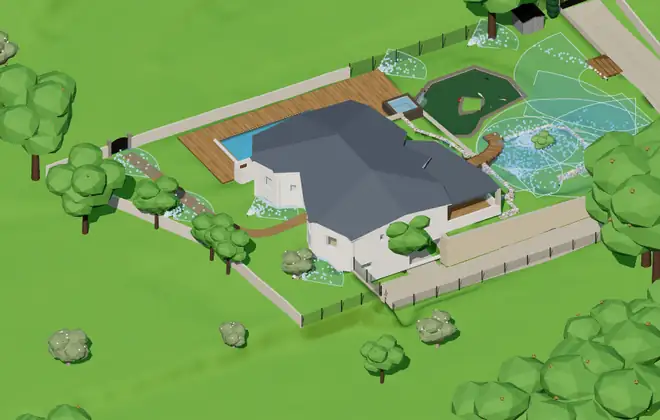</p>
<p align="center"><em>Ein Beispielgrundstück, das sich um sich selbst dreht: Das Relief stammt aus öffentlichen Daten, alles andere wurde im Editor der Karte gezeichnet.</em></p>
<p align="center">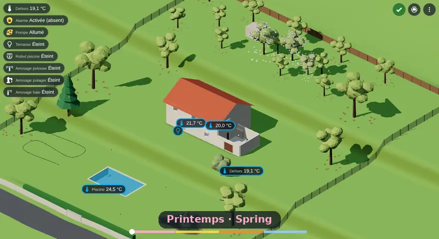 </p>
<p align="center"><a href="https://youtu.be/MyXz5AVbtJI">▶ Video ansehen</a></p>

House View macht aus dem Plan Ihres Hauses ein lebendiges Abbild davon. Die meisten 3D-Karten für Home Assistant laden ein schweres Modell des Gebäudes (einen GLB-/OBJ-Export) und hängen Entitäten an dessen Objekte oder stapeln transparente Ebenen über ein Bild. House View geht einen anderen Weg: eine **leichte prozedurale Szene**, live aus Ihrem Plan gezeichnet, die auch den Garten und den Himmel zeigt, nicht nur die Wände. Nach unserem Wissen kombiniert nichts Vergleichbares Folgendes:

### Das Gelände kommt von selbst

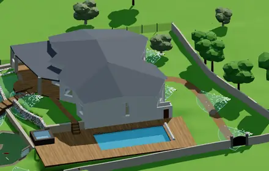

Nichts zu vermessen, nichts zu zeichnen: Geben Sie die Position des Hauses an, und die Integration lädt den Boden ringsum selbst aus **öffentlichen, kostenlosen Daten**, die **vom Flugzeug aus** (LiDAR-Laserscanning, Luftbilder) oder **von Satelliten** (weltweites Radarmodell) erfasst wurden. Ein Klick auf *Fetch the terrain*; wo es ein Oberflächenmodell gibt, wird der Plan danach von selbst auf das Gelände gesetzt, die Bäume stehen dort, wo der Laser sie gefunden hat, und komplizierte Dächer lassen sich daraus ablesen.

| Was | Frankreich | Rest der Welt |
|---|---|---|
| Relief des Bodens | IGN LiDAR HD: Laser aus dem Flugzeug, eine Höhe alle 50 cm (sonst RGE ALTI, 1 m) | Mapterhorn: die offenen LiDAR-Vermessungen vieler Länder, überall sonst das Copernicus-Modell mit 30 m, von Radarsatelliten gemessen |
| Dächer und Bäume | Oberflächenmodell des LiDAR HD | — |
| Gebäude und Straßen | IGN BD TOPO | OpenStreetMap |
| Flurstücke | Kataster: Ein Zaun kann ihnen folgen | — |
| Bild auf dem Boden | Luftbilder des IGN oder die IGN-Karte | — |

Die Karte ruft nie das Internet auf: Die Integration holt das Gelände einmal und behält es in Ihrem Home Assistant. Wo das Relief zu grob ist oder der Garten umgestaltet wurde, zeichnen die *Bodenkorrekturen* des Editors Böschungen, Plateaus und Stützmauern neu. Einzelheiten je Land: [Geländequellen nach Land](#geländequellen-nach-land).

### Was sich in der Ansicht bewegt

Alles Folgende wird live aus dem Zustand Ihrer Entitäten gezeichnet; die Bilder stammen aus dem Demo-Haus, das mit der Integration geliefert wird.

<table>
<tr>
<td width="50%" valign="top">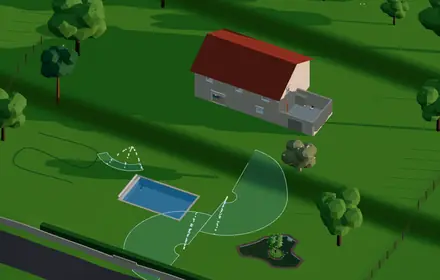<br><b>Sonne und Schatten</b><br>Das Licht folgt Stunde für Stunde der Sonne Ihres Breitengrads; das Haus lebt seinen Tag: Rollläden, Bewässerung, abends die Lampen.</td>
<td width="50%" valign="top">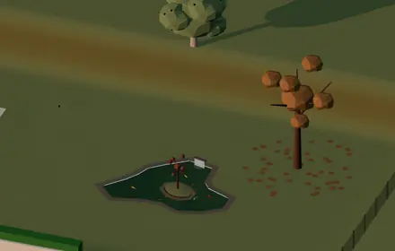<br><b>Jahreszeiten</b><br>Laub, Blüten, Früchte und welke Blätter folgen dem Datum, jede Art mit ihrem eigenen Kalender.</td>
</tr>
<tr>
<td width="50%" valign="top">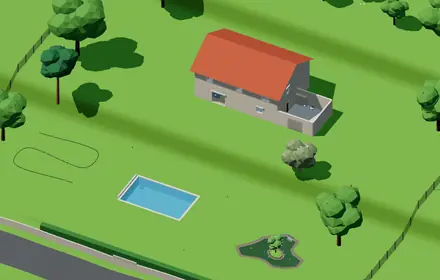<br><b>Wetter</b><br>Vom Wind geneigter Regen, Gewitter, liegender Schnee, Nebel: nach Ihrer Wetter-Entität oder Ihren eigenen Sensoren.</td>
<td width="50%" valign="top">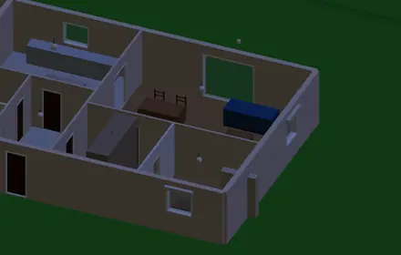<br><b>Lichter</b><br>Jede Lampe mit ihrem echten Zustand, ihrer Farbe und Helligkeit; ein Tipp auf einen Raum zoomt hinein und schaltet seine Lichter.</td>
</tr>
<tr>
<td width="50%" valign="top">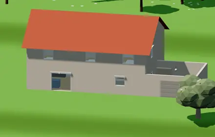<br><b>Rollläden</b><br>Sie folgen der Position Ihrer Rollläden.</td>
<td width="50%" valign="top">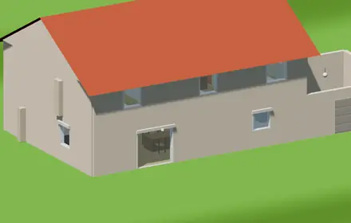<br><b>Fenster</b><br>Fenster und Fenstertüren öffnen sich mit ihren Kontakten.</td>
</tr>
<tr>
<td width="50%" valign="top">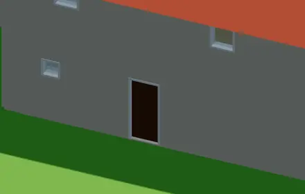<br><b>Türen</b><br>Die Türen ebenfalls, jede auf ihre Art.</td>
<td width="50%" valign="top">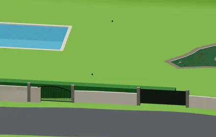<br><b>Tore</b><br>Dreh- oder Schiebetore, ein- oder zweiflügelig, mit Stäben oder geschlossen, an jedem Zaun.</td>
</tr>
<tr>
<td width="50%" valign="top">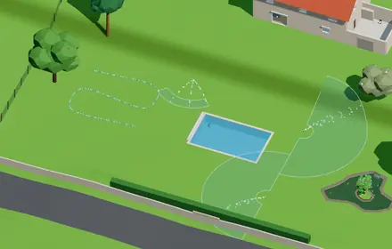<br><b>Bewässerung</b><br>Tropfleitungen und Regner (Getrieberegner, Rotationsdüsen, Sprühdüsen) laufen mit ihren Ventilen; der Boden wird nass.</td>
<td width="50%" valign="top">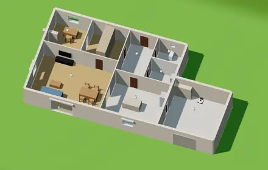<br><b>Saugroboter</b><br>Der Roboter fährt über den Plan, und die Räume färben sich, während er sie reinigt (im Zeitraffer).</td>
</tr>
<tr>
<td width="50%" valign="top">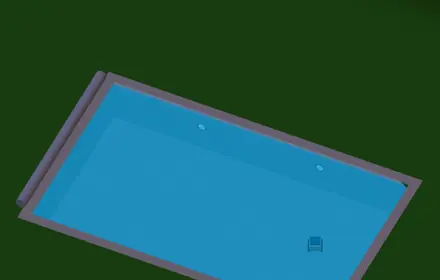<br><b>Pool</b><br>Der Reinigungsroboter bei der Arbeit, die Scheinwerfer, die Rollabdeckung.</td>
<td width="50%" valign="top">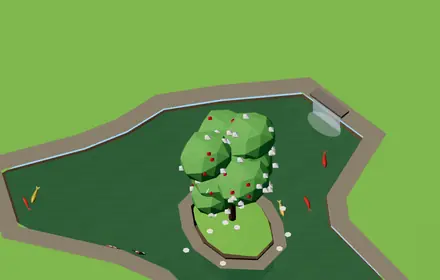<br><b>Teich</b><br>Koi mehrerer Varietäten, eine Insel, ein Wasserfall.</td>
</tr>
<tr>
<td colspan="2">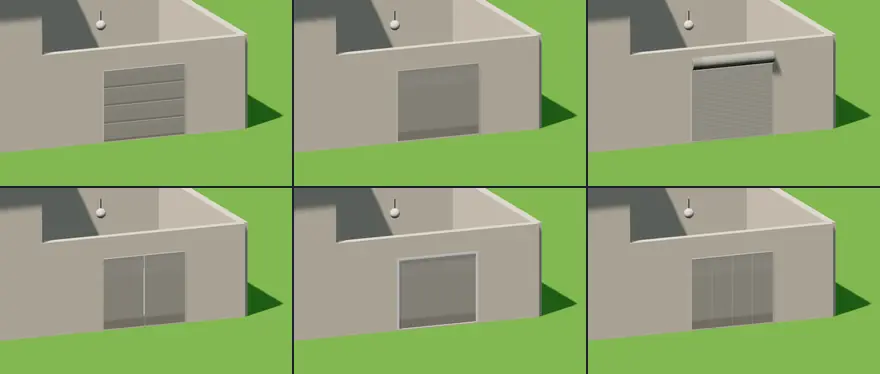<br><b>Garagentore</b><br>Die sechs Öffnungsarten: Sektionaltor, Schwingtor, Rolltor, Flügeltor, Schiebetor, Falttor (im Zeitraffer).</td>
</tr>
</table>

### Alles, was sie kann

- **Leicht von Grund auf** : kein schwerer 3D-Export zum Laden oder Zusammenführen: Wände, Möbel, Bäume, Wasser und Lichtvolumen werden aus dem Plan und einem kleinen Katalog erzeugt, und das Rendering stoppt, wenn die Karte nicht sichtbar ist, mit einem `fps_cap` für Wandtablets. Die Schatten werden nur neu berechnet, wenn sich die Sonne oder ein Objekt bewegt, das Bild wird auf einem schwachen Bildschirm während der Kamerabewegung leichter (`quality`), und die Szene bleibt einige Minuten bereit, wenn ein anderes Dashboard geöffnet wird (`keep_scene`).
- **Ihr Haus auf seinem echten Gelände** : der Sweet-Home-3D-Plan (oder IFC, SVG) liegt auf einem digitalen Geländemodell des Grundstücks (IGN LiDAR HD und Kataster in Frankreich — Zäune lassen sich aus den Flurstücken zeichnen —, anderswo offenes LiDAR und OpenStreetMap), mit Relief, Straßen, Nachbarbäumen und Ihren Zäunen.
- **Echte Sonne, Jahreszeiten und Wetter** : das Licht folgt der Sonne Ihres Breitengrads, Bäume und Rasen wechseln mit den Jahreszeiten, und Regen, Schnee, Nebel, Gewitter und Wind (Regen fällt schräg in Windrichtung) folgen Ihrer Wetter-Entität oder Ihren Sensoren. Ein Simulationsmodus spielt jeden Tag oder ein ganzes Jahr in Sekunden ab.
- **Jeder Raum lebt** : echter Zustand, Farbe und Helligkeit Ihrer Lampen, Raumtemperaturen, ein Tippen zoomt auf einen Raum, ein zweites schaltet sein Licht; frei platzierte Lampen werden zu echten Lichtquellen.
- **Ihre Entitäten, wo sie sind** : auf dem Plan platzierte Sensoren, Schalter und Auswahlen, ein allgemeines Panel, ein zentrales Alarm-Abzeichen (Rauch, Wasserleck, Einbruch…), antippbare Zonen (ein Mediaplayer auf einem Möbel, ein reeftank-Aquarium live auf seinem Becken).
- **Türen, Fenster, Rollläden und Tore in Bewegung** : mit Ihren Kontakten und Rollläden verknüpft, öffnen und schließen sie sich in der Ansicht; ein Tor (Dreh- oder Schiebetor, 1 oder 2 Flügel, Stäbe oder vollflächig, gerade oder gewölbt) folgt seinem Cover oder Kontakt.
- **Saugroboter** : Reinigung nach Räumen mit einem Tipp, ein 3D-Roboter fährt über den Plan, Räume je nach Fortschritt eingefärbt, mehrere Roboter, Roborock-Position unterstützt.
- **Ein Garten, der arbeitet** : Tropfleitungen und Regner, von ihren Ventilen animiert (Feuchtflecken, Strahlen), Zäune aller Art (Maschendraht, Holz, Mauer, Schmiedeeisen, Schilf, Gabionen und neun Hecken: Kirschlorbeer, Thuja, Leylandzypresse…), Terrassen aus Holz, Fliesen oder Stein, verputzte, steinerne oder gemauerte Mäuerchen, Außentreppen zwischen den Ebenen des Gartens, Blumenbeete, deren Anzahl und Farben Sie wählen, Pools und Teiche mit ihren Fischen.
- **Ein lebendiges Meer** : für ein Haus an der Küste ein bewegtes Meer mit Wellen, die vom Wind getrieben werden, einer Tide, die dem Kalender folgt (auf ein echtes Hochwasser Ihres Hafens eingestellt), Sand-, Kiesel-, Korallen- oder Felsstränden und dem Rauschen der Brandung (Abschnitt *Sea* des Editors).
- **Ein Katalog, der wächst** : Bäume mit bis zu vier Darstellungen pro Jahr und Farbvarianten (Apfelbäume mit roten, gelben oder grünen Früchten, Kirsche, Weide, Eukalyptus…) und Objekte stammen aus dem offenen [house-catalog](https://github.com/Elwinmage/house-catalog), im Hintergrund aktualisiert, offline nutzbar und mit dem [Katalog-Editor](https://github.com/Elwinmage/catalog-editor) erweiterbar. Auch die Beläge der Wege und Terrassen, die Verkleidungen der Mäuerchen und die Zaunarten kommen von dort.
- **Zeigen, ohne sein Zuhause zu zeigen** : eine Schaltfläche *Load the demo* fügt ein fiktives Haus an einem beliebigen Ort hinzu, um die Karte zu filmen, vorzuführen oder auszuprobieren (standardmäßig ausgeblendet: in den Optionen der Integration einschalten).
- **Nur die Integration muss installiert werden** : die Karte wird von der Integration ausgeliefert (keine Lovelace-Ressource), alles wird in der Karte selbst bearbeitet (✎), mehrere Häuser können nebeneinander bestehen, Ihre Korrekturen liegen getrennt vom Plan (ein erneuter Import verliert nichts), und die Oberfläche spricht acht Sprachen (Englisch, Französisch, Spanisch, Deutsch, Italienisch, Polnisch, Portugiesisch, Niederländisch).

## Installation

1. Aus dem Marketplace installieren: das Repository mit dieser Schaltfläche direkt öffnen und auf „Installieren“ klicken [](https://my.home-assistant.io/redirect/hacs_repository/?owner=Elwinmage&repository=ha-house-view-component&category=integration), oder in *Einstellungen → Marketplace* nach „House View“ suchen. Bei einem Home Assistant vor 2026.11 funktionieren dieselben Schritte in HACS, gefolgt von einem Neustart. Von Hand: `house_view.zip` der neuesten Version nach `config/custom_components/house_view/` entpacken, dann Home Assistant neu starten.
2. Die Integration *House View* hinzufügen: dem Zuhause einen Namen und seinen Standort geben (standardmäßig der von Home Assistant). Jedes Zuhause ist ein eigener Eintrag: Für ein zweites Zuhause (Ferienhaus…) die Integration noch einmal hinzufügen, mit eigenem Plan, Gelände und eigenen Bearbeitungen; die Karte zeigt ein Zuhause, gewählt mit ihrer Option `home`.
3. Die Karte einem Dashboard hinzufügen (`type: custom:house-view-card`).
4. In der Karte ⚙ öffnen (nur Administratoren), um Ihren Plan (Sweet Home 3D, IFC oder SVG) zu importieren oder einen einfachen zu zeichnen; danach das Gelände abrufen (cartes.gouv.fr in Frankreich, weltweite offene Daten sonst: siehe [Geländequellen nach Land](#geländequellen-nach-land)) oder ein Gelände als `.json` laden.

Die Version der Karte erscheint beim Laden in der Browserkonsole (`🏠 HOUSE VIEW v0.x.y`). Die Reinigung nach Räumen und das Symbol der Integration benötigen Home Assistant 2026.3 oder neuer.

Die gebaute Karte liegt nicht im Repository: `release.yml` baut sie bei jedem Release und veröffentlicht `house_view.zip`, das der Marketplace installiert. Für die Entwicklung: `cd card && npm install && npm run build`. Eine neu gebaute Karte (oder ein Release, das nur die Karte ändert) wird beim nächsten Aktualisieren des Browsers ausgeliefert, ohne Home Assistant neu zu starten: Die Dashboards laden einen kleinen Loader, der das Bundle mit seinem aktuellen Fingerabdruck benennt, und die offenen Seiten werden benachrichtigt (Schaltfläche zum Neuladen oder automatisches Neuladen mit `auto_reload`). Eine Änderung am Python der Integration erfordert weiterhin einen Neustart.

## Konfiguration der Karte

Die Optionen werden im visuellen Editor der Karte eingestellt (Dashboard bearbeiten, dann *Bearbeiten* an der Karte), in vier Abschnitten: Zeit und Wetter, Anzeige, Lichter, Saugroboter. Der Plan, das Gelände und alles, was in der Ansicht platziert ist, werden in der Karte selbst eingestellt (✎ und ⚙). Als YAML:

```yaml
type: custom:house-view-card
home: 01JXYZ…                         # optional, mehrere Zuhause: der angezeigte Eintrag (im visuellen Editor gewählt); standardmäßig der erste
weather_entity: weather.zuhause       # Live-Wetter (optional)
rain_entity: binary_sensor.regen      # optional: Regenmelder oder Sensor der Regenrate (mm/h) Ihrer Wetterstation
wind_speed_entity: sensor.wind_tempo    # optional: Sensor der Windgeschwindigkeit (Wetterstation oder Internet-Wetterdienst)
wind_bearing_entity: sensor.wind_richt  # optional: Sensor der Windrichtung (Grad oder Himmelsrichtungen)
mode: live                            # live (Echtzeit) | simulation (Regler für Uhrzeit / Datum / Wetter)
view: Vue générale                    # Startansicht (optional): der Name auf ihrer Schaltfläche
show_views: true                      # Schaltflächen der Kameraansichten
show_levels: true                     # Schaltflächen Dach / Geschosse (+ 🌡, wenn Raumtemperaturen bekannt sind)
tap_action: zoom                      # Tippen auf einen Raum: zoom (zweites Tippen = Lichter) | toggle_lights | none
show_entities: true                   # im Editor platzierte Entitäten
show_alarms: true                     # zentrales Alarm-Abzeichen (oben rechts)
vacuum_entity: vacuum.robot           # optional: standardmäßig der erste gefundene vacuum.*
vacuum_poll: 15                       # Sekunden zwischen zwei Positionsabfragen (Roborock: Cloud-Aktion, min. 5)
vacuum_show_floor: false              # true = während der Reinigung das Geschoss des Roboters von oben zeigen
vacuum_rate: 1                        # m²/min, für den geschätzten Weg eines Roboters ohne Position
vacuum_progress_entity: sensor.xxx    # optional: Fortschritt (%); bei Roborock automatisch gefunden
movable_camera: true                  # bewegliche Kamera (Drehen, Zoom, Verschieben); false = auf die Ansichten fixiert
height: fill                          # fill (Bildschirmhöhe unterhalb der Kartenoberkante) | aspect (16/10) | 600 | "70vh"
min_height: 320                       # Mindesthöhe im Modus fill (px)
fps_cap: 30                           # Obergrenze der Bilder pro Sekunde (Wandbildschirme, Tablets)
quality: auto                         # auto (leichter bei Kamerabewegung, wenn der Bildschirm nicht mitkommt) | low (Raspberry Pi, Wandtablet) | high (nie reduziert)
keep_scene: 10                        # Minuten, in denen die Szene bereit bleibt, nachdem die Karte den Bildschirm verlassen hat (anderes Dashboard): die Rückkehr ist sofort da; 0 = sofort freigegeben
auto_reload: false                    # true = die Seite lädt sich von selbst neu, wenn die Karte aktualisiert wird (Wanddisplay); sonst bietet eine Schaltfläche es an
year_seconds: 10                      # 📅 : spielt die Jahreszeiten eines ganzen Jahres in so vielen Sekunden ab (5 bis 60)
toolbar_buttons: [preview]            # Werkzeuge, die in der Leiste bleiben (preview, year, camera, sim, edit, setup); die anderen sind im Menü ⋮
hide_menu: false                      # true: kein Menü ⋮ für Benutzer, die keine Administratoren sind (Wandbildschirm)
light_entities: [light.wohnzimmer, ...]  # optional: beschränkt die berücksichtigten Lichter
```

## Liveansicht

- **Leiste** (oben rechts): das Alarmabzeichen, die Saugroboter und das Menü ⋮ mit den gelegentlich genutzten Werkzeugen (Vorschau Jahreszeit / Wetter / Uhrzeit, ein Jahr simulieren, Kamerasperre, Simulation, Demo) und, für Administratoren, dem Editor ✎ und der Einrichtung ⚙. Die Option `toolbar_buttons` behält einige davon in der Leiste; `hide_menu` blendet das Menü für Benutzer aus, die keine Administratoren sind.
- **Breite, Länge, Zeitzone**: die des Zuhauses (beim Hinzufügen gewählt; standardmäßig die Konfiguration von Home Assistant). Die Jahreszeiten von Vegetation und Rasen folgen dem Klima der Breite: vier Jahreszeiten in gemäßigten Zonen; ab 50° zu den Polen hin ein immer längerer Winter und ein kurzer Sommer (bei 68° Ende April noch Winter); zwischen den Wendekreisen kein Winter, sondern eine Regen- und eine Trockenzeit (die Bäume behalten ihr Laub, der Rasen vergilbt in der Trockenzeit etwas, weniger nahe am Äquator), die die Vorschau statt der vier Jahreszeiten anbietet. Auf der Südhalbkugel ist alles vertauscht.
- **Räume ↔ Bereiche**: Ein Raum des Plans ist mit dem gleichnamigen Bereich von Home Assistant verknüpft (Akzente und Groß-/Kleinschreibung werden ignoriert). ⚙ listet die Räume ohne passenden Bereich; unter ✎ → *Rooms ↔ Home Assistant areas* lässt sich Raum für Raum ein anderer Bereich oder keiner wählen.
- **Lichter**: Zustand, Farbe und Helligkeit der `light.*`-Entitäten des Bereichs jedes Raums.
- **Wetter**: Die Wetter-Entität `weather_entity` bestimmt das angezeigte Wetter: Regen (`rainy`, `pouring`, `hail`), Schnee (`snowy`, `snowy-rainy`), Gewitter (`lightning`, `lightning-rainy`), Nebel, Wolken; Temperatur, Wind und Bewölkung werden übernommen, wenn vorhanden. Mit `rain_entity` (ein Regenmelder `binary_sensor` oder ein Sensor der Regenrate in mm/h) folgt der Regen dem, was bei Ihnen wirklich fällt: Regen am Sensor → Regen, je nach gemessener Rate stärker oder schwächer; der Wetterdienst meldet Regen, aber der Sensor ist trocken → bedeckter Himmel ohne Regen (Gewitter: Blitze ohne Regen). Schnee und Gewitter bestimmt weiterhin der Wetterdienst, da ein Regenmesser sie nicht unterscheiden kann; eine Summe („Regen heute“ in mm) wird ignoriert, weil sie nicht sagt, ob es gerade regnet.
- **Wind und Regenstärke**: Regen und Schnee fallen bei Wind schräg, in die Richtung, in die der Wind weht: je stärker der Wind, desto schräger (Windstille → senkrecht, 60 km/h und mehr → etwa 50°). Die Richtung folgt dem Norden des Plans: Ein Westwind treibt den Regen also zur Ostseite Ihres Hauses. Geschwindigkeit und Richtung kommen von der Wetter-Entität (`wind_speed`, `wind_bearing`) oder von eigenen Sensoren mit `wind_speed_entity` (km/h, m/s, mph, kn, ft/s, Beaufort) und `wind_bearing_entity` (Grad oder Himmelsrichtungen wie `NW`): eine Wetterstation oder die Sensoren eines Internet-Wetterdienstes. Die Regenmenge bestimmt das Aussehen des Regens: Nieselregen ist spärlich, langsam und kurz, ein Wolkenbruch dicht, schnell und lang. Sie kommt von der Rate von `rain_entity` (mm/h; ab 8 mm/h Wolkenbruch), sonst von der Wetter-Entität (`pouring` ist stärker als `rainy`). Ist ein Sensor nicht verfügbar, gilt wieder die Wetter-Entität.
- **Zoom auf einen Raum**: Ein Tippen zoomt auf den Raum (Dach und obere Geschosse ausgeblendet); ein zweites Tippen auf denselben Raum schaltet seine Lichter um; *← Raum* führt zur vorherigen Ansicht zurück.
- **Vorschau** (Wetter-Schaltfläche): erzwingt eine Jahreszeit (Frühling, Sommer, Herbst, Winter), ein Wetter (klar, bewölkt, Regen, Gewitter, Schnee, Nebel) oder eine Tageszeit (Morgen, Mittag, Dämmerung, Nacht), auch kombiniert; zurück zur Liveansicht mit der Schaltfläche *Preview … ✕* oder automatisch nach 3 Minuten. Im Simulationsmodus sind es Abkürzungen zu den Reglern.
- **Kamera**: Die Schaltfläche oben rechts entsperrt oder sperrt die Kamera, ohne die Konfiguration zu ändern.
- **Temperaturen**: der Temperatursensor des Bereichs (Einstellung des Bereichs in Home Assistant), sonst der erste `sensor.*` mit `device_class: temperature` des Bereichs; Anzeige beim Überfahren und als Ebene (🌡).
- **Simulationsmodus**: ☀ öffnet Uhrzeit (mit Ablauf), Datum, Wettervorgabe, Wolken, Niederschlag, Wind (Stärke und Richtung), Temperatur und Schnee.
- **Straßen**: als Asphalt auf dem Relief gezeichnet (in ⚙ abschaltbar).
- **Leistung**: Das Rendern stoppt, wenn die Karte nicht sichtbar ist; die Lichtvolumen werden nur neu berechnet, wenn sich ein relevanter Zustand ändert.

## Saugroboter

- **Reinigung nach Räumen**: Gibt es eine `vacuum.*`-Entität, erscheint ihr Symbol oben rechts. Ein Tippen öffnet die Raumauswahl (das Geschoss des Roboters wird von oben gezeigt): Jeder angetippte Raum, der mit einem Bereich verknüpft ist, wird hervorgehoben, dann ruft *Clean* `vacuum.clean_area` mit den gewählten Bereichen auf (generische Aktion von Home Assistant 2026.3+; die Zuordnung zwischen den Räumen des Roboters und den Bereichen erfolgt einmalig in den Einstellungen der Saugroboter-Entität). Ebenso *Start*, *Pause* und *Dock*.
- **Verfolgung der Reinigung** (✎ → *Robot vacuum*): Ein 3D-Roboter (Farbe wählbar, standardmäßig weiß) bewegt sich über den Plan, der gerade gereinigte Raum wird eingefärbt (Farbe wählbar) und zeigt seinen Prozentwert, die noch folgenden Räume werden heller eingefärbt, ein fertiger Raum funkelt eine Minute lang, und eine Ringanzeige um das Robotersymbol zeigt den Gesamtfortschritt. Bei einem Fehler (`error`) blinken Raum und Roboter rot mit einem ⚠-Zeichen.
- **Ladestation**: *Place the dock*, dann auf den Boden tippen; sie ist der Bezugspunkt zwischen der Karte des Roboters und dem Plan. Ihre **Ausrichtung** wird in Grad eingestellt (0° = zeigt zum oberen Rand des Plans, 90° nach rechts, der Standardwert), in Vierteldrehungen (⟲ / ⟳) oder mit *Aim with a tap*: vor die Station tippen, dorthin, wo der Roboter herausfährt. Der ruhende Roboter parkt vor der Station, in derselben Richtung.
- **Position des Roboters**: *Roborock* (offizielle Aktion `roborock.get_vacuum_current_position`, Station bei 25500 / 25500; sie läuft über die Cloud, daher eine Abfrage alle `vacuum_poll` Sekunden, nach einem Fehler verlangsamt), *Attribute einer Entität* (`vacuum_position {x, y}` und `charger`, wie Kartenextraktoren sie liefern) oder *keine*: Der Roboter folgt dann einem geschätzten Weg (hin und her, Raum für Raum), gekennzeichnet mit „estimated position“.
- **Kalibrierung**: Drehung, Spiegelung und Maßstab; *Calibrate with a tap* berechnet die Drehung, wenn man die tatsächliche Position des Roboters antippt, sobald er die Station verlassen hat; *remember* speichert die Koordinaten der Station für andere Marken.
- **Ausrichten an der Karte des Roboters**: *Show the map of the robot over the plan* legt das Bild, das der Roboter vom Boden zeichnet (eine `image.*`- oder `camera.*`-Entität seines Geräts), halb durchsichtig auf den Boden der Ladestation; die Etagen darüber werden ausgeblendet. Die Ladestation ist der Fixpunkt: Das Bild mit dem Drehregler drehen, bis seine Wände denen des Plans folgen; die gefundene Drehung wird auf den Roboter angewendet. Liefert die Entität `calibration_points` (Kartenextraktoren, *Roborock Custom Map*), platziert sich das Bild von selbst. Andernfalls (Bild-Entitäten der offiziellen Roborock-Integration) dorthin tippen, wo das Bild die Ladestation zeichnet (*The dock is here on the map*), es in Schritten von 5 cm verschieben und die Größe eines Pixels anpassen, wenn die Räume zu groß oder zu klein sind (standardmäßig 12,5 mm für Roborock, sonst 50 mm).
- **Prozentwert eines Raums**: Anteil des vom Roboter befahrenen Bodens (Schätzung: 80 % des Bodens gelten als erreichbar); der Gesamtfortschritt kommt vom Sensor des Roboters, wenn es einen gibt (Roborock: `cleaning_progress`).
- *Test the animation* spielt eine beschleunigte Reinigung ab (mit oder ohne Fehler), ohne den Roboter zu starten.
- **Mehrere Roboter**: Jeder `vacuum.*` hat seine Schaltfläche in der Werkzeugleiste, seine Raumauswahl, seinen 3D-Roboter, seine Spur und seine Raumfarben. In ✎ → *Robot vacuum* wählt die Liste *Robot* den einzustellenden (Station, Position, Kalibrierung, Karte gelten pro Roboter); *Show this robot* nimmt ihn aus der Ansicht und der Leiste (etwa ein Roboter eines anderen Zuhauses).

## Katalog: Bäume und Objekte

Bäume und Möbel sind nicht in der Karte fest eingebaut: Sie kommen aus dem [Hauskatalog](https://github.com/Elwinmage/house-catalog), in dem eine neue Art oder ein neues Objekt ein Pull Request ist und keine neue Version dieser Integration.

- **Bäume**: Jede Art hat bis zu vier Darstellungen, eine pro Jahreszeit: Farbe und Dichte des Laubs, Blüte, Früchte, Laub am Boden. Die Ansicht geht Tag für Tag von einer Jahreszeit in die nächste über (zum Start Eiche, Kiefer, Eibe, Kirschbaum und Aprikosenbaum, dann Japanische Blütenkirsche, Holunder, Apfel, Birne, Eukalyptus und Trauerweide, dann Dattel-, Kanaren- und Kokospalme, Weißtanne und Fichte). Eine Art kann **Sorten** in verschiedenen Farben haben (rote, gelbe oder grüne Äpfel), die in der Pflanzliste als `Apfelbaum - Gala (red)` angeboten werden. Es sind die Arten, die beim Pflanzen eines Baums im Editor angeboten werden, innerhalb der Höhen, die der Katalog angibt.
- **Objekte**: Ein Möbelstück des Plans, dessen Name ein Stichwort eines Katalogobjekts enthält (`Chaise`, `Chair`, `Stuhl`…), wird damit gezeichnet, an Ort und in Größe des Möbelstücks, statt als einfacher Quader; gibt der Plan dem Möbelstück eine Farbe, übernimmt das Objekt sie an seinen einfärbbaren Teilen. Ebenso wird eine Pflanze des Plans, die wie ein Baum des Katalogs heißt (`Kirschbaum`, `Yew`), als dieser Baum gezeichnet.
- **Fische**: die Fische der Teiche (zuerst der Koi-Karpfen), jeder mit seinen Farbsorten; die Karte zeichnet sie selbst, von oben gesehen.
- **Wege, Terrassen, Mauern und Zäune**: Der Belag eines Wegs oder einer Terrasse, die Verkleidung eines Mäuerchens und die Zaunarten sind ebenfalls Einträge des Katalogs. Jeder ist eine gemalte Oberfläche, beschrieben durch wenige Zahlen (Farbe, Körnung, Größe der Dielen, Fliesen oder Steine, Fugen), die die Karte selbst malt: Ein Belag, eine Verkleidung oder ein Zaun, der zum Katalog hinzukommt, wird im Editor mit seiner Vorschau angeboten, ohne die Karte zu aktualisieren. Einige bringt die Karte selbst mit, um schon vor dem Lesen des Katalogs zu funktionieren.
- **Aktualisierungen**: Die Integration lädt den Katalog im Hintergrund von GitHub (die Karte greift nie auf das Netz zu) und funktioniert offline mit der mitgelieferten Kopie. Das Gerät *House view catalog* hat eine Update-Entität pro Bereich (Bäume, Objekte, Teichfische, Wege, Terrassen, Mauern, Zäune), einen Schalter *Automatische Aktualisierung* (standardmäßig an) und eine Taste *Jetzt aktualisieren*.
- **Eigene Einträge**: Mit dem [Katalog-Editor](https://github.com/Elwinmage/catalog-editor) wird ein Baum oder ein Objekt, das Sie speichern, sofort von der Ansicht verwendet, bevor (oder ohne dass) Sie es dem Katalog vorschlagen.

## Editor (✎)

Nur für Administratoren. Der Editor ist ein Menü von Abschnitten: Ein Abschnitt öffnet sich in einem eigenen Fenster über dem Menü, und ein Element einer Liste (eine Bewässerungsleitung, eine Zone, eine Entität des allgemeinen Panels, eine Tür…) öffnet sein Bearbeitungsfenster über dem Abschnitt; der Pfeil ← eines Fensters führt zum darunterliegenden zurück. Das Kreuz ✕, oben im Menü und in jedem Fenster immer sichtbar, schließt den Editor sofort. Wird der Editor geöffnet, während auf einen Raum, einen Pool oder einen Teich gezoomt ist, landet er direkt dort: auf der Entitätenebene des Raums bzw. den Einstellungen des Pools oder Teichs. Alles wird in der Bearbeitungsdatei gespeichert, getrennt von Plan und Gelände; Escape bricht das laufende Zeichnen ab.

- **Platzierte Entitäten** (Sensoren, Lichter, Schalter, Auswahlen…): mit einem Tippen gesetzt, dann durch Ziehen ihres Etiketts verschoben (Editor geöffnet). Befestigung am Boden (Standard: das Etikett bleibt unabhängig vom Blickwinkel in seinem Raum), an der Wand (auf der Raumseite, ausgeblendet, wenn die Wand von hinten gesehen wird) oder frei in der Höhe; ein von einem oberen Geschoss oder dem Dach verdecktes Etikett wird nicht angezeigt, außer einem Etikett mit *Shown over the roof*; solange *Placed entities* im Editor geöffnet ist, werden alle Etiketten angezeigt (abgeblendet, wenn das Haus sie verdeckt), damit sich eine Entität überall platzieren und verschieben lässt, auch in den Räumen. Plakette (Symbol + Wert) oder nur Symbol; Farbe, Beschriftung, Symbol (Symbolauswahl von Home Assistant mit Vorschau); sichtbar in der Gesamtansicht (immer oder in der Ansicht seines Geschosses; *Shown over the roof* macht die Temperatur eines Raums von weitem lesbar); Tippen = Detaildialog, Umschalten oder nichts. Im Editor ist die Liste zugeklappt: Nur die gewählte Entität ist aufgeklappt. Entitäten werden aus denen des aktuellen Raums gewählt, nach Gerät gruppiert (das ganze Haus ein Häkchen entfernt, mit Suche); Symbole werden beim Tippen ihres Namens angezeigt.
- **Allgemeine Leiste** (links, unter den Etagen-Schaltflächen): Sensoren und Aktoren des ganzen Hauses (Außentemperatur, Alarmzentrale…), in der gewählten Reihenfolge, mit Beschriftung und Symbol; ein Tippen schaltet um, was umschaltbar ist, und öffnet sonst den Dialog (oder nach Wahl: umschalten, Dialog, nichts).
- **Alarme**: ein Abzeichen oben rechts, grün mit Häkchen, wenn alles in Ordnung ist, rot mit Glocke und der Anzahl in Klammern, wenn Alarme ausgelöst sind; ein Tippen öffnet ihre Liste (Tippen auf einen = sein Dialog). Automatisch erkannt: Problem-, Rauch-, Gas-, Kohlenmonoxid-, Wasserleck-, Hitze-, Kälte- und Sabotagesensoren sowie ausgelöste Alarmzentralen (einschließlich der reeftank-Alarme); Entitäten können von Hand hinzugefügt und ein Alarm direkt in der Liste (durchgestrichene Glocke) oder im Editor ignoriert werden. Jeder Raum mit ausgelösten Alarmen (mit einem Home-Assistant-Bereich verknüpft) zeigt außerdem eine rote Glocke mit ihrer Anzahl; ein Tippen öffnet die Liste dieses Raums (*All* zurück zum ganzen Haus); diese Raum-Abzeichen lassen sich im Editor abschalten. Option `show_alarms`.
- **Antippbare Zonen**: ein Mediaplayer auf einem Möbelstück des Plans (im Editor angetippt) oder auf einem Rechteck an einer Wand oder auf einem Boden; ein reeftank-Aquarium auf einem Rechteck in der Größe des Beckens (Vorderseite an der Wand, Oberseite auf dem Boden). Ein Tippen öffnet den Player oder die Aquarium-Ansicht von ha-reef-card in einem Fenster; das Rechteck eines Aquariums zeigt diese Ansicht live, mit schwimmenden Fischen (Option je Zone), in der für die Zone gewählten Ansicht des Aquariums (sonst seiner Standardansicht). Beim Platzieren leuchtet die Wand oder der Boden unter dem Zeiger auf und das Rechteck wird darauf gezeichnet; eine Zone wird verschoben, indem man sie auf ihrer Fläche zieht. Breite, Höhe, Höhe der Mitte (Wand) oder Drehung (Boden) sind einstellbar. Ein **Link** (*Add a link*) öffnet im selben Fenstertyp ein Dashboard von Home Assistant (ein Pfad wie `/lovelace/cameras` oder eine vollständige Adresse, in einem Rahmen angezeigt) oder eine beliebige Lovelace-Karte (ihre Konfiguration als JSON, z. B. `{"type": "picture-entity", "entity": "camera.garden"}`); auf einem Rechteck erscheint er als Kachel mit Symbol und Name (Symbol und Kachel optional).
- **Platzierte Lichter**: Ein platziertes `light.*` wird zu einer Lichtquelle an dieser Stelle des Raums (Spot, Pendelleuchte, Lampe, Lichtleiste oder unsichtbar; Höhe und Reichweite einstellbar; an der Wand: eine Wandleuchte in der angetippten Höhe), gesteuert durch seinen eigenen Zustand und seine Farbe. Die übrigen Lichter des Bereichs beleuchten weiterhin den ganzen Raum.
- **Entitäten eines Raums**: Beim Zoom auf einen Raum erscheinen nur die Entitäten dieses Raums; die der Gesamtansicht verschwinden (der Saugroboter fährt weiter, wenn er dort ist). Im Editor zoomt ein Tippen auf einen Raum auf ihn, und die Bearbeitung wird die des Raums (rotes Band oben): Die dann hinzugefügten Entitäten werden auf seinen Boden, an eine Wand oder in die Luft gesetzt und gehören nur zu diesem Raum. Sie verschwinden, wenn ein anderer Raum gewählt oder zur Gesamtansicht zurückgekehrt wird. Eine Entität der Gesamtansicht, die in einem Raum steht, wechselt mit ihrer Einstellung *Its room only* in diesen Raum.
- **Türen und Fenster** (*Doors and windows*): die Öffnungen des Plans (Sweet Home 3D, IFC), nach Geschoss und Raum aufgelistet oder mit einem Tippen in der Ansicht gewählt (die Öffnung unter dem Zeiger leuchtet auf). Jede kann mit einem Offen/Zu-Sensor (`binary_sensor`), einem motorisierten Öffner (`cover` des Fensters) und, bei Fenstern und Schiebetüren, einem Rollladen (`cover`) verknüpft werden. Ein Raum mit nur einem Fenster wird von selbst mit dem Fenstersensor, dem Öffner und dem Rollladen seines Bereichs verknüpft, wenn es je einen gibt; ein Raum mit nur einer Tür mit ihrem Türsensor; eine von Hand gewählte Verknüpfung hat Vorrang, eine automatische kann entfernt werden. In der Ansicht öffnen sich die Flügel (einer, zwei ab 1,10 m) nach innen, eine Schiebetür gleitet, ein Türblatt dreht sich (eine Innentür erhält ihr Blatt, sobald sie verknüpft ist), und der Rollladen fährt auf der Außenseite bis zur Position des `cover` herunter (`current_position`, sanft).
- **Pools und Teiche** (*Pools and ponds*): von oben gezeichnet, als Rechteck (zwei gegenüberliegende Ecken) oder freie Form (Punkt für Punkt, *Finish*), mit Namen, Wasserfarbe und Tiefe (0,2 bis 6 m). Das Gelände wird ausgehoben: Ein Pool hat senkrechte Wände, einen flachen Boden und einen Beckenrand, ein Teich einen abfallenden Boden und ein Kiesufer; der Boden ringsum wird eingeebnet und das Wasser bewegt sich. Ein Reinigungsroboter kann mit einer Entität verknüpft werden (`binary_sensor`, `switch`, `input_boolean`, `vacuum`, `light`, `fan`, `sensor` oder jede andere per ID eingetippte Entität): Er fährt über den Boden, solange sie an ist, sonst bleibt er geparkt. **Lampen** lassen sich in die Wand einer Seite einbauen (Stelle entlang der Seite, Tiefe, je eine Entität): ein farbiges Licht gibt seine eigene Farbe, eine Steckdose die im Editor gewählte, und eingeschaltete Lampen färben Wasser und Becken, nachts umso mehr. Eine **Rollabdeckung** rollt ihre Lamellen von einer Seite über das Wasser, mit der Wickelwelle auf dem Beckenrand oder im Wasser versenkt, nach einer `cover`-Entität (ihre Position) oder allem, was offen oder geschlossen sagt; ein Klick auf die Abdeckung in der Ansicht öffnet oder schließt sie. Bei aufgerollter Abdeckung antwortet die Wickelwelle auf den Klick. Der Pool des importierten Plans bleibt, wie er ist. Ein Teich kann **Inseln** haben (wie der Umriss gezeichnet: der Boden bleibt etwas über dem Wasser, mit einem Kieselufer; darauf lassen sich Bäume pflanzen und Entitäten platzieren) und **Fische** aus dem Hauskatalog: Gruppen eines Fisches (zuerst der Koi-Karpfen), einer Sorte (Kohaku rot-weiß, Benigoi rot, Yamabuki Ogon gelb, Showa…) oder eigener Farben (Körper, Flecken, Muster, glänzende Schuppen), mit Anzahl und Größe: 3 rote, 1 rot-weißer und 2 gelbe sind drei Gruppen. Jeder Fisch hat seine eigene Zeichnung, schwimmt um die Inseln, nimmt mit der Tiefe die Farbe des Wassers an und bleibt bei kaltem Wasser am Grund.
- **Ansicht pro Raum**: Beim Zoom auf einen Raum und geöffnetem Editor speichert *📷 Room view* die Kamera und die sichtbaren Geschosse; ein Tippen auf diesen Raum öffnet danach diese Ansicht statt des automatischen Zooms. *Automatic view* kehrt dazu zurück.
- **Zäune** (*Fences*): Jede Seite hat ihren Typ (Maschendraht, Holz, Mauer, Schmiedeeisen, starre Paneele, Schilfmatte, Verbundlatten, Gabionen, neun Hecken nach Art — Kirschlorbeer, Thuja, Leyland-Zypresse, Hainbuche, Glanzmispel, Liguster, Bambus, Buchsbaum, gemischte Landhecke — oder offen, wo kein Zaun steht) und ihre Höhe. Die Typen stammen aus dem [house-catalog](https://github.com/Elwinmage/house-catalog) (eine Steinmauer, eine Ziegelmauer und ein Lattenzaun sind mit ihm dazugekommen): Die Palette zeigt von jedem eine Vorschau neben der Farbe, die seine Seiten beim Bearbeiten in der Ansicht kennzeichnet, und ein Maschendraht, Doppelstabmatten oder ein Gitter werden mit ihren Drähten oder Stäben gezeichnet, ein Holz- oder Steinzaun mit seinen Latten oder Steinen. Zwei Wege, einen anzulegen: *Fence from the cadastre* (die Flurstücke des Hauses sind vorausgewählt, Tippen fügt benachbarte Flurstücke desselben Grundstücks hinzu oder entfernt sie; umzäunt wird der Umriss des Ganzen) oder *Draw a fence* (aufeinanderfolgende Tipps, die Draufsicht „Dessus“ wird empfohlen; jede Seite erhält den in der Palette gewählten Typ, eine Farbe pro Typ). *Edit the sides*: den Typ einer Seite per Tippen ändern, eine Seite in zwei teilen (ein Teil Mauer, der andere Maschendraht), einen Punkt entfernen. Eine **Mauer** oder eine **Ziegelmauer** kann eine **Abdeckung** tragen (Steinplatten, hochkant gesetzte Ziegel, Dachziegel, Schiefer, gekantetes Blech…), in ihrer eigenen Farbe oder in Ihrer: Sie wird in der Palette unter der Höhe gewählt und Seite für Seite verlegt wie der Typ; sie deckt die Ecke zwischen zwei abgedeckten Seiten und steht an den Mauerenden etwas über.
- **Tore** (*Gates*): *Add a gate*, dann einen Zaun dort antippen, wo das Tor hinkommt: Der Zaun öffnet sich darunter von selbst. Beliebig viele Tore, an beliebigen Zäunen; *Move* und dann ein Tippen an eine andere Stelle verschiebt eines, *Delete* entfernt es (der Zaun schließt sich wieder). Einstellungen: Öffnung (Dreh- mit 1 oder 2 Flügeln, Schiebe- mit 1 oder 2 Flügeln), Füllung (Stäbe, voll, gemischt), Oberkante (gerade oder gewölbt), Breite, Höhe, Farbe, Pfeiler, **die Seite des Zauns, zu der es sich öffnet**, und bei einem Flügel das Ende, an dem er angeschlagen ist oder gleitet. Eine `cover`- (Position) oder `binary_sensor`-Entität (an = offen) bewegt es in 6 s; *Try the animation* zeigt es geöffnet, ganz ohne Entität.
- **Blumenbeete** (*Flower beds*): eine Fläche Punkt für Punkt zeichnen, dann die **Anzahl der Blumen** und eine **Liste von Farben mit Gewichten** wählen (3 Rot auf 1 Weiß ergibt drei rote Blumen auf jede weiße). Die Blumen werden zufällig, aber immer gleich gepflanzt (*Plant again* würfelt neu); die Blüte folgt der Jahreszeit: keine im Winter, drei Viertel im Frühling, alle im Sommer, ein Drittel im Herbst.
- **Zufahrten und Wege** (*Drives and paths*): *Draw a drive or path*, dann entlang der Mitte tippen; der Streifen wird zwischen den Punkten gerundet und folgt dem Gelände. Wählen Sie **Breite** und **Belag** (Asphalt, Kies, Beton, Pflaster, Erde, Fahrspuren mit Gras dazwischen), mit oder ohne **Randsteine**; *Extend* setzt am letzten Punkt fort, *Draw again* beginnt neu. Schnee und Regen bedecken ihn wie die Straßen. Ein Weg, der an einer Stützmauer entlang gezeichnet wird, endet an der Mauerfläche: Was seine Breite über die Linie der Mauer hinaus einnimmt, wird abgeschnitten, und ein Ende, das ein Stück durch eine Mauer gezeichnet wurde, hört dort auf – der Streifen klettert also nie die Mauer hinauf. Mit *As a flight of steps* wird ein Weg zur **Außentreppe**: Die Stufen steigen vom Gelände am ersten Punkt der Linie bis zum Gelände am letzten, in so vielen Stufen, wie die Höhe verlangt (je 16 cm), oder in der eingegebenen Anzahl, mit dem Belag des Wegs auf den Stufen und einer Wange auf jeder Seite. Der Boden wird unter der Treppe geöffnet, die sich in eine Böschung einschneidet oder vor einer Mauer steht, und eine durchquerte Stützmauer wird dort unterbrochen. Gezählt werden die Stufen ab dem, worauf man an jedem Ende steht — der Oberseite einer Terrasse ebenso wie dem Boden —, und die oberste Stufe läuft 30 cm als Podest weiter, das die Dicke einer Mauer überdeckt, an der die Treppe endet.
- **Terrassen** (*Terraces*): *Draw a terrace* als **Rechteck** (zwei gegenüberliegende Ecken) oder als **freie Form** (Punkt für Punkt, *Finish*). Eine Terrasse ist eine ebene Platte mit einer Dicke, die auf einer änderbaren Höhe liegt: Der Boden wird darunter eingeebnet und geht über die angegebene Distanz in das Gelände über, und ein Pool, der darin gezeichnet ist, wird ausgespart. Wählen Sie den **Belag** anhand von Vorschaubildern (Holz-, Tropenholz- oder WPC-Dielen, Feinsteinzeug-, beige oder Terrakottafliesen, Travertin- oder Schieferplatten, Polygonalplatten, Betonpflaster, Betonplatte oder einfarbig), eine eigene **Farbe** darüber (Maserung und Fugen bleiben) und die **Verlegerichtung** der Dielen oder Fliesen. Der Umriss bleibt änderbar: ✥ *Move* zieht einen Punkt oder die ganze Terrasse, *Add a point* und *Remove a point* wirken per Tippen auf eine Seite oder einen Punkt, ein Rechteck erhält Länge, Breite und Ausrichtung als Zahlen, und *Draw the outline again* beginnt ihn neu. Die Beläge stammen aus dem [house-catalog](https://github.com/Elwinmage/house-catalog); Schnee und Regen bedecken eine Terrasse wie einen Weg.
- **Bewässerung** (*Watering*):
  - **Tropfbewässerung** (*Drip lines*): eine Leitung pro Ventil (`switch`, `valve`, `input_boolean`), Punkt für Punkt gezeichnet und in der Darstellung gerundet; Schlauch schwarz, braun, grün oder ausgeblendet. Bei offenem Ventil wird die Leitung blau, Lichtreflexe laufen an ihr entlang, unter jedem Tropfer wächst und schrumpft ein Tropfen in einer Schleife (standardmäßig 30 cm Abstand, von Tropfer zu Tropfer leicht versetzt: die Leitung glitzert), und ein feuchter Fleck wächst, bis ein Streifen entsteht. Die Breite des Flecks folgt dem Modell von Schwartzman & Zur (1986), abhängig vom Durchfluss des Tropfers, der Öffnungsdauer und der Bodenart; er verblasst innerhalb von 30 Minuten nach dem Schließen.
  - **Regner** (*Sprinklers*): ein Kreis pro Ventil, mit einem oder mehreren Regnern (Katalogmodell: Hunter Pro-Spray PSU-04 8A bis 17A, SRM-04, PGJ-04, PGP Ultra, MP Rotator oder generisch; minimale / maximale Wurfweite, Ausrichtung und Winkel vorausgefüllt und änderbar; *Aim* per Tippen). Bei offenem Ventil wird der geschätzte beregnete Sektor angezeigt und der Strahl animiert (Schwenken bei einem Getrieberegner, Fächer bei einer Sprühdüse).
  - *Test the animation* spielt 30 Sekunden beschleunigte Bewässerung ab (30 s = 1 h 30) auf allen Leitungen und Kreisen, ohne ein Ventil zu öffnen: Der feuchte Fleck wächst, die Strahlen drehen sich, dann kehrt alles zum tatsächlichen Zustand zurück. Die Schaltfläche *Test* einer Leitung oder eines Kreises macht dasselbe nur für diese(n); das Schließen des Editors beendet den Test.
- **Dächer aus dem LiDAR** (*Roofs from the LiDAR*): Ein Dach, das sich im Plan nur mühsam zeichnen lässt (Grate, Kehlen, mehrere Dachflächen), wird aus dem Oberflächenmodell des Geländes gelesen, sofern die Quelle eines liefert (LiDAR HD des IGN in Frankreich). Geben Sie seinen Umriss von oben an — *Draw the outline of a roof* Punkt für Punkt, *Take the outline of the house (plan)* für die Außenseite der Wände, um den angegebenen **Dachüberstand** nach außen versetzt (wo die Wände unter dem Dach zurückspringen — ein in die Fassade gesetzter Eingang, eine Vorhalle — läuft der Umriss gerade durch, wie das Dach), oder *Take the outline of the building (map)*, erweitert um die Wände des Plans, wo sie darüber hinausragen — und die Karte findet die Dachflächen darin: Jede ist eine an die Messwerte angepasste Ebene, ihre Grenzen sind die Linien, an denen sich zwei Ebenen schneiden (Firste, Grate, Kehlen), und das Dach wird genau am Umriss abgeschnitten. Das Panel nennt die Zahl der gefundenen Dachflächen, ihre mittlere Neigung und die Höhe des Firsts über den Rändern. Die Punkte des Umrisses lassen sich in der Ansicht ziehen, hinzufügen oder entfernen, sodass das Dach auch nur einen Teil des Hauses decken kann: Das Dach des Plans weicht darunter und bleibt überall sonst bestehen (etwa ein Flachdach über einer Terrasse). Das Dach steht auf der gemessenen Höhe, die Wände dort, wo der Plan sie setzt: Unter dem Dach werden die Wände bis zu ihm hochgezogen, sodass es nie über ihnen schwebt; *Seat on the walls* senkt es auf die höchste von ihnen, und *Height correction* stellt es von Hand ein; die Farbe ist die des Plans, sofern Sie keine andere wählen. Es wird mit dem übrigen Dach ein- und ausgeblendet, verschneit und nass.
- **Bodenkorrekturen** (*Ground corrections*): Zeichnen Sie das Relief dort neu, wo das LiDAR falsch liegt oder der Garten umgestaltet wurde. *Select* umrandet in der Ansicht alle vorhandenen Korrekturen, jede mit ihrem Namen, und ein Tippen auf eine wählt sie in der Liste darunter aus, bereit zum Anpassen, Verschieben (✥) oder Löschen; eine Stützmauer zeigt außerdem einen kurzen Strich zur hohen Seite. *Retaining wall* und *Platform* (eine eingeebnete, unbedeckte Fläche: für eine belegte siehe *Terraces*) werden Punkt für Punkt gezeichnet, das noch offene Segment folgt dem Zeiger mit seiner Länge. Eine Mauer hat eine **Verkleidung**, anhand von Vorschaubildern gewählt (Glattputz, Rauputz, Trockenmauer, Werkstein, Bruchstein, unregelmäßige Steine, trocken gesetzt oder verfugt, Ziegel, Betonsteine, Schalbeton, Holzschwellen, Cortenstahl, Gabionen — aus dem [house-catalog](https://github.com/Elwinmage/house-catalog) — oder das schlichte Mauerwerk), eine eigene Farbe und, mit *Top and foot differ between the start and the end*, eigene Höhen an ihrem ersten Punkt (A) und ihrem letzten (B): Mauer und Boden auf beiden Seiten verlaufen dann geneigt vom einen zum anderen. Die drei Pinsel (auf eine Höhe einebnen, anheben / absenken, glätten) zeigen vor dem Klick den Kreis ihres Radius und das Relief, das sie hinterlassen würden: grün, wo der Boden steigt, orange, wo er fällt, mit der unter dem Zeiger gelesenen Höhe und der Änderung, die sie bewirken würden. **Umschalt + Mausrad** über der Ansicht ändert die Pinselgröße. *Terrain cross-section* zeichnet das Profil des Bodens zwischen zwei Punkten (ursprüngliches DGM, korrigierter Boden, Oberflächenmodell). Ein Werkzeug, das eine Art von Korrektur zeichnet, zeigt nur die Korrekturen dieser Art, da die anderen auf einem dicht bearbeiteten Gelände stören; *Shown on the view* holt sie zurück oder behält eine einzige Art, während man sie auswählt. Die Korrekturen werden in der Reihenfolge angewendet, in der sie gezeichnet wurden: Wo zwei aufeinandertreffen, hat die letzte das letzte Wort. Eine Mauer hat keinen Einfluss auf den Boden hinter einer anderen Mauer, der Übergang um ein Plateau endet an einer Mauer — und wenn der von Hand entlang einer Mauer gezeichnete Umriss eines Plateaus etwas über ihre Linie hinausragt, bleibt dieser Streifen der Mauer überlassen —, und die Erde kommt nie durch eine Terrasse hindurch nach oben, außer auf der hohen Seite einer darauf stehenden Mauer (ein Pflanzbeet). Eine Mauer trägt die **Abdeckung** ihrer Verkleidung, wenn diese eine hat, oder eine nach Wahl (*Coping of the wall*): keine, Steinplatten, eine Ziegel-Rollschicht, Terrakottaziegel, eine Betonabdeckung, Schiefer, eine Holzbohle oder ein gekantetes Blech aus Aluminium, Zink oder Cortenstahl — aus dem Hauskatalog —, in einer eigenen Farbe.
- **Punkte verschieben**: Die Punkte dessen, was gerade bearbeitet wird — der in seinem Abschnitt aufgeklappte Weg, die Terrasse, das Blumenbeet, die Tropfleitung, der Pool oder die Bodenkorrektur, der Zaun, dessen Seiten bearbeitet werden — erscheinen als Punkte in der Ansicht und werden **direkt gezogen**, ohne zuerst ein Werkzeug zu wählen; ein Tippen auf einen Punkt geht weiterhin an das aktive Werkzeug (Punkt entfernen, Seite ändern). *✥ Move* fügt den Griff hinzu, der das ganze Objekt verschiebt, und den Modus „Tippen, dann Tippen“ für Touchscreens. *＋ Add a point* und *− Remove a point* oben im Abschnitt setzen einen Punkt auf die angeklickte Seite oder entfernen den angeklickten Punkt: bei einem Weg, einem Blumenbeet, einer Tropfleitung, einem Pool (＋ und − neben einer Insel für deren eigenen Umriss) oder einer Bodenkorrektur. Ein Zaun und eine Terrasse haben dafür eigene Werkzeuge.
- **Rückgängig und Wiederholen**: **Strg+Z** macht die letzte Änderung im Editor rückgängig, gleich in welchem Abschnitt (eine Zaunseite, ein verschobener Punkt, eine gelöschte Terrasse, ein gepflanzter Baum…), und **Strg+Y** (oder Strg+Umschalt+Z) stellt sie wieder her; beim Zeichnen nimmt Strg+Z zuerst den letzten Punkt zurück. Auf einem Touchscreen tun die beiden Pfeile ↶ ↷ oben in jedem Fenster des Editors dasselbe. Der einfache Planeditor hat sie ebenfalls. In einem Feld, in das gerade getippt wird, bleibt Strg+Z das des Feldes; der Verlauf beginnt neu, wenn die Dokumente neu gelesen werden (Seite neu geladen, Import, Einpassung).
- **Weitere Werkzeuge**: Außenobjekte (ausblenden, Höhe, Versatz, Drehung), Wasserstand des Pools, Bäume (entfernen, mit Art und Höhe hinzufügen, rückgängig, alle wiederherstellen), Ansichten.

## Einrichtung (⚙)

- **Demo** (um die Ansicht zu filmen oder vorzuführen, ohne Ihr Haus oder seinen Standort zu zeigen; standardmäßig ausgeblendet, siehe *Demo anzeigen* weiter unten): *Load the demo* fügt ein Zuhause „Démo“ hinzu, mit einem erfundenen zweigeschossigen Haus (die Sweet-Home-3D-Datei `custom_components/house_view/demo/demo-maison.sh3d` lässt sich öffnen und überarbeiten), einem Gelände in drei Terrassen mit Obstgarten, Pool, Teich, Zaun, Bewässerung, Saugroboter und Rollläden, an einem erfundenen Ort (45° N). Ihre Zuhause bleiben unberührt. Seine Entitäten simuliert die Karte (in Home Assistant wird nichts angelegt, und nichts von Ihrem Haus erscheint): Ein Tagesablauf, 1 h alle 2 s, öffnet und schließt die Rollläden, schaltet die Lichter, bewässert im Morgengrauen, startet den Sauger am Morgen und den Poolroboter am Nachmittag, löst vor dem Abendessen ein Wasserleck aus… Die Schaltfläche 🎬 der Leiste hält ihn an, stellt die Uhrzeit und löst ein Ereignis von Hand aus (Rollläden, Licht, Sauger, Bewässerung, Roboter, Leck, Rauch); ein Tippen auf eine simulierte Entität schaltet sie um. *Reset the demo* stellt sie wie ausgeliefert wieder her, *Leave the demo* kehrt zu Ihrem Zuhause zurück; das Demo-Zuhause wird wie jeder andere Eintrag entfernt. Ihre echten Aquarien (reeftank) lassen sich darin platzieren. Die Dateien erzeugt `npm run demo` in `card/`. Das Demo-Zuhause beginnt leer und flach, um von Anfang an gefilmt zu werden: `demo-maison.sh3d` (*Download demo-maison.sh3d* in ⚙) mit *Import a .sh3d* importieren, dann das Gelände abrufen: Der Abruf durchläuft seine Schritte und bringt das Gelände der Demo, ganz ohne Netzwerkzugriff.
- **Plan**: *Import a plan* liest im Browser eine Sweet-Home-3D-Datei (`.sh3d`), eine IFC-Datei (`.ifc`, BIM: ArchiCAD, Revit, FreeCAD, BlenderBIM: Geschosse, Räume, Wände, Türen und Fenster) oder einen SVG-Plan (`.svg`, wie für ha-floorplan oder mit Inkscape gezeichnet: jede benannte Form ist ein Raum, jede Inkscape-Ebene ein Geschoss; *Scale: SVG units per meter* korrigiert die Größe) und listet das Gefundene auf. Ohne Datei: *Create a simple plan* öffnet einen Editor rechteckiger Räume, Geschoss für Geschoss (einen Raum ziehen, um ihn zu verschieben, seine Griffe, um die Größe zu ändern; die Kanten haften an den Nachbarräumen; Name und Home-Assistant-Bereich, Türen, Fenster und Schiebetüren per Klick auf eine Wand mit Breite, Höhe und Brüstung; Raumhöhe pro Geschoss, ein neues Geschoss übernimmt den Umriss des unteren; Dach automatisch, Satteldach oder flach), die 3D-Ansicht aktualisiert sich dahinter. *Plan from the robot's map* startet mit den Räumen der Karte eines Saugroboters (Kartenextraktoren, die `rooms` liefern). Ein SVG aus Rechtecken und die Räume des Roboters öffnen sich im einfachen Plan, um Türen und Fenster hinzuzufügen. Jeder Raum erhält eine Deckenleuchte, die von den Lichtern seines Bereichs geschaltet wird. Die Möbel eines Sweet-Home-3D-Plans werden mit ihren eigenen 3D-Modellen gezeichnet (OBJ-Modelle der Datei, verschlankt: höchstens einige tausend Dreiecke, eine Farbe pro Material, die mittlere Farbe einer Textur), in ihrer Größe, gedreht und gespiegelt wie im Plan; *Furniture drawn with the 3D models of the plan* kehrt zu einfachen Formen zurück.
- **Abruf des Geländes** (*Terrain (DTM)*): Die Integration ruft das Relief und seine Umgebung selbst ab, rund um die Koordinaten von Home Assistant (änderbar). Die Quelle richtet sich nach dem Land der Home-Assistant-Konfiguration (*Automatic*) oder wird im Formular vorgegeben:
  - **France: cartes.gouv.fr (IGN)**: LiDAR-HD-Boden mit 0,5 m (sonst RGE ALTI mit 1 m), Oberflächenmodell (automatische Ausrichtung, Bäume), Gebäude, Straßen und Kataster (BD TOPO, Flurstücke), Luftbild oder IGN-Karte auf den Boden gelegt. Hat das IGN an diesem Ort keine Daten, übernehmen die weltweiten Quellen;
  - **World: Mapterhorn + OpenStreetMap**: Relief aus den Kacheln von [Mapterhorn](https://mapterhorn.com) (offene LiDAR-Daten vieler Länder, sonst 30 m; ersatzweise die gröberen Terrain Tiles von Mapzen, gehostet bei AWS), Gebäude und Straßen aus OpenStreetMap. Kein Oberflächenmodell, kein Kataster, kein Luftbild: Bäume werden mit dem Editor gesetzt, der Zaun wird von Hand gezeichnet.

  In beiden Fällen: optionales Einrasten auf das nächstgelegene Gebäude (der Standort von Home Assistant ist oft ungenau), automatische Ausrichtung des Plans am Ende, und die Quelle wird unter dem Formular angezeigt.
- **Korrigiertes Gelände**: ⚙ → *Edits file* → *Export the corrected terrain* speichert das Relief, wie die Ansicht es zeigt — Bodenkorrekturen des Editors, Einebnung unter den Terrassen und um die Becken an jedem Punkt des Rasters angewendet — als Geländedatei (`.json`, das Format von *Load a terrain .json*), für ein anderes Werkzeug oder als Archiv. Es kommt zum Export der Bearbeitungen und zur GitHub-Sicherung hinzu, die unverändert bleiben: Die Korrekturen bleiben in den Bearbeitungen, wo sie weiterhin verschoben oder rückgängig gemacht werden können, und die Datei ist markiert, sodass die Karte warnt, wenn sie als Gelände eines Hauses wieder geladen wird (ihre Korrekturen würden ein zweites Mal angewendet). Eine Stufe an einer Stützmauer ist darin nicht schärfer als das Raster, und die Becken selbst sind nicht ausgehoben.
- **GitHub-Sicherung**: Optionen der Integration, Menü *GitHub-Sicherung* (privates Repository `besitzer/name`, Fine-grained-Token mit *Contents: read and write*, Branch, Ordner); Schaltflächen *Back up to GitHub* / *Restore from GitHub* in ⚙. Nur geänderte Dateien werden committet; ein öffentliches Repository wird abgelehnt (es enthält den Plan Ihres Hauses). Nichts wird je von selbst gesendet oder wiederhergestellt: nur auf Knopfdruck. Eine orange Wolke in der Werkzeugleiste (Administratoren) und ein Punkt bei *GitHub backup* zeigen, dass das Zuhause von der Sicherung abweicht, Dokument für Dokument (↻ vergleicht erneut). *Backups…* listet die Sicherungen nach Datum: *Restore* stellt alle Dokumente so wieder her, wie sie damals waren (ein Dokument, das diese Sicherung nicht enthielt, bleibt erhalten); ein zweiter Klick bestätigt.
- **Bearbeitungsschutz**: Nur Administratoren von Home Assistant können die Ansicht ändern. Um zusätzlich versehentliche Änderungen zu vermeiden (ein gemeinsam genutzter Bildschirm, der mit einem Administratorkonto angemeldet blieb), kann vor dem Öffnen des Editors ✎ und der Einrichtung ⚙ ein Passwort verlangt werden:
  - es wird in den Optionen der Integration festgelegt (Einstellungen → Geräte & Dienste → House View → Konfigurieren → *Bearbeitungsschutz*): mindestens 4 Zeichen, leeres Feld, um das aktuelle zu behalten, ein Kontrollkästchen, um den Schutz zu entfernen. Gespeichert wird es als gesalzener Hash, nie im Klartext;
  - die Karte fragt beim Öffnen von ✎ oder ⚙ danach (der Stift trägt dann ein Schloss), dann erneut nach 10 Minuten ohne Änderung, nach dem Neuladen der Seite oder einem Neustart von Home Assistant. Die Schaltfläche 🔒 oben im Panel sperrt sofort wieder;
  - die Prüfung erfolgt durch die Integration: Ohne gültiges Passwort wird jeder Schreibzugriff abgelehnt (HTTP-Code 423), auch außerhalb der Karte. Nach 5 falschen Passwörtern muss man 1 Minute warten;
  - Passwort vergessen: in den Optionen der Integration ändern oder entfernen;
  - die Ansicht betrachten, zoomen, Lichter oder Saugroboter steuern und die Jahreszeit- / Wettervorschau bleiben frei.
- **Demo anzeigen**: Sie ist standardmäßig ausgeblendet. Optionen der Integration → *Demo* → Haken bei *Hide the demo* entfernen, damit der Abschnitt *Load the demo* in der Einrichtung der Karte erscheint (ein bereits geladenes Demo-Zuhause behält in beiden Fällen seine eigenen Schaltflächen).

## Geländequellen nach Land

Frankreich nutzt die Dienste des IGN. Überall sonst stammt das Relief von [Mapterhorn](https://mapterhorn.com), das die offenen nationalen LiDAR-Daten über ein weltweites 30-m-Modell legt, und die Gebäude und Straßen stammen aus [OpenStreetMap](https://www.openstreetmap.org). Die angegebene Auflösung ist die von Mapterhorn im November 2026 genannte; sie verbessert sich mit jeder Version des Projekts (aktuelle Abdeckungskarte auf mapterhorn.com).

| | Land | Relief | Gebäude, Straßen | Kataster, Luftbild | Getestet |
|---|---|---|---|---|---|
| 🇫🇷 | Frankreich | IGN LiDAR HD 0,5 m (sonst RGE ALTI 1 m) | IGN BD TOPO | IGN (Flurstücke, Luftbild oder Karte) | ✅ |
| 🇧🇪 | Belgien | Mapterhorn: 0,5 m (Wallonien) | OpenStreetMap | — | ❌ |
| 🇩🇰 | Dänemark | Mapterhorn: 0,4 m | OpenStreetMap | — | ❌ |
| 🇩🇪 | Deutschland | Mapterhorn: 0,25 m (Baden-Württemberg), 1 m (die meisten Bundesländer) | OpenStreetMap | — | ❌ |
| 🇪🇪 | Estland | Mapterhorn: 1 m | OpenStreetMap | — | ❌ |
| 🇮🇹 | Italien | Mapterhorn: LiDAR in Sizilien und einem Teil Sardiniens | OpenStreetMap | — | ❌ |
| 🇱🇺 | Luxemburg | Mapterhorn: 0,5 m | OpenStreetMap | — | ❌ |
| 🇳🇱 | Niederlande | Mapterhorn: nationales LiDAR | OpenStreetMap | — | ❌ |
| 🇳🇴 | Norwegen | Mapterhorn: 1 m | OpenStreetMap | — | ❌ |
| 🇦🇹 | Österreich | Mapterhorn: 1 m | OpenStreetMap | — | ❌ |
| 🇵🇱 | Polen | Mapterhorn: nationales LiDAR | OpenStreetMap | — | ❌ |
| 🇵🇹 | Portugal | Mapterhorn: 0,5 m (teilweise Abdeckung) | OpenStreetMap | — | ❌ |
| 🇷🇴 | Rumänien | Mapterhorn: 0,5 m (teilweise Abdeckung) | OpenStreetMap | — | ❌ |
| 🇸🇪 | Schweden | Mapterhorn: 1 m | OpenStreetMap | — | ❌ |
| 🇨🇭 | Schweiz | Mapterhorn: 0,25 m (Kanton Zürich), 0,5 m (teilweise Abdeckung) | OpenStreetMap | — | ❌ |
| 🇸🇰 | Slowakei | Mapterhorn: 1 m | OpenStreetMap | — | ❌ |
| 🇸🇮 | Slowenien | Mapterhorn: 0,5 m | OpenStreetMap | — | ❌ |
| 🇪🇸 | Spanien | Mapterhorn: 0,5 m (teilweise Abdeckung) | OpenStreetMap | — | ❌ |
| 🇬🇧 | Vereinigtes Königreich | Mapterhorn: 1 m (England, Schottland, Wales) | OpenStreetMap | — | ❌ |
| 🌍 | Rest der Welt | Mapterhorn: 30 m (Copernicus GLO-30); ersatzweise Terrain Tiles (Mapzen / AWS) | OpenStreetMap | — | ❌ |

> **Außerhalb Frankreichs nicht getestet.** Die weltweiten Quellen wurden anhand ihrer Dokumentation geschrieben und mit simulierten Daten geprüft, ohne sie unter realen Bedingungen ausprobieren zu können. Wenn der Abruf fehlschlägt oder bei Ihnen ein unstimmiges Relief liefert, [eröffnen Sie bitte ein Issue](https://github.com/elwinmage/ha-house-view-component/issues) mit dem Land, der gewählten Quelle und der unter dem Formular angezeigten Meldung. Auch eine positive Rückmeldung ist willkommen: Dann kann das Land als getestet markiert werden.

Mit einem 30-m-Modell ist das Gelände nur eine geneigte Ebene: Mit den Bodenkorrekturen des Editors (✎) lassen sich Terrassen und Böschungen nachzeichnen. Kataster und Luftbilder gibt es nur Land für Land; sie können auf Anfrage ergänzt werden, ein Issue pro Land.

## HTTP-API (von der Karte verwendet)

| Route | GET | POST | DELETE |
|---|---|---|---|
| `/api/house_view/homes` | eingerichtete Zuhause: `[{id, title}]` | | |
| `/api/house_view/demo` | Plan des Demo-Hauses (Admin) | legt das Demo-Zuhause an oder stellt es wie ausgeliefert wieder her → `{home}` (Admin) | |
| `/api/house_view/info` | Zustand, Name und Standort des Zuhauses | | |
| `/api/house_view/scene` | Plan | ersetzt (Admin) | |
| `/api/house_view/terrain` | Höhenraster | ersetzt (Admin) | löscht (Admin) |
| `/api/house_view/edits` | Korrekturen | ersetzt (Admin) | löscht (Admin) |
| `/api/house_view/ortho` | Bodenfoto / -karte | ersetzt (Admin) | löscht (Admin) |
| `/api/house_view/fetch` | Zustand des Abrufs | startet den Abruf des Geländes, `provider`: `auto` \| `ign` \| `world` (Admin) | |
| `/api/house_view/github` | | `{"action": "backup" \| "restore"}` (Admin) | |
| `/api/house_view/unlock` | `{locked, unlocked}` | `{"password"}` → Token (Admin) | sperrt wieder |

Bei mehreren Zuhause nimmt jede Route `?home=<Eintrags-ID>` (ohne sie das erste Zuhause).

Ist ein Bearbeitungspasswort gesetzt, verlangen die Schreibzugriffe (POST / DELETE oben) zusätzlich den Header `X-House-View-Unlock` mit dem von `/unlock` gelieferten Token; andernfalls antworten sie mit 423.

Jedes Dokument wird validiert (`validate.py`) und in `.storage/house_view.<schlüssel>` (vor Version 0.2 eingerichtetes Zuhause) oder `.storage/house_view.<zuhause-id>.<schlüssel>` abgelegt; jeder Schreibzugriff löst das Ereignis `house_view_updated` aus (`key`, `updated`, `home`). Wird ein Zuhause entfernt, werden seine Dokumente gelöscht. Die Dokumente sind groß (ein Gelände umfasst mehrere MB): Sie laufen über HTTP (Home-Assistant-Grenze von 16 MB pro Anfrage), nicht über den Websocket.

## Entwicklung und Tests

```bash
pip install pre-commit
# (optional) cd card && npm install, um Build und Tests von Hand zu starten
pre-commit install            # ruff, prettier, vitest, Übersetzungen, pytest (100 % Abdeckung); pre-commit verwaltet die Abhängigkeiten der Hooks
pre-commit run --all-files
```

- **Integration**: `pytest` (echter HTTP-Server von Home Assistant über `pytest-homeassistant-custom-component`, 100 % Abdeckung verlangt).
- **Karte**: `cd card && npm test` (vitest); `npm run build` schreibt `custom_components/house_view/frontend/house-view-card.js`; `npm run format` (prettier).
- **Übersetzungen**: `scripts/check_translations.py` prüft, dass jede Sprache der Integration (en, fr, it, de, es, pl, pt, nl) und der Karte (`card/src/i18n.js`) genau die Schlüssel des Englischen hat. Dieses README gibt es in denselben acht Sprachen (`doc/<sprache>/README.<sprache>.md`).
- **Testseite ohne Home Assistant**: `python3 card/test/harness/server.py` (nachgebildeter API-Server), dann http://localhost:8765/card/test/harness/index.html
- **Markenbilder**: `custom_components/house_view/brand/` (Symbol und Logo, hell und dunkel), von Home Assistant 2026.3+ ausgeliefert, ohne Umweg über das Repository `home-assistant/brands`. Vektorquellen in `assets/brand/`; `scripts/build_brand.sh` erzeugt die PNG-Dateien neu (`rsvg-convert`, ImageMagick, Schrift Inter).
- **CI** (`.github/workflows/`): `validate.yml` (hassfest + HACS), `tests.yml` (pre-commit, pytest, vitest + Build), `release.yml` (von Hand mit der Version gestartet: aktualisiert `manifest.json` und `card/package.json`, baut die Karte, setzt das Tag, veröffentlicht das Release mit `house_view.zip`).
- **Katalog-Client**: `catalog_pack.py` und `catalog_runtime.py` sind Kopien von `reeftech-catalog/client/` (der Client kennt nur seine eigenen Bereiche: `catalog.py` meldet ihm die des Hauses an); `house_catalog_sections.py` und `catalog_builtin*/` sind Kopien der Beschreibung und der Einträge von `house-catalog`. Alle werden vom `scripts/sync_client.py` dieser Repositories geschrieben: Geändert wird dort, nie hier.

`card/src/engine.js` ist die 3D-Engine (eine Instanz pro Karte, ohne Abhängigkeit von Home Assistant); `card/src/ha-bridge.js` wandelt den Zustand von Home Assistant in Daten für die Engine um; `card/src/engine/` enthält die Module des Prototyps (Geometrie, Vegetation, Gelände, Lichter…). Was Home Assistant erzeugt, ist eine dünne Hülle (`card/src/card-shell.js`): die Karte selbst lebt darin und wartet in einer Reserve (`card/src/scene-reserve.js`), wenn das Dashboard verlassen wird, bis die nächste gleich konfigurierte Karte sie wieder übernimmt. Die Editoren merken sich den Stand der Korrekturen nach jeder Änderung (`card/src/history.js`): Rückgängig setzt den vorherigen Stand an Ort und Stelle wieder in das lebende Dokument ein.

## Fahrplan

1. ✅ Phase 1: Integration + Karte, Planimport, Gelände, Ausrichtung, Lichter und Wetter live.
2. ✅ Editoren in der Karte: Außenobjekte, Bäume, Bodenkorrekturen, eigene Ansichten.
3. ✅ Abruf des Geländes durch die Integration für Frankreich (IGN), Straßen, Bodenfoto, Zäune, platzierte Entitäten, Saugroboter, Zoom auf einen Raum, Jahreszeit- / Wettervorschau, GitHub-Sicherung.
4. ✅ Weitere Länder: Relief von Mapterhorn, Gebäude und Straßen von OpenStreetMap (Land für Land zu bestätigen). Danach: Kataster und Luftbild der Länder, die sie als offene Daten veröffentlichen.
5. ✅ Katalog (Bäume in vier Jahreszeiten, Objekte), gelesen aus `house-catalog` und bearbeitet mit `catalog_editor`. Danach: mehr Arten und Objekte, Regnermodelle.
6. ✅ Mehrere Zuhause, mehrere Saugroboter, Entitäten eines Raums beim Zoom, mit Home Assistant verknüpfte Türen / Fenster / Rollläden, ins Gelände gegrabene Pools und Teiche, Editor in Fenstern.

## Lizenz

Code unter der [MIT](../../LICENSE)-Lizenz © Elwinmage. Symbol und Logo (`assets/brand/`) sind eigene Entwürfe des Projekts, unter derselben Lizenz.

- **In der gebauten Karte enthaltene Bibliotheken**: [three.js](https://threejs.org) (MIT), [Lit](https://lit.dev) (BSD-3-Clause) und [fflate](https://github.com/101arrowz/fflate) (MIT); ihre Lizenzhinweise bleiben am Ende der gebauten Datei erhalten.
- **Daten**: Das Repository enthält keinerlei Kartendaten; jede Nutzerin und jeder Nutzer lädt die Daten des eigenen Grundstücks, und die Quelle wird unter ⚙ → *Terrain (DTM)* angezeigt. Wer einen Screenshot veröffentlicht, nennt diese Quelle:
  - Frankreich: Dienste des IGN (cartes.gouv.fr), unter der [Licence Ouverte Etalab 2.0](https://www.etalab.gouv.fr/licence-ouverte-open-licence/);
  - Relief außerhalb Frankreichs: [Mapterhorn](https://mapterhorn.com/attribution) und die offenen Datensätze, die es zusammenführt, oder die [Terrain Tiles](https://registry.opendata.aws/terrain-tiles) von Mapzen;
  - Gebäude und Straßen außerhalb Frankreichs: © [OpenStreetMap](https://www.openstreetmap.org/copyright)-Mitwirkende, unter der ODbL-Lizenz.
- Markennamen (Hunter, Roborock, Sweet Home 3D…) gehören ihren Inhabern und werden nur genannt, um die Kompatibilität zu beschreiben.
