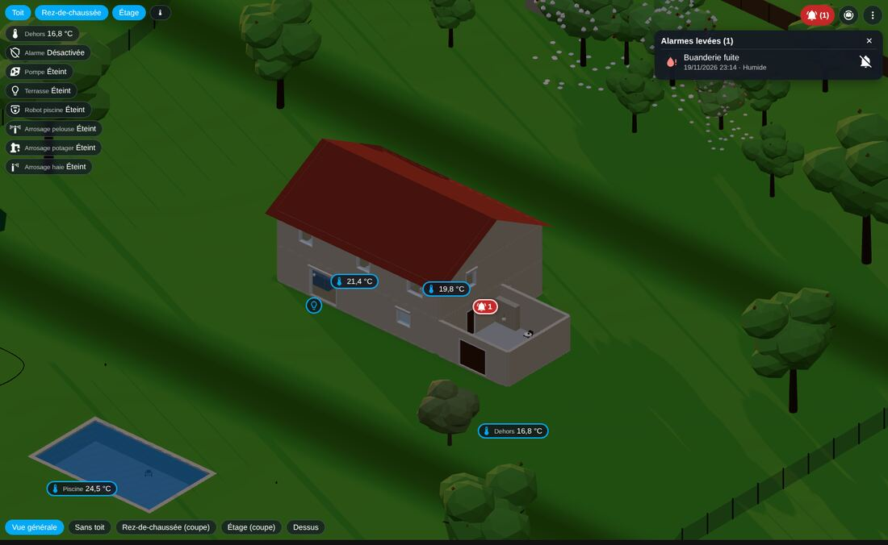
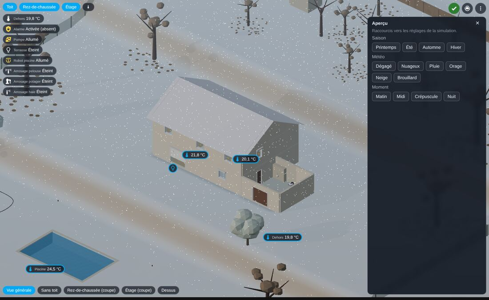
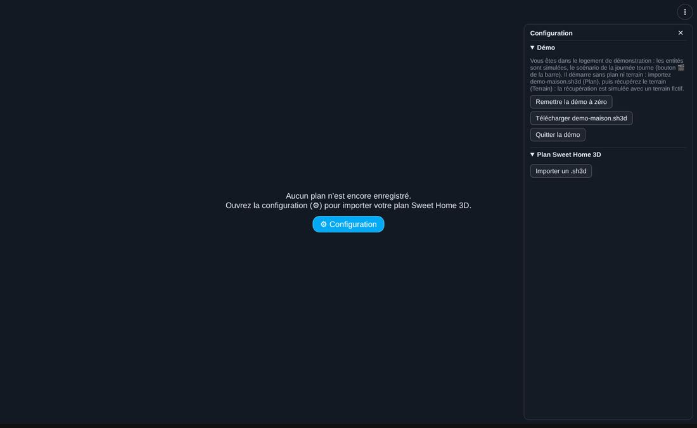

# House View: installation, setup and user guide

House View shows your house in 3D in Home Assistant. Your plan (Sweet Home 3D, IFC or SVG, or a simple plan drawn in the card) is laid on the real relief of the ground and lit by the sun of the moment. The view also shows the weather, the seasons of the plants, the lights of each room and the state of your devices (shutters, windows, robot vacuum, watering, pool, alarms…).

All the pictures of this guide were taken on the **demo home** that comes with the integration: a fictitious house, terrain and entities. They show the French interface of the card; the card is also in English, and the labels quoted below are the English ones.


## Contents

1. [What you need](#1-what-you-need)
2. [Installation](#2-installation)
3. [Adding the card to a dashboard](#3-adding-the-card-to-a-dashboard)
4. [First setup: the plan and the terrain](#4-first-setup-the-plan-and-the-terrain)
5. [Using the view](#5-using-the-view)
6. [The editor](#6-the-editor)
7. [The setup (⚙)](#7-the-setup-)
8. [Several homes](#8-several-homes)
9. [Demo mode](#9-demo-mode)
10. [Card options](#10-card-options)
11. [Frequently asked questions](#11-frequently-asked-questions)

---

## 1. What you need

- **Home Assistant 2026.3 or later**. Cleaning by rooms and the icon of the integration need it; the rest works with older versions.
- **A plan of the house**. The most complete one is a **Sweet Home 3D** plan (`.sh3d`, saved with version 5.3 or later); an **IFC** file (ArchiCAD, Revit, FreeCAD…) or an **SVG** plan work too, and without any file the card draws a simple one ([4.2](#42-creating-a-simple-plan)). In a Sweet Home 3D plan, what matters:
  - one **level per floor** (ground floor, first floor, basement…);
  - the **walls**;
  - the **rooms**, drawn with the *Create rooms* tool and **named**: the name links them to the areas of Home Assistant;
  - the **doors and windows** of the catalog (they cut the walls and can be animated);
  - the **compass** set to your latitude and to the north (the sun and the seasons depend on it);
  - optional: furniture, lights, trees and garden objects (shed, gate, pool…).
- **Areas in Home Assistant** for your rooms, with your lights, sensors and shutters assigned to them: this is how the view knows what to show where.

You do not provide the terrain (relief, neighbouring buildings, roads, cadastre, aerial photo): the integration fetches it itself (see [4.4](#44-fetching-the-terrain)).

## 2. Installation

### 2.1 Installing the integration

**With HACS** (recommended):

1. HACS → ⋮ menu → *Custom repositories* → add `https://github.com/elwinmage/ha-house-view-component`, type *Integration*.
2. Search for **House View** in HACS and install it.
3. Restart Home Assistant.

**By hand**: unzip `house_view.zip` of the latest release (it holds the built card) into `config/custom_components/house_view/`, then restart.

> The card (the JavaScript file) comes with the integration and is loaded on every dashboard on its own: there is **no Lovelace resource to add** by hand.

### 2.2 Adding the home

1. *Settings → Devices & services → Add integration →* **House View**.
2. Give the home a **name** (for example "Home") and check its **location** on the map: by default it is the one of Home Assistant. Move the marker onto the house if needed: it is used for the sun, the seasons and the download of the terrain.
3. Submit.

Each home is an entry of the integration; for a second house, see [Several homes](#8-several-homes).

## 3. Adding the card to a dashboard

1. Open a dashboard, enter edit mode, *Add card*, then search for **House View**.
2. The options are set in the visual editor of the card (see [Card options](#10-card-options)). To start with, only the weather entity is useful.

In YAML, the minimum is:

```yaml
type: custom:house-view-card
weather_entity: weather.home
```

**To get it large**, put the card in a **Sections** view and make it **full width**: in the editor of the card, *Layout* tab, turn on *Full width card*. With the option `height: fill` (the default), it then takes all the width and height available. A *Panel* view (a single card) also gives a full screen.

As long as no plan is imported, the card shows a message and a **⚙ Setup** button (visible to administrators only).


## 4. First setup: the plan and the terrain

Open ⚙ **Setup** (button of the empty card, or **⋮ menu → Setup**).


### 4.1 Importing the plan

In **Plan of the house**, click *Import a plan* and choose your file: Sweet Home 3D (`.sh3d`), IFC (`.ifc`) or SVG (`.svg`). The plan is read in the browser (only the structure is kept: levels, walls, rooms, openings, lights, furniture, plants), and a **report** lists what was found, with remarks if any (level without rooms, compass not set…).


The house shows up at once on flat ground. The furniture is drawn with its **own 3D models**, those of the Sweet Home 3D file (made lighter, one colour per material, the mean colour of a texture); the *Furniture drawn with the 3D models of the plan* box goes back to plain shapes. A piece whose model is in another format than OBJ stays a box, or the object of the catalog named like it.

> **Tip**: if a room has no Home Assistant area of the same name, the setup says so. You can link it by hand in the editor ([6.5](#65-rooms--home-assistant-areas)).

**The formats**:

- **Sweet Home 3D**: levels, walls, rooms, doors and windows, lights, furniture and plants.
- **IFC** (exported by ArchiCAD, Revit, FreeCAD, BlenderBIM…): the storeys become levels and the spaces (`IfcSpace`) rooms, with the walls, doors and windows. Remember to export the spaces: without them there are no rooms, so no lights and no link with the areas.
- **SVG** (plan drawn for ha-floorplan, or with Inkscape): each closed shape that has a name (its id, its Inkscape label or a `<title>`) is a room; the id `area.living_room` gives "Living room". Inkscape layers holding rooms become levels. Correct the **scale** (*Scale: SVG units per meter*) if the size given does not match. An SVG made of rectangles opens in the simple plan, to add doors and windows.

With an IFC, SVG or simple plan, each room gets a ceiling light lit by the lights of its area.

### 4.2 Creating a simple plan

No plan? *Create a simple plan* (in **Plan of the house**) opens an editor of rectangular rooms; the 3D view updates behind it.


- **Rooms**: *＋ Room* adds one next to the previous one, named after a Home Assistant area not used yet. Drag a room to move it and its handles to resize it: the edges stick to the neighbouring rooms, which then share their wall. The fields of the selected room set its name, its **HA area**, its width, its depth and its position.
- **Doors and windows**: choose *＋ Window*, *＋ Patio door* or *＋ Door*, then click the wall of the room where it goes. Drag it along the wall, and set its width, height and sill.
- **Levels**: *＋ Level* adds a floor that copies the outline of the rooms below, to rename and to cut up again; the ceiling height is set per level. The outline of the level below stays shown dashed.
- **Roof and orientation**: automatic, gable or flat roof; angle of north (the registration on the terrain corrects it afterwards).

The plan saves itself and opens again with *Edit the simple plan*. A simple plan replaces an imported plan, after a confirmation; placed entities, watering, fences… are kept.

### 4.3 Starting from the robot's map

If a robot vacuum has mapped the house and a map extractor (Xiaomi Cloud Map Extractor, Roborock Custom Map…) gives its rooms (`rooms` attribute), the *Plan from the robot's map* button creates a simple plan with these rooms, at their size and place. They are rough rectangles, and only those of the robot's level: adjust them, then add doors, windows and other levels in the simple plan.

### 4.4 Fetching the terrain

In **Terrain (DTM)**:

1. **Source**: *Automatic (by country)* chooses the services of the IGN in France, and the open worldwide data elsewhere (Mapterhorn for the relief, OpenStreetMap for buildings and roads).
2. **Latitude / longitude**: taken from the location of the home, that is from the configuration of Home Assistant (*Settings → System → General*) unless you changed it when adding the home. You can change them here.
3. **Size** of the terrain around the house (120 m by default).
4. Options (France): surface model (trees and auto-registration), buildings, roads and cadastre, aerial photo or IGN map draped on the ground; snapping to the nearest building (the location in Home Assistant is often approximate).
5. Click **Fetch the terrain**. The steps show under the form (locating, relief, surface, buildings and roads, photo).


At the end, the plan is **registered on the terrain automatically** (rotation, offset, height), the trees found are planted, and the relief, the roads and the photo appear.

You can also load a terrain file (*Load a terrain .json*) or adjust the registration by hand (rotation, offset, height) in the same section.

## 5. Using the view


### 5.1 Moving around

- **Drag** to rotate, **wheel or pinch** to zoom, **right click / two fingers** to pan.
- The **views** at the bottom (General view, Without roof, Ground floor (cut), First floor (cut), Top) move the camera. You can save your own in the editor ([6.11](#611-trees-outdoor-objects-and-ground-corrections)).
- The **levels** at the top left (Roof, Ground floor, First floor) show or hide the roof and each floor; 🌡 colours the rooms by their temperature.


| Cut of the ground floor | Top view |
|---|---|
|  |  |

### 5.2 Rooms

- A **tap on a room** zooms on it (the roof and the floors above disappear). A **second tap** turns its lights on or off. The **← Room** button goes back to the previous view.
- Zoomed on a room, only **the entities of that room** are shown (those of the general view disappear); the robot vacuum stays visible if it is there.


### 5.3 The left column: the general panel

Under the levels, the **general panel** gathers the sensors and controls of the whole house (outdoor temperature, alarm, pump, watering…). A tap toggles what can be toggled and opens the more-info dialog of the others.

### 5.4 The toolbar and the ⋮ menu

At the top right:

- the **alarm badge**: green when all is well, red with the number of raised alarms;
- one button per **robot vacuum**;
- the **⋮** menu, which gathers the occasional tools and the administration.


| Entry | Use |
|---|---|
| Preview | Force a season, a weather or a time of day |
| Simulate a year | Play the seasons of a year in a few seconds |
| Lock the camera | Keep the camera on the views (wall screen) |
| Simulation | Settings of simulation mode (when the card is in simulation mode) |
| Demo | Panel of the demo home |
| Editor ✎ | Place entities, watering, fences… (administrators) |
| Setup ⚙ | Plan, terrain, backup, protection (administrators) |

The tools you use often can stay in the toolbar (option *Buttons in the toolbar*), and the menu can be hidden from non-administrators (option *Hide the ⋮ menu*).

### 5.5 Alarms

Smoke, gas, carbon monoxide, water leak, problem, heat, cold and tamper sensors, and triggered alarm panels, are found on their own. When an alarm is raised, the badge turns red and the **room concerned** shows a red bell with the number of alarms. A tap opens the list; a tap on an alarm opens its more-info dialog; the crossed-out bell ignores it.



### 5.6 Weather, sun and seasons

- The **sun** follows the time and date of the home; the **shadows** turn during the day.
- The **weather** comes from the weather entity (rain, snow, storm, fog, clouds, wind). A rain gauge or wind sensors of your own can correct it (see the options).
- The **plants** and the **grass** follow the seasons of the climate of the latitude: four seasons in temperate areas, a long winter and a short summer near the poles, a wet season and a dry season between the tropics. Everything is reversed in the southern hemisphere.
- **Preview** (⋮ menu): force a season, a weather or a time of day, which can be combined; back to live with *Preview… ✕* or after 3 minutes.

| Preview: winter under snow | Simulate a year: autumn |
|---|---|
|  |  |

**Simulate a year** plays a whole year (10 s by default, 5 to 60 s) from the date shown; a chip shows the date. At the end, the view goes back to the date before.

### 5.7 Lights, shutters and windows

The lights of each room light the room and its windows. **Roller shutters** go down to their real position, **windows** open, **patio doors** slide, **doors** swing.


### 5.8 Robot vacuum

A tap on the button of the robot opens the room selection: choose the rooms on the plan, then *Clean* (also *Start*, *Pause*, *Dock*). While it cleans, a 3D robot moves, the room being cleaned is coloured with its percentage, the rooms still to do are tinted, a finished room sparkles, and a ring around the button gives the overall progress. On an error, the room and the robot blink in red.


### 5.9 Watering, pool and pond

When a valve opens, the **drip lines** light up in blue and a wet patch grows; the **sprinklers** show their jet and their sector. The pool robot travels the bottom while its entity is on; the water moves. The lamps of the pool colour the water in the evening and the roller cover unrolls over the water, which a tap opens or closes.

| Sprinklers at dawn | Pool and pond |
|---|---|
|  |  |

## 6. The editor

For administrators only: **⋮ menu → Editor**. The editor is a **menu of sections**. A section opens in its own window, over the menu; an item of a list (a drip line, a zone, an entity…) opens over the section. The **←** arrow goes back to the window below. Everything is saved on its own; **Esc** cancels the drawing in progress.


### 6.1 Placed entities

To place an entity in the view (temperature, light, switch, shutter…):

1. *Add an entity*: the list first offers the entities of the current room, grouped by device (the whole house in one tap, with a search).
2. Tap the place you want in the view. The label can then be **moved by dragging it** (editor open).
3. Set it up: **Mount** (on the floor, on a wall, free at a height), **Display** (chip with the value, or icon only), label, icon, colour, tap action (more-info, toggle, nothing).

The entities are sorted into **layers**:

- **General view**: shown in the general view (or only in the view of their floor). The *Shown over the roof* box lets you read, for example, the temperature of a room from afar.
- **Room**: shown only when zoomed on their room.


To edit **the entities of a room**, tap the room in the view with the editor open: it zooms in and a **red banner** says that you are editing that room. The entities added then belong to that room only; place them on the floor, on a wall or in the air.


> An entity of the general view already placed in a room moves into that room with *Visible → Its room only*.

A placed **light** becomes a real light source at that spot (spot, pendant, lamp, strip or invisible; height and reach can be set; on a wall: a wall lamp).

### 6.2 General panel

The sensors and controls of the left column, in the order you want, with their label, icon and tap action (automatic, toggle, more-info, nothing).


### 6.3 Alarms

Automatic detection on or off, bells in the rooms, entities added by hand, ignored entities.


### 6.4 Clickable zones

A **media player** laid on a piece of furniture of the plan (tap it) or on a rectangle against a wall or on a floor; an **aquarium** of the [reeftank](https://github.com/Elwinmage/ha-reeftank-component) integration on a rectangle the size of the tank. A tap opens the player, or the aquarium view of the [ha-reef-card](https://github.com/Elwinmage/ha-reef-card) card; the rectangle of an aquarium shows that view live, fish included, never stretched. While placing, the surface aimed at lights up; a zone is moved by dragging it. A **link** (*Add a link*) opens, in the same window, a dashboard of Home Assistant (a path such as `/lovelace/cameras`, or a full address, shown in a frame) or any Lovelace card (its configuration as JSON, e.g. `{"type": "picture-entity", "entity": "camera.garden"}`). On a rectangle it shows as a tile with its icon (chosen with the icon picker, which lists the icons while you type) and its name.


### 6.5 Rooms ↔ Home Assistant areas

Each room of the plan is linked to the Home Assistant area **with the same name** (accents and case ignored). This section lets you choose another area, or none, room by room.


### 6.6 Doors and windows

The openings of the plan, by level and by room; **Pick on the view** lets you tap a window directly (it lights up under the pointer). Each one can be linked to:

- an **open / closed sensor** (`binary_sensor`);
- a **motorised opener** (`cover` of the window);
- a **roller shutter** (`cover`), for windows and patio doors.

A room with **only one window** is linked on its own to the window sensor, the opener and the shutter of its area (when there is one of each); a room with only one door, to its door sensor. A link chosen by hand wins; an automatic link can be removed.


### 6.7 Pools and ponds

*＋ Pool* or *＋ Pond*, then draw the outline seen from above: **Rectangle** (two opposite corners) or **Free shape** (point by point, then *Finish*). Set the name, the water colour, the depth (0.2 to 6 m) and, if you have one, the **cleaning robot** (`binary_sensor`, `switch`, `input_boolean`, `vacuum`, `light`, `fan` or `sensor` — and any other entity by typing its id in the picker; a reading above zero counts as on). The terrain is dug: vertical walls, flat bottom and coping for a pool; sloping bottom and a pebble bank for a pond. A pool or a pond counts as a **room**: a tap zooms the camera on it (the view can be saved like that of a room), entities and links can be placed in it, and it can be linked to a Home Assistant area like a room of the plan.

**Lamps in the water**: *＋ Lamp* adds a projector sunk in the wall of the chosen side (its place along the side and its depth can be set), linked to a light or to a plug. A coloured light gives its own colour, otherwise the colour chosen in the editor is used; the lamps that are on tint the water and the basin, all the more at night.

**Roller cover**: *＋ Roller cover* adds a sheet of slats unrolling over the water from the chosen side, its roller on the deck or sunk in the water. A `cover` entity gives its position (0 to 100 %), a `switch`, `input_boolean` or `binary_sensor` entity only says open or closed (on = closed, *Swap* turns the reading around). A tap on the sheet in the view opens or closes the cover. A tap on a lamp switches it the same way. In the editor these taps command nothing: they open the pool concerned and frame the lamp or the cover aimed at in the panel. With the cover rolled up, the roller answers the tap.

For both of them, the 🎯 button beside the list of sides lights them up on the ground: the side in use is yellow, and the next click in the view takes the nearest one. *Test* (💡 for a lamp, ▶ for the cover) shows the result without touching the entities: the lamp lights on its own, whatever the hour, and the cover closes then opens again, at its real speed. A second click on the button ends the preview, which also ends when the window of the pool is closed.


> A pool drawn in Sweet Home 3D, if any, is kept as it is.

**Islands** (pond): *＋ Island (Rectangle)* or *＋ Island (Free shape)*, then draw it in the water like the outline. The ground is kept there, a little above the water, with a pebble bank: a tree can be planted on it (**Trees** section) and entities placed on it.

**Fish** (pond): the fish come from the house catalog (koi carp to start with). Add a **group** per variety, with its count and size: for 3 red koi, 1 red and white and 2 yellow, make three groups (Benigoi × 3, Kohaku × 1, Yamabuki ogon × 2). *Colours of my own* lets you choose the colour of the body, of the patches, the pattern (plain, large patches, medium patches, small spots) and shiny scales. Each fish has a robe of its own, always the same; it wanders in the water away from the banks and the islands, takes the colour of the water as it goes down, and stays at the bottom, hardly moving, when it is cold (under 8 °C).


### 6.8 Robot vacuum

For each robot (*Robot* list):

- **Place the dock** then tap the floor; set its **direction** (or *Aim with a tap*);
- **Robot position**: Roborock (official action), attributes of an entity (map extractors), or none (estimated path);
- **Calibration**: rotation, mirror, scale; *Calibrate with a tap* when the robot is away from its dock;
- **Map of the robot** laid over the plan to line it up: with a map extractor (calibration points) it places itself; with the official Roborock integration, show the dock with a tap (*The dock is here on the map*);
- colours of the robot and of the room being cleaned, *Show this robot on the view*, *Test the animation*.


### 6.9 Watering

- **Drip lines**: one line per valve (`switch`, `valve`, `input_boolean`), drawn point by point, with the colour of the pipe, the flow and the spacing of the drippers.
- **Sprinklers**: one circuit per valve, with one or more sprinklers of the catalog (Hunter PSU, SRM, PGJ, PGP, MP Rotator or generic), their range, direction and angle (*Aim* with a tap).
- One valve can drive **several lines or circuits**: choose the same entity for each, they come on together.
- **Test the animation**: 30 s of sped-up watering without opening any valve.


### 6.10 Fences

*Fence from the cadastre* (the parcels of the house are preselected; **in France only**, as the cadastre comes from the services of the IGN: elsewhere, draw the fence by hand) or *Draw a fence* point by point. Each side has its type (wire mesh, wood, wall, hedge, or open where there is no fence; a gate is added in *Gates* and opens the fence by itself) and its height; *Edit the sides* changes a side, cuts it in two or removes a point.


### 6.11 Trees, outdoor objects and ground corrections

- **Trees**: delete those found by mistake, plant some (species of the catalog and height), undo, restore all.
- **Outdoor objects** (shed, gate…): hide, height, offset, rotation.
- **Ground corrections**: low wall, terrace, brushes (raise, dig, smooth), cut of the terrain.
- **Views**: save the current camera as a view, rename, delete.


### 6.12 The catalog of trees and objects

The species of trees (with their look in each season), the garden objects or pieces of furniture drawn instead of plain boxes, and the fish of the ponds come from the [house catalog](https://github.com/Elwinmage/house-catalog). The integration updates it on its own from GitHub (device *House view catalog*: one update entity per section, an *Automatic update* switch, an *Update now* button) and works offline with the copy it ships.

To create **your own tree or object**, use the [catalog editor](https://github.com/Elwinmage/catalog-editor): a Home Assistant card where you set the shape, the colours and the seasons while seeing the result. What you save is used by the view at once, and you can then propose it to the shared catalog (a pull request on GitHub), so that everyone benefits.

### 6.13 The sea

For a house by the sea or an ocean, the *Sea* section of the editor adds a moving sea to the terrain (the shape of the ground is the one fetched: the terrain data includes the sea bed).

- **Sea** on/off, and the **level** of the water in metres (the hint shows the lowest ground and the level of the house; the sea fills everything below the level, and the houses stay dry).
- **Beach**: sand, pebbles, coral, rock or none; the ground close to the water is tinted accordingly (a strip of wet sand, foam on the shore).
- **Waves**: the swell grows with the wind of the weather and travels in the direction it comes from; the slider sets the base height.
- **Tide**: amplitude in metres at spring tides (0 = none). The tide follows the **real calendar**: two high waters a day that slide by about 50 minutes each day, strong at new and full moon, weak at the quarters. To fit your harbour, enter in *Observed high water* the time of one real high water (tide tables, SHOM…): the following days then stay within a few tens of minutes of the tables. Without it the tide is only approximate. The model has no harmonic table of the place (no local effects, no pressure or wind surge).
- **Clarity**: clear turquoise water or murky water.
- **Sound of the surf**: ambient sound that follows the waves (browsers require a first click or tap on the page before any sound).

The settings are saved in the `sea` key of the edits. Known limits: a single water level for the whole terrain (a river or a pond at another level is not drawn), and the seasonal colour of the grass is replaced by the beach tinting while the sea is on.


## 7. The setup (⚙)


- **Demo** (hidden by default, to switch on in the integration options): see [Demo mode](#9-demo-mode).
- **Plan** and **Terrain**: see [the first setup](#4-first-setup-the-plan-and-the-terrain).
- **GitHub backup**: set a **private** repository in the integration options (*Settings → Devices & services → House View → Configure → GitHub backup*: repository `owner/name`, *fine-grained* token with *Contents: read and write*, branch, folder), then *Back up to GitHub* / *Restore from GitHub*. A public repository is refused: it would hold the plan of your house. Above the two buttons, **Stored in Home Assistant** lists what the integration holds (plan, terrain, edits, aerial photo) with the date of the last write: a backup can only send what is listed there, and its message says what was written, what was already up to date, what is not stored here and what GitHub refused. Edits still pending are saved before the backup.
- **Edit protection**: a password can be asked before the editor and the setup open (integration options → *Edit protection*). The card asks for it again after 10 minutes without any change; the 🔒 button locks at once. Looking at the view, zooming, controlling the lights or the vacuum stay free.
- **Edits file**: export or import all your edits (entities, watering, fences…) as a JSON file.

## 8. Several homes

A holiday home, a chalet… Each home is an **entry** of the integration, with its own plan, terrain and edits.

1. *Settings → Devices & services → House View → Add entry*.
2. Give it a name (different from the others) and its location.
3. In the card (visual editor), choose the **Home** shown: the list appears as soon as there are two. In YAML: `home: <entry id>`.
4. Import its plan and fetch its terrain as in [chapter 4](#4-first-setup-the-plan-and-the-terrain).

Deleting an entry deletes its documents; the other homes are not touched.

## 9. Demo mode

To film or present the view **without showing your house or where it is**.

The demo is **hidden by default**. Switch it on first: *Settings → Devices & services → House View → Configure → Demo*, uncheck *Hide the demo*; the **Demo** section then shows in ⚙.

1. ⚙ → **Demo** → *Load the demo*: a "Démo" home is added, with a fictitious location (45° N); your homes are left alone. It starts **empty and flat**, to be filmed from the start.

   

2. Import `demo-maison.sh3d` (*Download demo-maison.sh3d* in ⚙) with *Import a plan*.
3. *Fetch the terrain*: the fetch goes through its steps and brings a fictitious terrain on three plateaus (orchard, house, garden with pool and pond), without any network access.

The entities of the demo are **simulated by the card**: nothing is created in Home Assistant and nothing of your house shows. A **scenario of the day** (1 h every 2 s) brings the house to life: shutters open in the morning, watering at dawn, vacuum in the morning, pool robot in the afternoon, windows opened to air the rooms, water leak before dinner, lights on and shutters closed in the evening.

The **🎬 Demo** button (⋮ menu) pauses the scenario, sets the time and triggers an event by hand (shutters, lights, vacuum, watering, pool robot, leak, smoke). A tap on a simulated entity toggles it; that change stays until the scenario moves it again.


*Reset the demo* puts it back as shipped; *Leave the demo* goes back to your home. The Démo home is deleted like any other entry of the integration.

## 10. Card options

They are set in the visual editor of the card (dashboard in edit mode → *Edit* on the card), in sections.

| Option | Use | Default |
|---|---|---|
| `home` | Home shown (several homes) | the first one |
| `mode` | `live` (real time) or `simulation` (time, date and weather sliders) | `live` |
| `weather_entity` | Weather entity | — |
| `rain_entity` | Rain detector or rain rate sensor (mm/h) | — |
| `wind_speed_entity`, `wind_bearing_entity` | Wind sensors of your own | — |
| `view` | Starting view (its name) | — |
| `show_views`, `show_levels` | View buttons, level buttons | yes |
| `show_entities` | Placed entities | yes |
| `show_alarms` | Alarm badge | yes |
| `tap_action` | Tap on a room: `zoom`, `toggle_lights`, `none` | `zoom` |
| `movable_camera` | Movable camera | yes |
| `height`, `min_height` | Height of the card (`fill`, `aspect`, in px or `vh`) | `fill`, 320 |
| `fps_cap` | Maximum frames per second (wall tablet) | 30 |
| `year_seconds` | Length of "Simulate a year" (5 to 60 s) | 10 |
| `toolbar_buttons` | Tools kept in the toolbar (`preview`, `year`, `camera`, `sim`, `edit`, `setup`) | none |
| `hide_menu` | Hide the ⋮ menu from non-administrators | no |
| `light_entities` | Restrict the lights taken into account | all |
| `vacuum_entity`, `vacuum_poll`, `vacuum_rate`, `vacuum_show_floor`, `vacuum_progress_entity` | Robot vacuum | — |

In **simulation** mode, the *Simulation* panel (⋮ menu) sets the time (with playback), the date, the weather, the clouds, the rain, the wind, the temperature and the snow.


## 11. Frequently asked questions

**A room stays dark, its lights do not show.**
Check that it is linked to a Home Assistant area ([6.5](#65-rooms--home-assistant-areas)) and that its lights are assigned to that area.

**The sun or the seasons do not match.**
The compass of the Sweet Home 3D plan must be set (latitude and north), and the location of the home must be right (options of the House View entry).

**The house floats or sinks into the terrain.**
Adjust the height in ⚙ → *Terrain (DTM)*, or run the auto-registration again.

**A label does not show.**
A label hidden by the roof or a floor is not shown (unless *Shown over the roof*), and a room label shows only when zoomed on its room. With the editor open on *Placed entities*, all the labels of the layer are shown (faded when hidden).

**The map of the robot is not lined up.**
With the official Roborock integration, show the dock on the map with a tap, then set the rotation. With a map extractor (Roborock Custom Map, Xiaomi Cloud Map Extractor), choose its entity: the map places itself.

**There is no aerial photo on the ground.**
In ⚙ → *Terrain (DTM)*, check that *Aerial photo on the ground* is ticked. If the fetch says "ground texture unavailable", the reason given in brackets comes from the IGN service; fetch again later.

**I want to show the view without showing my house.**
Use [demo mode](#9-demo-mode).
