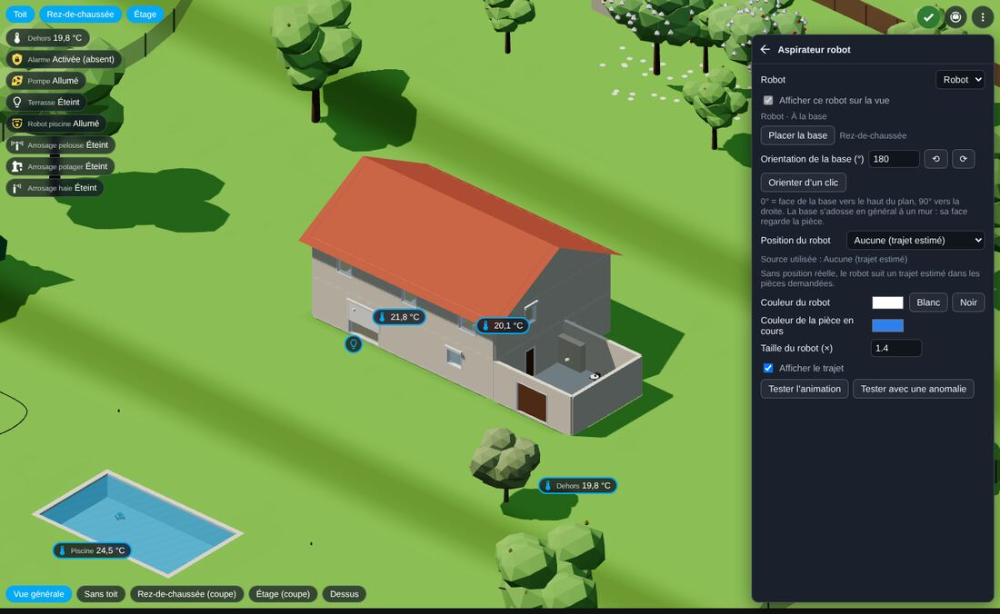
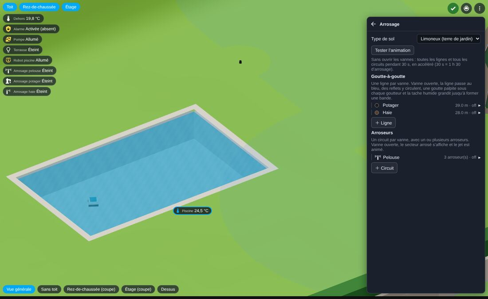

# House View: guía de instalación, configuración y uso

House View muestra su casa en 3D en Home Assistant. El plano dibujado en Sweet Home 3D se coloca sobre el relieve real del terreno y lo ilumina el sol del momento. La vista muestra también el tiempo, las estaciones de la vegetación, las luces de cada habitación y el estado de sus aparatos (persianas, ventanas, robot aspirador, riego, piscina, alarmas…).

Todas las imágenes de esta guía se tomaron en la **vivienda de demostración** que viene con la integración: una casa, un terreno y unas entidades ficticios. Muestran la interfaz francesa de la tarjeta. La tarjeta existe en francés y en inglés: los textos de la tarjeta citados abajo son los de la interfaz inglesa; los de Home Assistant, en español.


## Índice

1. [Lo que necesita](#1-lo-que-necesita)
2. [Instalación](#2-instalación)
3. [Añadir la tarjeta a un panel](#3-añadir-la-tarjeta-a-un-panel)
4. [Primera puesta en marcha: el plano y el terreno](#4-primera-puesta-en-marcha-el-plano-y-el-terreno)
5. [Usar la vista](#5-usar-la-vista)
6. [El editor](#6-el-editor)
7. [La configuración (⚙)](#7-la-configuración-)
8. [Varias viviendas](#8-varias-viviendas)
9. [El modo demo](#9-el-modo-demo)
10. [Opciones de la tarjeta](#10-opciones-de-la-tarjeta)
11. [Preguntas frecuentes](#11-preguntas-frecuentes)

---

## 1. Lo que necesita

- **Home Assistant 2026.3 o posterior**. La limpieza por habitaciones y el icono de la integración lo necesitan; lo demás funciona con versiones anteriores.
- **Un plano de la casa**. El más completo es un plano de **Sweet Home 3D** (`.sh3d`, guardado con la versión 5.3 o posterior); un archivo **IFC** (ArchiCAD, Revit, FreeCAD…) o un plano **SVG** también sirven, y sin ningún archivo la tarjeta dibuja uno simple ([4.2](#42-crear-un-plano-simple)). En un plano de Sweet Home 3D, lo que cuenta:
  - un **nivel por planta** (planta baja, primera planta, sótano…);
  - las **paredes**;
  - las **habitaciones**, dibujadas con la herramienta *Crear habitaciones* y **con nombre**: el nombre sirve para enlazarlas con las áreas de Home Assistant;
  - las **puertas y ventanas** del catálogo (recortan las paredes y se pueden animar);
  - la **brújula** ajustada a su latitud y al norte (el sol y las estaciones dependen de ella);
  - opcional: los muebles, las luces, los árboles y los objetos del jardín (caseta, portón, piscina…).
- **Áreas en Home Assistant** para sus habitaciones, con sus luces, sensores y persianas asignados a ellas: así sabe la vista qué mostrar y dónde.

No tiene que aportar el terreno (relieve, edificios vecinos, carreteras, catastro, foto aérea): la integración lo descarga ella misma (véase [4.4](#44-descargar-el-terreno)).

## 2. Instalación

### 2.1 Instalar la integración

**Con HACS** (recomendado):

1. HACS → menú ⋮ → *Repositorios personalizados* → añada `https://github.com/elwinmage/ha-house-view-component`, tipo *Integración*.
2. Busque **House View** en HACS e instálelo.
3. Reinicie Home Assistant.

**A mano**: descomprima `house_view.zip` de la última versión publicada (contiene la tarjeta compilada) en `config/custom_components/house_view/` y reinicie.

> La tarjeta (el archivo JavaScript) viene con la integración y se carga sola en todos los paneles: **no hay ningún recurso de Lovelace que añadir** a mano.

### 2.2 Añadir la vivienda

1. *Ajustes → Dispositivos y servicios → Añadir integración →* **House View**.
2. Dé un **nombre** a la vivienda (por ejemplo «Casa») y compruebe su **ubicación** en el mapa: por defecto es la de Home Assistant. Mueva el marcador sobre la casa si hace falta: sirve para el sol, las estaciones y la descarga del terreno.
3. Confirme.

Cada vivienda es una entrada de la integración; para una segunda casa, véase [Varias viviendas](#8-varias-viviendas).

## 3. Añadir la tarjeta a un panel

1. Abra un panel, pase al modo edición, *Añadir tarjeta* y busque **House View**.
2. Las opciones se ajustan en el editor visual de la tarjeta (véase [Opciones de la tarjeta](#10-opciones-de-la-tarjeta)). Al principio, solo la entidad meteorológica es útil.

En YAML, lo mínimo es:

```yaml
type: custom:house-view-card
weather_entity: weather.casa
```

**Para verla en grande**, coloque la tarjeta en una vista de tipo **Secciones** y póngala a **ancho completo**: en el editor de la tarjeta, pestaña *Diseño*, active el ancho completo. Con la opción `height: fill` (por defecto), ocupa entonces todo el ancho y el alto disponibles. Una vista de tipo *Panel* (una sola tarjeta) también da la pantalla completa.

Mientras no se haya importado ningún plano, la tarjeta muestra un mensaje y un botón **⚙ Setup** (visible solo para los administradores).


## 4. Primera puesta en marcha: el plano y el terreno

Abra ⚙ **Setup** (botón de la tarjeta vacía, o **menú ⋮ → Setup**).


### 4.1 Importar el plano

En **Plan of the house**, pulse *Import a plan* y elija su archivo: Sweet Home 3D (`.sh3d`), IFC (`.ifc`) o SVG (`.svg`). El plano se lee en el navegador (solo se guarda la estructura: niveles, paredes, habitaciones, aberturas, luces, muebles, vegetación) y un **informe** enumera lo encontrado, con posibles observaciones (nivel sin habitaciones, brújula sin ajustar…).


La casa aparece enseguida sobre un suelo plano. Los muebles se dibujan con sus **propios modelos 3D**, los del archivo de Sweet Home 3D (aligerados, un color por material, el color medio de una textura); la casilla *Furniture drawn with the 3D models of the plan* vuelve a formas simples. Un mueble cuyo modelo está en otro formato que OBJ sigue siendo una caja, o el objeto del catálogo que lleva su nombre.

> **Consejo**: si una habitación no tiene un área de Home Assistant con el mismo nombre, la configuración lo indica. Podrá enlazarla a mano en el editor ([6.5](#65-habitaciones--áreas-de-home-assistant)).

**Los formatos**:

- **Sweet Home 3D**: niveles, paredes, habitaciones, puertas y ventanas, luces, muebles y vegetación.
- **IFC** (exportado por ArchiCAD, Revit, FreeCAD, BlenderBIM…): las plantas se convierten en niveles y los espacios (`IfcSpace`) en habitaciones, con las paredes, las puertas y las ventanas. Acuérdese de exportar los espacios: sin ellos no hay habitaciones, y por tanto ni luces ni enlace con las áreas.
- **SVG** (plano dibujado para ha-floorplan, o con Inkscape): cada forma cerrada con nombre (su id, su etiqueta de Inkscape o un `<title>`) es una habitación; el id `area.salon` da «Salon». Las capas de Inkscape que contienen habitaciones se convierten en niveles. Corrija la **escala** (*Scale: SVG units per meter*) si el tamaño indicado no coincide. Un SVG hecho de rectángulos se abre en el plano simple, para añadir puertas y ventanas.

Con un plano IFC, SVG o simple, cada habitación recibe una luz de techo encendida por las luces de su área.

### 4.2 Crear un plano simple

¿No tiene plano? *Create a simple plan* (en **Plan of the house**) abre un editor de habitaciones rectangulares; la vista 3D se actualiza detrás.


- **Habitaciones**: *＋ Room* añade una junto a la anterior, con el nombre de un área de Home Assistant aún no usada. Arrastre una habitación para moverla y sus tiradores para cambiar su tamaño: los bordes se pegan a las habitaciones vecinas, que comparten entonces su pared. Los campos de la habitación seleccionada ajustan su nombre, su **área de HA**, su ancho, su fondo y su posición.
- **Puertas y ventanas**: elija *＋ Window*, *＋ Patio door* o *＋ Door* y pulse en la pared de la habitación donde va. Arrástrela a lo largo de la pared y ajuste su ancho, su alto y su antepecho.
- **Niveles**: *＋ Level* añade una planta que copia el contorno de las habitaciones de abajo, para renombrar y volver a dividir; la altura del techo se ajusta por nivel. El contorno del nivel de abajo sigue visible en línea discontinua.
- **Tejado y orientación**: tejado automático, a dos aguas o plano; ángulo del norte (el ajuste sobre el terreno lo corrige después).

El plano se guarda solo y se vuelve a abrir con *Edit the simple plan*. Un plano simple sustituye a un plano importado, previa confirmación; las entidades colocadas, el riego, las vallas… se conservan.

### 4.3 Partir del mapa del robot

Si un robot aspirador ha cartografiado la casa y un extractor de mapa (Xiaomi Cloud Map Extractor, Roborock Custom Map…) da sus habitaciones (atributo `rooms`), el botón *Plan from the robot's map* crea un plano simple con esas habitaciones, con su tamaño y su lugar. Son rectángulos aproximados, y solo los del nivel del robot: ajústelos y añada después puertas, ventanas y otros niveles en el plano simple.

### 4.4 Descargar el terreno

En **Terrain (DTM)**:

1. **Source**: *Automatic (by country)* elige los servicios del IGN en Francia y los datos abiertos mundiales en otros lugares (Mapterhorn para el relieve, OpenStreetMap para los edificios y las carreteras).
2. **Latitud / longitud**: tomadas de la ubicación de la vivienda, es decir, de la configuración de Home Assistant (*Ajustes → Sistema → General*), salvo que la haya cambiado al añadir la vivienda. Puede modificarlas aquí.
3. **Size**: tamaño del terreno alrededor de la casa (120 m por defecto).
4. Opciones (Francia): modelo de superficie (árboles y ajuste automático), edificios, carreteras y catastro, foto aérea o mapa del IGN sobre el suelo; ajuste sobre el edificio más cercano (la ubicación de Home Assistant suele ser aproximada).
5. Pulse **Fetch the terrain**. Los pasos aparecen bajo el formulario (localización, relieve, superficie, edificios y carreteras, foto).


Al final, el plano se **ajusta automáticamente** al terreno (rotación, desplazamiento, altura), se plantan los árboles detectados y aparecen el relieve, las carreteras y la foto.

También puede cargar un archivo de terreno (*Load a terrain .json*) o retocar el ajuste a mano (rotación, desplazamiento, altura) en la misma sección.

## 5. Usar la vista


### 5.1 Moverse

- **Arrastrar** para girar, **rueda o pellizco** para hacer zoom, **clic derecho / dos dedos** para desplazar.
- Las **vistas** de abajo (General view, Without roof, Ground floor (cut), First floor (cut), Top) recolocan la cámara. Puede guardar las suyas en el editor ([6.11](#611-árboles-objetos-exteriores-y-correcciones-del-suelo)).
- Los **niveles** arriba a la izquierda (Roof, Ground floor, First floor) muestran u ocultan el tejado y cada planta; 🌡 colorea las habitaciones según su temperatura.


| Corte de la planta baja | Vista desde arriba |
|---|---|
|  |  |

### 5.2 Las habitaciones

- Un **toque en una habitación** hace zoom sobre ella (el tejado y las plantas superiores desaparecen). Un **segundo toque** enciende o apaga sus luces. El botón **← Room** vuelve a la vista anterior.
- Con el zoom sobre una habitación, solo se muestran **las entidades de esa habitación** (las de la vista general desaparecen); el robot aspirador sigue visible si está allí.


### 5.3 La columna izquierda: el panel general

Bajo los niveles, el **panel general** reúne los sensores y mandos de toda la casa (temperatura exterior, alarma, bomba, riego…). Un toque conmuta lo que se puede conmutar y abre la ficha de lo demás.

### 5.4 La barra y el menú ⋮

Arriba a la derecha:

- la **insignia de alarma**: verde cuando todo va bien, roja con el número de alarmas activas;
- un botón por **robot aspirador**;
- el menú **⋮**, que reúne las herramientas ocasionales y la administración.


| Entrada | Función |
|---|---|
| Preview | Forzar una estación, un tiempo o un momento del día |
| Simulate a year | Pasar las estaciones de un año en unos segundos |
| Lock the camera | Fijar la cámara en las vistas (pantalla de pared) |
| Simulation | Ajustes del modo simulación (si la tarjeta está en modo simulación) |
| Demo | Panel de la vivienda de demostración |
| Editor ✎ | Colocar entidades, riego, vallas… (administradores) |
| Setup ⚙ | Plano, terreno, copia de seguridad, protección (administradores) |

Las herramientas que usa a menudo pueden quedarse en la barra (opción *Buttons in the toolbar*), y el menú se puede ocultar a quienes no son administradores (opción *Hide the ⋮ menu*).

### 5.5 Las alarmas

Los sensores de humo, gas, monóxido de carbono, fuga de agua, problema, calor, frío y manipulación, y los paneles de alarma disparados, se detectan solos. Cuando salta una alarma, la insignia se pone roja y la **habitación afectada** muestra una campana roja con el número de alarmas. Un toque abre la lista; un toque en una alarma abre su ficha; la campana tachada la ignora.


### 5.6 Tiempo, sol y estaciones

- El **sol** sigue la hora y la fecha de la vivienda; las **sombras** giran a lo largo del día.
- El **tiempo** viene de la entidad meteorológica (lluvia, nieve, tormenta, niebla, nubes, viento). Un pluviómetro o sensores de viento propios pueden corregirlo (véanse las opciones).
- La **vegetación** y el **césped** siguen las estaciones del clima de la latitud: cuatro estaciones en zona templada, invierno largo y verano corto cerca de los polos, estación de lluvias y estación seca entre los trópicos. Todo se invierte en el hemisferio sur.
- **Preview** (menú ⋮): fuerce una estación, un tiempo o un momento, combinables; vuelta al directo con *Preview… ✕* o al cabo de 3 minutos.

| Preview: invierno bajo la nieve | Simulate a year: el otoño |
|---|---|
|  |  |

**Simulate a year** pasa un año entero (10 s por defecto, de 5 a 60 s) a partir de la fecha mostrada; una etiqueta indica la fecha. Al final, la vista vuelve a la fecha de antes.

### 5.7 Luces, persianas y ventanas

Las luces de cada habitación iluminan la habitación y sus ventanas. Las **persianas enrollables** bajan hasta su posición real, las **ventanas** se abren, los **ventanales** se deslizan, las **puertas** giran.


### 5.8 El robot aspirador

Un toque en el botón del robot abre la selección de habitaciones: elíjalas en el plano y luego *Clean* (también *Start*, *Pause*, *Dock*). Durante la limpieza, un robot 3D se desplaza, la habitación en curso se colorea con su porcentaje, las habitaciones pendientes se tiñen, una habitación terminada destella y un anillo alrededor del botón da el avance global. En caso de error, la habitación y el robot parpadean en rojo.


### 5.9 Riego, piscina y estanque

Cuando se abre una válvula, los **goteros** se iluminan en azul y crece una mancha húmeda; los **aspersores** muestran su chorro y su sector. El robot de la piscina recorre el fondo mientras su entidad está activa; el agua se mueve.

| Aspersores al amanecer | Piscina y estanque |
|---|---|
|  |  |

## 6. El editor

Solo para administradores: **menú ⋮ → Editor**. El editor es un **menú de secciones**. Una sección se abre en su propia ventana, encima del menú; un elemento de una lista (una línea de goteo, una zona, una entidad…) se abre encima de la sección. La flecha **←** vuelve a la ventana de debajo. Todo se guarda solo; **Esc** cancela el trazado en curso.


### 6.1 Entidades colocadas

Para colocar una entidad en la vista (temperatura, luz, interruptor, persiana…):

1. *Add an entity*: la lista propone primero las entidades de la habitación actual, agrupadas por dispositivo (toda la casa con un toque, con búsqueda).
2. Toque el lugar deseado en la vista. La etiqueta se **desplaza luego arrastrándola** (con el editor abierto).
3. Ajústela: **Mount** (en el suelo, en una pared, libre en altura), **Display** (pastilla con el valor, o solo el icono), etiqueta, icono, color, acción al tocar (ficha, conmutar, nada).

Las entidades se ordenan en **capas**:

- **Vista general**: se muestran en la vista general (o solo en la vista de su planta). La casilla *Shown over the roof* permite leer de lejos, por ejemplo, la temperatura de una habitación.
- **Habitación**: se muestran solo con el zoom sobre su habitación.


Para editar **las entidades de una habitación**, toque la habitación en la vista con el editor abierto: se hace zoom sobre ella y una **franja roja** indica que se edita esa habitación. Las entidades añadidas entonces solo pertenecen a esa habitación; colóquelas en el suelo, en una pared o en el aire.


> Una entidad de la vista general ya colocada en una habitación pasa a esa habitación con *Visible → Its room only*.

Una **luz** colocada se convierte en una verdadera fuente de luz en ese punto (foco, colgante, lámpara, tira o invisible; altura y alcance ajustables; en una pared: un aplique).

### 6.2 Panel general

Los sensores y mandos de la columna izquierda, en el orden que desee, con su etiqueta, su icono y la acción al tocar (automática, conmutar, ficha, nada).


### 6.3 Alarmas

Detección automática activada o no, campanas en las habitaciones, entidades añadidas a mano, entidades ignoradas.


### 6.4 Zonas clicables

Un **reproductor multimedia** colocado sobre un mueble del plano (tóquelo) o sobre un rectángulo pegado a una pared o al suelo; un **acuario** de la integración [reeftank](https://github.com/Elwinmage/ha-reeftank-component) sobre un rectángulo del tamaño del tanque. Un toque abre el reproductor, o la vista del acuario de la tarjeta [ha-reef-card](https://github.com/Elwinmage/ha-reef-card); el rectángulo de un acuario muestra esa vista en directo, peces incluidos, sin deformarla nunca. Durante la colocación, la superficie apuntada se ilumina; una zona se desplaza arrastrándola.


### 6.5 Habitaciones ↔ áreas de Home Assistant

Cada habitación del plano se enlaza con el área de Home Assistant **del mismo nombre** (sin tener en cuenta acentos ni mayúsculas). Esta sección permite elegir otra área, o ninguna, habitación por habitación.


### 6.6 Puertas y ventanas

Las aberturas del plano, por nivel y por habitación; **Pick on the view** permite tocar directamente una ventana (se ilumina al pasar por encima). Cada una puede enlazarse con:

- un **sensor abierto / cerrado** (`binary_sensor`);
- un **abridor motorizado** (`cover` de la ventana);
- una **persiana enrollable** (`cover`), para ventanas y ventanales.

Una habitación que **solo tiene una ventana** se enlaza sola con el sensor de ventana, el abridor y la persiana de su área (cuando hay uno de cada); una habitación que solo tiene una puerta, con su sensor de puerta. Un enlace elegido a mano prevalece; un enlace automático se puede quitar.


### 6.7 Piscinas y estanques

*＋ Pool* o *＋ Pond*, y luego dibuje el contorno visto desde arriba: **Rectangle** (dos esquinas opuestas) o **Free shape** (punto a punto, y luego *Finish*). Ajuste el nombre, el color del agua, la profundidad (0,2 a 6 m) y, si tiene uno, el **robot limpiador** (`binary_sensor`, `switch`, `input_boolean` o `vacuum`). El terreno se excava: paredes verticales, fondo plano y borde para una piscina; fondo en pendiente y orilla de guijarros para un estanque.


> La piscina dibujada en Sweet Home 3D, si la hay, se conserva tal cual.

**Islas** (estanque): *＋ Island (Rectangle)* o *＋ Island (Free shape)*, y dibújela en el agua como el contorno. El suelo se conserva allí, un poco por encima del agua, con una orilla de guijarros: se puede plantar un árbol (sección **Árboles**) y colocar entidades.

**Peces** (estanque): los peces vienen del catálogo de la casa (la carpa koi para empezar). Añada un **grupo** por variedad, con su número y su tamaño: para 3 carpas rojas, 1 roja y blanca y 2 amarillas, haga tres grupos (Benigoi × 3, Kohaku × 1, Yamabuki ogon × 2). *Colours of my own* permite elegir el color del cuerpo, el de las manchas, el motivo (liso, manchas grandes, medianas o pequeñas) y escamas brillantes. Cada pez tiene su propio dibujo, siempre el mismo; nada por el agua evitando las orillas y las islas, toma el color del agua al bajar y se queda en el fondo, casi inmóvil, cuando hace frío (menos de 8 °C).


### 6.8 Robot aspirador

Para cada robot (lista *Robot*):

- **Place the dock** y toque el suelo; ajuste su **dirección** (o *Aim with a tap*);
- **Robot position**: Roborock (acción oficial), atributos de una entidad (extractores de mapa), o ninguna (trayecto estimado);
- **Calibración**: rotación, espejo, escala; *Calibrate with a tap* cuando el robot ha salido de su base;
- **Mapa del robot** colocado sobre el plano para alinearlo: con un extractor de mapa (puntos de calibración) se coloca solo; con la integración oficial de Roborock, indique la base con un toque (*The dock is here on the map*);
- colores del robot y de la habitación en curso, *Show this robot on the view*, *Test the animation*.



### 6.9 Riego

- **Drip lines** (goteo): una línea por válvula (`switch`, `valve`, `input_boolean`), trazada punto a punto, con el color del tubo, el caudal y la separación de los goteros.
- **Sprinklers** (aspersores): un circuito por válvula, con uno o varios aspersores del catálogo (Hunter PSU, SRM, PGJ, PGP, MP Rotator o genérico), su alcance, su dirección y su ángulo (*Aim* con un toque).
- Una misma válvula puede mandar **varias líneas o circuitos**: elija la misma entidad para cada uno; se encienden juntos.
- **Test the animation**: 30 s de riego acelerado sin abrir ninguna válvula.



### 6.10 Vallas

*Fence from the cadastre* (las parcelas de la casa vienen preseleccionadas; **solo en Francia**, ya que el catastro viene de los servicios del IGN: en otros lugares, trace la valla a mano) o *Draw a fence* punto a punto. Cada lado tiene su tipo (malla, madera, muro, seto, o abierto donde no hay valla; un portón se añade en *Gates* y abre la valla por sí solo) y su altura; *Edit the sides* cambia un lado, lo corta en dos o quita un punto.


### 6.11 Árboles, objetos exteriores y correcciones del suelo

- **Árboles**: borrar los detectados por error, plantar otros (especie del catálogo y altura), deshacer, restablecer todos.
- **Objetos exteriores** (caseta, portón…): ocultar, altura, desplazamiento, rotación.
- **Correcciones del suelo**: murete, terraza, pinceles (subir, excavar, alisar), corte del terreno.
- **Vistas**: guardar la cámara actual como vista, renombrar, borrar.


### 6.12 El catálogo de árboles y objetos

Las especies de árboles (con su aspecto en cada estación), los objetos del jardín o los muebles dibujados en lugar de simples cajas, y los peces de los estanques vienen del [catálogo de la casa](https://github.com/Elwinmage/house-catalog). La integración lo actualiza sola desde GitHub (dispositivo *House view catalog*: una entidad de actualización por sección, un interruptor de actualización automática y un botón para actualizar ya) y funciona sin conexión con la copia que incluye.

Para crear **su propio árbol u objeto**, use el [editor de catálogo](https://github.com/Elwinmage/catalog-editor): una tarjeta de Home Assistant donde se ajustan la forma, los colores y las estaciones viendo el resultado. Lo que guarde lo usa la vista enseguida, y luego puede proponerlo al catálogo común (una solicitud de incorporación en GitHub) para que todos lo aprovechen.

## 7. La configuración (⚙)


- **Demo**: véase [El modo demo](#9-el-modo-demo).
- **Plano** y **terreno**: véase [la puesta en marcha](#4-primera-puesta-en-marcha-el-plano-y-el-terreno).
- **GitHub backup**: configure un repositorio **privado** en las opciones de la integración (*Ajustes → Dispositivos y servicios → House View → Configurar → copia de seguridad en GitHub*: repositorio `propietario/nombre`, token *fine-grained* con *Contents: read and write*, rama, carpeta), y luego *Back up to GitHub* / *Restore from GitHub*. Un repositorio público se rechaza: contendría el plano de su casa.
- **Edit protection**: se puede pedir una contraseña antes de abrir el editor y la configuración (opciones de la integración → protección de la edición). La tarjeta la vuelve a pedir tras 10 minutos sin cambios; el botón 🔒 bloquea al instante. Mirar la vista, hacer zoom, mandar las luces o el aspirador sigue siendo libre.
- **Edits file**: exportar o importar todas sus ediciones (entidades, riego, vallas…) en un archivo JSON.

## 8. Varias viviendas

Una casa de vacaciones, un chalé… Cada vivienda es una **entrada** de la integración, con su propio plano, su terreno y sus ediciones.

1. *Ajustes → Dispositivos y servicios → House View → Añadir entrada*.
2. Dele un nombre (distinto de los demás) y su ubicación.
3. En la tarjeta (editor visual), elija la **vivienda** mostrada: la lista aparece en cuanto hay dos. En YAML: `home: <id de la entrada>`.
4. Importe su plano y descargue su terreno como en el [capítulo 4](#4-primera-puesta-en-marcha-el-plano-y-el-terreno).

Borrar una entrada borra sus documentos; las demás viviendas no se tocan.

## 9. El modo demo

Para grabar o presentar la vista **sin mostrar su casa ni su ubicación**.

La demo está **oculta por defecto**. Actívela primero: *Ajustes → Dispositivos y servicios → House View → Configurar → Demo*, desmarque *Ocultar la demo*; la sección **Demo** aparece entonces en ⚙.

1. ⚙ → **Demo** → *Load the demo*: se añade una vivienda «Démo», con una ubicación ficticia (45° N); sus viviendas no se tocan. Empieza **vacía y plana**, para grabarla desde el principio.

   

2. Importe `demo-maison.sh3d` (*Download demo-maison.sh3d* en ⚙) con *Import a plan*.
3. *Fetch the terrain*: la descarga pasa por sus pasos y trae un terreno ficticio en tres mesetas (huerto, casa, jardín con piscina y estanque), sin ningún acceso a la red.

Las entidades de la demo están **simuladas por la tarjeta**: no se crea nada en Home Assistant y no aparece nada de su casa. Un **escenario del día** (1 h cada 2 s) da vida a la casa: persianas abiertas por la mañana, riego al amanecer, aspirador por la mañana, robot de piscina por la tarde, ventanas abiertas para ventilar, fuga de agua antes de la cena, luces encendidas y persianas cerradas por la noche.

El botón **🎬 Demo** (menú ⋮) pone el escenario en pausa, ajusta la hora y dispara un evento a mano (persianas, luces, aspirador, riego, robot de piscina, fuga, humo). Un toque en una entidad simulada la conmuta; ese cambio dura hasta el siguiente movimiento del escenario.


*Reset the demo* la deja como venía; *Leave the demo* vuelve a su vivienda. La vivienda Démo se borra como cualquier otra entrada de la integración.

## 10. Opciones de la tarjeta

Se ajustan en el editor visual de la tarjeta (panel en modo edición → *Editar* en la tarjeta), por secciones.

| Opción | Función | Por defecto |
|---|---|---|
| `home` | Vivienda mostrada (varias viviendas) | la primera |
| `mode` | `live` (tiempo real) o `simulation` (deslizadores de hora, fecha y tiempo) | `live` |
| `weather_entity` | Entidad meteorológica | — |
| `rain_entity` | Detector de lluvia o sensor de intensidad de lluvia (mm/h) | — |
| `wind_speed_entity`, `wind_bearing_entity` | Sensores de viento propios | — |
| `view` | Vista inicial (su nombre) | — |
| `show_views`, `show_levels` | Botones de vistas, de niveles | sí |
| `show_entities` | Entidades colocadas | sí |
| `show_alarms` | Insignia de alarma | sí |
| `tap_action` | Toque en una habitación: `zoom`, `toggle_lights`, `none` | `zoom` |
| `movable_camera` | Cámara móvil | sí |
| `height`, `min_height` | Altura de la tarjeta (`fill`, `aspect`, en px o en `vh`) | `fill`, 320 |
| `fps_cap` | Máximo de imágenes por segundo (tableta de pared) | 30 |
| `year_seconds` | Duración de «Simulate a year» (5 a 60 s) | 10 |
| `toolbar_buttons` | Herramientas que se quedan en la barra (`preview`, `year`, `camera`, `sim`, `edit`, `setup`) | ninguna |
| `hide_menu` | Ocultar el menú ⋮ a quienes no son administradores | no |
| `light_entities` | Limitar las luces tenidas en cuenta | todas |
| `vacuum_entity`, `vacuum_poll`, `vacuum_rate`, `vacuum_show_floor`, `vacuum_progress_entity` | Robot aspirador | — |

En modo **simulación**, el panel *Simulation* (menú ⋮) ajusta la hora (con reproducción), la fecha, el tiempo, las nubes, la lluvia, el viento, la temperatura y la nieve.


## 11. Preguntas frecuentes

**Una habitación se queda a oscuras, sus luces no aparecen.**
Compruebe que está enlazada con un área de Home Assistant ([6.5](#65-habitaciones--áreas-de-home-assistant)) y que sus luces están asignadas a esa área.

**El sol o las estaciones no coinciden.**
La brújula del plano de Sweet Home 3D debe estar ajustada (latitud y norte), y la ubicación de la vivienda debe ser la correcta (opciones de la entrada House View).

**La casa flota o se hunde en el terreno.**
Retoque la altura en ⚙ → *Terrain (DTM)*, o vuelva a lanzar el ajuste automático.

**Una etiqueta no aparece.**
Una etiqueta tapada por el tejado o por una planta no se muestra (salvo con *Shown over the roof*), y una etiqueta de habitación solo aparece con el zoom sobre su habitación. Con el editor abierto en *Placed entities*, se muestran todas las etiquetas de la capa (atenuadas cuando están tapadas).

**El mapa del robot no está alineado.**
Con la integración oficial de Roborock, indique la base en el mapa con un toque y luego ajuste la rotación. Con un extractor de mapa (Roborock Custom Map, Xiaomi Cloud Map Extractor), elija su entidad: el mapa se coloca solo.

**No hay foto aérea en el suelo.**
En ⚙ → *Terrain (DTM)*, compruebe que *Aerial photo on the ground* está marcada. Si la descarga indica «ground texture unavailable», el motivo entre paréntesis viene del servicio del IGN; vuelva a intentarlo más tarde.

**Quiero mostrar la vista sin mostrar mi casa.**
Use el [modo demo](#9-el-modo-demo).
