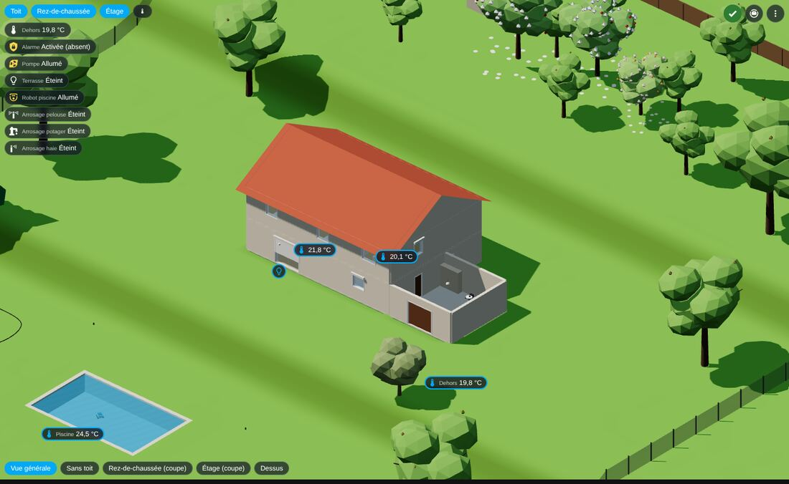
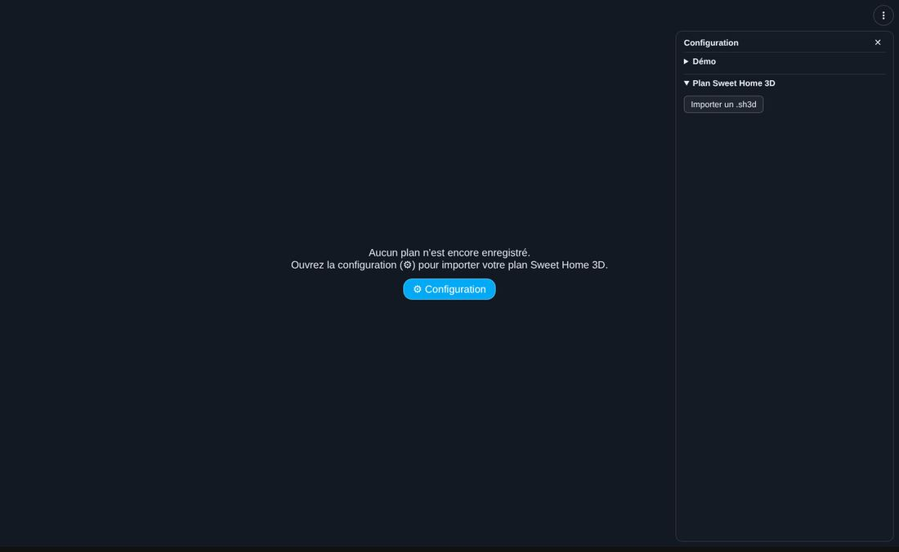
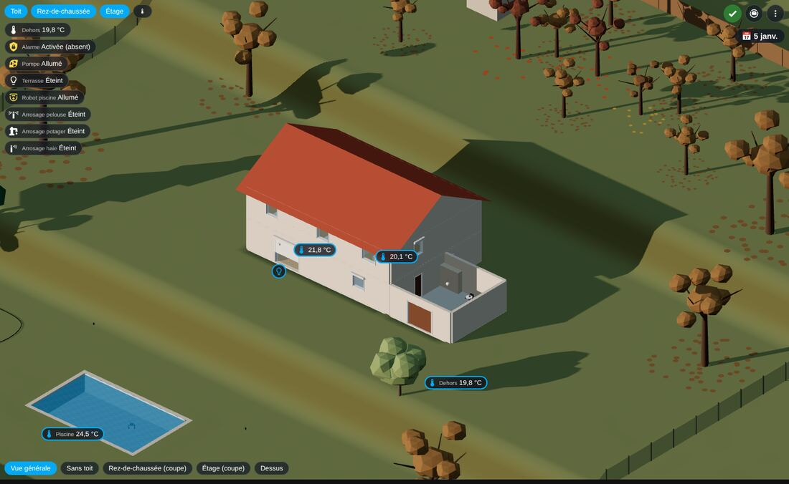
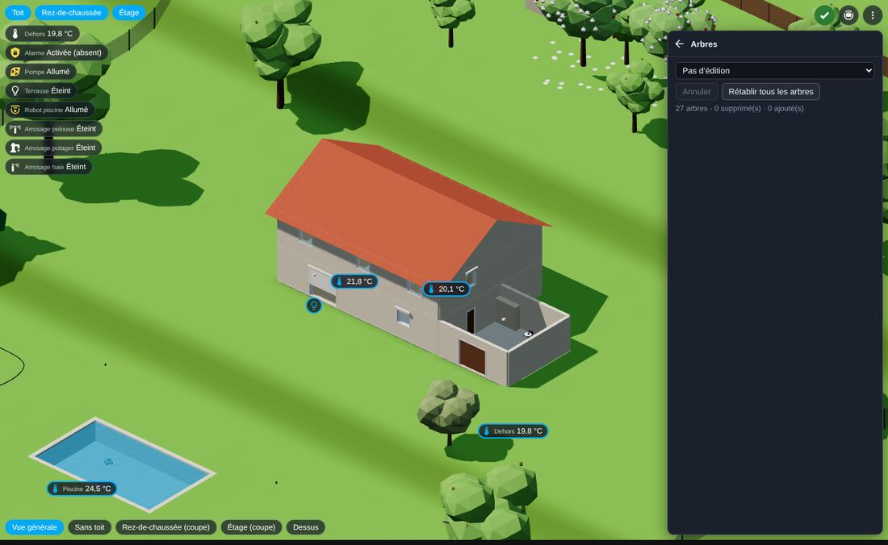

# House View : guide d'installation, de configuration et d'utilisation

House View affiche votre maison en 3D dans Home Assistant : le plan dessiné dans Sweet Home 3D, posé sur le vrai relief du terrain, éclairé par le soleil du moment, avec la météo, les saisons de la végétation, les lumières de chaque pièce et l'état de vos appareils (volets, fenêtres, robot aspirateur, arrosage, piscine, alarmes…).

Toutes les images de ce guide ont été prises sur le **logement de démonstration** fourni avec l'intégration : une maison, un terrain et des entités fictifs.



## Sommaire

1. [Ce qu'il faut](#1-ce-quil-faut)
2. [Installation](#2-installation)
3. [Ajouter la carte à un tableau de bord](#3-ajouter-la-carte-à-un-tableau-de-bord)
4. [Première mise en place : le plan et le terrain](#4-première-mise-en-place--le-plan-et-le-terrain)
5. [Utiliser la vue](#5-utiliser-la-vue)
6. [L'éditeur](#6-léditeur)
7. [La configuration (⚙)](#7-la-configuration-)
8. [Plusieurs logements](#8-plusieurs-logements)
9. [Le mode démo](#9-le-mode-démo)
10. [Options de la carte](#10-options-de-la-carte)
11. [Questions fréquentes](#11-questions-fréquentes)

---

## 1. Ce qu'il faut

- **Home Assistant 2026.3 ou plus récent** (le nettoyage par pièces de l'aspirateur et l'icône de l'intégration en ont besoin ; le reste fonctionne avec des versions plus anciennes).
- **Un plan de la maison**. Le plus complet est un plan **Sweet Home 3D** (`.sh3d`, enregistré avec la version 5.3 ou plus récente) ; un fichier **IFC** (ArchiCAD, Revit, FreeCAD…) ou un plan **SVG** conviennent aussi, et sans aucun fichier la carte en dessine un simple ([4.2](#42-créer-un-plan-simple)). Dans un plan Sweet Home 3D, ce qui compte :
  - un **niveau par étage** (rez-de-chaussée, étage, sous-sol…) ;
  - les **murs** ;
  - les **pièces**, tracées avec l'outil *Créer des pièces*, et **nommées** : le nom sert à les relier aux zones (areas) de Home Assistant ;
  - les **portes et fenêtres** du catalogue (elles découpent les murs et deviennent animables) ;
  - la **boussole** réglée sur votre latitude et le nord (le soleil et les saisons en dépendent) ;
  - facultatif : les meubles, les lumières, les arbres et les objets du jardin (abri, portail, piscine…).
- **Des zones (areas) dans Home Assistant** pour vos pièces, avec vos lumières, capteurs et volets rangés dedans : c'est ce qui permet à la vue de savoir quoi afficher où.

Le terrain (relief, bâtiments voisins, routes, cadastre, photo aérienne) n'est pas à fournir : l'intégration le récupère elle-même (voir [4.4](#44-récupérer-le-terrain)).

## 2. Installation

### 2.1 Installer l'intégration

**Avec HACS** (recommandé) :

1. HACS → menu ⋮ → *Dépôts personnalisés* → ajoutez `https://github.com/elwinmage/ha-house-view-component`, type *Intégration*.
2. Cherchez **House View** dans HACS et installez-le.
3. Redémarrez Home Assistant.

**À la main** : décompressez `house_view.zip` de la dernière version publiée (il contient la carte compilée) dans `config/custom_components/house_view/`, puis redémarrez.

> La carte (le fichier JavaScript) est livrée avec l'intégration et chargée automatiquement sur tous les tableaux de bord : il n'y a **pas de ressource Lovelace à ajouter** à la main.

### 2.2 Ajouter le logement

1. *Paramètres → Appareils et services → Ajouter une intégration →* **House View**.
2. Donnez un **nom** au logement (par exemple « Maison ») et vérifiez sa **position** sur la carte : par défaut c'est celle de Home Assistant. Déplacez le repère sur la maison si besoin : elle sert au soleil, aux saisons et au téléchargement du terrain.
3. Validez.

Chaque logement est une entrée de l'intégration ; pour une deuxième maison, voir [Plusieurs logements](#8-plusieurs-logements).

## 3. Ajouter la carte à un tableau de bord

1. Ouvrez un tableau de bord, passez en mode édition, *Ajouter une carte*, puis cherchez **House View**.
2. Les options se règlent dans l'éditeur visuel de la carte (voir [Options de la carte](#10-options-de-la-carte)). Au départ, seule l'entité météo est utile.

En YAML, le minimum est :

```yaml
type: custom:house-view-card
weather_entity: weather.maison
```

**Pour l'avoir en grand**, placez la carte dans une vue de type **Sections** et réglez-la en **pleine largeur** : dans l'éditeur de la carte, onglet *Disposition*, activez *Pleine largeur*. Avec l'option `height: fill` (par défaut), elle prend alors toute la largeur et la hauteur disponibles. Une vue de type *Panneau* (une seule carte) donne aussi le plein écran.

Tant qu'aucun plan n'est importé, la carte affiche un message et un bouton **⚙ Configuration** (visible des administrateurs seulement).


## 4. Première mise en place : le plan et le terrain

Ouvrez ⚙ **Configuration** (bouton de la carte vide, ou menu **⋮ → Configuration**).



### 4.1 Importer le plan

Dans **Plan de la maison**, cliquez *Importer un plan* et choisissez votre fichier : Sweet Home 3D (`.sh3d`), IFC (`.ifc`) ou SVG (`.svg`). Le plan est lu dans le navigateur (seule la structure est gardée : niveaux, murs, pièces, ouvertures, lumières, meubles, végétation) et un **rapport** liste ce qui a été trouvé, avec d'éventuelles remarques (niveau sans pièce, boussole non réglée…).


La maison apparaît aussitôt sur un sol plat. Les meubles sont dessinés avec leurs **propres modèles 3D**, ceux du fichier Sweet Home 3D (allégés, une couleur par matériau, la couleur moyenne d'une texture) ; la case *Meubles dessinés avec leurs modèles 3D du plan* revient à des formes simples. Un meuble au modèle dans un autre format qu'OBJ reste une boîte, ou l'objet du catalogue qui porte son nom.

> **Conseil** : si une pièce n'a pas de zone Home Assistant du même nom, la configuration la signale. Vous pourrez la relier à la main dans l'éditeur ([6.5](#65-pièces--zones-home-assistant)).

**Les formats** :

- **Sweet Home 3D** : niveaux, murs, pièces, portes et fenêtres, lumières, meubles et végétation.
- **IFC** (exporté par ArchiCAD, Revit, FreeCAD, BlenderBIM…) : les étages deviennent des niveaux et les espaces (`IfcSpace`) des pièces, avec les murs, les portes et les fenêtres. Pensez à exporter les espaces : sans eux, pas de pièces, donc ni lumières ni lien avec les zones.
- **SVG** (plan dessiné pour ha-floorplan, ou avec Inkscape) : chaque forme fermée qui porte un nom (son id, son libellé Inkscape ou un `<title>`) est une pièce ; l'id `area.sejour` donne « Sejour ». Les calques Inkscape qui contiennent des pièces deviennent des niveaux. Corrigez l'**échelle** (*Échelle : unités SVG par mètre*) si la taille annoncée ne correspond pas. Un SVG fait de rectangles s'ouvre dans le plan simple, pour y ajouter portes et fenêtres.

Avec un plan IFC, SVG ou simple, chaque pièce reçoit un plafonnier allumé par les lumières de sa zone.

### 4.2 Créer un plan simple

Pas de plan ? *Créer un plan simple* (dans **Plan de la maison**) ouvre un éditeur de pièces rectangulaires ; la vue 3D se met à jour derrière.


- **Pièces** : *＋ Pièce* en ajoute une à côté de la précédente, nommée d'après une zone Home Assistant pas encore utilisée. Glissez une pièce pour la déplacer et ses poignées pour la redimensionner : les bords se collent aux pièces voisines, qui partagent alors leur mur. Les champs de la pièce sélectionnée règlent son nom, sa **zone HA**, sa largeur, sa profondeur et sa position.
- **Portes et fenêtres** : choisissez *＋ Fenêtre*, *＋ Baie vitrée* ou *＋ Porte*, puis cliquez sur le mur de la pièce où la placer. Faites-la glisser le long du mur, et réglez sa largeur, sa hauteur et son allège.
- **Niveaux** : *＋ Niveau* ajoute un étage qui reprend le contour des pièces du dessous, à renommer et à redécouper ; la hauteur sous plafond se règle par niveau. Le contour du niveau du dessous reste affiché en pointillés.
- **Toit et orientation** : toit automatique, à deux pans ou plat ; angle du nord (le calage sur le terrain le corrige ensuite).

Le plan s'enregistre tout seul et se rouvre avec *Modifier le plan simple*. Un plan simple remplace un plan importé, après confirmation ; les entités placées, l'arrosage, les clôtures… sont gardés.

### 4.3 Partir de la carte du robot

Si un robot aspirateur a cartographié la maison et qu'un extracteur de carte (Xiaomi Cloud Map Extractor, Roborock Custom Map…) donne ses pièces (attribut `rooms`), le bouton *Plan depuis la carte du robot* crée un plan simple avec ces pièces, à leur taille et à leur place. Ce sont des rectangles approximatifs, et seulement ceux du niveau du robot : ajustez-les, puis ajoutez portes, fenêtres et autres niveaux dans le plan simple.

### 4.4 Récupérer le terrain

Dans **Terrain (MNT)** :

1. **Source** : *Automatique* choisit les services de l'IGN en France, les données ouvertes mondiales ailleurs (Mapterhorn pour le relief, OpenStreetMap pour les bâtiments et les routes).
2. **Latitude / longitude** : reprises de la position du logement, c'est-à-dire de la configuration de Home Assistant (*Paramètres → Système → Général*) sauf si vous l'avez changée à l'ajout du logement. Vous pouvez les modifier ici.
3. **Taille** du terrain autour de la maison (120 m par défaut).
4. Options (France) : modèle de surface (arbres et calage automatique), bâtiments, routes et cadastre, photo aérienne ou plan IGN plaqué au sol ; recalage sur le bâtiment le plus proche (la position de Home Assistant est souvent approximative).
5. Cliquez **Récupérer le terrain**. Les étapes s'affichent sous le formulaire (localisation, relief, surface, bâtiments et routes, photo).


À la fin, le plan est **calé automatiquement** sur le terrain (rotation, décalage, hauteur), les arbres détectés sont plantés, et le relief, les routes et la photo apparaissent.

Vous pouvez aussi charger un fichier de terrain `.json` (*Charger un terrain .json*) ou retoucher le calage à la main (rotation, décalage, hauteur) dans la même section.

## 5. Utiliser la vue


### 5.1 Se déplacer

- **Glisser** pour tourner, **molette ou pincement** pour zoomer, **clic droit / deux doigts** pour déplacer.
- Les **vues** en bas (Vue générale, Sans toit, Rez-de-chaussée (coupe), Étage (coupe), Dessus) replacent la caméra. Vous pouvez enregistrer les vôtres dans l'éditeur ([6.11](#611-arbres-objets-extérieurs-et-corrections-du-sol)).
- Les **niveaux** en haut à gauche (Toit, Rez-de-chaussée, Étage) affichent ou masquent le toit et chaque étage ; 🌡 colore les pièces selon leur température.


| Coupe du rez-de-chaussée | Vue de dessus |
|---|---|
|  |  |

### 5.2 Les pièces

- Un **clic sur une pièce** zoome dessus (le toit et les étages au-dessus disparaissent). Un **deuxième clic** allume ou éteint ses lumières. Le bouton **← Pièce** revient à la vue d'avant.
- En zoom sur une pièce, seules **les entités de cette pièce** s'affichent (celles de la vue générale disparaissent) ; le robot aspirateur reste visible s'il est là.


### 5.3 La colonne de gauche : le panneau général

Sous les niveaux, le **panneau général** regroupe les capteurs et commandes de toute la maison (température extérieure, alarme, pompe, arrosage…). Un clic bascule ce qui peut l'être et ouvre la fiche des autres.

### 5.4 La barre et le menu ⋮

En haut à droite :

- le **badge d'alarme** : vert quand tout va bien, rouge avec le nombre d'alarmes levées ;
- un bouton par **robot aspirateur** ;
- le menu **⋮**, qui regroupe les outils occasionnels et l'administration.


| Entrée | Rôle |
|---|---|
| Aperçu | Forcer une saison, une météo ou un moment de la journée |
| Simuler une année | Faire défiler les saisons d'une année en quelques secondes |
| Bloquer la caméra | Figer la caméra sur les vues (écran mural) |
| Simulation | Réglages du mode simulation (si la carte est en mode simulation) |
| Démo | Panneau du logement de démonstration |
| Éditeur ✎ | Placer les entités, l'arrosage, les clôtures… (administrateurs) |
| Configuration ⚙ | Plan, terrain, sauvegarde, protection (administrateurs) |

Les outils que vous utilisez souvent peuvent rester dans la barre (option *Boutons dans la barre*), et le menu peut être masqué aux non-administrateurs (option *Masquer le menu*).

### 5.5 Les alarmes

Les capteurs de fumée, gaz, monoxyde de carbone, fuite d'eau, problème, chaleur, froid, sabotage et les alarmes déclenchées sont détectés tout seuls. Quand une alarme se lève, le badge devient rouge et la **pièce concernée** affiche une cloche rouge avec le nombre d'alarmes. Un clic ouvre la liste ; un clic sur une alarme ouvre sa fiche ; la cloche barrée l'ignore.


### 5.6 Météo, soleil et saisons

- Le **soleil** suit l'heure et la date du logement ; les **ombres** tournent dans la journée.
- La **météo** vient de l'entité météo (pluie, neige, orage, brouillard, nuages, vent). Un pluviomètre ou des capteurs de vent personnels peuvent la corriger (voir les options).
- La **végétation** et l'**herbe** suivent les saisons du climat de la latitude : quatre saisons en zone tempérée, hiver long et été court vers les pôles, saison des pluies et saison sèche entre les tropiques. Tout s'inverse dans l'hémisphère sud.
- **Aperçu** (menu ⋮) : forcez une saison, une météo ou un moment, combinables ; retour au direct avec *Aperçu… ✕* ou au bout de 3 minutes.

| Aperçu : hiver sous la neige | Simuler une année : l'automne |
|---|---|
|  |  |

**Simuler une année** fait défiler une année entière (10 s par défaut, de 5 à 60 s) à partir de la date affichée ; une pastille indique la date. À la fin, la vue revient à la date d'avant.

### 5.7 Lumières, volets et fenêtres

Les lumières de chaque pièce éclairent la pièce et ses fenêtres. Les **volets roulants** descendent jusqu'à leur position réelle, les **fenêtres** s'ouvrent, les **baies** coulissent, les **portes** pivotent.


### 5.8 Le robot aspirateur

Un clic sur le bouton du robot ouvre la sélection des pièces : choisissez-les sur le plan puis *Nettoyer* (ainsi que *Démarrer*, *Pause*, *Base*). Pendant le nettoyage, un robot 3D se déplace, la pièce en cours est colorée avec son pourcentage, les pièces à venir sont teintées, une pièce terminée scintille, et une jauge autour du bouton donne l'avancement global. En cas d'erreur, la pièce et le robot clignotent en rouge.


### 5.9 Arrosage, piscine et étang

Quand une vanne s'ouvre, les **goutte-à-goutte** s'allument en bleu et une tache humide grandit ; les **arroseurs** montrent leur jet et leur secteur. Le robot de piscine parcourt le fond tant que son entité est active ; l'eau bouge.

| Arroseurs à l'aube | Piscine et étang |
|---|---|
|  |  |

## 6. L'éditeur

Réservé aux administrateurs : menu **⋮ → Éditeur**. L'éditeur est un **menu de sections**. Une section s'ouvre dans sa propre fenêtre, par-dessus le menu ; un élément d'une liste (une ligne d'arrosage, une zone, une entité…) s'ouvre par-dessus la section. La flèche **←** revient à la fenêtre du dessous. Tout est enregistré automatiquement ; **Échap** annule le tracé en cours.


### 6.1 Entités placées

Pour poser une entité dans la vue (température, lumière, interrupteur, volet…) :

1. *Ajouter une entité* : la liste propose d'abord les entités de la pièce courante, groupées par appareil (toute la maison en un clic, avec une recherche).
2. Cliquez à l'endroit voulu dans la vue. L'étiquette se **déplace ensuite en la glissant** (éditeur ouvert).
3. Réglez-la : **Fixation** (au sol, sur un mur, libre en hauteur), **Affichage** (pastille avec la valeur, ou icône seule), libellé, icône, couleur, action au clic (fiche, bascule, rien).

Les entités sont rangées en **couches** :

- **Vue générale** : affichées dans la vue générale (ou seulement sur la vue de leur étage). La case *Visible par-dessus le toit* permet de lire de loin, par exemple, la température d'une pièce.
- **Pièce** : affichées seulement en zoom sur leur pièce.


Pour éditer **les entités d'une pièce**, cliquez la pièce dans la vue, éditeur ouvert : elle passe en zoom et un **bandeau rouge** indique que l'édition est celle de la pièce. Les entités ajoutées alors n'appartiennent qu'à cette pièce ; placez-les sur le sol, sur un mur ou en l'air.


> Une entité de la vue générale déjà posée dans une pièce passe dans cette pièce avec le réglage *Portée → Sa pièce seulement*.

Une **lumière** placée devient une vraie source de lumière à cet endroit (spot, suspension, lampe, ruban ou invisible ; hauteur et portée réglables ; sur un mur : une applique).

### 6.2 Panneau général

Les capteurs et commandes de la colonne de gauche, dans l'ordre voulu, avec leur libellé, leur icône et l'action au clic (automatique, bascule, fiche, rien).


### 6.3 Alarmes

Détection automatique activée ou non, cloches dans les pièces, entités ajoutées à la main, entités ignorées.


### 6.4 Zones cliquables

Un **lecteur multimédia** posé sur un meuble du plan (cliquez-le) ou sur un rectangle collé à un mur ou au sol ; un **aquarium** de l'intégration [reeftank](https://github.com/Elwinmage/ha-reeftank-component) sur un rectangle à la taille de la cuve. Un clic ouvre le lecteur, ou la vue de l'aquarium de la carte [ha-reef-card](https://github.com/Elwinmage/ha-reef-card) ; le rectangle d'un aquarium montre cette vue en direct, poissons compris, sans jamais être déformé. Pendant le placement, la surface visée s'allume ; une zone se déplace en la glissant.


### 6.5 Pièces ↔ zones Home Assistant

Chaque pièce du plan est reliée à la zone Home Assistant **du même nom** (accents et majuscules ignorés). Cette section permet de choisir une autre zone, ou aucune, pièce par pièce.


### 6.6 Portes et fenêtres

Les ouvertures du plan, par niveau et par pièce ; **Choisir sur la vue** permet de cliquer directement une fenêtre (elle s'allume au survol). Chacune peut être liée à :

- un **capteur ouvert / fermé** (`binary_sensor`) ;
- un **ouvrant motorisé** (`cover` de la fenêtre) ;
- un **volet roulant** (`cover`), pour les fenêtres et baies.

Une pièce qui n'a **qu'une fenêtre** est liée toute seule au capteur de fenêtre, à l'ouvrant et au volet de sa zone (quand il y en a un de chaque) ; une pièce qui n'a qu'une porte, à son capteur de porte. Un lien choisi à la main l'emporte ; un lien automatique peut être retiré.


### 6.7 Piscines et étangs

*＋ Piscine* ou *＋ Étang*, puis dessinez le contour vu de dessus : **Rectangle** (deux coins opposés) ou **Forme libre** (point par point, puis *Terminer*). Réglez le nom, la couleur de l'eau, la profondeur (0,2 à 6 m) et, si vous en avez un, le **robot nettoyeur** (`binary_sensor`, `switch`, `input_boolean` ou `vacuum`). Le terrain est creusé : parois verticales, fond plat et margelle pour une piscine ; fond en pente et berge de galets pour un étang.


> La piscine éventuellement dessinée dans Sweet Home 3D est gardée telle quelle.

**Îles** (étang) : *＋ Île (Rectangle)* ou *＋ Île (Forme libre)*, puis dessinez-la dans l'eau comme le contour. Le sol y est gardé, un peu au-dessus de l'eau, avec une berge de galets : on peut y planter un arbre (section **Arbres**) ou y poser des entités.

**Poissons** (étang) : les poissons viennent du catalogue de la maison (la carpe koï pour commencer). Ajoutez un **groupe** par variété, avec son nombre et sa taille : pour 3 carpes rouges, 1 rouge et blanche et 2 jaunes, faites trois groupes (Benigoi × 3, Kohaku × 1, Yamabuki ogon × 2). *Couleurs personnalisées* permet de choisir la couleur du corps, celle des taches, le motif (uni, grandes taches, taches moyennes, petites taches) et des écailles brillantes. Chaque poisson a sa propre robe, toujours la même ; il se promène dans l'eau en évitant les berges et les îles, prend la couleur de l'eau quand il descend, et reste au fond, presque immobile, quand il fait froid (moins de 8 °C).


### 6.8 Robot aspirateur

Pour chaque robot (liste *Robot*) :

- **Placer la base** puis cliquer le sol ; régler sa **direction** (ou *Viser d'un clic*) ;
- **Position du robot** : Roborock (action officielle), attributs d'une entité (extracteurs de carte), ou aucune (trajet estimé) ;
- **Calibrage** : rotation, miroir, échelle ; *Calibrer d'un clic* quand le robot est sorti de sa base ;
- **Carte du robot** posée sur le plan pour l'aligner : avec un extracteur de carte (points de calibration) elle se place seule ; avec l'intégration Roborock officielle, indiquez la base d'un clic (*La base est ici sur la carte*) ;
- couleurs du robot et de la pièce en cours, *Afficher ce robot*, *Tester l'animation*.


### 6.9 Arrosage

- **Goutte-à-goutte** : une ligne par vanne (`switch`, `valve`, `input_boolean`), tracée point par point, avec la couleur du tuyau, le débit et l'espacement des goutteurs.
- **Arroseurs** : un circuit par vanne, avec un ou plusieurs arroseurs du catalogue (Hunter PSU, SRM, PGJ, PGP, MP Rotator ou générique), leur portée, leur direction et leur angle (*Viser* d'un clic).
- Une même vanne peut commander **plusieurs lignes ou circuits** : choisissez la même entité pour chacun, ils s'allument ensemble.
- **Tester l'animation** : 30 s d'arrosage accéléré sans ouvrir de vanne.


### 6.10 Clôtures

*Clôturer d'après le cadastre* (les parcelles de la maison sont présélectionnées ; **en France seulement**, le cadastre venant des services de l'IGN : ailleurs, tracez la clôture à la main) ou *Tracer une clôture* point par point. Chaque côté a son type (grillage, bois, mur, haie, ou ouvert pour un portail) et sa hauteur ; *Modifier les côtés* change un côté, le coupe en deux ou retire un point.


### 6.11 Arbres, objets extérieurs et corrections du sol

- **Arbres** : supprimer ceux détectés à tort, en planter (espèce du catalogue et hauteur), annuler, tout rétablir.
- **Objets extérieurs** (abri, portail…) : masquer, hauteur, décalage, rotation.
- **Corrections du sol** : muret, terrasse, pinceaux (monter, creuser, lisser), coupe du terrain.
- **Vues** : enregistrer la caméra courante comme une vue, renommer, supprimer.



### 6.12 Le catalogue des arbres et des objets

Les espèces d'arbres (avec leur aspect à chaque saison), les objets du jardin ou les meubles dessinés à la place des simples boîtes, et les poissons des étangs viennent du [catalogue de la maison](https://github.com/Elwinmage/house-catalog). L'intégration le met à jour toute seule depuis GitHub (appareil *House view catalog* : une entité de mise à jour par section, un interrupteur *Mise à jour automatique*, un bouton *Mettre à jour*) et fonctionne hors ligne avec la copie qu'elle embarque.

Pour créer **votre propre arbre ou objet**, utilisez l'[éditeur de catalogue](https://github.com/Elwinmage/catalog-editor) : une carte Home Assistant où l'on règle la forme, les couleurs et les saisons en voyant le résultat. Ce que vous enregistrez est utilisé tout de suite par la vue, et vous pouvez ensuite le proposer au catalogue commun (une demande de fusion sur GitHub), pour que tout le monde en profite.

## 7. La configuration (⚙)


- **Démo** : voir [Le mode démo](#9-le-mode-démo).
- **Plan** et **Terrain** : voir [la mise en place](#4-première-mise-en-place--le-plan-et-le-terrain).
- **Sauvegarde GitHub** : réglez un dépôt **privé** dans les options de l'intégration (*Paramètres → Appareils et services → House View → Configurer → Sauvegarde GitHub* : dépôt `propriétaire/nom`, jeton *fine-grained* avec *Contents : read and write*, branche, dossier), puis *Sauvegarder sur GitHub* / *Restaurer depuis GitHub*. Un dépôt public est refusé : il contiendrait le plan de votre maison.
- **Protection de l'édition** : un mot de passe peut être demandé avant d'ouvrir l'éditeur et la configuration (options de l'intégration → *Protection de l'édition*). La carte le redemande après 10 minutes sans modification ; le bouton 🔒 reverrouille tout de suite. Regarder la vue, zoomer, commander les lumières ou l'aspirateur restent libres.
- **Fichier d'éditions** : exporter ou importer toutes vos éditions (entités, arrosage, clôtures…) dans un fichier JSON.

## 8. Plusieurs logements

Une maison de vacances, un chalet… Chaque logement est une **entrée** de l'intégration, avec son propre plan, son terrain et ses éditions.

1. *Paramètres → Appareils et services → House View → Ajouter une entrée*.
2. Donnez-lui un nom (différent des autres) et sa position.
3. Dans la carte (éditeur visuel), choisissez le **Logement** affiché : la liste apparaît dès qu'il y en a deux. En YAML : `home: <id de l'entrée>`.
4. Importez son plan et récupérez son terrain comme au [chapitre 4](#4-première-mise-en-place--le-plan-et-le-terrain).

Supprimer une entrée supprime ses documents ; les autres logements ne sont pas touchés.

## 9. Le mode démo

Pour filmer ou présenter la vue **sans montrer votre maison ni votre emplacement**.

1. ⚙ → **Démo** → *Charger la démo* : un logement « Démo » est ajouté, avec un emplacement fictif (45° N) ; vos logements ne sont pas touchés. Il démarre **vide et plat**, pour être filmé depuis le début.

   

2. Importez `demo-maison.sh3d` (*Télécharger demo-maison.sh3d* dans ⚙) avec *Importer un plan*.
3. *Récupérer le terrain* : la récupération passe par ses étapes et apporte un terrain fictif en trois plateaux (verger, maison, jardin avec piscine et étang), sans aucun accès réseau.

Les entités de la démo sont **simulées par la carte** : rien n'est créé dans Home Assistant et rien de votre maison n'apparaît. Un **scénario de la journée** (1 h toutes les 2 s) fait vivre la maison : volets ouverts le matin, arrosage à l'aube, aspirateur dans la matinée, robot de piscine l'après-midi, fenêtres aérées, fuite d'eau avant le dîner, lumières et volets fermés le soir.

Le bouton **🎬 Démo** (menu ⋮) met le scénario en pause, règle l'heure et déclenche un événement à la main (volets, lumières, aspirateur, arrosage, robot de piscine, fuite, fumée). Un clic sur une entité simulée la bascule ; ce changement tient jusqu'au prochain mouvement du scénario.


*Remettre la démo à zéro* la remet comme livrée ; *Quitter la démo* revient à votre logement. Le logement Démo se supprime comme une autre entrée de l'intégration.

## 10. Options de la carte

Elles se règlent dans l'éditeur visuel de la carte (mode édition du tableau de bord → *Modifier* sur la carte), en sections.

| Option | Rôle | Défaut |
|---|---|---|
| `home` | Logement affiché (plusieurs logements) | le premier |
| `mode` | `live` (temps réel) ou `simulation` (curseurs d'heure, de date, de météo) | `live` |
| `weather_entity` | Entité météo | — |
| `rain_entity` | Détecteur de pluie ou capteur de pluviométrie (mm/h) | — |
| `wind_speed_entity`, `wind_bearing_entity` | Capteurs de vent personnels | — |
| `view` | Vue de départ (son nom) | — |
| `show_views`, `show_levels` | Boutons des vues, des niveaux | oui |
| `show_entities` | Entités placées | oui |
| `show_alarms` | Badge d'alarme | oui |
| `tap_action` | Clic sur une pièce : `zoom`, `toggle_lights`, `none` | `zoom` |
| `movable_camera` | Caméra mobile | oui |
| `height`, `min_height` | Hauteur de la carte (`fill`, `aspect`, en px ou en `vh`) | `fill`, 320 |
| `fps_cap` | Images par seconde maximum (tablette murale) | 30 |
| `year_seconds` | Durée de « Simuler une année » (5 à 60 s) | 10 |
| `toolbar_buttons` | Outils gardés dans la barre (`preview`, `year`, `camera`, `sim`, `edit`, `setup`) | aucun |
| `hide_menu` | Masquer le menu ⋮ aux non-administrateurs | non |
| `light_entities` | Restreindre les lumières prises en compte | toutes |
| `vacuum_entity`, `vacuum_poll`, `vacuum_rate`, `vacuum_show_floor`, `vacuum_progress_entity` | Robot aspirateur | — |

En mode **simulation**, le panneau *Simulation* (menu ⋮) règle l'heure (avec défilement), la date, la météo, les nuages, la pluie, le vent, la température et la neige.


## 11. Questions fréquentes

**Une pièce reste sombre, ses lumières ne s'affichent pas.**
Vérifiez qu'elle est reliée à une zone Home Assistant ([6.5](#65-pièces--zones-home-assistant)) et que ses lumières sont rangées dans cette zone.

**Le soleil ou les saisons ne correspondent pas.**
La boussole du plan Sweet Home 3D doit être réglée (latitude et nord), et la position du logement doit être la bonne (options de l'entrée House View).

**La maison flotte ou s'enfonce dans le terrain.**
Retouchez la hauteur dans ⚙ → *Terrain*, ou relancez le calage automatique.

**Une étiquette n'apparaît pas.**
Une étiquette cachée par le toit ou un étage n'est pas affichée (sauf avec *Visible par-dessus le toit*), et une étiquette de pièce n'apparaît qu'en zoom sur sa pièce. Éditeur ouvert sur *Entités placées*, toutes les étiquettes de la couche s'affichent (estompées quand elles sont cachées).

**La carte du robot n'est pas alignée.**
Avec l'intégration Roborock officielle, indiquez la base sur la carte d'un clic, puis réglez la rotation. Avec un extracteur de carte (Roborock Custom Map, Xiaomi Cloud Map Extractor), choisissez son entité : la carte se place seule.

**Il n'y a pas de photo aérienne au sol.**
Dans ⚙ → *Terrain*, vérifiez que *Photo aérienne au sol* est cochée. Si la récupération indique « ground texture unavailable », la raison donnée entre parenthèses vient du service de l'IGN ; relancez la récupération plus tard.

**Je veux montrer la vue sans montrer ma maison.**
Utilisez le [mode démo](#9-le-mode-démo).
