# House View: guida all'installazione, alla configurazione e all'uso

House View mostra la vostra casa in 3D in Home Assistant. La pianta disegnata in Sweet Home 3D poggia sul rilievo reale del terreno ed è illuminata dal sole del momento. La vista mostra anche il meteo, le stagioni della vegetazione, le luci di ogni stanza e lo stato dei vostri dispositivi (tapparelle, finestre, robot aspirapolvere, irrigazione, piscina, allarmi…).

Tutte le immagini di questa guida sono state prese sull'**abitazione dimostrativa** fornita con l'integrazione: una casa, un terreno e delle entità fittizi. Mostrano l'interfaccia francese della scheda. La scheda esiste in francese e in inglese: i testi della scheda citati qui sotto sono quelli dell'interfaccia inglese; quelli di Home Assistant, in italiano.


## Indice

1. [Cosa serve](#1-cosa-serve)
2. [Installazione](#2-installazione)
3. [Aggiungere la scheda a una plancia](#3-aggiungere-la-scheda-a-una-plancia)
4. [Prima messa in opera: la pianta e il terreno](#4-prima-messa-in-opera-la-pianta-e-il-terreno)
5. [Usare la vista](#5-usare-la-vista)
6. [L'editor](#6-leditor)
7. [La configurazione (⚙)](#7-la-configurazione-)
8. [Più abitazioni](#8-più-abitazioni)
9. [La modalità demo](#9-la-modalità-demo)
10. [Opzioni della scheda](#10-opzioni-della-scheda)
11. [Domande frequenti](#11-domande-frequenti)

---

## 1. Cosa serve

- **Home Assistant 2026.3 o successivo**. La pulizia per stanze e l'icona dell'integrazione ne hanno bisogno; il resto funziona anche con versioni precedenti.
- **Una pianta della casa**. La più completa è una pianta di **Sweet Home 3D** (`.sh3d`, salvata con la versione 5.3 o successiva); vanno bene anche un file **IFC** (ArchiCAD, Revit, FreeCAD…) o una pianta **SVG**, e senza alcun file la scheda ne disegna una semplice ([4.2](#42-creare-una-pianta-semplice)). In una pianta di Sweet Home 3D, quello che conta:
  - un **livello per piano** (piano terra, primo piano, cantina…);
  - i **muri**;
  - le **stanze**, disegnate con lo strumento *Crea stanze* e **con un nome**: il nome serve a collegarle alle aree di Home Assistant;
  - le **porte e finestre** del catalogo (ritagliano i muri e possono essere animate);
  - la **bussola** regolata sulla vostra latitudine e sul nord (il sole e le stagioni ne dipendono);
  - facoltativo: mobili, luci, alberi e oggetti del giardino (casetta, cancello, piscina…).
- **Delle aree in Home Assistant** per le vostre stanze, con luci, sensori e tapparelle assegnati: è così che la vista sa cosa mostrare e dove.

Il terreno (rilievo, edifici vicini, strade, catasto, foto aerea) non va fornito: l'integrazione lo scarica da sola (vedi [4.4](#44-scaricare-il-terreno)).

## 2. Installazione

### 2.1 Installare l'integrazione

**Dal Marketplace** (consigliato): House View è nel suo catalogo, non c'è nessun repository da aggiungere.

1. Aprite il repository nel Marketplace con questo pulsante: [](https://my.home-assistant.io/redirect/hacs_repository/?owner=Elwinmage&repository=ha-house-view-component&category=integration), oppure cercate **House View** in *Impostazioni → Marketplace*.
2. Fate clic su «Installa».

Su un Home Assistant precedente a 2026.11, gli stessi passaggi funzionano in HACS; riavviate poi Home Assistant.

**A mano**: estraete `house_view.zip` dell'ultima versione pubblicata (contiene la scheda compilata) in `config/custom_components/house_view/`, poi riavviate.

> La scheda (il file JavaScript) arriva con l'integrazione e viene caricata da sola su tutte le plance: **non c'è nessuna risorsa Lovelace da aggiungere** a mano.

### 2.2 Aggiungere l'abitazione

1. *Impostazioni → Dispositivi e servizi → Aggiungi integrazione →* **House View**.
2. Date un **nome** all'abitazione (per esempio «Casa») e controllate la sua **posizione** sulla mappa: per impostazione predefinita è quella di Home Assistant. Spostate il segnaposto sulla casa se serve: è usata per il sole, le stagioni e lo scaricamento del terreno.
3. Confermate.

Ogni abitazione è una voce dell'integrazione; per una seconda casa, vedi [Più abitazioni](#8-più-abitazioni).

## 3. Aggiungere la scheda a una plancia

1. Aprite una plancia, passate in modalità modifica, *Aggiungi scheda*, poi cercate **House View**.
2. Le opzioni si regolano nell'editor visuale della scheda (vedi [Opzioni della scheda](#10-opzioni-della-scheda)). All'inizio è utile solo l'entità meteo.

In YAML, il minimo è:

```yaml
type: custom:house-view-card
weather_entity: weather.casa
```

**Per averla in grande**, mettete la scheda in una vista di tipo **Sezioni** e impostatela a **larghezza piena**: nell'editor della scheda, scheda *Layout*, attivate la larghezza piena. Con l'opzione `height: fill` (predefinita), occupa allora tutta la larghezza e l'altezza disponibili. Anche una vista di tipo *Pannello* (una sola scheda) dà lo schermo intero.

Finché nessuna pianta è importata, la scheda mostra un messaggio e un pulsante **⚙ Setup** (visibile solo agli amministratori).


## 4. Prima messa in opera: la pianta e il terreno

Aprite ⚙ **Setup** (pulsante della scheda vuota, oppure **menu ⋮ → Setup**).


### 4.1 Importare la pianta

In **Plan of the house**, cliccate *Import a plan* e scegliete il vostro file: Sweet Home 3D (`.sh3d`), IFC (`.ifc`) o SVG (`.svg`). La pianta viene letta nel browser (si tiene solo la struttura: livelli, muri, stanze, aperture, luci, mobili, vegetazione) e un **rapporto** elenca ciò che è stato trovato, con eventuali osservazioni (livello senza stanze, bussola non regolata…).


La casa compare subito su un terreno piatto. I mobili sono disegnati con i loro **modelli 3D**, quelli del file di Sweet Home 3D (alleggeriti, un colore per materiale, il colore medio di una texture); la casella *Furniture drawn with the 3D models of the plan* torna a forme semplici. Un mobile il cui modello è in un formato diverso da OBJ resta una scatola, o l'oggetto del catalogo con il suo nome.

> **Consiglio**: se una stanza non ha un'area di Home Assistant con lo stesso nome, la configurazione lo segnala. Potrete collegarla a mano nell'editor ([6.5](#65-stanze--aree-di-home-assistant)).

**I formati**:

- **Sweet Home 3D**: livelli, muri, stanze, porte e finestre, luci, mobili e vegetazione.
- **IFC** (esportato da ArchiCAD, Revit, FreeCAD, BlenderBIM…): i piani diventano livelli e gli spazi (`IfcSpace`) stanze, con i muri, le porte e le finestre. Ricordate di esportare gli spazi: senza di loro non ci sono stanze, quindi né luci né collegamento con le aree.
- **SVG** (pianta disegnata per ha-floorplan, o con Inkscape): ogni forma chiusa con un nome (il suo id, la sua etichetta Inkscape o un `<title>`) è una stanza; l'id `area.soggiorno` dà «Soggiorno». I livelli di Inkscape che contengono stanze diventano piani. Correggete la **scala** (*Scale: SVG units per meter*) se la dimensione indicata non corrisponde. Un SVG fatto di rettangoli si apre nella pianta semplice, per aggiungere porte e finestre.

Con una pianta IFC, SVG o semplice, ogni stanza riceve una luce a soffitto accesa dalle luci della sua area.

### 4.2 Creare una pianta semplice

Nessuna pianta? *Create a simple plan* (in **Plan of the house**) apre un editor di stanze rettangolari; la vista 3D si aggiorna dietro.


- **Stanze**: *＋ Room* ne aggiunge una accanto alla precedente, con il nome di un'area di Home Assistant non ancora usata. Trascinate una stanza per spostarla e le sue maniglie per ridimensionarla: i bordi si attaccano alle stanze vicine, che condividono allora il muro. I campi della stanza selezionata regolano nome, **area HA**, larghezza, profondità e posizione.
- **Porte e finestre**: scegliete *＋ Window*, *＋ Patio door* o *＋ Door*, poi cliccate sul muro della stanza dove va. Trascinatela lungo il muro e regolate larghezza, altezza e davanzale.
- **Livelli**: *＋ Level* aggiunge un piano che riprende il contorno delle stanze sotto, da rinominare e ridividere; l'altezza si regola per livello. Il contorno del livello sotto resta visibile tratteggiato.
- **Tetto e orientamento**: tetto automatico, a due falde o piano; angolo del nord (l'allineamento sul terreno lo corregge poi).

La pianta si salva da sola e si riapre con *Edit the simple plan*. Una pianta semplice sostituisce una pianta importata, dopo conferma; entità posizionate, irrigazione, recinzioni… vengono mantenute. **Ctrl+Z** e le frecce **↶ ↷** in alto nel pannello annullano e ripetono le modifiche della pianta.

### 4.3 Partire dalla mappa del robot

Se un robot aspirapolvere ha mappato la casa e un estrattore di mappa (Xiaomi Cloud Map Extractor, Roborock Custom Map…) fornisce le sue stanze (attributo `rooms`), il pulsante *Plan from the robot's map* crea una pianta semplice con quelle stanze, nella loro dimensione e posizione. Sono rettangoli approssimativi, e solo quelli del livello del robot: regolateli, poi aggiungete porte, finestre e altri livelli nella pianta semplice.

### 4.4 Scaricare il terreno

Il terreno non va né misurato né disegnato: l'integrazione lo scarica da dati pubblici e gratuiti, rilevati da aerei (laser LiDAR e fotografie aeree dell'IGN in Francia, rilievi LiDAR aperti di molti paesi) o da satelliti (modello mondiale Copernicus a 30 m).

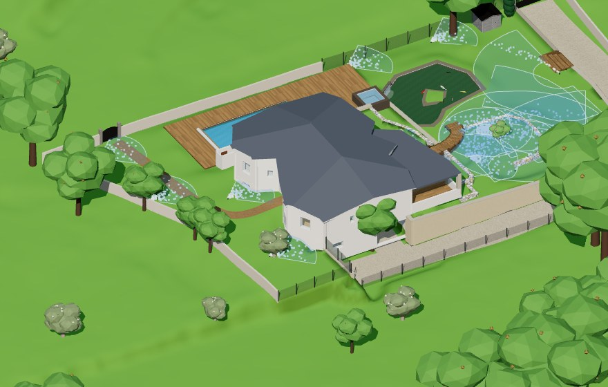

In **Terrain (DTM)**:

1. **Source**: *Automatic (by country)* sceglie i servizi dell'IGN in Francia e i dati aperti mondiali altrove (Mapterhorn per il rilievo, OpenStreetMap per edifici e strade).
2. **Latitudine / longitudine**: riprese dalla posizione dell'abitazione, cioè dalla configurazione di Home Assistant (*Impostazioni → Sistema → Generale*), a meno che non l'abbiate cambiata aggiungendo l'abitazione. Si possono modificare qui.
3. **Size**: dimensione del terreno intorno alla casa (120 m per impostazione predefinita).
4. Opzioni (Francia): modello di superficie (alberi e allineamento automatico), edifici, strade e catasto, foto aerea o mappa IGN sul terreno; allineamento sull'edificio più vicino (la posizione in Home Assistant è spesso approssimativa).
5. Cliccate **Fetch the terrain**. I passaggi compaiono sotto il modulo (localizzazione, rilievo, superficie, edifici e strade, foto).

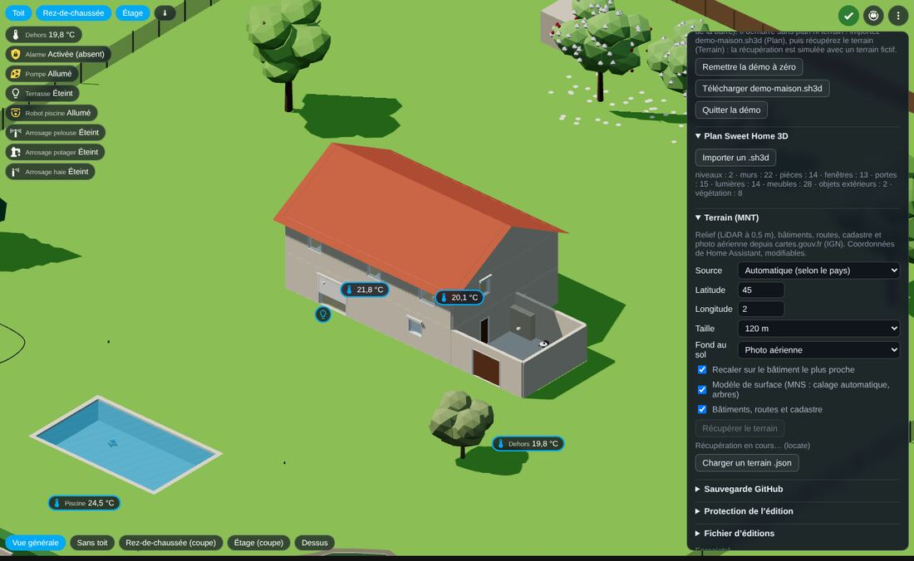

Alla fine, la pianta viene **allineata automaticamente** al terreno (rotazione, spostamento, altezza), gli alberi trovati vengono piantati e compaiono il rilievo, le strade e la foto.

Potete anche caricare un file di terreno (*Load a terrain .json*) o ritoccare l'allineamento a mano (rotazione, spostamento, altezza) nella stessa sezione.

Attorno alla casa, il terreno si ferma alla faccia esterna dei muri e resta sotto i pavimenti, qualunque altezza gli diate: una cantina, o un piano seminterrato in un pendio, mantiene le sue stanze libere dalla terra che si appoggia ai suoi muri. Questo segue le stanze della pianta e i muri che le circondano, piano per piano; quando la cantina occupa solo una parte della casa, il terreno è mantenuto sotto il resto del piano terra.

## 5. Usare la vista


### 5.1 Muoversi

- **Trascinare** per ruotare, **rotella o pizzico** per lo zoom, **clic destro / due dita** per spostare.
- Le **viste** in basso (General view, Without roof, Ground floor (cut), First floor (cut), Top) riposizionano la telecamera. Le vostre si salvano nell'editor ([6.11](#611-alberi-oggetti-esterni-e-correzioni-del-terreno)).
- I **livelli** in alto a sinistra (Roof, Ground floor, First floor) mostrano o nascondono il tetto e ogni piano; 🌡 colora le stanze secondo la loro temperatura.


| Sezione del piano terra | Vista dall'alto |
|---|---|
|  | 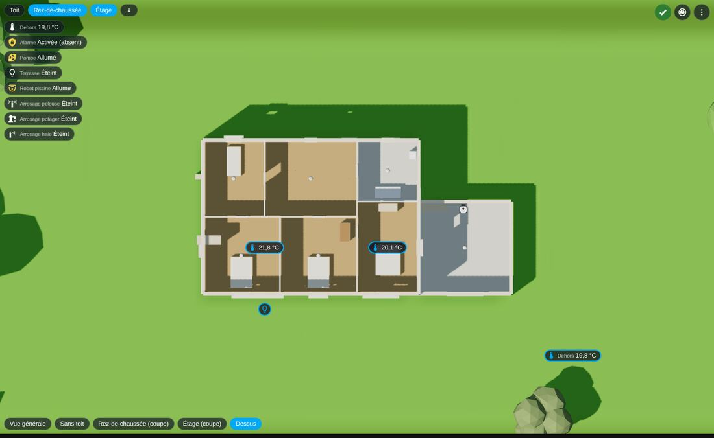 |

### 5.2 Le stanze

- Un **tocco su una stanza** la ingrandisce (il tetto e i piani superiori spariscono). Un **secondo tocco** accende o spegne le sue luci. Il pulsante **← Room** torna alla vista precedente.
- Con lo zoom su una stanza, si vedono solo **le entità di quella stanza** (quelle della vista generale spariscono); il robot aspirapolvere resta visibile se è lì.


### 5.3 La colonna di sinistra: il pannello generale

Sotto i livelli, il **pannello generale** raccoglie i sensori e i comandi di tutta la casa (temperatura esterna, allarme, pompa, irrigazione…). Un tocco commuta ciò che si può commutare e apre la scheda di dettaglio degli altri.

### 5.4 La barra e il menu ⋮

In alto a destra:

- il **distintivo d'allarme**: verde quando va tutto bene, rosso con il numero di allarmi attivi;
- un pulsante per ogni **robot aspirapolvere**;
- il menu **⋮**, che raccoglie gli strumenti occasionali e l'amministrazione.


| Voce | Funzione |
|---|---|
| Preview | Forzare una stagione, un meteo o un momento della giornata |
| Simulate a year | Far scorrere le stagioni di un anno in pochi secondi |
| Lock the camera | Bloccare la telecamera sulle viste (schermo a parete) |
| Simulation | Impostazioni della modalità simulazione (se la scheda è in modalità simulazione) |
| Demo | Pannello dell'abitazione dimostrativa |
| Editor ✎ | Posizionare entità, irrigazione, recinzioni… (amministratori) |
| Setup ⚙ | Pianta, terreno, backup, protezione (amministratori) |

Gli strumenti che usate spesso possono restare nella barra (opzione *Buttons in the toolbar*), e il menu si può nascondere a chi non è amministratore (opzione *Hide the ⋮ menu*).

### 5.5 Gli allarmi

I sensori di fumo, gas, monossido di carbonio, perdita d'acqua, problema, calore, freddo e manomissione, e le centrali d'allarme scattate, vengono rilevati da soli. Quando scatta un allarme, il distintivo diventa rosso e la **stanza interessata** mostra una campana rossa con il numero di allarmi. Un tocco apre l'elenco; un tocco su un allarme apre la sua scheda; la campana barrata lo ignora.


### 5.6 Meteo, sole e stagioni

- Il **sole** segue l'ora e la data dell'abitazione; le **ombre** ruotano nel corso della giornata.
- Il **meteo** viene dall'entità meteo (pioggia, neve, temporale, nebbia, nuvole, vento). Un pluviometro o sensori di vento propri possono correggerlo (vedi le opzioni).
- La **vegetazione** e il **prato** seguono le stagioni del clima della latitudine: quattro stagioni nelle zone temperate, inverno lungo ed estate breve vicino ai poli, stagione delle piogge e stagione secca tra i tropici. Tutto è invertito nell'emisfero sud.
- **Preview** (menu ⋮): forzate una stagione, un meteo o un momento, combinabili; ritorno alla diretta con *Preview… ✕* o dopo 3 minuti.

| Preview: inverno sotto la neve | Simulate a year: l'autunno |
|---|---|
|  |  |

**Simulate a year** fa scorrere un anno intero (10 s per impostazione predefinita, da 5 a 60 s) a partire dalla data mostrata; un'etichetta indica la data. Alla fine, la vista torna alla data di prima.

<p align="center">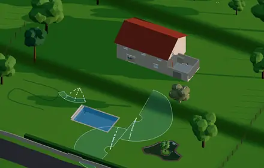 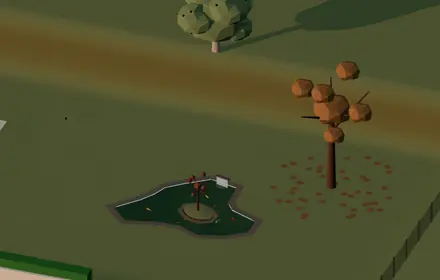 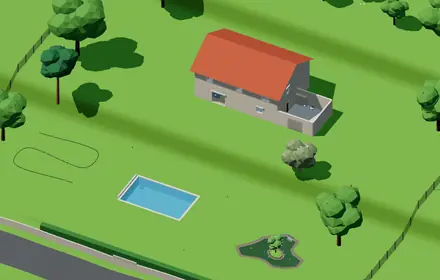</p>

### 5.7 Luci, tapparelle e finestre

Le luci di ogni stanza illuminano la stanza e le sue finestre. Le **tapparelle** scendono fino alla loro posizione reale, le **finestre** si aprono, le **porte scorrevoli** scorrono, le **porte** ruotano.


<p align="center">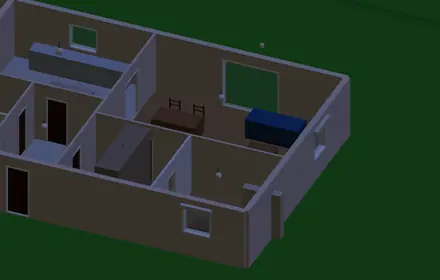 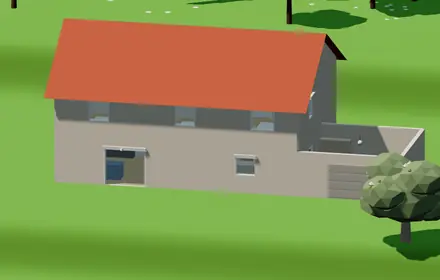 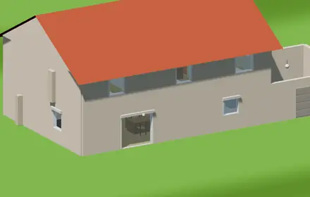</p>

### 5.8 Il robot aspirapolvere

Un tocco sul pulsante del robot apre la selezione delle stanze: sceglietele sulla pianta, poi *Clean* (anche *Start*, *Pause*, *Dock*). Durante la pulizia, un robot 3D si sposta, la stanza in corso è colorata con la sua percentuale, le stanze ancora da fare sono tinte, una stanza finita scintilla e un anello intorno al pulsante dà l'avanzamento globale. In caso di errore, la stanza e il robot lampeggiano in rosso.


<p align="center">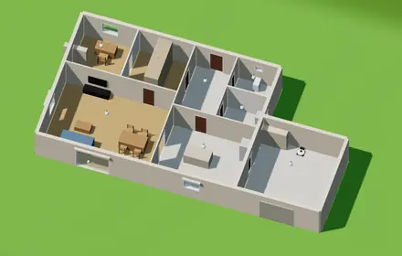</p>

### 5.9 Irrigazione, piscina e laghetto

Quando una valvola si apre, le **linee a goccia** si accendono in blu e cresce una macchia bagnata; gli **irrigatori** mostrano il getto e il settore. Il robot della piscina percorre il fondo finché la sua entità è attiva; l'acqua si muove. Le lampade della piscina colorano l'acqua la sera e la tapparella si srotola sull'acqua; un clic la apre o la chiude.

| Irrigatori all'alba | Piscina e laghetto |
|---|---|
|  |  |

<p align="center">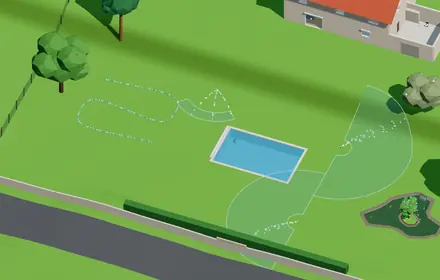 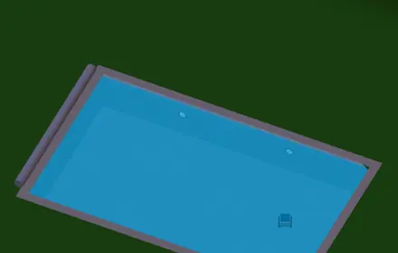 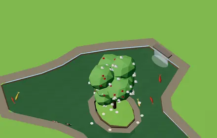</p>

## 6. L'editor

Riservato agli amministratori: **menu ⋮ → Editor**. L'editor è un **menu di sezioni**. Una sezione si apre nella propria finestra, sopra il menu; un elemento di un elenco (una linea a goccia, una zona, un'entità…) si apre sopra la sezione. La freccia **←** torna alla finestra sottostante. Tutto viene salvato da solo; **Esc** annulla il tracciato in corso. I punti di ciò che si sta modificando appaiono come pallini nella vista: **trascinatene uno per spostarlo**. **Ctrl+Z** annulla l'ultima modifica, qualunque sia la sezione, e **Ctrl+Y** la ripete (durante un tracciato, Ctrl+Z toglie prima l'ultimo punto); su un tablet, le frecce **↶ ↷** in alto in ogni finestra fanno lo stesso.


### 6.1 Entità posizionate

Per posizionare un'entità nella vista (temperatura, luce, interruttore, tapparella…):

1. *Add an entity*: l'elenco propone prima le entità della stanza corrente, raggruppate per dispositivo (tutta la casa con un tocco, con ricerca).
2. Toccate il punto voluto nella vista. L'etichetta si **sposta poi trascinandola** (con l'editor aperto).
3. Regolatela: **Mount** (sul pavimento, su un muro, libera in altezza), **Display** (pastiglia con il valore, o solo l'icona), etichetta, icona, colore, azione al tocco (scheda di dettaglio, commuta, niente).

Le entità sono ordinate in **livelli di visualizzazione**:

- **Vista generale**: mostrate nella vista generale (o solo nella vista del loro piano). La casella *Shown over the roof* permette di leggere da lontano, per esempio, la temperatura di una stanza.
- **Stanza**: mostrate solo con lo zoom sulla loro stanza.


Per modificare **le entità di una stanza**, toccate la stanza nella vista con l'editor aperto: viene ingrandita e una **fascia rossa** indica che state modificando quella stanza. Le entità aggiunte allora appartengono solo a quella stanza; posizionatele sul pavimento, su un muro o in aria.


> Un'entità della vista generale già posizionata in una stanza passa in quella stanza con *Visible → Its room only*.

Una **luce** posizionata diventa una vera sorgente luminosa in quel punto (faretto, sospensione, lampada, striscia o invisibile; altezza e portata regolabili; su un muro: un applique).

### 6.2 Pannello generale

I sensori e i comandi della colonna di sinistra, nell'ordine voluto, con etichetta, icona e azione al tocco (automatica, commuta, scheda di dettaglio, niente).

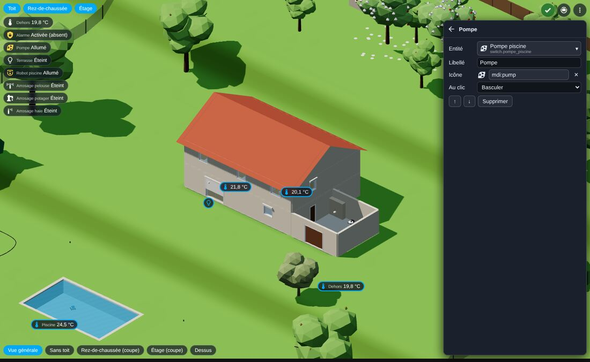

### 6.3 Allarmi

Rilevamento automatico attivo o no, campane nelle stanze, entità aggiunte a mano, entità ignorate.

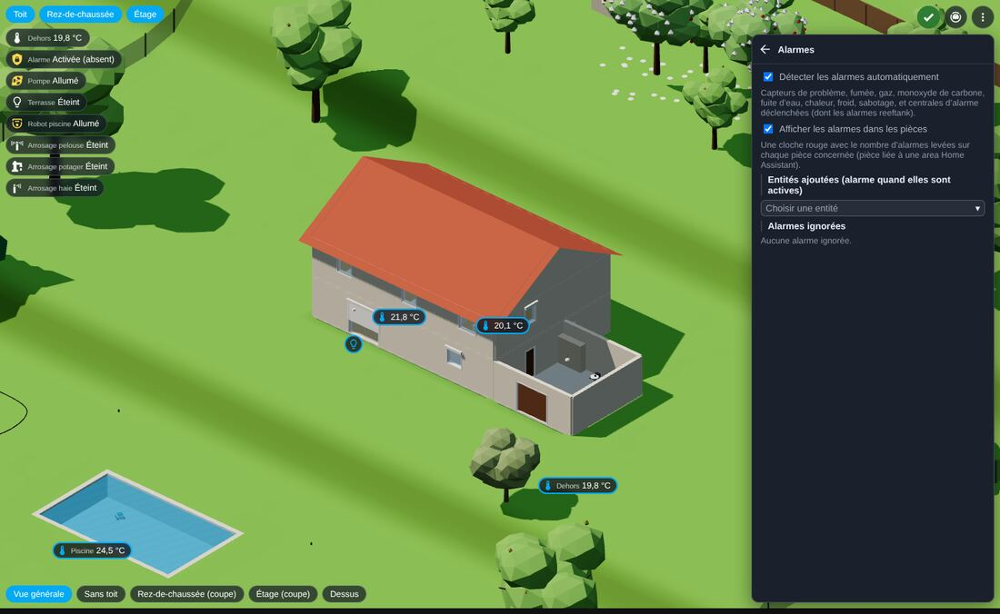

### 6.4 Zone cliccabili

Un **lettore multimediale** posato su un mobile della pianta (toccatelo) o su un rettangolo contro un muro o sul pavimento; un **acquario** dell'integrazione [reeftank](https://github.com/Elwinmage/ha-reeftank-component) su un rettangolo delle dimensioni della vasca. Un tocco apre il lettore, o la vista dell'acquario della scheda [ha-reef-card](https://github.com/Elwinmage/ha-reef-card); il rettangolo di un acquario mostra quella vista in diretta, pesci compresi, senza mai deformarla. Durante il posizionamento, la superficie puntata si illumina; una zona si sposta trascinandola.


### 6.5 Stanze ↔ aree di Home Assistant

Ogni stanza della pianta è collegata all'area di Home Assistant **con lo stesso nome** (accenti e maiuscole ignorati). Questa sezione permette di scegliere un'altra area, o nessuna, stanza per stanza.


### 6.6 Porte e finestre

Le aperture della pianta, per livello e per stanza; **Pick on the view** permette di toccare direttamente una finestra (si illumina al passaggio). Ognuna può essere collegata a:

- un **sensore aperto / chiuso** (`binary_sensor`);
- un **motore di apertura** della finestra (`cover`);
- una **tapparella** (`cover`), per finestre e porte scorrevoli.

Una stanza che ha **una sola finestra** viene collegata da sola al sensore della finestra, all'apertura motorizzata e alla tapparella della sua area (quando ce n'è uno di ciascuno); una stanza con una sola porta, al suo sensore di porta. Un collegamento scelto a mano prevale; un collegamento automatico si può rimuovere.


<p align="center">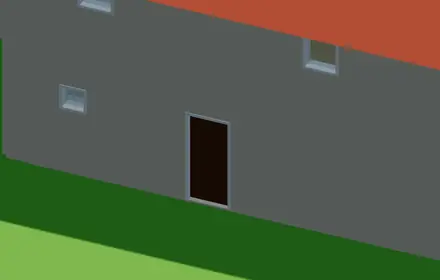 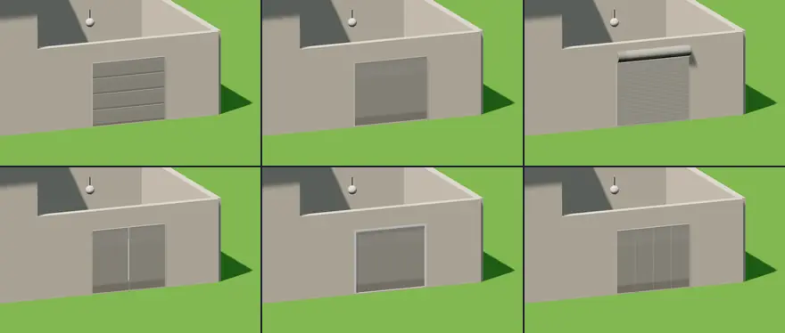</p>

### 6.7 Piscine e laghetti

*＋ Pool* o *＋ Pond*, poi disegnate il contorno visto dall'alto: **Rectangle** (due angoli opposti) o **Free shape** (punto per punto, poi *Finish*). Regolate il nome, il colore dell'acqua, la profondità (da 0,2 a 6 m) e, se ne avete uno, il **robot pulitore** (`binary_sensor`, `switch`, `input_boolean`, `vacuum`, `light`, `fan` o `sensor` — e qualunque altra entità digitando il suo id nel selettore; un valore maggiore di zero conta come attivo). Il terreno viene scavato: pareti verticali, fondo piatto e bordo per una piscina; fondo in pendenza e sponda di ciottoli per un laghetto.

**Lampade nell'acqua** : *＋ Lamp* aggiunge un faro incassato nella parete del lato scelto (posizione lungo il lato e profondità regolabili), collegato a una luce o a una presa. Una luce colorata dà il proprio colore, altrimenti viene usato il colore scelto nell'editor; le lampade accese tingono l'acqua e la vasca, tanto più di notte.

**Tapparella** : *＋ Roller cover* aggiunge un telo di lamelle che si srotola sull'acqua dal lato scelto, con l'avvolgitore sul bordo o immerso. Un'entità `cover` dà la sua posizione (da 0 a 100 %), un'entità `switch`, `input_boolean` o `binary_sensor` dice solo aperto o chiuso (attivo = chiuso, *Swap* rovescia la lettura). Un clic sul telo nella vista apre o chiude la tapparella. Un clic su una lampada la accende o la spegne allo stesso modo. Nell'editor questi clic non comandano nulla: aprono la piscina in questione e incorniciano nel pannello la lampada o la tapparella mirata. A tapparella arrotolata, risponde l'avvolgitore.

Per entrambi, il pulsante 🎯 accanto all'elenco dei lati li accende sul terreno: il lato in uso è in giallo, e il clic successivo nella vista prende il più vicino. *Provare* (💡 per una lampada, ▶ per la tapparella) mostra il risultato senza toccare le entità: la lampada si accende da sola, a qualunque ora, e la tapparella si chiude e si riapre, alla sua vera velocità. Un secondo clic sul pulsante ferma l'anteprima, che si ferma anche chiudendo la finestra della piscina.


> La piscina eventualmente disegnata in Sweet Home 3D viene mantenuta così com'è.

**Isole** (laghetto): *＋ Island (Rectangle)* o *＋ Island (Free shape)*, poi disegnatela nell'acqua come il contorno. Il terreno vi resta, un po' sopra l'acqua, con una sponda di ciottoli: vi si può piantare un albero (sezione **Alberi**) e posizionare entità.

**Pesci** (laghetto): i pesci vengono dal catalogo della casa (la carpa koi per cominciare). Aggiungete un **gruppo** per varietà, con il suo numero e la sua taglia: per 3 carpe rosse, 1 rossa e bianca e 2 gialle, fate tre gruppi (Benigoi × 3, Kohaku × 1, Yamabuki ogon × 2). *Colours of my own* permette di scegliere il colore del corpo, quello delle macchie, il motivo (uniforme, macchie grandi, medie o piccole) e squame lucide. Ogni pesce ha la propria livrea, sempre la stessa; nuota nell'acqua evitando sponde e isole, prende il colore dell'acqua scendendo e resta sul fondo, quasi immobile, quando fa freddo (sotto gli 8 °C).


### 6.8 Robot aspirapolvere

Per ogni robot (elenco *Robot*):

- **Place the dock** poi toccate il pavimento; regolate la sua **direzione** (o *Aim with a tap*);
- **Robot position**: Roborock (azione ufficiale), attributi di un'entità (estrattori di mappa), o nessuna (percorso stimato);
- **Calibrazione**: rotazione, specchio, scala; *Calibrate with a tap* quando il robot è uscito dalla base;
- **Mappa del robot** sovrapposta alla pianta per allinearla: con un estrattore di mappa (punti di calibrazione) si posiziona da sola; con l'integrazione ufficiale Roborock, indicate la base con un tocco (*The dock is here on the map*);
- colori del robot e della stanza in corso, *Show this robot on the view*, *Test the animation*.


### 6.9 Irrigazione

- **Drip lines** (linee a goccia): una linea per valvola (`switch`, `valve`, `input_boolean`), tracciata punto per punto, con il colore del tubo, la portata e la distanza tra i gocciolatori.
- **Sprinklers** (irrigatori): un circuito per valvola, con uno o più irrigatori del catalogo (Hunter PSU, SRM, PGJ, PGP, MP Rotator o generico), la loro gittata, direzione e angolo (*Aim* con un tocco).
- Una stessa valvola può comandare **più linee o circuiti**: scegliete la stessa entità per ciascuno, si accendono insieme.
- **Test the animation**: 30 s di irrigazione accelerata senza aprire nessuna valvola.


### 6.10 Recinzioni

*Fence from the cadastre* (le particelle della casa sono preselezionate; **solo in Francia**, poiché il catasto viene dai servizi dell'IGN: altrove, tracciate la recinzione a mano) o *Draw a fence* punto per punto. Ogni lato ha il suo tipo (rete, legno, muro, siepe, o aperto dove non c'è recinzione; un cancello si aggiunge in *Gates* e apre la recinzione da solo) e la sua altezza; *Edit the sides* cambia un lato, lo divide in due o rimuove un punto. I tipi vengono dal catalogo della casa: la tavolozza mostra un'anteprima di ciascuno accanto al colore che ne contrassegna i lati nella vista durante la modifica. Un muro o un muro in mattoni può portare una **copertina** (pietra, mattoni di coltello, tegole, lamiera piegata…), nel vostro colore: si sceglie nella tavolozza, sotto l'altezza, e si posa lato per lato.


<p align="center">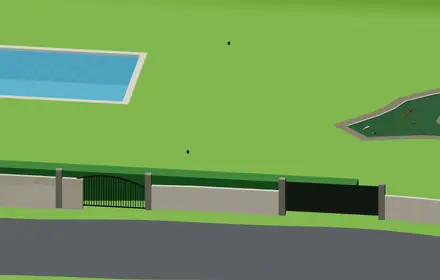</p>

### 6.11 Alberi, oggetti esterni e correzioni del terreno

- **Alberi**: eliminare quelli rilevati per errore, piantarne altri (specie del catalogo e altezza), annullare, ripristinare tutti.
- **Oggetti esterni** (casetta, cancello…): nascondere, altezza, spostamento, rotazione.
- **Terrazze** (*Terraces*): disegnate un rettangolo o una forma libera, poi scegliete il rivestimento dalle anteprime (legno, piastrelle, pietra, calcestruzzo, tinta unita), un colore vostro, l'altitudine e lo spessore. Il terreno viene livellato sotto, una piscina al suo interno viene ritagliata e i suoi punti restano modificabili (spostare, aggiungere, rimuovere).
- **Scale esterne** (*Drives and paths* → *As a flight of steps*): un viale tracciato tra un punto basso e uno alto diventa una scala nel rivestimento del viale; il terreno viene aperto sotto e un muro di sostegno attraversato viene tagliato.
- **Tetti dal LiDAR**: un tetto troppo complicato per la pianta viene letto dal modello di superficie del terreno. Indicate il suo contorno (tracciato punto per punto, ripreso dai muri della pianta con il suo sporto, o dall'edificio della mappa) e le falde vengono trovate all'interno, tagliate lungo colmi, displuvi e compluvi; spostate, aggiungete o togliete i punti del contorno per coprire solo una parte della casa: il tetto della pianta resta ovunque altrove.
- **Correzioni del terreno**: ogni correzione presente è contornata e nominata nella vista, e un tocco la seleziona nell'elenco. Muro di sostegno — con un paramento scelto dalle anteprime (intonaco, pietra, mattone…), un colore, e una sommità e un piede che possono differire alle due estremità —, piano nudo, pennelli (alzare, scavare, levigare) il cui effetto appare prima del clic, sezione del terreno. Uno strumento che traccia un tipo mostra solo quel tipo (*Shown on the view* fa tornare gli altri). Si applicano nell'ordine in cui sono state tracciate; un muro non agisce dietro un altro muro, e un piano tracciato lungo un muro resta dal suo lato. Un muro prende la copertina che scegliete (lastre di pietra, mattoni di coltello, tegole, lamiera piegata…) nel vostro colore, e *＋ Add a point* / *− Remove a point*, in cima a una sezione, ritoccano una linea o un contorno libero.
- **Viste**: salvare la telecamera corrente come vista, rinominare, eliminare.


### 6.12 Il catalogo di alberi e oggetti

Le specie di alberi (con il loro aspetto in ogni stagione), gli oggetti del giardino o i mobili disegnati al posto di semplici scatole, e i pesci dei laghetti vengono dal [catalogo della casa](https://github.com/Elwinmage/house-catalog). Lo stesso vale per i rivestimenti dei viali e delle terrazze, i paramenti dei muri e i tipi di recinzione, ciascuno mostrato con la sua anteprima là dove lo si sceglie. L'integrazione lo aggiorna da sola da GitHub (dispositivo *House view catalog*: un'entità di aggiornamento per sezione, un interruttore di aggiornamento automatico, un pulsante per aggiornare subito) e funziona offline con la copia che porta con sé.

Per creare **il vostro albero o oggetto**, usate l'[editor di catalogo](https://github.com/Elwinmage/catalog-editor): una scheda di Home Assistant in cui si regolano forma, colori e stagioni vedendo il risultato. Ciò che salvate viene usato subito dalla vista, e potete poi proporlo al catalogo comune (una pull request su GitHub), perché tutti ne approfittino.

## 7. La configurazione (⚙)


- **Demo**: vedi [La modalità demo](#9-la-modalità-demo).
- **Pianta** e **terreno**: vedi [la prima messa in opera](#4-prima-messa-in-opera-la-pianta-e-il-terreno).
- **GitHub backup**: impostate un repository **privato** nelle opzioni dell'integrazione (*Impostazioni → Dispositivi e servizi → House View → Configura → backup su GitHub*: repository `proprietario/nome`, token *fine-grained* con *Contents: read and write*, ramo, cartella), poi *Back up to GitHub* / *Restore from GitHub*. Un repository pubblico viene rifiutato: conterrebbe la pianta della vostra casa. Sopra i due pulsanti, **Salvato in Home Assistant** elenca ciò che l'integrazione detiene (pianta, terreno, modifiche, foto aerea) con la data dell'ultima scrittura: il backup può inviare solo ciò che è elencato lì, e il suo messaggio dice cosa è stato scritto, cosa era già aggiornato, cosa non è salvato qui e cosa GitHub ha rifiutato. Le modifiche ancora in sospeso vengono salvate prima del backup.
- **Edit protection**: si può chiedere una password prima di aprire l'editor e la configurazione (opzioni dell'integrazione → protezione della modifica). La scheda la richiede dopo 10 minuti senza modifiche; il pulsante 🔒 blocca subito. Guardare la vista, zoomare, comandare le luci o l'aspirapolvere restano liberi.
- **Edits file**: esportare o importare tutte le vostre modifiche (entità, irrigazione, recinzioni…) in un file JSON. *Export the corrected terrain* salva inoltre il rilievo come lo mostra la vista, con le correzioni del suolo applicate, in un file di terreno per un altro strumento: le correzioni restano nelle modifiche, quindi non ricaricatelo come terreno di questa casa.

## 8. Più abitazioni

Una casa per le vacanze, uno chalet… Ogni abitazione è una **voce** dell'integrazione, con la propria pianta, il proprio terreno e le proprie modifiche.

1. *Impostazioni → Dispositivi e servizi → House View → Aggiungi voce*.
2. Datele un nome (diverso dagli altri) e la sua posizione.
3. Nella scheda (editor visuale), scegliete l'**abitazione** mostrata: l'elenco compare appena ce ne sono due. In YAML: `home: <id della voce>`.
4. Importate la sua pianta e scaricate il suo terreno come nel [capitolo 4](#4-prima-messa-in-opera-la-pianta-e-il-terreno).

Eliminare una voce elimina i suoi documenti; le altre abitazioni non vengono toccate.

## 9. La modalità demo

Per filmare o presentare la vista **senza mostrare la vostra casa né la vostra posizione**.

La demo è **nascosta per impostazione predefinita**. Attivatela prima: *Impostazioni → Dispositivi e servizi → House View → Configura → Demo*, deselezionate *Nascondi la demo*; la sezione **Demo** compare allora in ⚙.

1. ⚙ → **Demo** → *Load the demo*: viene aggiunta un'abitazione «Démo», con una posizione fittizia (45° N); le vostre abitazioni non vengono toccate. Parte **vuota e piatta**, per essere filmata dall'inizio.

   

2. Importate `demo-maison.sh3d` (*Download demo-maison.sh3d* in ⚙) con *Import a plan*.
3. *Fetch the terrain*: lo scaricamento passa per i suoi passaggi e porta un terreno fittizio su tre terrazze (frutteto, casa, giardino con piscina e laghetto), senza alcun accesso alla rete.

Le entità della demo sono **simulate dalla scheda**: niente viene creato in Home Assistant e niente della vostra casa compare. Uno **scenario della giornata** (1 h ogni 2 s) anima la casa: tapparelle aperte al mattino, irrigazione all'alba, aspirapolvere in mattinata, robot della piscina nel pomeriggio, finestre aperte per arieggiare, perdita d'acqua prima di cena, luci accese e tapparelle chiuse la sera.

Il pulsante **🎬 Demo** (menu ⋮) mette in pausa lo scenario, regola l'ora e fa scattare un evento a mano (tapparelle, luci, aspirapolvere, irrigazione, robot della piscina, perdita, fumo). Un tocco su un'entità simulata la commuta; il cambiamento dura fino al movimento successivo dello scenario.


*Reset the demo* la riporta come consegnata; *Leave the demo* torna alla vostra abitazione. L'abitazione Démo si elimina come qualsiasi altra voce dell'integrazione.

## 10. Opzioni della scheda

Si regolano nell'editor visuale della scheda (plancia in modalità modifica → *Modifica* sulla scheda), per sezioni.

| Opzione | Funzione | Predefinito |
|---|---|---|
| `home` | Abitazione mostrata (più abitazioni) | la prima |
| `mode` | `live` (tempo reale) o `simulation` (cursori di ora, data e meteo) | `live` |
| `weather_entity` | Entità meteo | — |
| `rain_entity` | Rilevatore di pioggia o sensore di intensità di pioggia (mm/h) | — |
| `wind_speed_entity`, `wind_bearing_entity` | Sensori di vento propri | — |
| `view` | Vista iniziale (il suo nome) | — |
| `show_views`, `show_levels` | Pulsanti delle viste, dei livelli | sì |
| `show_entities` | Entità posizionate | sì |
| `show_alarms` | Distintivo d'allarme | sì |
| `tap_action` | Tocco su una stanza: `zoom`, `toggle_lights`, `none` | `zoom` |
| `movable_camera` | Telecamera mobile | sì |
| `height`, `min_height` | Altezza della scheda (`fill`, `aspect`, in px o `vh`) | `fill`, 320 |
| `fps_cap` | Massimo di immagini al secondo (tablet a parete) | 30 |
| `quality` | Qualità dell'immagine: `auto` (più leggera mentre la telecamera si muove se lo schermo non tiene il passo), `low` (schermo poco potente), `high` (mai alleggerita) | `auto` |
| `keep_scene` | Minuti durante i quali la scena resta pronta quando la scheda esce dallo schermo (0: liberata subito) | 10 |
| `auto_reload` | Ricaricare la pagina da sola quando la scheda viene aggiornata, appena nessuno la usa (schermo a parete); altrimenti lo propone un pulsante | `false` |
| `year_seconds` | Durata di «Simulate a year» (da 5 a 60 s) | 10 |
| `toolbar_buttons` | Strumenti che restano nella barra (`preview`, `year`, `camera`, `sim`, `edit`, `setup`) | nessuno |
| `hide_menu` | Nascondere il menu ⋮ a chi non è amministratore | no |
| `light_entities` | Limitare le luci prese in considerazione | tutte |
| `vacuum_entity`, `vacuum_poll`, `vacuum_rate`, `vacuum_show_floor`, `vacuum_progress_entity` | Robot aspirapolvere | — |

In modalità **simulazione**, il pannello *Simulation* (menu ⋮) regola l'ora (con riproduzione), la data, il meteo, le nuvole, la pioggia, il vento, la temperatura e la neve.

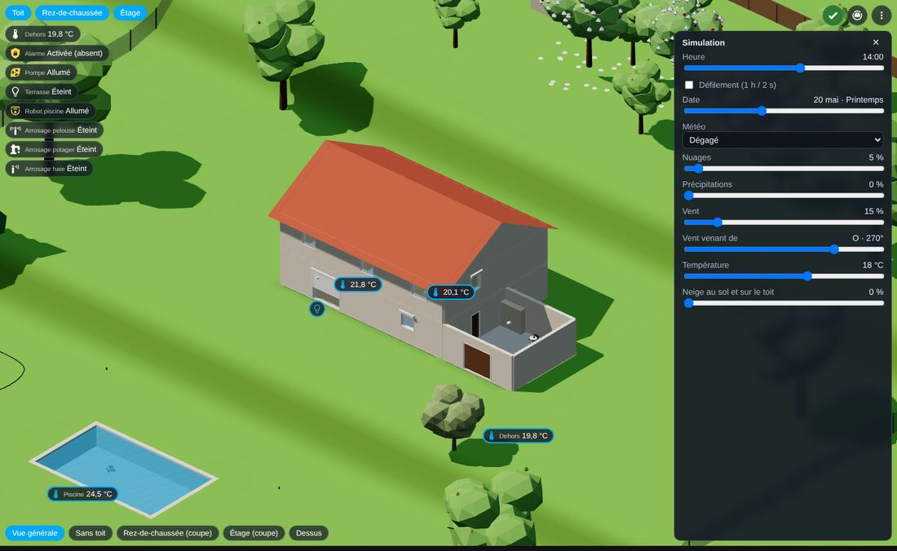

## 11. Domande frequenti

**Una stanza resta buia, le sue luci non compaiono.**
Verificate che sia collegata a un'area di Home Assistant ([6.5](#65-stanze--aree-di-home-assistant)) e che le sue luci siano assegnate a quell'area.

**Il sole o le stagioni non corrispondono.**
La bussola della pianta di Sweet Home 3D deve essere regolata (latitudine e nord), e la posizione dell'abitazione deve essere giusta (opzioni della voce House View).

**La casa galleggia o sprofonda nel terreno.**
Ritoccate l'altezza in ⚙ → *Terrain (DTM)*, o rilanciate l'allineamento automatico.

**Un'etichetta non compare.**
Un'etichetta nascosta dal tetto o da un piano non viene mostrata (salvo con *Shown over the roof*), e un'etichetta di stanza compare solo con lo zoom sulla sua stanza. Con l'editor aperto su *Placed entities*, si vedono tutte le etichette del livello (attenuate quando nascoste).

**La mappa del robot non è allineata.**
Con l'integrazione ufficiale Roborock, indicate la base sulla mappa con un tocco, poi regolate la rotazione. Con un estrattore di mappa (Roborock Custom Map, Xiaomi Cloud Map Extractor), scegliete la sua entità: la mappa si posiziona da sola.

**Non c'è la foto aerea sul terreno.**
In ⚙ → *Terrain (DTM)*, verificate che *Aerial photo on the ground* sia spuntata. Se lo scaricamento indica «ground texture unavailable», il motivo tra parentesi viene dal servizio dell'IGN; riprovate più tardi.

**Voglio mostrare la vista senza mostrare la mia casa.**
Usate la [modalità demo](#9-la-modalità-demo).

**La vista va a scatti su un Raspberry Pi o su un tablet a parete.**
Nelle opzioni della scheda, impostate *Rendering quality* (`quality`) su `low` e abbassate `fps_cap`; anche ridurre la risoluzione dello schermo aiuta. Con `auto`, l'immagine si alleggerisce già da sola mentre la telecamera si muove quando lo schermo non tiene il passo, e ritrova tutti i dettagli da ferma.

**La vista si ricarica quando torno da un'altra plancia.**
La scena resta pronta per dieci minuti dopo aver lasciato lo schermo, poi la sua memoria viene liberata: oltre questo tempo viene riletta e ricostruita al ritorno. Aumentate `keep_scene` (in minuti) per tenerla più a lungo.

**Dopo un aggiornamento, la scheda a schermo è quella nuova?**
Sì: la scheda viene sempre caricata con l'impronta del file presente sul server, quindi basta aggiornare il browser (nessuna cache da svuotare). Le pagine rimaste aperte mostrano nella barra un pulsante blu *Nuova versione della scheda*; con l'opzione `auto_reload`, un tablet a parete si ricarica da solo quando nessuno lo usa. Riavviate Home Assistant quando lo chiede dopo un aggiornamento dell'integrazione; una scheda soltanto ricompilata (sviluppo) non ne ha bisogno.
