<p align="center">
  <picture>
    <source media="(prefers-color-scheme: dark)" srcset="../../custom_components/house_view/brand/dark_logo.png">
    
  </picture>
</p>

# House View

[](https://github.com/Elwinmage/ha-house-view-component/releases)
[](https://github.com/Elwinmage/ha-house-view-component/commits/main)
[](https://github.com/hacs/default)
[](https://opensource.org/licenses/MIT)
[](https://codecov.io/gh/Elwinmage/ha-house-view-component)
[](https://analytics.home-assistant.io/custom_integrations)

**Lingue disponibili:**
[](../fr/README.fr.md)
[](../../README.md)
[](../es/README.es.md)
[](../de/README.de.md)
[](../pl/README.pl.md)
[](../pt/README.pt.md)
[](README.it.md)
[](../nl/README.nl.md)

📘 **Guida completa** (installazione, configurazione, utilizzo, con immagini): [GUIDE.it.md](GUIDE.it.md)

Vista pseudo-3D in tempo reale della vostra casa per Home Assistant: la vostra pianta (**Sweet Home 3D**, IFC o SVG) posata su un modello digitale del terreno, con luci, meteo, sole e stagioni in diretta, più un robot aspirapolvere, l'irrigazione del giardino e le recinzioni. Un unico repository contiene:

- `custom_components/house_view/`: l'**integrazione** (conserva la pianta, il terreno e le vostre correzioni; scarica il terreno; API HTTP);
- `card/`: la **scheda Lovelace** `house-view-card` (three.js), compilata in `custom_components/house_view/frontend/`. L'integrazione la serve direttamente (`/house_view/house-view-card.js`) e la carica su tutte le plance: **nessuna risorsa Lovelace da dichiarare**.

L'interfaccia della scheda e le opzioni dell'integrazione esistono in inglese, francese, italiano, tedesco, spagnolo, polacco, portoghese e olandese (la scheda segue la lingua del vostro profilo Home Assistant). I nomi dei pulsanti e delle sezioni sono qui citati in inglese. Le traduzioni sono benvenute: i testi si trovano in `custom_components/house_view/translations/` e `card/src/i18n.js`.

## Panoramica

<p align="center">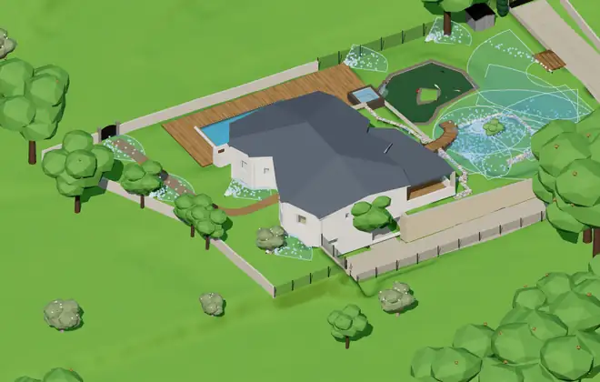</p>
<p align="center"><em>Una proprietà di esempio che ruota su se stessa: il rilievo viene da dati pubblici, tutto il resto è stato disegnato nell'editor della scheda.</em></p>
<p align="center"> </p>
<p align="center"><a href="https://youtu.be/MyXz5AVbtJI">▶ Guarda il video</a></p>

House View trasforma la pianta della vostra casa in un ritratto vivo di essa. La maggior parte delle schede 3D per Home Assistant carica un modello pesante dell'edificio (un'esportazione GLB / OBJ) e collega le entità ai suoi oggetti, oppure sovrappone livelli trasparenti a un'immagine. House View prende un'altra strada: una **scena procedurale leggera**, disegnata dal vivo a partire dalla vostra pianta, che mostra anche il giardino e il cielo, non solo i muri. Per quanto ne sappiamo, nulla di simile combina quanto segue:

### Il terreno arriva da solo

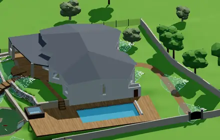

Niente da misurare, niente da disegnare: indicate la posizione della casa e l'integrazione scarica da sola il suolo che la circonda da **dati pubblici e gratuiti**, rilevati **da aerei** (laser LiDAR, fotografie aeree) o **da satelliti** (modello radar mondiale). Un clic su *Fetch the terrain*; dove esiste un modello di superficie, la pianta viene poi allineata da sola sul terreno, gli alberi sono piantati dove il laser li ha visti e i tetti complicati vi si possono leggere.

| Che cosa | Francia | Resto del mondo |
|---|---|---|
| Rilievo del suolo | LiDAR HD dell'IGN: laser aviotrasportato, una quota ogni 50 cm (altrimenti RGE ALTI, 1 m) | Mapterhorn: i rilievi LiDAR aperti di molti paesi e, altrove, il modello Copernicus a 30 m, misurato da satelliti radar |
| Tetti e alberi | Modello di superficie del LiDAR HD | — |
| Edifici e strade | BD TOPO dell'IGN | OpenStreetMap |
| Particelle | Catasto: una recinzione può seguirle | — |
| Immagine al suolo | Fotografie aeree dell'IGN, o la mappa IGN | — |

La scheda non chiama mai Internet: l'integrazione recupera il terreno una volta e lo conserva nel vostro Home Assistant. Dove il rilievo è troppo grossolano, o quando il giardino è stato rimodellato, le *correzioni del suolo* dell'editor ridisegnano scarpate, piani e muri di sostegno. Il dettaglio paese per paese: [Fonti del terreno per paese](#fonti-del-terreno-per-paese).

### Ciò che si muove nella vista

Tutto ciò che segue è disegnato dal vivo secondo lo stato delle vostre entità; queste immagini vengono dalla casa dimostrativa fornita con l'integrazione.

<table>
<tr>
<td width="50%" valign="top">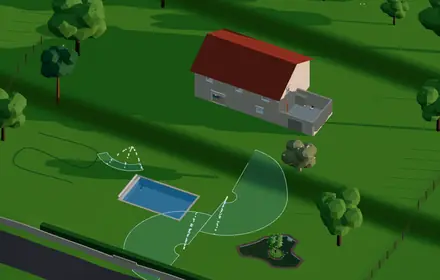<br><b>Sole e ombre</b><br>La luce segue il sole della vostra latitudine ora per ora; la casa vive la sua giornata: tapparelle, irrigazione, lampade la sera.</td>
<td width="50%" valign="top">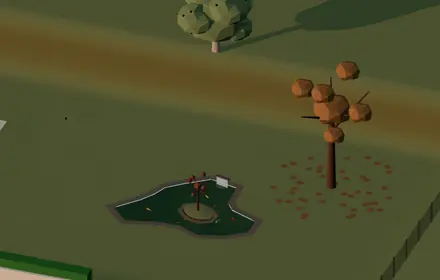<br><b>Stagioni</b><br>Foglie, fiori, frutti e foglie secche seguono la data, ogni specie con il suo calendario.</td>
</tr>
<tr>
<td width="50%" valign="top">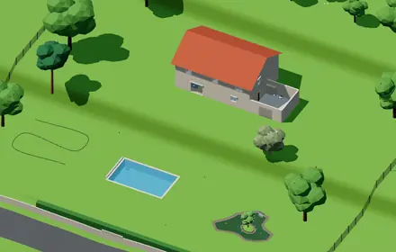<br><b>Meteo</b><br>Pioggia inclinata dal vento, temporali, neve che attecchisce, nebbia: secondo la vostra entità meteo o i vostri sensori.</td>
<td width="50%" valign="top">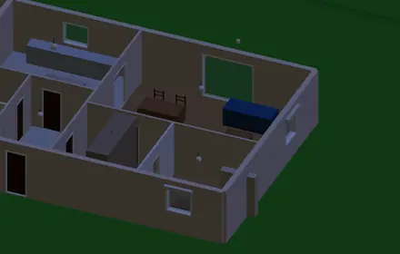<br><b>Luci</b><br>Ogni lampada con stato, colore e luminosità reali; un tocco su una stanza la ingrandisce e ne comanda le luci.</td>
</tr>
<tr>
<td width="50%" valign="top">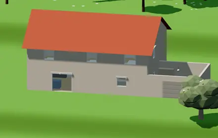<br><b>Tapparelle</b><br>Seguono la posizione delle vostre tapparelle.</td>
<td width="50%" valign="top">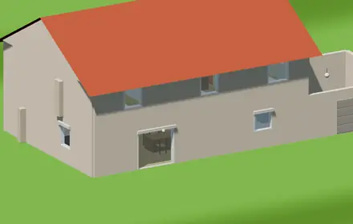<br><b>Finestre</b><br>Finestre e portefinestre si aprono con i loro contatti.</td>
</tr>
<tr>
<td width="50%" valign="top">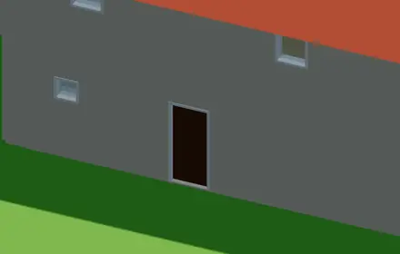<br><b>Porte</b><br>Anche le porte, ciascuna a modo suo.</td>
<td width="50%" valign="top">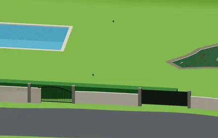<br><b>Cancelli</b><br>A battente o scorrevoli, a una o due ante, a sbarre o pieni, su qualsiasi recinzione.</td>
</tr>
<tr>
<td width="50%" valign="top">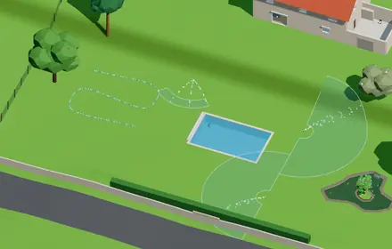<br><b>Irrigazione</b><br>Ali gocciolanti e irrigatori (turbine, ugelli rotanti, statici) funzionano con le loro valvole; il suolo si bagna.</td>
<td width="50%" valign="top">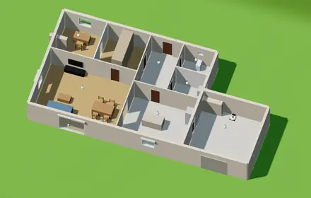<br><b>Robot aspirapolvere</b><br>Il robot si muove sulla pianta e le stanze si colorano man mano che le pulisce (accelerato).</td>
</tr>
<tr>
<td width="50%" valign="top">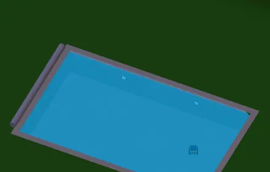<br><b>Piscina</b><br>Il robot pulitore al lavoro, i fari, la copertura a tapparella.</td>
<td width="50%" valign="top">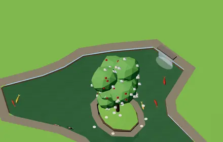<br><b>Laghetto</b><br>Carpe koi di più varietà, un'isola, una cascata.</td>
</tr>
<tr>
<td colspan="2">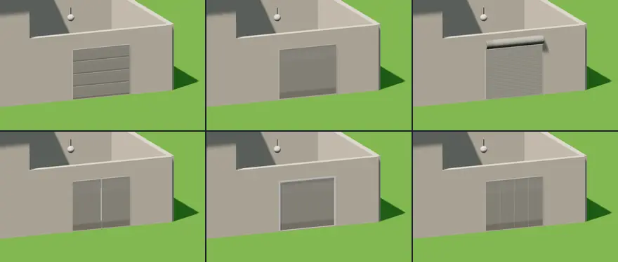<br><b>Porte del garage</b><br>I sei modi di aprirsi: sezionale, basculante, avvolgibile, a battente, scorrevole, a libro (accelerato).</td>
</tr>
</table>

### Tutto ciò che sa fare

- **Leggera per costruzione** : nessuna pesante esportazione 3D da caricare o unire: muri, mobili, alberi, acqua e volumi di luce sono generati dalla pianta e da un piccolo catalogo, e il rendering si ferma quando la scheda non è visibile, con un `fps_cap` per i tablet a parete. Le ombre vengono ricalcolate solo quando si muove il sole o un oggetto, l'immagine si alleggerisce mentre la telecamera si muove su uno schermo poco potente (`quality`), e la scena resta pronta per alcuni minuti quando si apre un'altra plancia (`keep_scene`).
- **La vostra casa sul suo vero terreno** : la pianta Sweet Home 3D (o IFC, SVG) è posata su un modello digitale del terreno del lotto (IGN LiDAR HD e catasto in Francia — le recinzioni si possono tracciare a partire dalle particelle —, LiDAR aperto e OpenStreetMap altrove), con il rilievo, le strade, gli alberi vicini e le vostre recinzioni.
- **Sole, stagioni e meteo reali** : la luce segue il sole della vostra latitudine, alberi ed erba cambiano con le stagioni, e pioggia, neve, nebbia, temporali e vento (la pioggia si inclina dove soffia il vento) seguono la vostra entità meteo o i vostri sensori. Una modalità simulazione riproduce un giorno qualsiasi, o un anno intero, in pochi secondi.
- **Ogni stanza è viva** : stato, colore e luminosità reali delle luci, temperature delle stanze, un tocco per zoomare su una stanza e un secondo per accenderne le luci; le luci posizionate ovunque diventano vere sorgenti di luce.
- **Le vostre entità, dove sono** : sensori, interruttori e selettori posti sulla pianta, un pannello generale, un badge centrale degli allarmi (fumo, perdita d'acqua, intrusione…), zone cliccabili (un lettore multimediale su un mobile, un acquario reeftank mostrato dal vivo sulla sua vasca).
- **Porte, finestre, tapparelle e cancelli che si muovono** : collegati ai vostri contatti e alle tapparelle, si aprono e si chiudono nella vista; un cancello (a battente o scorrevole, 1 o 2 ante, a sbarre o pieno, dritto o ad arco) segue il suo cover o il suo contatto.
- **Robot aspirapolvere** : pulizia per stanze con un tocco, un robot 3D che si muove sulla pianta, stanze colorate secondo l'avanzamento, più robot, posizione Roborock supportata.
- **Un giardino che lavora** : irrigazione a goccia e irrigatori animati dalle loro valvole (macchie d'umidità, getti), recinzioni di ogni tipo (rete, legno, muro, ferro battuto, arella, gabbioni e nove siepi: lauroceraso, tuia, Leyland…), terrazze in legno, piastrelle o pietra, muretti intonacati, in pietra o in mattoni, scale esterne tra i livelli del giardino, aiuole di cui scegliete il numero e i colori dei fiori, piscine e laghetti con i loro pesci.
- **Un mare vivo** : per una casa sulla costa, un mare in movimento con onde spinte dal vento, una marea che segue il calendario (regolata su un'alta marea reale del vostro porto), spiagge di sabbia, ciottoli, corallo o roccia e il suono della risacca (sezione *Sea* dell'editor).
- **Un catalogo che cresce** : gli alberi, con fino a quattro aspetti l'anno e varietà di colore (meli con frutti rossi, gialli o verdi, ciliegio, salice, eucalipto…), e gli oggetti vengono dal [catalogo house-catalog](https://github.com/Elwinmage/house-catalog), aperto, aggiornato in background, utilizzabile offline ed estendibile con l'[editor del catalogo](https://github.com/Elwinmage/catalog-editor). Anche i rivestimenti dei viali e delle terrazze, i paramenti dei muretti e i tipi di recinzione vengono da lì.
- **Mostrarla senza mostrare la propria casa** : un pulsante *Load the demo* aggiunge una casa fittizia in un luogo qualsiasi, per filmare, presentare o provare la scheda (nascosto per impostazione predefinita: si attiva nelle opzioni dell'integrazione).
- **Nulla da installare oltre all'integrazione** : la scheda è servita dall'integrazione (nessuna risorsa Lovelace), tutto si modifica dalla scheda stessa (✎), più case possono coesistere, le vostre correzioni sono tenute a parte dalla pianta (reimportarla non fa perdere nulla) e l'interfaccia parla otto lingue (inglese, francese, spagnolo, tedesco, italiano, polacco, portoghese, olandese).

## Installazione

1. Installare dal Marketplace: aprire direttamente il repository con questo pulsante e fare clic su «Installa» [](https://my.home-assistant.io/redirect/hacs_repository/?owner=Elwinmage&repository=ha-house-view-component&category=integration), oppure cercare «House View» in *Impostazioni → Marketplace*. Su un Home Assistant precedente a 2026.11, gli stessi passaggi funzionano in HACS, seguiti da un riavvio. A mano: estrarre `house_view.zip` dell'ultima versione pubblicata in `config/custom_components/house_view/`, quindi riavviare Home Assistant.
2. Aggiungere l'integrazione *House View*: dare un nome all'abitazione e la sua posizione (quella di Home Assistant per impostazione predefinita). Ogni abitazione è una voce a sé: aggiungere di nuovo l'integrazione per una seconda abitazione (casa per le vacanze…), con pianta, terreno e modifiche propri; la scheda mostra un'abitazione, scelta con la sua opzione `home`.
3. Aggiungere la scheda a una plancia (`type: custom:house-view-card`).
4. Aprire ⚙ nella scheda (solo amministratori) per importare la pianta (Sweet Home 3D, IFC o SVG) o disegnarne una semplice, poi scaricare il terreno (cartes.gouv.fr in Francia, dati aperti mondiali altrove: vedere [Fonti del terreno per paese](#fonti-del-terreno-per-paese)) oppure caricare un terreno `.json`.

La versione della scheda compare nella console del browser al caricamento (`🏠 HOUSE VIEW v0.x.y`). La pulizia per stanze e l'icona dell'integrazione richiedono Home Assistant 2026.3 o successivo.

La scheda compilata non è nel repository: `release.yml` la costruisce a ogni rilascio e pubblica `house_view.zip`, che il Marketplace installa. Per lo sviluppo: `cd card && npm install && npm run build`. Una scheda ricompilata (o una release che cambia solo la scheda) viene servita al successivo aggiornamento del browser, senza riavviare Home Assistant: le plance caricano un piccolo loader che nomina il bundle con la sua impronta del momento, e le pagine aperte vengono avvisate (pulsante di ricarica, o ricarica automatica con `auto_reload`). Una modifica al Python dell'integrazione richiede ancora un riavvio.

## Configurazione della scheda

Le opzioni si impostano nell'editor visuale della scheda (modificare la plancia, poi *Modifica* sulla scheda), in quattro sezioni: ora e meteo, visualizzazione, luci, robot aspirapolvere. La pianta, il terreno e tutto ciò che è collocato nella vista si impostano nella scheda stessa (✎ e ⚙). In YAML:

```yaml
type: custom:house-view-card
home: 01JXYZ…                         # facoltativo, più abitazioni: la voce mostrata (scelta nell'editor visivo); la prima per impostazione predefinita
weather_entity: weather.casa          # meteo in diretta (facoltativo)
rain_entity: binary_sensor.pioggia    # facoltativo: rilevatore di pioggia o sensore di intensità (mm/h) della vostra stazione
wind_speed_entity: sensor.vento_vel     # facoltativo: sensore di velocità del vento (stazione o servizio meteo su internet)
wind_bearing_entity: sensor.vento_dir   # facoltativo: sensore di direzione del vento (gradi o punti cardinali)
mode: live                            # live (ora reale) | simulation (cursori ora / data / meteo)
view: Vue générale                    # vista iniziale (facoltativa): il nome mostrato sul suo pulsante
show_views: true                      # pulsanti delle viste della telecamera
show_levels: true                     # pulsanti tetto / piani (+ 🌡 se sono note le temperature per stanza)
tap_action: zoom                      # tocco su una stanza: zoom (secondo tocco = luci) | toggle_lights | none
show_entities: true                   # entità collocate nell'editor
show_alarms: true                     # badge centrale degli allarmi (in alto a destra)
vacuum_entity: vacuum.robot           # facoltativo: per impostazione predefinita il primo vacuum.* trovato
vacuum_poll: 15                       # secondi tra due letture della posizione (Roborock: azione cloud, min. 5)
vacuum_show_floor: false              # true = durante una pulizia mostra il piano del robot visto dall'alto
vacuum_rate: 1                        # m²/min, per il percorso stimato di un robot senza posizione
vacuum_progress_entity: sensor.xxx    # facoltativo: avanzamento (%); rilevato automaticamente per Roborock
movable_camera: true                  # telecamera mobile (rotazione, zoom, spostamento); false = fissa sulle viste
height: fill                          # fill (altezza dello schermo sotto il bordo superiore della scheda) | aspect (16/10) | 600 | "70vh"
min_height: 320                       # altezza minima in modalità fill (px)
fps_cap: 30                           # limite di fotogrammi al secondo (schermi a parete, tablet)
quality: auto                         # auto (più leggera mentre la telecamera si muove se lo schermo non tiene il passo) | low (Raspberry Pi, tablet a parete) | high (mai alleggerita)
keep_scene: 10                        # minuti durante i quali la scena resta pronta quando la scheda esce dallo schermo (altra plancia): il ritorno è immediato; 0 = liberata subito
auto_reload: false                    # true = la pagina si ricarica da sola quando la scheda viene aggiornata (schermo a parete); altrimenti lo propone un pulsante
year_seconds: 10                      # 📅 : fa scorrere le stagioni di un anno intero in questi secondi (da 5 a 60)
toolbar_buttons: [preview]            # strumenti lasciati nella barra (preview, year, camera, sim, edit, setup); gli altri sono nel menu ⋮
hide_menu: false                      # true: nessun menu ⋮ per gli utenti non amministratori (schermo a parete)
light_entities: [light.salotto, ...]  # facoltativo: limita le luci considerate
```

## Vista in diretta

- **Barra** (in alto a destra): il badge degli allarmi, i robot aspirapolvere e il menu ⋮, che raccoglie gli strumenti occasionali (anteprima stagione / meteo / ora, simulare un anno, blocco della telecamera, simulazione, demo) e, per gli amministratori, l'editor ✎ e la configurazione ⚙. L'opzione `toolbar_buttons` ne lascia alcuni nella barra; `hide_menu` nasconde il menu agli utenti non amministratori.
- **Latitudine, longitudine, fuso orario**: quelli dell'abitazione (scelti quando viene aggiunta; la configurazione di Home Assistant per impostazione predefinita). Le stagioni della vegetazione e del prato seguono il clima della latitudine: quattro stagioni nelle zone temperate; da 50° verso i poli, un inverno sempre più lungo e un'estate breve (ancora inverno a fine aprile a 68°); tra i tropici, niente inverno ma una stagione delle piogge e una stagione secca (gli alberi tengono le foglie, il prato ingiallisce un po' nella stagione secca, meno vicino all'equatore), che l'anteprima delle stagioni propone al posto delle quattro stagioni. Nell'emisfero australe tutto è invertito.
- **Stanze ↔ aree**: una stanza della pianta è collegata all'area di Home Assistant con lo stesso nome (accenti e maiuscole ignorati). ⚙ elenca le stanze senza area corrispondente; ✎ → *Rooms ↔ Home Assistant areas* permette di scegliere un'altra area, o nessuna, stanza per stanza.
- **Luci**: stato, colore e intensità delle entità `light.*` dell'area di ogni stanza.
- **Meteo**: l'entità meteo `weather_entity` decide il tempo mostrato: pioggia (`rainy`, `pouring`, `hail`), neve (`snowy`, `snowy-rainy`), temporale (`lightning`, `lightning-rainy`), nebbia, nuvole; temperatura, vento e nuvolosità vengono ripresi se disponibili. Con `rain_entity` (un rilevatore di pioggia `binary_sensor`, oppure un sensore di intensità in mm/h), la pioggia segue ciò che cade davvero a casa vostra: piove sul sensore → pioggia, più o meno fitta secondo l'intensità misurata; il servizio meteo annuncia pioggia ma il sensore è asciutto → cielo coperto senza pioggia (temporale: lampi senza pioggia). Neve e temporale restano decisi dal servizio meteo, perché un pluviometro non li distingue; un totale («pioggia di oggi» in mm) viene ignorato, perché non dice se sta piovendo adesso.
- **Vento e intensità della pioggia**: con il vento pioggia e neve cadono inclinate, nel verso in cui soffia: più il vento è forte, più sono inclinate (calma → verticale, 60 km/h e oltre → circa 50°). La direzione segue il nord della pianta: un vento da ovest spinge quindi la pioggia verso il lato est della casa. Velocità e direzione vengono dall'entità meteo (`wind_speed`, `wind_bearing`), oppure dai vostri sensori con `wind_speed_entity` (km/h, m/s, mph, kn, ft/s, Beaufort) e `wind_bearing_entity` (gradi, o punti cardinali come `NO`): una stazione meteo, o i sensori di un servizio meteo su internet. La quantità di pioggia decide l'aspetto della pioggia: una pioviggine è rada, lenta e corta, un acquazzone fitto, veloce e lungo. Viene dall'intensità di `rain_entity` (mm/h; da 8 mm/h acquazzone), altrimenti dall'entità meteo (`pouring` è più forte di `rainy`). Un sensore non disponibile lascia decidere l'entità meteo.
- **Zoom su una stanza**: un tocco ingrandisce la stanza (tetto e piani superiori nascosti); un secondo tocco sulla stessa stanza commuta le sue luci; *← stanza* torna alla vista precedente.
- **Anteprima** (pulsante meteo): forza una stagione (primavera, estate, autunno, inverno), un tempo (sereno, nuvoloso, pioggia, temporale, neve, nebbia) o un momento (mattino, mezzogiorno, crepuscolo, notte), anche combinati; si torna alla diretta con il pulsante *Preview … ✕*, oppure automaticamente dopo 3 minuti. In modalità simulazione sono scorciatoie verso i cursori.
- **Telecamera**: il pulsante in alto a destra sblocca o blocca la telecamera senza toccare la configurazione.
- **Temperature**: il sensore di temperatura dell'area (impostazione dell'area in Home Assistant), altrimenti il primo `sensor.*` con `device_class: temperature` dell'area; mostrate al passaggio del cursore e come livello (🌡).
- **Modalità simulazione**: ☀ apre ora (con scorrimento), data, meteo predefinito, nuvole, precipitazioni, vento (forza e direzione), temperatura e neve.
- **Strade**: disegnate come asfalto sul rilievo (disattivabili in ⚙).
- **Prestazioni**: il rendering si ferma quando la scheda non è visibile; i volumi di luce vengono ricalcolati solo quando cambia uno stato utile.

## Robot aspirapolvere

- **Pulizia per stanze**: se esiste un'entità `vacuum.*`, la sua icona compare in alto a destra. Un tocco apre la selezione delle stanze (il piano del robot è mostrato dall'alto): ogni stanza toccata, se collegata a un'area, viene evidenziata, poi *Clean* chiama `vacuum.clean_area` con le aree scelte (azione generica di Home Assistant 2026.3+; la corrispondenza tra le stanze del robot e le aree si fa una volta nelle impostazioni dell'entità aspirapolvere). Anche *Start*, *Pause* e *Dock*.
- **Monitoraggio della pulizia** (✎ → *Robot vacuum*): un robot 3D (colore a scelta, bianco per impostazione predefinita) si muove sulla pianta, la stanza in corso viene colorata (colore a scelta) con la sua percentuale, le stanze ancora da fare sono colorate più chiare, una stanza terminata scintilla per un minuto e un indicatore circolare attorno all'icona del robot dà l'avanzamento complessivo. In caso di errore (`error`), la stanza e il robot lampeggiano in rosso con un segnale ⚠.
- **Base**: *Place the dock*, poi un tocco sul pavimento; è il punto di riferimento tra la mappa del robot e la pianta. Il suo **orientamento** si imposta in gradi (0° = rivolta verso l'alto della pianta, 90° verso destra, il valore predefinito), a quarti di giro (⟲ / ⟳) o con *Aim with a tap*: si tocca davanti alla base, dove il robot esce. Il robot a riposo si parcheggia davanti alla base, nello stesso verso.
- **Posizione del robot**: *Roborock* (azione ufficiale `roborock.get_vacuum_current_position`, base in 25500 / 25500; passa dal cloud, da cui una lettura ogni `vacuum_poll` secondi, rallentata dopo un errore), *attributi di un'entità* (`vacuum_position {x, y}` e `charger`, come quelli forniti dagli estrattori di mappe), oppure *nessuna*: il robot segue allora un percorso stimato (avanti e indietro, stanza per stanza), segnalato come «estimated position».
- **Calibrazione**: rotazione, specchio e scala; *Calibrate with a tap* calcola la rotazione quando si tocca la posizione reale del robot uscito dalla base; *remember* registra le coordinate della base per le altre marche.
- **Allineamento con la mappa del robot**: *Show the map of the robot over the plan* posa l'immagine che il robot disegna del pavimento (un'entità `image.*` o `camera.*` del suo dispositivo) sul pavimento della base, semitrasparente, con i piani superiori nascosti. La base è il punto fisso: ruotare l'immagine con il cursore di rotazione finché le sue pareti seguono quelle della pianta; la rotazione trovata è quella applicata al robot. Se l'entità fornisce `calibration_points` (estrattori di mappe, *Roborock Custom Map*), l'immagine si posiziona da sola. Altrimenti (entità immagine dell'integrazione ufficiale Roborock), toccare il punto in cui l'immagine disegna la base (*The dock is here on the map*), spostarla a passi di 5 cm e regolare la dimensione di un pixel se le stanze sono troppo grandi o troppo piccole (12,5 mm per impostazione predefinita per Roborock, 50 mm negli altri casi).
- **Percentuale di una stanza**: parte del pavimento percorsa dal robot (stima: si suppone accessibile l'80 % del pavimento); l'avanzamento complessivo viene dal sensore del robot quando esiste (Roborock: `cleaning_progress`).
- *Test the animation* riproduce una pulizia accelerata (con o senza errore) senza avviare il robot.
- **Più robot**: ogni `vacuum.*` ha il suo pulsante nella barra degli strumenti, la sua selezione di stanze, il suo robot 3D, il suo percorso e i suoi colori di stanza. In ✎ → *Robot vacuum*, l'elenco *Robot* sceglie quello da impostare (base, posizione, calibrazione e mappa sono propri di ogni robot); *Show this robot* lo toglie dalla vista e dalla barra (un robot di un'altra abitazione, per esempio).

## Catalogo: alberi e oggetti

Gli alberi e i mobili non sono scritti nella scheda: vengono dal [catalogo della casa](https://github.com/Elwinmage/house-catalog), dove aggiungere una specie o un oggetto è una pull request, non una nuova versione di questa integrazione.

- **Alberi**: ogni specie ha fino a quattro rappresentazioni, una per stagione: colore e densità del fogliame, fioritura, frutti, foglie a terra. La vista passa da una stagione alla successiva, giorno dopo giorno (all'inizio quercia, pino, tasso, ciliegio e albicocco, poi ciliegio giapponese, sambuco, melo, pero, eucalipto e salice piangente, poi palma da datteri, palma delle Canarie e palma da cocco, abete bianco e abete rosso). Una specie può avere **varietà** di colore (mele rosse, gialle o verdi), proposte come `Melo - Gala (red)` nell'elenco di piantagione. Sono le specie proposte quando si pianta un albero nell'editor, entro le altezze indicate dal catalogo.
- **Oggetti**: un mobile della pianta il cui nome contiene una parola chiave di un oggetto del catalogo (`Chaise`, `Chair`, `Sedia`…) viene disegnato con esso, nel posto e con le dimensioni del mobile, invece di una semplice scatola; quando la pianta dà un colore al mobile, l'oggetto lo prende sulle sue parti colorabili. Allo stesso modo una pianta chiamata come un albero del catalogo (`Ciliegio`, `Yew`) viene disegnata come quell'albero.
- **Pesci**: i pesci dei laghetti (la carpa koi per cominciare), ognuno con le sue varietà di colore; la scheda li disegna da sé, visti dall'alto.
- **Viali, terrazze, muri e recinzioni**: anche il rivestimento di un viale o di una terrazza, il paramento di un muretto e i tipi di recinzione sono voci del catalogo. Ognuna è una superficie dipinta descritta da pochi numeri (colore, grana, dimensione delle doghe, delle piastrelle o delle pietre, fughe) che la scheda dipinge da sé: un rivestimento, un paramento o una recinzione aggiunti al catalogo vengono proposti nell'editor con la loro anteprima, senza aggiornare la scheda. La scheda ne conserva alcuni propri per funzionare prima della lettura del catalogo.
- **Aggiornamenti**: l'integrazione scarica il catalogo da GitHub in background (la scheda non accede mai alla rete) e funziona offline con la copia inclusa. Il dispositivo *House view catalog* ha un'entità di aggiornamento per sezione (alberi, oggetti, pesci, viali, terrazze, muri, recinzioni), un interruttore *Aggiornamento automatico* (attivo per impostazione predefinita) e un pulsante *Aggiorna ora*.
- **Le vostre voci**: con l'[editor dei cataloghi](https://github.com/Elwinmage/catalog-editor), un albero o un oggetto salvato è usato subito dalla vista, prima di proporlo al catalogo (o senza proporlo).

## Editor (✎)

Riservato agli amministratori. L'editor è un menu di sezioni: una sezione si apre in una finestra propria sopra il menu, e un elemento di un elenco (una linea di irrigazione, una zona, un'entità del pannello generale, una porta…) apre la sua finestra di modifica sopra la sezione; la freccia ← di una finestra torna a quella sottostante. La croce ✕, sempre visibile in cima al menu e a ogni finestra, chiude l'editor in un colpo. Aperto durante lo zoom su una stanza, una piscina o un laghetto, l'editor arriva direttamente lì: il livello di entità della stanza, le impostazioni della piscina o del laghetto. Tutto viene salvato nel file delle modifiche, separato dalla pianta e dal terreno; Esc annulla il tracciato in corso.

- **Entità collocate** (sensori, luci, interruttori, selettori…): posate con un tocco, poi spostate trascinando la loro etichetta (a editor aperto). Fissaggio al pavimento (predefinito: l'etichetta resta nella sua stanza qualunque sia l'angolo), alla parete (lato stanza, nascosta quando la parete è vista da dietro) o libero in altezza; un'etichetta coperta da un piano superiore o dal tetto non viene mostrata, tranne un'etichetta *Shown over the roof*; mentre *Placed entities* è aperto nell'editor, tutte le etichette sono mostrate (attenuate quando la casa le copre), per posizionare e trascinare un'entità ovunque, stanze comprese. Badge (icona + valore) o sola icona; colore, etichetta, icona (selettore di icone di Home Assistant con anteprima); visibile nella vista generale (sempre, o nella vista del suo piano; *Shown over the roof* permette di leggere da lontano la temperatura di una stanza); tocco = maggiori informazioni, commutazione o nulla. Nell'editor l'elenco è ripiegato: solo l'entità scelta è aperta. Le entità si scelgono tra quelle della stanza corrente, raggruppate per dispositivo (tutta la casa a una casella di distanza, con ricerca); le icone compaiono mentre se ne digita il nome.
- **Pannello generale** (a sinistra, sotto i pulsanti dei piani): sensori e attuatori di tutta la casa (temperatura esterna, centrale d'allarme…), nell'ordine scelto, con etichetta e icona; un tocco commuta ciò che si può commutare e apre la finestra degli altri (o a scelta: commuta, finestra, niente).
- **Allarmi**: un badge in alto a destra, verde con una spunta quando tutto va bene, rosso con una campana e il numero tra parentesi quando ci sono allarmi attivi; un tocco apre il loro elenco (tocco su uno = la sua finestra). Rilevati automaticamente: sensori di problema, fumo, gas, monossido di carbonio, perdita d'acqua, caldo, freddo e manomissione, e centrali d'allarme scattate (compresi gli allarmi reeftank); si possono aggiungere entità a mano, e ignorare un allarme dall'elenco stesso (campana barrata) o dall'editor. Ogni stanza con allarmi attivi (stanza collegata a un'area di Home Assistant) mostra anche una campana rossa con il loro numero; un tocco apre l'elenco di quella stanza (*All* torna a tutta la casa); questi badge delle stanze si disattivano nell'editor. Opzione `show_alarms`.
- **Zone toccabili**: un lettore multimediale su un mobile della pianta (lo si tocca nell'editor) o su un rettangolo posato su una parete o su un pavimento; un acquario reeftank su un rettangolo della dimensione della vasca (fronte su una parete, parte superiore su un pavimento). Un tocco apre il lettore, o la vista dell'acquario di ha-reef-card in una finestra; il rettangolo di un acquario mostra quella vista dal vivo, con i pesci in movimento (opzione per zona), nella vista dell'acquario scelta per la zona (altrimenti la sua vista predefinita). Durante il posizionamento, la parete o il pavimento sotto il puntatore si illumina e il rettangolo vi viene disegnato; una zona si sposta trascinandola sulla sua superficie. Larghezza, altezza, altezza del centro (parete) o rotazione (pavimento) sono regolabili. Un **collegamento** (*Add a link*) apre, nello stesso tipo di finestra, una dashboard di Home Assistant (un percorso come `/lovelace/cameras`, o un indirizzo completo, mostrato in un riquadro) o una qualsiasi scheda Lovelace (la sua configurazione in JSON, ad es. `{"type": "picture-entity", "entity": "camera.garden"}`); su un rettangolo appare come una tessera con la sua icona e il suo nome (icona e tessera facoltative).
- **Luci collocate**: una `light.*` collocata diventa una sorgente luminosa in quel punto della stanza (faretto, sospensione, lampada, barra o invisibile; altezza e portata regolabili; a parete: un'applique all'altezza toccata), comandata dal suo stato e dal suo colore. Le altre luci dell'area continuano a illuminare l'intera stanza.
- **Entità di una stanza**: con lo zoom su una stanza compaiono solo le entità di quella stanza; quelle della vista generale scompaiono (il robot aspirapolvere continua a muoversi se è lì). Nell'editor un tocco su una stanza la ingrandisce e la modifica diventa quella della stanza (banda rossa in alto): le entità aggiunte allora si collocano sul pavimento, su una parete o in aria, e appartengono solo a quella stanza. Scompaiono quando si sceglie un'altra stanza o si torna alla vista generale. Un'entità della vista generale posta in una stanza passa in quella stanza con l'impostazione *Its room only*.
- **Porte e finestre** (*Doors and windows*): le aperture della pianta (Sweet Home 3D, IFC), per piano e per stanza, o scelte con un tocco sulla vista (l'apertura sotto il puntatore si illumina). Ognuna può essere collegata a un sensore aperto / chiuso (`binary_sensor`), a un apriserramento motorizzato (`cover` della finestra) e, per finestre e portefinestre scorrevoli, a una tapparella (`cover`). Una stanza con una sola finestra si collega da sola al sensore di finestra, all'apriserramento e alla tapparella della sua area quando ce n'è uno di ciascuno; una stanza con una sola porta al suo sensore di porta; un collegamento scelto a mano ha la precedenza e uno automatico può essere tolto. Nella vista le ante (una, due oltre 1,10 m) si aprono verso l'interno, una scorrevole scorre, una porta ruota (una porta interna riceve la sua anta una volta collegata) e la tapparella scende sulla faccia esterna fino alla posizione del `cover` (`current_position`, dolcemente).
- **Piscine e laghetti** (*Pools and ponds*): disegnati visti dall'alto, come rettangolo (due angoli opposti) o forma libera (punto per punto, *Finish*), con un nome, un colore dell'acqua e una profondità (da 0,2 a 6 m). Il terreno viene scavato: una piscina ha pareti verticali, fondo piatto e bordo, un laghetto un fondo in pendenza e una riva di ciottoli; il suolo intorno viene livellato e l'acqua si muove. Un robot pulitore può essere collegato a un'entità (`binary_sensor`, `switch`, `input_boolean`, `vacuum`, `light`, `fan`, `sensor`, o qualunque altra entità digitata con il suo id): percorre il fondo finché è attiva, altrimenti resta parcheggiato. Delle **lampade** possono essere incassate nella parete di un lato (posizione lungo il lato, profondità, un'entità ciascuna): una luce colorata dà il proprio colore, una presa quello scelto nell'editor, e le lampade accese tingono l'acqua e la vasca, tanto più di notte. Una **tapparella** srotola le sue lamelle sull'acqua da un lato, con l'avvolgitore sul bordo o immerso, secondo un'entità `cover` (la sua posizione) o qualunque cosa dica aperto o chiuso; un clic sul telo nella vista la apre o la chiude. A tapparella arrotolata, risponde l'avvolgitore. La piscina della pianta importata resta com'è. Un laghetto può avere **isole** (disegnate come il contorno: il terreno resta un po' sopra l'acqua, con una sponda di ciottoli; vi si piantano alberi e si posizionano entità) e **pesci** del catalogo della casa: gruppi di un pesce (la carpa koi per cominciare), di una varietà (kohaku rosso e bianco, benigoi rosso, yamabuki ogon giallo, showa…) o di colori propri (corpo, macchie, motivo, squame lucide), con un numero e una taglia: 3 rosse, 1 rossa e bianca e 2 gialle sono tre gruppi. Ogni pesce ha la propria livrea, nuota intorno alle isole, prende il colore dell'acqua più scende e resta sul fondo quando l'acqua è fredda.
- **Vista per stanza**: con lo zoom su una stanza e l'editor aperto, *📷 Room view* salva la telecamera e i piani visibili; un tocco su quella stanza apre poi questa vista invece dello zoom automatico. *Automatic view* vi fa ritorno.
- **Recinzioni** (*Fences*): ogni lato ha il suo tipo (rete, legno, muro, ferro battuto, pannelli rigidi, arella, doghe in composito, gabbioni, nove siepi per specie — lauroceraso, tuia, cipresso di Leyland, carpino, fotinia, ligustro, bambù, bosso, siepe campestre mista — oppure aperto dove non c'è recinzione) e la sua altezza. I tipi vengono dal [house-catalog](https://github.com/Elwinmage/house-catalog) (con esso sono arrivati un muro in pietra, un muro in mattoni e una staccionata): la tavolozza mostra un'anteprima di ciascuno accanto al colore che ne contrassegna i lati nella vista durante la modifica, e una rete, dei pannelli rigidi o una cancellata sono disegnati con i loro fili o le loro sbarre, una recinzione in legno o in pietra con le sue assi o le sue pietre. Due modi per crearne una: *Fence from the cadastre* (le particelle della casa sono preselezionate, un tocco aggiunge o toglie le particelle vicine della stessa proprietà; si recinta il contorno dell'insieme) o *Draw a fence* (tocchi successivi, si consiglia la vista dall'alto «Dessus»; ogni lato prende il tipo scelto nella tavolozza, un colore per tipo). *Edit the sides*: cambiare il tipo di un lato con un tocco, tagliare un lato in due (una parte come muro, l'altra come rete), rimuovere un punto. Un **muro** o un **muro in mattoni** può portare una **copertina** (lastre di pietra, mattoni di coltello, tegole, ardesia, lamiera piegata…), nel suo colore o nel vostro: si sceglie nella tavolozza, sotto l'altezza, e si posa lato per lato come il tipo; copre l'angolo tra due lati coperti e sporge un po' alle estremità del muro.
- **Cancelli** (*Gates*): *Add a gate*, poi toccare una recinzione dove va il cancello: la recinzione si apre da sola sotto di esso. Quanti cancelli si vuole, su qualsiasi recinzione; *Move* poi un tocco su un altro punto ne fa scorrere uno, *Delete* lo rimuove (la recinzione si richiude). Impostazioni: apertura (a battente con 1 o 2 ante, scorrevole con 1 o 2 ante), riempimento (sbarre, pieno, misto), parte superiore (dritta o ad arco), larghezza, altezza, colore, pilastri, **il lato della recinzione verso cui si apre** e, per un'anta, l'estremità dove è incernierata o scorre. Un'entità `cover` (posizione) o `binary_sensor` (on = aperto) lo muove, in 6 s; *Try the animation* lo mostra aperto senza alcuna entità.
- **Aiuole** (*Flower beds*): disegnare un'area punto per punto, poi scegliere il **numero di fiori** e un **elenco di colori con pesi** (3 rossi per 1 bianco dà tre fiori rossi per ogni bianco). I fiori sono piantati a caso ma sempre allo stesso modo (*Plant again* ne estrae un altro); la fioritura segue la stagione: nessuno in inverno, tre quarti in primavera, tutti in estate, un terzo in autunno.
- **Viali e sentieri** (*Drives and paths*): *Draw a drive or path*, poi toccare lungo il suo centro; la striscia è arrotondata tra i punti e segue il rilievo. Scegliere **larghezza** e **pavimentazione** (asfalto, ghiaia, cemento, autobloccanti, terra, carreggiate con l'erba in mezzo), con o senza **cordoli**; *Extend* riparte dall'ultimo punto, *Draw again* lo ricomincia. Neve e pioggia lo coprono come le strade. Un viale tracciato lungo un muro di sostegno si ferma alla faccia del muro: ciò che la sua larghezza occupa oltre la linea del muro viene tagliato, e un'estremità tracciata un po' attraverso un muro si ferma lì, così la striscia non si arrampica mai sul muro. Spuntate *As a flight of steps* per trasformare un viale in **scala esterna**: i gradini salgono dal livello del terreno al primo punto della linea fino a quello dell'ultimo, in tanti gradini quanti ne richiede l'altezza (16 cm ciascuno) o nel numero che digitate, con il rivestimento del viale sulle pedate e un muretto su ciascun lato. Il terreno viene aperto sotto la scala, che si incassa in una scarpata o si appoggia davanti a un muro, e un muro di sostegno attraversato viene tagliato al suo passaggio. I gradini si contano da ciò su cui si cammina a ciascuna estremità — la sommità di una terrazza come il terreno — e il gradino più alto prosegue di 30 cm come pianerottolo, che copre lo spessore di un muro su cui la scala arriva.
- **Terrazze** (*Terraces*): *Draw a terrace* come **rettangolo** (due angoli opposti) o **forma libera** (punto per punto, *Finish*). Una terrazza è una lastra piana, con uno spessore, posata a un'altitudine modificabile: il terreno viene livellato sotto di essa e si raccorda al rilievo sulla distanza indicata, e una piscina disegnata al suo interno viene ritagliata. Scegliete il **rivestimento** dalle anteprime (doghe in legno, in legno esotico o in composito, piastrelle in gres porcellanato, beige o in cotto, pavimento in travertino o in ardesia, opus incertum, autobloccanti, soletta in calcestruzzo o tinta unita), un **colore** vostro sopra di esso (la grana e le fughe restano) e il **verso di posa** delle doghe o delle piastrelle. Il contorno resta modificabile: ✥ *Move* trascina un punto o tutta la terrazza, *Add a point* e *Remove a point* agiscono con un tocco su un lato o su un punto, un rettangolo accetta lunghezza, larghezza e orientamento digitati, e *Draw the outline again* lo ricomincia. I rivestimenti vengono dal [house-catalog](https://github.com/Elwinmage/house-catalog); neve e pioggia coprono una terrazza come un viale.
- **Irrigazione** (*Watering*):
  - **Ala gocciolante** (*Drip lines*): una linea per valvola (`switch`, `valve`, `input_boolean`), tracciata punto per punto e arrotondata nella resa; tubo nero, marrone, verde o nascosto. A valvola aperta la linea diventa blu, vi scorrono dei riflessi, sotto ogni gocciolatore una goccia cresce e si restringe in ciclo (a 30 cm l'uno dall'altro per impostazione predefinita, con un leggero sfasamento da un gocciolatore al successivo: la linea scintilla) e una macchia umida cresce fino a formare una fascia. La larghezza della macchia segue il modello di Schwartzman e Zur (1986), in base alla portata del gocciolatore, al tempo di apertura e al tipo di suolo; scompare in 30 minuti dopo la chiusura.
  - **Irrigatori** (*Sprinklers*): un circuito per valvola, con uno o più irrigatori (modello del catalogo: Hunter Pro-Spray PSU-04 da 8A a 17A, SRM-04, PGJ-04, PGP Ultra, MP Rotator, o generico; distanza minima / massima, orientamento e angolo precompilati e modificabili; *Aim* con un tocco). A valvola aperta viene mostrato il settore irrigato stimato e il getto è animato (spazzata per una turbina, ventaglio per un ugello).
  - *Test the animation* riproduce 30 secondi di irrigazione accelerata (30 s = 1 h 30) su tutte le linee e tutti i circuiti, senza aprire alcuna valvola: la macchia umida cresce, i getti ruotano, poi tutto torna allo stato reale. Il pulsante *Test* di una linea o di un circuito fa lo stesso solo per quell'elemento; chiudere l'editor interrompe la prova.
- **Tetti dal LiDAR** (*Roofs from the LiDAR*): un tetto troppo complicato da disegnare nella pianta (displuvi, compluvi, più falde) viene letto dal modello di superficie del terreno, quando la fonte ne fornisce uno (LiDAR HD dell'IGN in Francia). Indicate il suo contorno visto dall'alto — *Draw the outline of a roof* punto per punto, *Take the outline of the house (plan)* per la faccia esterna dei muri spostata in fuori dello **sporto** indicato (dove i muri arretrano sotto il tetto — un ingresso rientrato nella facciata, un portico — il contorno passa diritto, come il tetto), oppure *Take the outline of the building (map)*, allargato ai muri della pianta dove ne sporgono — e la scheda trova le falde al suo interno: ciascuna è un piano adattato alle misure, i loro limiti sono le linee in cui due piani si intersecano (colmi, displuvi, compluvi), e il tetto è tagliato esattamente sul contorno. Il pannello indica quante falde sono state trovate, la loro pendenza media e l'altezza del colmo sopra i bordi. I punti del contorno si trascinano nella vista, si aggiungono o si tolgono, così il tetto può coprire solo una parte della casa: il tetto della pianta si ritira sotto di esso e resta ovunque altrove (un tetto piano su una terrazza, per esempio). Il tetto è all'altezza misurata, i muri dove li mette la pianta: sotto il tetto i muri vengono prolungati fino ad esso, così non resta mai sospeso sopra di loro; *Seat on the walls* lo abbassa sul più alto di essi, e *Height correction* lo regola a mano; il colore è quello della pianta, a meno che ne scegliate un altro. Si mostra, si nasconde, si copre di neve e si bagna con la pioggia insieme al resto del tetto.
- **Correzioni del suolo** (*Ground corrections*): ridisegnate il rilievo dove il LiDAR sbaglia o dove il giardino è stato rimodellato. *Select* contorna nella vista tutte le correzioni già presenti, ciascuna con il suo nome, e un tocco su una la seleziona nell'elenco sottostante, pronta per essere regolata, spostata (✥) o eliminata; un muro mostra anche un trattino verso il lato alto. *Retaining wall* e *Platform* (un'area livellata lasciata nuda: per una rivestita, vedere *Terraces*) si disegnano punto per punto, e il segmento ancora da chiudere segue il puntatore con la sua lunghezza. Un muro ha un **paramento** scelto dalle anteprime (intonaco liscio, intonaco rustico, pietra a secco, pietra da taglio, pietrame, pietra irregolare a secco o stuccata, mattone, blocchi di calcestruzzo, calcestruzzo a vista, traversine in legno, acciaio corten, gabbioni — dal [house-catalog](https://github.com/Elwinmage/house-catalog) — oppure la muratura semplice), un colore vostro e, con *Top and foot differ between the start and the end*, altitudini proprie al primo punto (A) e all'ultimo (B): il muro e il terreno su ciascun lato sono allora in pendenza dall'uno all'altro. I tre pennelli (livellare a un'altitudine, alzare / abbassare, lisciare) mostrano, prima del clic, il cerchio del loro raggio e il rilievo che lascerebbero: in verde dove il terreno sale, in arancione dove scende, con l'altitudine letta sotto il puntatore e la variazione che produrrebbero. **Maiusc + rotellina** sulla vista regola la dimensione del pennello. *Terrain cross-section* traccia il profilo del terreno tra due punti (DTM originale, terreno corretto, modello di superficie). Uno strumento che traccia un tipo di correzione mostra solo le correzioni di quel tipo, poiché le altre intralciano su un terreno affollato; *Shown on the view* le fa tornare, oppure mantiene un solo tipo mentre le si seleziona. Le correzioni si applicano nell'ordine in cui sono state tracciate: dove due si incontrano, l'ultima ha l'ultima parola. Un muro non agisce sul terreno dietro un altro muro, il raccordo attorno a un piano si ferma a un muro — e quando il contorno di un piano, tracciato a mano lungo un muro, supera di poco la sua linea, quella striscia è lasciata al muro — e la terra non risale mai attraverso una terrazza, tranne sul lato alto di un muro posato sopra (una fioriera). Un muro porta la **copertina** del suo rivestimento, quando ne ha una, o quella che scegliete (*Coping of the wall*): nessuna, lastre di pietra, mattoni di coltello, tegole in cotto, una copertina in calcestruzzo, ardesia, una tavola di legno o una lamiera piegata in alluminio, zinco o acciaio corten — dal catalogo della casa —, nel colore che volete.
- **Spostare i punti**: i punti di ciò che si sta modificando — il viale, la terrazza, l'aiuola, la linea a goccia, la piscina o la correzione del suolo aperti nella loro sezione, la recinzione di cui si modificano i lati — appaiono come pallini nella vista e si **trascinano direttamente**, senza scegliere prima uno strumento; un tocco su un punto va sempre allo strumento in uso (rimuovere un punto, cambiare un lato). *✥ Move* aggiunge la maniglia che sposta l'intero oggetto, e la modalità «tocco e poi tocco» degli schermi tattili. *＋ Add a point* e *− Remove a point*, in cima alla sezione, mettono un punto sul lato cliccato o tolgono il punto cliccato: su un vialetto, un'aiuola, una linea a goccia, una piscina (i ＋ e − accanto a un'isola per il suo contorno) o una correzione del suolo. Una recinzione e una terrazza hanno i propri strumenti per questo.
- **Annullare e ripetere**: **Ctrl+Z** annulla l'ultima modifica fatta nell'editor, qualunque sia la sezione (un lato di recinzione, un punto spostato, una terrazza eliminata, un albero piantato…), e **Ctrl+Y** (o Ctrl+Maiusc+Z) la ripete; durante un tracciato, Ctrl+Z toglie prima l'ultimo punto. Su uno schermo tattile, le due frecce ↶ ↷ in alto in ogni finestra dell'editor fanno lo stesso. Anche l'editor della pianta semplice le ha. In un campo in cui si sta scrivendo, Ctrl+Z resta quello del campo; la cronologia riparte da zero quando i documenti vengono riletti (ricaricamento della pagina, importazione, allineamento).
- **Altri strumenti**: oggetti esterni (nascondere, altezza, scostamento, rotazione), livello della piscina, alberi (rimuovere, aggiungere con specie e altezza, annullare, ripristinare tutto), viste.

## Configurazione (⚙)

- **Demo** (per filmare o presentare la vista senza mostrare la propria casa né dove si trova; nascosta per impostazione predefinita, vedere *Mostrare la demo* più sotto): *Load the demo* aggiunge un'abitazione «Démo» con una casa fittizia a due piani (il file di Sweet Home 3D `custom_components/house_view/demo/demo-maison.sh3d` si può aprire e rielaborare), un terreno a tre terrazze con frutteto, piscina, laghetto, recinzione, irrigazione, robot aspirapolvere e tapparelle, in un luogo fittizio (45° N). Le vostre abitazioni non vengono toccate. Le sue entità sono simulate dalla scheda (in Home Assistant non viene creato nulla e nulla della vostra casa compare): uno scenario della giornata, 1 h ogni 2 s, apre e chiude le tapparelle, accende le luci, irriga all'alba, avvia l'aspirapolvere al mattino e il robot della piscina nel pomeriggio, provoca una perdita d'acqua prima di cena… Il pulsante 🎬 della barra lo mette in pausa, regola l'ora e fa scattare un evento a mano (tapparelle, luci, aspirapolvere, irrigazione, robot, perdita, fumo); un tocco su un'entità simulata la commuta. *Reset the demo* la riporta come fornita, *Leave the demo* torna alla vostra abitazione; l'abitazione dimostrativa si rimuove come qualsiasi altra voce. I vostri acquari reali (reeftank) possono esservi collocati. I file sono generati da `npm run demo` in `card/`. L'abitazione dimostrativa parte vuota e piatta, per essere filmata dall'inizio: importare `demo-maison.sh3d` (*Download demo-maison.sh3d* in ⚙) con *Import a .sh3d*, poi recuperare il terreno: il recupero passa per le sue fasi e porta il terreno della demo, senza alcun accesso alla rete.
- **Pianta**: *Import a plan* legge nel browser un file Sweet Home 3D (`.sh3d`), un file IFC (`.ifc`, BIM: ArchiCAD, Revit, FreeCAD, BlenderBIM: piani, spazi, muri, porte e finestre) o una pianta SVG (`.svg`, come quelle disegnate per ha-floorplan o con Inkscape: ogni forma con un nome è una stanza, ogni livello di Inkscape un piano; *Scale: SVG units per meter* corregge la dimensione) ed elenca ciò che è stato trovato. Senza file: *Create a simple plan* apre un editor di stanze rettangolari, piano per piano (trascinare una stanza per spostarla, le sue maniglie per ridimensionarla, i bordi si attaccano alle stanze vicine; nome e area di Home Assistant, porte, finestre e porte scorrevoli cliccate su un muro con larghezza, altezza e davanzale; altezza per piano, un nuovo piano riprende il contorno di quello sotto; tetto automatico, a due falde o piano), con la vista 3D che si aggiorna dietro. *Plan from the robot's map* parte dalle stanze della mappa di un robot aspirapolvere (estrattori di mappa che forniscono `rooms`). Un SVG di rettangoli e le stanze del robot si aprono nella pianta semplice, per aggiungere porte e finestre. Ogni stanza riceve una luce a soffitto accesa dalle luci della sua area. I mobili di una pianta di Sweet Home 3D sono disegnati con i loro modelli 3D (modelli OBJ del file, alleggeriti: qualche migliaio di triangoli al massimo, un colore per materiale, il colore medio di una texture), nella loro dimensione, ruotati e specchiati come nella pianta; *Furniture drawn with the 3D models of the plan* torna alle forme semplici.
- **Scaricamento del terreno** (*Terrain (DTM)*): l'integrazione scarica da sé il rilievo e ciò che lo circonda, attorno alle coordinate di Home Assistant (modificabili). La fonte segue il paese della configurazione di Home Assistant (*Automatic*), oppure viene imposta nel modulo:
  - **France: cartes.gouv.fr (IGN)**: suolo LiDAR HD a 0,5 m (in mancanza RGE ALTI a 1 m), modello di superficie (allineamento automatico, alberi), edifici, strade e catasto (BD TOPO, particellare), foto aerea o carta IGN stesa sul suolo. Se l'IGN non ha dati per quel luogo, subentrano le fonti mondiali;
  - **World: Mapterhorn + OpenStreetMap**: rilievo dalle tessere di [Mapterhorn](https://mapterhorn.com) (LiDAR aperti di molti paesi, 30 m altrove; in mancanza, le Terrain Tiles di Mapzen ospitate da AWS, meno dettagliate), edifici e strade da OpenStreetMap. Niente modello di superficie, catasto né foto aerea: gli alberi si collocano con l'editor, la recinzione si traccia a mano.

  In entrambi i casi: aggancio facoltativo all'edificio più vicino (la posizione di Home Assistant è spesso approssimativa), allineamento automatico della pianta alla fine, e fonte mostrata sotto il modulo.
- **Terreno corretto**: ⚙ → *Edits file* → *Export the corrected terrain* salva il rilievo come lo mostra la vista — correzioni del suolo dell'editor, livellamento sotto le terrazze e attorno alle vasche applicati in ogni punto della griglia — come file di terreno (`.json`, il formato di *Load a terrain .json*), per un altro strumento o come archivio. Si aggiunge all'esportazione delle modifiche e al backup GitHub, che non cambiano: le correzioni restano nelle modifiche, dove possono ancora essere spostate o annullate, e il file è contrassegnato perché la scheda avvisi se viene ricaricato come terreno di una casa (le sue correzioni verrebbero applicate una seconda volta). Un gradino di muro di sostegno non vi è più netto della griglia, e le vasche stesse non sono scavate.
- **Backup GitHub**: opzioni dell'integrazione, menu *Backup GitHub* (repository privato `proprietario/nome`, token fine-grained con *Contents: read and write*, ramo, cartella); pulsanti *Back up to GitHub* / *Restore from GitHub* in ⚙. Vengono registrati solo i file modificati; un repository pubblico viene rifiutato (contiene la pianta della vostra casa). Nulla viene mai inviato o ripristinato da solo: solo quando premete un pulsante. Una nuvola arancione nella barra (amministratori) e un pallino su *GitHub backup* segnalano che la casa differisce dal backup, documento per documento (↻ confronta di nuovo). *Backups…* elenca i backup per data: *Restore* riporta tutti i documenti com'erano allora (un documento assente da quel backup viene conservato); un secondo clic conferma.
- **Protezione delle modifiche**: solo gli amministratori di Home Assistant possono modificare la vista. Per evitare inoltre modifiche fatte per errore (uno schermo condiviso rimasto connesso con un account amministratore), si può richiedere una password prima di aprire l'editor ✎ e la configurazione ⚙:
  - si imposta nelle opzioni dell'integrazione (Impostazioni → Dispositivi e servizi → House View → Configura → *Protezione delle modifiche*): almeno 4 caratteri, campo vuoto per mantenere quella attuale, una casella per rimuovere la protezione. Viene conservata come hash con sale, mai in chiaro;
  - la scheda la richiede all'apertura di ✎ o ⚙ (la matita porta allora un lucchetto), poi di nuovo dopo 10 minuti senza modifiche, dopo un ricaricamento della pagina o un riavvio di Home Assistant. Il pulsante 🔒 in testa al pannello blocca di nuovo subito;
  - il controllo è fatto dall'integrazione: senza una password valida ogni scrittura viene rifiutata (codice HTTP 423), anche al di fuori della scheda. Dopo 5 password errate bisogna attendere 1 minuto;
  - password dimenticata: cambiarla o rimuoverla nelle opzioni dell'integrazione;
  - consultare la vista, fare zoom, comandare le luci o l'aspirapolvere e l'anteprima stagione / meteo restano liberi.
- **Mostrare la demo**: è nascosta per impostazione predefinita. Opzioni dell'integrazione → *Demo* → deselezionare *Hide the demo* per ottenere la sezione *Load the demo* nella configurazione della scheda (una casa demo già caricata conserva in ogni caso i propri pulsanti).

## Fonti del terreno per paese

La Francia usa i servizi dell'IGN. Ovunque altrove il rilievo viene da [Mapterhorn](https://mapterhorn.com), che posa i LiDAR nazionali aperti su un modello mondiale a 30 m, e gli edifici e le strade vengono da [OpenStreetMap](https://www.openstreetmap.org). La risoluzione indicata è quella annunciata da Mapterhorn nel novembre 2026; migliora a ogni versione del progetto (mappa di copertura aggiornata su mapterhorn.com).

| | Paese | Rilievo | Edifici, strade | Catasto, foto aerea | Testato |
|---|---|---|---|---|---|
| 🇫🇷 | Francia | IGN LiDAR HD 0,5 m (in mancanza RGE ALTI 1 m) | IGN BD TOPO | IGN (particellare, foto aerea o carta) | ✅ |
| 🇦🇹 | Austria | Mapterhorn: 1 m | OpenStreetMap | — | ❌ |
| 🇧🇪 | Belgio | Mapterhorn: 0,5 m (Vallonia) | OpenStreetMap | — | ❌ |
| 🇩🇰 | Danimarca | Mapterhorn: 0,4 m | OpenStreetMap | — | ❌ |
| 🇪🇪 | Estonia | Mapterhorn: 1 m | OpenStreetMap | — | ❌ |
| 🇩🇪 | Germania | Mapterhorn: 0,25 m (Baden-Württemberg), 1 m (la maggior parte dei Länder) | OpenStreetMap | — | ❌ |
| 🇮🇹 | Italia | Mapterhorn: LiDAR in Sicilia e in parte della Sardegna | OpenStreetMap | — | ❌ |
| 🇱🇺 | Lussemburgo | Mapterhorn: 0,5 m | OpenStreetMap | — | ❌ |
| 🇳🇴 | Norvegia | Mapterhorn: 1 m | OpenStreetMap | — | ❌ |
| 🇳🇱 | Paesi Bassi | Mapterhorn: LiDAR nazionale | OpenStreetMap | — | ❌ |
| 🇵🇱 | Polonia | Mapterhorn: LiDAR nazionale | OpenStreetMap | — | ❌ |
| 🇵🇹 | Portogallo | Mapterhorn: 0,5 m (copertura parziale) | OpenStreetMap | — | ❌ |
| 🇬🇧 | Regno Unito | Mapterhorn: 1 m (Inghilterra, Scozia, Galles) | OpenStreetMap | — | ❌ |
| 🇷🇴 | Romania | Mapterhorn: 0,5 m (copertura parziale) | OpenStreetMap | — | ❌ |
| 🇸🇰 | Slovacchia | Mapterhorn: 1 m | OpenStreetMap | — | ❌ |
| 🇸🇮 | Slovenia | Mapterhorn: 0,5 m | OpenStreetMap | — | ❌ |
| 🇪🇸 | Spagna | Mapterhorn: 0,5 m (copertura parziale) | OpenStreetMap | — | ❌ |
| 🇸🇪 | Svezia | Mapterhorn: 1 m | OpenStreetMap | — | ❌ |
| 🇨🇭 | Svizzera | Mapterhorn: 0,25 m (Canton Zurigo), 0,5 m (copertura parziale) | OpenStreetMap | — | ❌ |
| 🌍 | Resto del mondo | Mapterhorn: 30 m (Copernicus GLO-30); in mancanza, Terrain Tiles (Mapzen / AWS) | OpenStreetMap | — | ❌ |

> **Non testato fuori dalla Francia.** Le fonti mondiali sono state scritte in base alla loro documentazione e verificate su dati simulati, senza poterle provare in condizioni reali. Se lo scaricamento fallisce o dà un rilievo incoerente a casa vostra, per favore [aprite una issue](https://github.com/elwinmage/ha-house-view-component/issues) indicando il paese, la fonte scelta e il messaggio mostrato sotto il modulo. Anche una buona notizia è benvenuta: permetterà di segnare il paese come testato.

Con un modello a 30 m il terreno è solo un piano inclinato: le correzioni del suolo dell'editor (✎) permettono di ridisegnare terrazze e scarpate. Il catasto e la foto aerea esistono solo paese per paese; potranno essere aggiunti su richiesta, una issue per paese.

## API HTTP (usata dalla scheda)

| Percorso | GET | POST | DELETE |
|---|---|---|---|
| `/api/house_view/homes` | abitazioni configurate: `[{id, title}]` | | |
| `/api/house_view/demo` | pianta della casa dimostrativa (admin) | crea l'abitazione dimostrativa o la riporta come fornita → `{home}` (admin) | |
| `/api/house_view/info` | stato, nome e posizione dell'abitazione | | |
| `/api/house_view/scene` | pianta | sostituisce (admin) | |
| `/api/house_view/terrain` | griglia delle altezze | sostituisce (admin) | elimina (admin) |
| `/api/house_view/edits` | correzioni | sostituisce (admin) | elimina (admin) |
| `/api/house_view/ortho` | foto / carta del suolo | sostituisce (admin) | elimina (admin) |
| `/api/house_view/fetch` | stato dello scaricamento | avvia lo scaricamento del terreno, `provider`: `auto` \| `ign` \| `world` (admin) | |
| `/api/house_view/github` | | `{"action": "backup" \| "restore"}` (admin) | |
| `/api/house_view/unlock` | `{locked, unlocked}` | `{"password"}` → token (admin) | blocca di nuovo |

Con più abitazioni, ogni percorso accetta `?home=<id della voce>` (senza, la prima abitazione).

Quando è impostata una password di modifica, le scritture (POST / DELETE qui sopra) richiedono anche l'intestazione `X-House-View-Unlock` con il token restituito da `/unlock`; altrimenti rispondono 423.

Ogni documento viene validato (`validate.py`) e conservato in `.storage/house_view.<chiave>` (abitazione creata prima della versione 0.2) o in `.storage/house_view.<id dell'abitazione>.<chiave>`; ogni scrittura genera l'evento `house_view_updated` (`key`, `updated`, `home`). Rimuovere un'abitazione rimuove i suoi documenti. I documenti sono voluminosi (un terreno pesa diversi MB): viaggiano su HTTP (limite di Home Assistant di 16 MB per richiesta), non sul websocket.

## Sviluppo e test

```bash
pip install pre-commit
# (facoltativo) cd card && npm install per lanciare a mano la compilazione e i test
pre-commit install            # ruff, prettier, vitest, traduzioni, pytest (100 % di copertura); pre-commit gestisce le dipendenze degli hook
pre-commit run --all-files
```

- **Integrazione**: `pytest` (vero server HTTP di Home Assistant tramite `pytest-homeassistant-custom-component`, copertura del 100 % richiesta).
- **Scheda**: `cd card && npm test` (vitest); `npm run build` scrive `custom_components/house_view/frontend/house-view-card.js`; `npm run format` (prettier).
- **Traduzioni**: `scripts/check_translations.py` verifica che ogni lingua dell'integrazione (en, fr, it, de, es, pl, pt, nl) e della scheda (`card/src/i18n.js`) abbia esattamente le chiavi dell'inglese. Questo README esiste nelle stesse otto lingue (`doc/<lingua>/README.<lingua>.md`).
- **Pagina di prova senza Home Assistant**: `python3 card/test/harness/server.py` (finto server dell'API), poi http://localhost:8765/card/test/harness/index.html
- **Immagini del marchio**: `custom_components/house_view/brand/` (icona e logo, chiaro e scuro), servite da Home Assistant 2026.3+ senza passare dal repository `home-assistant/brands`. Sorgenti vettoriali in `assets/brand/`; `scripts/build_brand.sh` rigenera i PNG (`rsvg-convert`, ImageMagick, carattere Inter).
- **CI** (`.github/workflows/`): `validate.yml` (hassfest + HACS), `tests.yml` (pre-commit, pytest, vitest + compilazione), `release.yml` (avviato a mano con la versione: aggiorna `manifest.json` e `card/package.json`, compila la scheda, crea il tag, pubblica il rilascio con `house_view.zip`).
- **Client del catalogo**: `catalog_pack.py` e `catalog_runtime.py` sono copie di `reeftech-catalog/client/` (il client conosce solo le proprie sezioni: `catalog.py` gli dichiara quelle della casa); `house_catalog_sections.py` e `catalog_builtin*/` sono copie della descrizione e delle voci di `house-catalog`. Tutti sono scritti dallo `scripts/sync_client.py` di quei repository: si modificano lì, mai qui.

`card/src/engine.js` è il motore 3D (un'istanza per scheda, senza dipendenza da Home Assistant); `card/src/ha-bridge.js` converte lo stato di Home Assistant in dati per il motore; `card/src/engine/` contiene i moduli del prototipo (geometria, vegetazione, terreno, luci…). Ciò che Home Assistant crea è un sottile involucro (`card/src/card-shell.js`): la scheda vera e propria vive al suo interno e attende in una riserva (`card/src/scene-reserve.js`) quando si lascia la plancia, per essere ripresa dalla prossima scheda configurata allo stesso modo. Gli editor conservano lo stato delle correzioni dopo ogni modifica (`card/src/history.js`): annullare rimette lo stato precedente nel documento vivo, sul posto.

## Tabella di marcia

1. ✅ Fase 1: integrazione + scheda, importazione della pianta, terreno, allineamento, luci e meteo in diretta.
2. ✅ Editor nella scheda: oggetti esterni, alberi, correzioni del suolo, viste personalizzate.
3. ✅ Scaricamento del terreno da parte dell'integrazione per la Francia (IGN), strade, foto del suolo, recinzioni, entità collocate, robot aspirapolvere, zoom su una stanza, anteprima stagione / meteo, backup GitHub.
4. ✅ Altri paesi: rilievo Mapterhorn, edifici e strade OpenStreetMap (da confermare paese per paese). In seguito: catasto e foto aerea dei paesi che li pubblicano come dati aperti.
5. ✅ Catalogo (alberi a quattro stagioni, oggetti) letto da `house-catalog` e modificato con `catalog_editor`. Poi: altre specie e oggetti, modelli di irrigatori.
6. ✅ Più abitazioni, più robot aspirapolvere, entità di una stanza con lo zoom, porte / finestre / tapparelle collegate a Home Assistant, piscine e laghetti scavati nel terreno, editor in finestre.

## Licenza

Codice sotto licenza [MIT](../../LICENSE) © Elwinmage. L'icona e il logo (`assets/brand/`) sono creazioni originali del progetto, sotto la stessa licenza.

- **Librerie incluse nella scheda compilata**: [three.js](https://threejs.org) (MIT), [Lit](https://lit.dev) (BSD-3-Clause) e [fflate](https://github.com/101arrowz/fflate) (MIT); le loro note di licenza sono conservate alla fine del file compilato.
- **Dati**: il repository non contiene alcun dato cartografico; ogni utente scarica quelli del proprio terreno, e la fonte è ricordata in ⚙ → *Terrain (DTM)*. Se pubblicate una schermata, citate quella fonte:
  - Francia: servizi dell'IGN (cartes.gouv.fr), sotto [Licence Ouverte Etalab 2.0](https://www.etalab.gouv.fr/licence-ouverte-open-licence/);
  - rilievo fuori dalla Francia: [Mapterhorn](https://mapterhorn.com/attribution) e gli insiemi di dati aperti che riunisce, oppure le [Terrain Tiles](https://registry.opendata.aws/terrain-tiles) di Mapzen;
  - edifici e strade fuori dalla Francia: © i contributori di [OpenStreetMap](https://www.openstreetmap.org/copyright), sotto licenza ODbL.
- I nomi dei marchi (Hunter, Roborock, Sweet Home 3D…) appartengono ai rispettivi proprietari e sono citati solo per descrivere la compatibilità.
