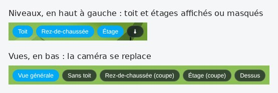
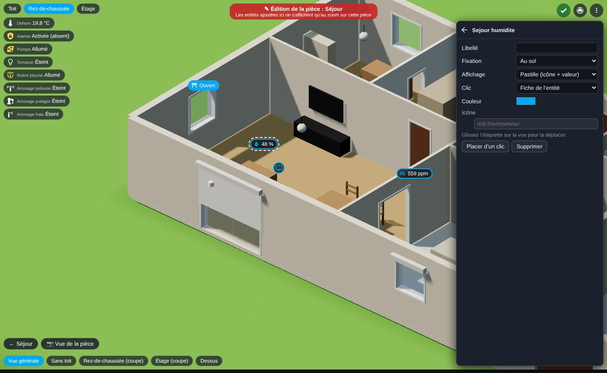
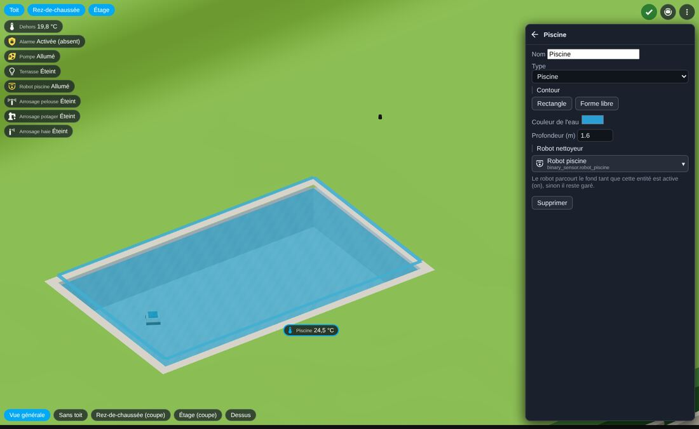
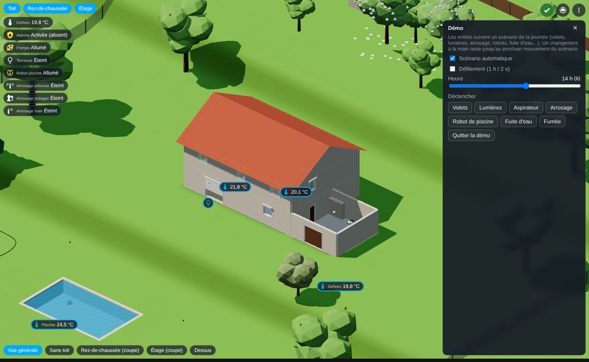

# House View: przewodnik po instalacji, konfiguracji i użytkowaniu

House View pokazuje Twój dom w 3D w Home Assistant. Plan narysowany w Sweet Home 3D leży na prawdziwej rzeźbie terenu i jest oświetlony przez słońce w danej chwili. Widok pokazuje też pogodę, pory roku roślinności, światła w każdym pomieszczeniu i stan urządzeń (rolety, okna, robot sprzątający, nawadnianie, basen, alarmy…).

Wszystkie obrazy w tym przewodniku wykonano w **domu demonstracyjnym** dostarczanym z integracją: fikcyjny dom, teren i encje. Pokazują francuski interfejs karty. Karta istnieje po francusku i po angielsku: cytowane niżej napisy karty pochodzą z interfejsu angielskiego, a napisy Home Assistant są po polsku.


## Spis treści

1. [Czego potrzebujesz](#1-czego-potrzebujesz)
2. [Instalacja](#2-instalacja)
3. [Dodanie karty do pulpitu](#3-dodanie-karty-do-pulpitu)
4. [Pierwsze uruchomienie: plan i teren](#4-pierwsze-uruchomienie-plan-i-teren)
5. [Korzystanie z widoku](#5-korzystanie-z-widoku)
6. [Edytor](#6-edytor)
7. [Konfiguracja (⚙)](#7-konfiguracja-)
8. [Kilka domów](#8-kilka-domów)
9. [Tryb demo](#9-tryb-demo)
10. [Opcje karty](#10-opcje-karty)
11. [Częste pytania](#11-częste-pytania)

---

## 1. Czego potrzebujesz

- **Home Assistant 2026.3 lub nowszy**. Wymagają go sprzątanie według pomieszczeń i ikona integracji; reszta działa ze starszymi wersjami.
- **Plan domu**. Najpełniejszy jest plan **Sweet Home 3D** (`.sh3d`, zapisany w wersji 5.3 lub nowszej); nadaje się też plik **IFC** (ArchiCAD, Revit, FreeCAD…) lub plan **SVG**, a bez żadnego pliku karta rysuje prosty plan ([4.2](#42-tworzenie-prostego-planu)). W planie Sweet Home 3D liczy się:
  - jeden **poziom na kondygnację** (parter, piętro, piwnica…);
  - **ściany**;
  - **pomieszczenia**, narysowane narzędziem *Utwórz pomieszczenia* i **nazwane**: nazwa łączy je z obszarami Home Assistant;
  - **drzwi i okna** z katalogu (wycinają ściany i mogą być animowane);
  - **kompas** ustawiony na Twoją szerokość geograficzną i na północ (zależą od niego słońce i pory roku);
  - opcjonalnie: meble, światła, drzewa i obiekty ogrodowe (szopa, brama, basen…).
- **Obszary w Home Assistant** dla Twoich pomieszczeń, z przypisanymi światłami, czujnikami i roletami: dzięki temu widok wie, co gdzie pokazać.

Terenu (rzeźba, sąsiednie budynki, drogi, kataster, zdjęcie lotnicze) nie musisz dostarczać: integracja pobiera go sama (zob. [4.4](#44-pobieranie-terenu)).

## 2. Instalacja

### 2.1 Instalacja integracji

**Przez HACS** (zalecane):

1. HACS → menu ⋮ → *Niestandardowe repozytoria* → dodaj `https://github.com/elwinmage/ha-house-view-component`, typ *Integracja*.
2. Wyszukaj **House View** w HACS i zainstaluj.
3. Uruchom ponownie Home Assistant.

**Ręcznie**: rozpakuj `house_view.zip` z najnowszego wydania (zawiera zbudowaną kartę) do `config/custom_components/house_view/`, a potem uruchom ponownie.

> Karta (plik JavaScript) jest dostarczana z integracją i ładuje się sama na wszystkich pulpitach: **nie trzeba ręcznie dodawać zasobu Lovelace**.

### 2.2 Dodanie domu

1. *Ustawienia → Urządzenia oraz usługi → Dodaj integrację →* **House View**.
2. Nadaj domowi **nazwę** (na przykład „Dom”) i sprawdź jego **lokalizację** na mapie: domyślnie jest to lokalizacja Home Assistant. W razie potrzeby przesuń znacznik na dom: służy do słońca, pór roku i pobierania terenu.
3. Zatwierdź.

Każdy dom to wpis integracji; drugi dom opisuje rozdział [Kilka domów](#8-kilka-domów).

## 3. Dodanie karty do pulpitu

1. Otwórz pulpit, włącz tryb edycji, *Dodaj kartę*, a następnie wyszukaj **House View**.
2. Opcje ustawia się w edytorze wizualnym karty (zob. [Opcje karty](#10-opcje-karty)). Na początek przydatna jest tylko encja pogody.

W YAML wystarczy:

```yaml
type: custom:house-view-card
weather_entity: weather.dom
```

**Aby była duża**, umieść kartę w widoku typu **Sekcje** i ustaw ją na **pełną szerokość**: w edytorze karty, karta *Układ*, włącz pełną szerokość. Z opcją `height: fill` (domyślną) zajmuje wtedy całą dostępną szerokość i wysokość. Widok typu *Panel* (jedna karta) również daje pełny ekran.

Dopóki nie zaimportowano planu, karta pokazuje komunikat i przycisk **⚙ Setup** (widoczny tylko dla administratorów).


## 4. Pierwsze uruchomienie: plan i teren

Otwórz ⚙ **Setup** (przycisk pustej karty albo **menu ⋮ → Setup**).


### 4.1 Import planu

W sekcji **Plan of the house** kliknij *Import a plan* i wybierz plik: Sweet Home 3D (`.sh3d`), IFC (`.ifc`) lub SVG (`.svg`). Plan jest odczytywany w przeglądarce (zachowana zostaje tylko struktura: poziomy, ściany, pomieszczenia, otwory, światła, meble, roślinność), a **raport** wymienia, co znaleziono, z ewentualnymi uwagami (poziom bez pomieszczeń, nieustawiony kompas…).


Dom od razu pojawia się na płaskim gruncie. Meble są rysowane z ich **własnymi modelami 3D** z pliku Sweet Home 3D (odchudzonymi, jeden kolor na materiał, średni kolor tekstury); pole *Furniture drawn with the 3D models of the plan* przywraca proste kształty. Mebel z modelem w innym formacie niż OBJ zostaje prostopadłościanem lub obiektem katalogu o tej samej nazwie.

> **Wskazówka**: jeśli pomieszczenie nie ma obszaru Home Assistant o tej samej nazwie, konfiguracja to zgłasza. Możesz je połączyć ręcznie w edytorze ([6.5](#65-pomieszczenia--obszary-home-assistant)).

**Formaty**:

- **Sweet Home 3D**: poziomy, ściany, pomieszczenia, drzwi i okna, światła, meble i roślinność.
- **IFC** (eksportowany z ArchiCAD, Revit, FreeCAD, BlenderBIM…): kondygnacje stają się poziomami, a przestrzenie (`IfcSpace`) pomieszczeniami, wraz ze ścianami, drzwiami i oknami. Pamiętaj o eksporcie przestrzeni: bez nich nie ma pomieszczeń, a więc ani świateł, ani połączenia z obszarami.
- **SVG** (plan rysowany dla ha-floorplan lub w Inkscape): każdy zamknięty kształt z nazwą (jego id, etykieta Inkscape lub `<title>`) to pomieszczenie; id `area.salon` daje „Salon”. Warstwy Inkscape zawierające pomieszczenia stają się poziomami. Popraw **skalę** (*Scale: SVG units per meter*), jeśli podany rozmiar się nie zgadza. SVG złożony z prostokątów otwiera się w prostym planie, aby dodać drzwi i okna.

W planie IFC, SVG lub prostym każde pomieszczenie dostaje lampę sufitową zapalaną przez światła jego obszaru.

### 4.2 Tworzenie prostego planu

Nie masz planu? *Create a simple plan* (w sekcji **Plan of the house**) otwiera edytor prostokątnych pomieszczeń; widok 3D aktualizuje się za nim.


- **Pomieszczenia**: *＋ Room* dodaje pomieszczenie obok poprzedniego, nazwane według jeszcze nieużytego obszaru Home Assistant. Przeciągnij pomieszczenie, aby je przesunąć, a jego uchwyty, aby zmienić rozmiar: krawędzie przyklejają się do sąsiednich pomieszczeń, które dzielą wtedy ścianę. Pola wybranego pomieszczenia ustawiają jego nazwę, **obszar HA**, szerokość, głębokość i położenie.
- **Drzwi i okna**: wybierz *＋ Window*, *＋ Patio door* lub *＋ Door*, a potem kliknij ścianę pomieszczenia, na której ma się znaleźć. Przeciągnij je wzdłuż ściany i ustaw szerokość, wysokość i wysokość parapetu.
- **Poziomy**: *＋ Level* dodaje kondygnację kopiującą obrys pomieszczeń poniżej, do przemianowania i ponownego podziału; wysokość ustawia się dla każdego poziomu. Obrys poziomu poniżej pozostaje widoczny jako linia przerywana.
- **Dach i orientacja**: dach automatyczny, dwuspadowy lub płaski; kąt północy (dopasowanie do terenu poprawia go później).

Plan zapisuje się sam i otwiera ponownie przyciskiem *Edit the simple plan*. Prosty plan zastępuje zaimportowany plan po potwierdzeniu; umieszczone encje, nawadnianie, ogrodzenia… zostają zachowane.

### 4.3 Start od mapy robota

Jeśli robot sprzątający zmapował dom, a ekstraktor map (Xiaomi Cloud Map Extractor, Roborock Custom Map…) podaje jego pomieszczenia (atrybut `rooms`), przycisk *Plan from the robot's map* tworzy prosty plan z tymi pomieszczeniami, w ich rozmiarze i miejscu. To przybliżone prostokąty, i tylko z poziomu robota: dopasuj je, a potem dodaj drzwi, okna i inne poziomy w prostym planie.

### 4.4 Pobieranie terenu

W sekcji **Terrain (DTM)**:

1. **Source**: *Automatic (by country)* wybiera usługi IGN we Francji, a gdzie indziej otwarte dane światowe (Mapterhorn dla rzeźby, OpenStreetMap dla budynków i dróg).
2. **Szerokość / długość**: przejęte z lokalizacji domu, czyli z konfiguracji Home Assistant (*Ustawienia → System → Ogólne*), chyba że zmieniono ją przy dodawaniu domu. Można je tu zmienić.
3. **Size**: wielkość terenu wokół domu (domyślnie 120 m).
4. Opcje (Francja): model powierzchni (drzewa i automatyczne dopasowanie), budynki, drogi i kataster, zdjęcie lotnicze lub mapa IGN na gruncie; dopasowanie do najbliższego budynku (lokalizacja w Home Assistant bywa przybliżona).
5. Kliknij **Fetch the terrain**. Kroki pojawiają się pod formularzem (lokalizacja, rzeźba, powierzchnia, budynki i drogi, zdjęcie).


Na koniec plan jest **automatycznie dopasowany** do terenu (obrót, przesunięcie, wysokość), znalezione drzewa zostają posadzone, a rzeźba, drogi i zdjęcie się pojawiają.

Możesz też wczytać plik terenu (*Load a terrain .json*) albo ręcznie poprawić dopasowanie (obrót, przesunięcie, wysokość) w tej samej sekcji.

## 5. Korzystanie z widoku


### 5.1 Poruszanie się

- **Przeciągnij**, aby obrócić, **kółko lub uszczypnięcie**, aby powiększyć, **prawy przycisk / dwa palce**, aby przesunąć.
- **Widoki** na dole (General view, Without roof, Ground floor (cut), First floor (cut), Top) ustawiają kamerę. Własne zapisujesz w edytorze ([6.11](#611-drzewa-obiekty-zewnętrzne-i-poprawki-gruntu)).
- **Poziomy** w lewym górnym rogu (Roof, Ground floor, First floor) pokazują lub ukrywają dach i każdą kondygnację; 🌡 koloruje pomieszczenia według temperatury.



| Przekrój parteru | Widok z góry |
|---|---|
|  |  |

### 5.2 Pomieszczenia

- **Dotknięcie pomieszczenia** przybliża je (dach i wyższe kondygnacje znikają). **Drugie dotknięcie** włącza lub wyłącza jego światła. Przycisk **← Room** wraca do poprzedniego widoku.
- Po przybliżeniu pomieszczenia widać tylko **jego encje** (encje widoku ogólnego znikają); robot sprzątający pozostaje widoczny, jeśli tam jest.


### 5.3 Lewa kolumna: panel ogólny

Pod poziomami **panel ogólny** zbiera czujniki i sterowanie całego domu (temperatura na zewnątrz, alarm, pompa, nawadnianie…). Dotknięcie przełącza to, co da się przełączyć, a dla pozostałych otwiera okno szczegółów.

### 5.4 Pasek i menu ⋮

W prawym górnym rogu:

- **plakietka alarmu**: zielona, gdy wszystko w porządku, czerwona z liczbą aktywnych alarmów;
- przycisk dla każdego **robota sprzątającego**;
- menu **⋮**, które zbiera rzadziej używane narzędzia i administrację.


| Pozycja | Zastosowanie |
|---|---|
| Preview | Wymuszenie pory roku, pogody lub pory dnia |
| Simulate a year | Przewinięcie pór roku całego roku w kilka sekund |
| Lock the camera | Zablokowanie kamery na widokach (ekran ścienny) |
| Simulation | Ustawienia trybu symulacji (gdy karta jest w trybie symulacji) |
| Demo | Panel domu demonstracyjnego |
| Editor ✎ | Rozmieszczanie encji, nawadniania, ogrodzeń… (administratorzy) |
| Setup ⚙ | Plan, teren, kopia zapasowa, ochrona (administratorzy) |

Często używane narzędzia mogą zostać na pasku (opcja *Buttons in the toolbar*), a menu można ukryć przed osobami, które nie są administratorami (opcja *Hide the ⋮ menu*).

### 5.5 Alarmy

Czujniki dymu, gazu, tlenku węgla, wycieku wody, problemu, ciepła, zimna i sabotażu oraz uruchomione centrale alarmowe są wykrywane same. Gdy pojawi się alarm, plakietka robi się czerwona, a **dane pomieszczenie** pokazuje czerwony dzwonek z liczbą alarmów. Dotknięcie otwiera listę; dotknięcie alarmu otwiera jego szczegóły; przekreślony dzwonek go ignoruje.


### 5.6 Pogoda, słońce i pory roku

- **Słońce** podąża za godziną i datą domu; **cienie** obracają się w ciągu dnia.
- **Pogoda** pochodzi z encji pogody (deszcz, śnieg, burza, mgła, chmury, wiatr). Deszczomierz lub własne czujniki wiatru mogą ją poprawić (zob. opcje).
- **Roślinność** i **trawa** podążają za porami roku klimatu danej szerokości: cztery pory roku w strefie umiarkowanej, długa zima i krótkie lato przy biegunach, pora deszczowa i sucha między zwrotnikami. Na półkuli południowej wszystko jest odwrócone.
- **Preview** (menu ⋮): wymuś porę roku, pogodę lub porę dnia, łącząc je dowolnie; powrót na żywo przez *Preview… ✕* lub po 3 minutach.

| Preview: zima pod śniegiem | Simulate a year: jesień |
|---|---|
|  |  |

**Simulate a year** przewija cały rok (domyślnie 10 s, od 5 do 60 s) od wyświetlanej daty; etykieta pokazuje datę. Na koniec widok wraca do wcześniejszej daty.

### 5.7 Światła, rolety i okna

Światła każdego pomieszczenia oświetlają je i jego okna. **Rolety** opuszczają się do swojego rzeczywistego położenia, **okna** się otwierają, **drzwi przesuwne** się przesuwają, **drzwi** obracają się na zawiasach.


### 5.8 Robot sprzątający

Dotknięcie przycisku robota otwiera wybór pomieszczeń: wybierz je na planie, potem *Clean* (także *Start*, *Pause*, *Dock*). Podczas sprzątania porusza się robot 3D, bieżące pomieszczenie jest kolorowane wraz z procentem, pomieszczenia oczekujące są lekko zabarwione, skończone pomieszczenie migocze, a pierścień wokół przycisku pokazuje ogólny postęp. Przy błędzie pomieszczenie i robot migają na czerwono.


### 5.9 Nawadnianie, basen i oczko wodne

Gdy zawór się otwiera, **linie kroplujące** świecą na niebiesko i rośnie mokra plama; **zraszacze** pokazują strumień i sektor. Robot basenowy jeździ po dnie, dopóki jego encja jest aktywna; woda się porusza.

| Zraszacze o świcie | Basen i oczko wodne |
|---|---|
|  |  |

## 6. Edytor

Tylko dla administratorów: **menu ⋮ → Editor**. Edytor to **menu sekcji**. Sekcja otwiera się we własnym oknie, nad menu; element listy (linia kroplująca, strefa, encja…) otwiera się nad sekcją. Strzałka **←** wraca do okna pod spodem. Wszystko zapisuje się samo; **Esc** anuluje bieżące rysowanie.


### 6.1 Umieszczone encje

Aby umieścić encję w widoku (temperatura, światło, przełącznik, roleta…):

1. *Add an entity*: lista najpierw proponuje encje bieżącego pomieszczenia, pogrupowane według urządzenia (cały dom jednym dotknięciem, z wyszukiwaniem).
2. Dotknij wybranego miejsca w widoku. Etykietę można potem **przesuwać, przeciągając ją** (przy otwartym edytorze).
3. Ustaw: **Mount** (na podłodze, na ścianie, swobodnie na wysokości), **Display** (plakietka z wartością lub sama ikona), etykietę, ikonę, kolor, akcję dotknięcia (szczegóły, przełączenie, nic).

Encje są ułożone w **warstwy**:

- **Widok ogólny**: pokazywane w widoku ogólnym (lub tylko w widoku swojej kondygnacji). Pole *Shown over the roof* pozwala na przykład odczytać z daleka temperaturę pomieszczenia.
- **Pomieszczenie**: pokazywane tylko po przybliżeniu ich pomieszczenia.


Aby edytować **encje pomieszczenia**, dotknij go w widoku przy otwartym edytorze: zostaje przybliżone, a **czerwony pasek** informuje, że edytujesz to pomieszczenie. Dodane wtedy encje należą tylko do niego; umieść je na podłodze, na ścianie lub w powietrzu.



> Encja widoku ogólnego umieszczona już w pomieszczeniu przechodzi do niego po ustawieniu *Visible → Its room only*.

Umieszczone **światło** staje się w tym miejscu prawdziwym źródłem światła (reflektor, lampa wisząca, lampa, taśma lub niewidoczne; wysokość i zasięg do ustawienia; na ścianie: kinkiet).

### 6.2 Panel ogólny

Czujniki i sterowanie lewej kolumny, w wybranej kolejności, z etykietą, ikoną i akcją dotknięcia (automatyczna, przełączenie, szczegóły, nic).


### 6.3 Alarmy

Automatyczne wykrywanie włączone lub nie, dzwonki w pomieszczeniach, encje dodane ręcznie, encje ignorowane.


### 6.4 Strefy klikalne

**Odtwarzacz multimedialny** położony na meblu z planu (dotknij go) lub na prostokącie przy ścianie albo na podłodze; **akwarium** integracji [reeftank](https://github.com/Elwinmage/ha-reeftank-component) na prostokącie o wymiarach zbiornika. Dotknięcie otwiera odtwarzacz albo widok akwarium karty [ha-reef-card](https://github.com/Elwinmage/ha-reef-card); prostokąt akwarium pokazuje ten widok na żywo, z rybami, nigdy nie zniekształcony. Podczas umieszczania wskazana powierzchnia się podświetla; strefę przesuwa się, przeciągając ją.


### 6.5 Pomieszczenia ↔ obszary Home Assistant

Każde pomieszczenie planu jest połączone z obszarem Home Assistant **o tej samej nazwie** (bez względu na akcenty i wielkość liter). Ta sekcja pozwala wybrać inny obszar lub żaden, pomieszczenie po pomieszczeniu.


### 6.6 Drzwi i okna

Otwory planu, według poziomu i pomieszczenia; **Pick on the view** pozwala dotknąć okna bezpośrednio (podświetla się po najechaniu). Każdy można połączyć z:

- **czujnikiem otwarcia** (`binary_sensor`);
- **napędem okna** (`cover` okna);
- **roletą** (`cover`), dla okien i drzwi przesuwnych.

Pomieszczenie, które ma **tylko jedno okno**, samo łączy się z czujnikiem okna, napędem i roletą swojego obszaru (gdy jest po jednym z każdego); pomieszczenie z tylko jednymi drzwiami — z czujnikiem drzwi. Połączenie wybrane ręcznie ma pierwszeństwo; połączenie automatyczne można usunąć.


### 6.7 Baseny i oczka wodne

*＋ Pool* lub *＋ Pond*, potem narysuj obrys widziany z góry: **Rectangle** (dwa przeciwległe narożniki) lub **Free shape** (punkt po punkcie, potem *Finish*). Ustaw nazwę, kolor wody, głębokość (0,2 do 6 m) i, jeśli masz, **robota czyszczącego** (`binary_sensor`, `switch`, `input_boolean` lub `vacuum`). Teren zostaje wykopany: pionowe ściany, płaskie dno i obrzeże dla basenu; opadające dno i brzeg z kamyków dla oczka.



> Basen narysowany w Sweet Home 3D, jeśli jest, zostaje bez zmian.

**Wyspy** (oczko): *＋ Island (Rectangle)* lub *＋ Island (Free shape)*, a potem narysuj ją w wodzie jak obrys. Grunt zostaje tam zachowany, nieco nad wodą, z brzegiem z kamyków: można na niej posadzić drzewo (sekcja **Drzewa**) i umieścić encje.

**Ryby** (oczko): ryby pochodzą z katalogu domu (na początek karp koi). Dodaj **grupę** dla każdej odmiany, z liczbą i rozmiarem: dla 3 czerwonych karpi, 1 czerwono-białego i 2 żółtych utwórz trzy grupy (Benigoi × 3, Kohaku × 1, Yamabuki ogon × 2). *Colours of my own* pozwala wybrać kolor ciała, kolor plam, wzór (jednolity, duże, średnie lub małe plamy) i błyszczące łuski. Każda ryba ma własny, zawsze ten sam wzór; pływa w wodzie, omijając brzegi i wyspy, im głębiej, tym bardziej przybiera kolor wody, a w zimnie (poniżej 8 °C) stoi niemal nieruchomo przy dnie.


### 6.8 Robot sprzątający

Dla każdego robota (lista *Robot*):

- **Place the dock**, potem dotknij podłogi; ustaw jej **kierunek** (lub *Aim with a tap*);
- **Robot position**: Roborock (oficjalna akcja), atrybuty encji (ekstraktory map) lub brak (szacowana trasa);
- **Kalibracja**: obrót, lustro, skala; *Calibrate with a tap*, gdy robot opuścił stację;
- **Mapa robota** nałożona na plan, aby ją wyrównać: z ekstraktorem map (punkty kalibracji) układa się sama; z oficjalną integracją Roborock wskaż stację dotknięciem (*The dock is here on the map*);
- kolory robota i bieżącego pomieszczenia, *Show this robot on the view*, *Test the animation*.


### 6.9 Nawadnianie

- **Drip lines** (linie kroplujące): jedna linia na zawór (`switch`, `valve`, `input_boolean`), rysowana punkt po punkcie, z kolorem rury, przepływem i rozstawem emiterów.
- **Sprinklers** (zraszacze): jeden obwód na zawór, z jednym lub kilkoma zraszaczami z katalogu (Hunter PSU, SRM, PGJ, PGP, MP Rotator lub ogólny), ich zasięgiem, kierunkiem i kątem (*Aim* dotknięciem).
- Jeden zawór może sterować **kilkoma liniami lub obwodami**: wybierz dla każdego tę samą encję, włączają się razem.
- **Test the animation**: 30 s przyspieszonego nawadniania bez otwierania żadnego zaworu.


### 6.10 Ogrodzenia

*Fence from the cadastre* (działki domu są wstępnie zaznaczone; **tylko we Francji**, bo kataster pochodzi z usług IGN: gdzie indziej narysuj ogrodzenie ręcznie) lub *Draw a fence* punkt po punkcie. Każdy bok ma swój typ (siatka, drewno, mur, żywopłot lub otwarty na bramę) i wysokość; *Edit the sides* zmienia bok, dzieli go na dwa lub usuwa punkt.


### 6.11 Drzewa, obiekty zewnętrzne i poprawki gruntu

- **Drzewa**: usuń błędnie wykryte, posadź nowe (gatunek z katalogu i wysokość), cofnij, przywróć wszystkie.
- **Obiekty zewnętrzne** (szopa, brama…): ukrycie, wysokość, przesunięcie, obrót.
- **Poprawki gruntu**: murek, taras, pędzle (podnieś, wykop, wygładź), przekrój terenu.
- **Widoki**: zapisz bieżącą kamerę jako widok, zmień nazwę, usuń.


### 6.12 Katalog drzew i obiektów

Gatunki drzew (z wyglądem w każdej porze roku), obiekty ogrodowe i meble rysowane zamiast zwykłych prostopadłościanów oraz ryby oczek pochodzą z [katalogu domu](https://github.com/Elwinmage/house-catalog). Integracja aktualizuje go sama z GitHuba (urządzenie *House view catalog*: jedna encja aktualizacji na sekcję, przełącznik automatycznej aktualizacji, przycisk natychmiastowej aktualizacji) i działa offline z dołączoną kopią.

Aby stworzyć **własne drzewo lub obiekt**, użyj [edytora katalogu](https://github.com/Elwinmage/catalog-editor): karty Home Assistant, w której ustawia się kształt, kolory i pory roku, widząc wynik. To, co zapiszesz, widok wykorzystuje od razu, a potem możesz to zaproponować do wspólnego katalogu (pull request na GitHubie), aby wszyscy mogli z tego korzystać.

## 7. Konfiguracja (⚙)


- **Demo**: zob. [Tryb demo](#9-tryb-demo).
- **Plan** i **teren**: zob. [pierwsze uruchomienie](#4-pierwsze-uruchomienie-plan-i-teren).
- **GitHub backup**: ustaw **prywatne** repozytorium w opcjach integracji (*Ustawienia → Urządzenia oraz usługi → House View → Konfiguruj → kopia zapasowa GitHub*: repozytorium `właściciel/nazwa`, token *fine-grained* z *Contents: read and write*, gałąź, folder), potem *Back up to GitHub* / *Restore from GitHub*. Repozytorium publiczne jest odrzucane: zawierałoby plan Twojego domu.
- **Edit protection**: przed otwarciem edytora i konfiguracji może być wymagane hasło (opcje integracji → ochrona edycji). Karta prosi o nie ponownie po 10 minutach bez zmian; przycisk 🔒 blokuje od razu. Oglądanie, przybliżanie, sterowanie światłami czy odkurzaczem pozostają wolne.
- **Edits file**: eksport lub import wszystkich edycji (encje, nawadnianie, ogrodzenia…) w pliku JSON.

## 8. Kilka domów

Dom wakacyjny, domek w górach… Każdy dom to **wpis** integracji, z własnym planem, terenem i edycjami.

1. *Ustawienia → Urządzenia oraz usługi → House View → Dodaj wpis*.
2. Nadaj mu nazwę (inną niż pozostałe) i lokalizację.
3. W karcie (edytor wizualny) wybierz wyświetlany **dom**: lista pojawia się, gdy są co najmniej dwa. W YAML: `home: <id wpisu>`.
4. Zaimportuj jego plan i pobierz teren jak w [rozdziale 4](#4-pierwsze-uruchomienie-plan-i-teren).

Usunięcie wpisu usuwa jego dokumenty; pozostałe domy nie są ruszane.

## 9. Tryb demo

Aby nagrać lub zaprezentować widok **bez pokazywania swojego domu ani lokalizacji**.

1. ⚙ → **Demo** → *Load the demo*: dodany zostaje dom „Démo” z fikcyjną lokalizacją (45° N); Twoje domy nie są ruszane. Zaczyna się **pusty i płaski**, aby można go było nagrywać od początku.

   

2. Zaimportuj `demo-maison.sh3d` (*Download demo-maison.sh3d* w ⚙) przez *Import a plan*.
3. *Fetch the terrain*: pobieranie przechodzi przez swoje kroki i przynosi fikcyjny teren na trzech tarasach (sad, dom, ogród z basenem i oczkiem), bez żadnego dostępu do sieci.

Encje demo są **symulowane przez kartę**: w Home Assistant nic nie powstaje i nic z Twojego domu się nie pojawia. **Scenariusz dnia** (1 h co 2 s) ożywia dom: rano rolety w górę, nawadnianie o świcie, odkurzacz przed południem, robot basenowy po południu, okna otwarte do wietrzenia, wyciek wody przed kolacją, wieczorem światła włączone i rolety zamknięte.

Przycisk **🎬 Demo** (menu ⋮) wstrzymuje scenariusz, ustawia godzinę i ręcznie wywołuje zdarzenie (rolety, światła, odkurzacz, nawadnianie, robot basenowy, wyciek, dym). Dotknięcie symulowanej encji ją przełącza; zmiana trwa do następnego ruchu scenariusza.



*Reset the demo* przywraca stan początkowy; *Leave the demo* wraca do Twojego domu. Dom Démo usuwa się jak każdy inny wpis integracji.

## 10. Opcje karty

Ustawia się je w edytorze wizualnym karty (pulpit w trybie edycji → *Edytuj* na karcie), w sekcjach.

| Opcja | Zastosowanie | Domyślnie |
|---|---|---|
| `home` | Wyświetlany dom (kilka domów) | pierwszy |
| `mode` | `live` (czas rzeczywisty) lub `simulation` (suwaki godziny, daty i pogody) | `live` |
| `weather_entity` | Encja pogody | — |
| `rain_entity` | Czujnik deszczu lub natężenia opadu (mm/h) | — |
| `wind_speed_entity`, `wind_bearing_entity` | Własne czujniki wiatru | — |
| `view` | Widok początkowy (jego nazwa) | — |
| `show_views`, `show_levels` | Przyciski widoków, poziomów | tak |
| `show_entities` | Umieszczone encje | tak |
| `show_alarms` | Plakietka alarmu | tak |
| `tap_action` | Dotknięcie pomieszczenia: `zoom`, `toggle_lights`, `none` | `zoom` |
| `movable_camera` | Ruchoma kamera | tak |
| `height`, `min_height` | Wysokość karty (`fill`, `aspect`, w px lub `vh`) | `fill`, 320 |
| `fps_cap` | Maksymalna liczba klatek na sekundę (tablet ścienny) | 30 |
| `year_seconds` | Czas trwania „Simulate a year” (5 do 60 s) | 10 |
| `toolbar_buttons` | Narzędzia pozostające na pasku (`preview`, `year`, `camera`, `sim`, `edit`, `setup`) | brak |
| `hide_menu` | Ukrycie menu ⋮ przed osobami niebędącymi administratorami | nie |
| `light_entities` | Ograniczenie uwzględnianych świateł | wszystkie |
| `vacuum_entity`, `vacuum_poll`, `vacuum_rate`, `vacuum_show_floor`, `vacuum_progress_entity` | Robot sprzątający | — |

W trybie **symulacji** panel *Simulation* (menu ⋮) ustawia godzinę (z odtwarzaniem), datę, pogodę, chmury, deszcz, wiatr, temperaturę i śnieg.


## 11. Częste pytania

**Pomieszczenie pozostaje ciemne, jego światła się nie pokazują.**
Sprawdź, czy jest połączone z obszarem Home Assistant ([6.5](#65-pomieszczenia--obszary-home-assistant)) i czy jego światła są przypisane do tego obszaru.

**Słońce lub pory roku się nie zgadzają.**
Kompas planu Sweet Home 3D musi być ustawiony (szerokość i północ), a lokalizacja domu musi być poprawna (opcje wpisu House View).

**Dom unosi się nad terenem lub w niego zapada.**
Popraw wysokość w ⚙ → *Terrain (DTM)* albo ponownie uruchom automatyczne dopasowanie.

**Etykieta się nie pojawia.**
Etykieta zasłonięta przez dach lub kondygnację nie jest pokazywana (chyba że z *Shown over the roof*), a etykieta pomieszczenia pojawia się tylko po przybliżeniu jej pomieszczenia. Przy edytorze otwartym na *Placed entities* widać wszystkie etykiety warstwy (przygaszone, gdy są zasłonięte).

**Mapa robota nie jest wyrównana.**
Z oficjalną integracją Roborock wskaż stację na mapie dotknięciem, potem ustaw obrót. Z ekstraktorem map (Roborock Custom Map, Xiaomi Cloud Map Extractor) wybierz jego encję: mapa układa się sama.

**Na gruncie nie ma zdjęcia lotniczego.**
W ⚙ → *Terrain (DTM)* sprawdź, czy *Aerial photo on the ground* jest zaznaczone. Jeśli pobieranie zgłasza „ground texture unavailable”, przyczyna w nawiasie pochodzi z usługi IGN; spróbuj ponownie później.

**Chcę pokazać widok bez pokazywania swojego domu.**
Użyj [trybu demo](#9-tryb-demo).
