<p align="center">
  <picture>
    <source media="(prefers-color-scheme: dark)" srcset="../../custom_components/house_view/brand/dark_logo.png">
    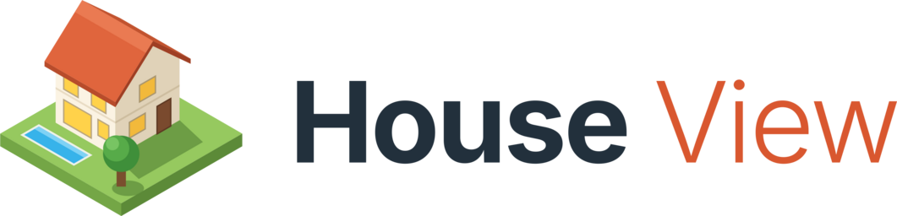
  </picture>
</p>

# House View

[](https://github.com/Elwinmage/ha-house-view-component/releases)
[](https://github.com/Elwinmage/ha-house-view-component/commits/main)
[](https://github.com/hacs/default)
[](https://opensource.org/licenses/MIT)
[](https://codecov.io/gh/Elwinmage/ha-house-view-component)
[](https://analytics.home-assistant.io/custom_integrations)

**Dostępne języki:**
[](../fr/README.fr.md)
[](../../README.md)
[](../es/README.es.md)
[](../de/README.de.md)
[](README.pl.md)
[](../pt/README.pt.md)
[](../it/README.it.md)
[](../nl/README.nl.md)

📘 **Pełny przewodnik** (instalacja, konfiguracja, użytkowanie, z ilustracjami): [GUIDE.pl.md](GUIDE.pl.md)

Widok pseudo-3D Twojego domu na żywo dla Home Assistant: plan (**Sweet Home 3D**, IFC lub SVG) położony na numerycznym modelu terenu, ze światłami, pogodą, słońcem i porami roku w czasie rzeczywistym, a do tego robot odkurzający, podlewanie ogrodu i ogrodzenia. Jedno repozytorium zawiera:

- `custom_components/house_view/`: **integrację** (przechowuje plan, teren i Twoje poprawki; pobiera teren; API HTTP);
- `card/`: **kartę Lovelace** `house-view-card` (three.js), budowaną do `custom_components/house_view/frontend/`. Integracja sama ją udostępnia (`/house_view/house-view-card.js`) i ładuje na wszystkich pulpitach: **nie trzeba deklarować żadnego zasobu Lovelace**.

Interfejs karty i opcje integracji są dostępne po angielsku, francusku, włosku, niemiecku, hiszpańsku, polsku, portugalsku i niderlandzku (karta podąża za językiem Twojego profilu Home Assistant). Nazwy przycisków i sekcji są tu podane po angielsku. Tłumaczenia są mile widziane: teksty znajdują się w `custom_components/house_view/translations/` i `card/src/i18n.js`.

## Przegląd

<p align="center">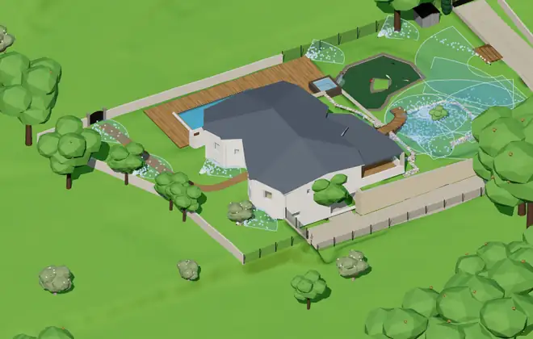</p>
<p align="center"><em>Przykładowa posesja obracająca się wokół własnej osi: rzeźba terenu pochodzi z danych publicznych, wszystko inne narysowano w edytorze karty.</em></p>
<p align="center"> 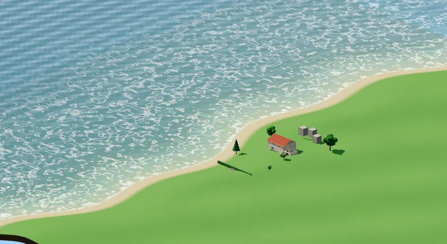</p>
<p align="center"><a href="https://youtu.be/MyXz5AVbtJI">▶ Obejrzyj film</a></p>

House View zamienia plan Twojego domu w jego żywy obraz. Większość kart 3D dla Home Assistant wczytuje ciężki model budynku (eksport GLB / OBJ) i przypisuje encje do jego obiektów albo układa przezroczyste warstwy na obrazie. House View idzie inną drogą: **lekka scena proceduralna** rysowana na żywo z Twojego planu, pokazująca także ogród i niebo, nie tylko ściany. O ile nam wiadomo, nic podobnego nie łączy następujących cech:

### Teren przychodzi sam

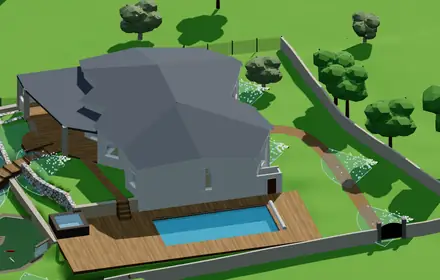

Nic do mierzenia, nic do rysowania: podaj położenie domu, a integracja sama pobierze grunt wokół niego z **publicznych, bezpłatnych danych**, zebranych **z samolotów** (skaning laserowy LiDAR, zdjęcia lotnicze) lub **z satelitów** (światowy model radarowy). Jedno kliknięcie *Fetch the terrain*; tam, gdzie istnieje model powierzchni, plan jest potem sam dopasowywany do terenu, drzewa stają tam, gdzie zobaczył je laser, a skomplikowane dachy można z niego odczytać.

| Co | Francja | Reszta świata |
|---|---|---|
| Rzeźba gruntu | IGN LiDAR HD: laser z samolotu, wysokość co 50 cm (w razie braku RGE ALTI, 1 m) | Mapterhorn: otwarte pomiary LiDAR wielu krajów, a wszędzie indziej model Copernicus 30 m, zmierzony przez satelity radarowe |
| Dachy i drzewa | Model powierzchni LiDAR HD | — |
| Budynki i drogi | IGN BD TOPO | OpenStreetMap |
| Działki | Kataster: ogrodzenie może biec wzdłuż nich | — |
| Obraz na gruncie | Zdjęcia lotnicze IGN albo mapa IGN | — |

Karta nigdy nie łączy się z Internetem: integracja pobiera teren raz i przechowuje go w Twoim Home Assistant. Tam, gdzie rzeźba jest zbyt zgrubna albo ogród został przebudowany, *poprawki gruntu* edytora rysują na nowo skarpy, platformy i mury oporowe. Szczegóły kraj po kraju: [Źródła terenu według kraju](#źródła-terenu-według-kraju).

### Co się rusza w widoku

Wszystko poniżej jest rysowane na żywo według stanu Twoich encji; te obrazy pochodzą z domu demonstracyjnego dostarczanego z integracją.

<table>
<tr>
<td width="50%" valign="top">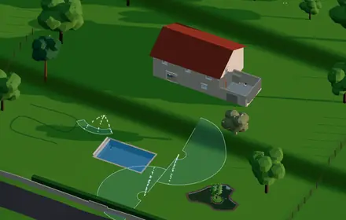<br><b>Słońce i cienie</b><br>Światło godzina po godzinie podąża za słońcem Twojej szerokości geograficznej; dom żyje swoim dniem: rolety, podlewanie, wieczorem lampy.</td>
<td width="50%" valign="top">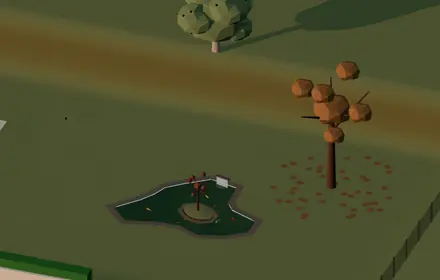<br><b>Pory roku</b><br>Liście, kwiaty, owoce i opadłe liście podążają za datą, każdy gatunek według własnego kalendarza.</td>
</tr>
<tr>
<td width="50%" valign="top">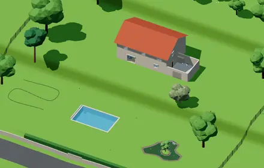<br><b>Pogoda</b><br>Deszcz pochylony przez wiatr, burze, zalegający śnieg, mgła: według Twojej encji pogody albo własnych czujników.</td>
<td width="50%" valign="top">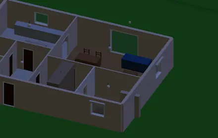<br><b>Światła</b><br>Każda lampa z prawdziwym stanem, kolorem i jasnością; dotknięcie pomieszczenia przybliża je i steruje jego światłami.</td>
</tr>
<tr>
<td width="50%" valign="top">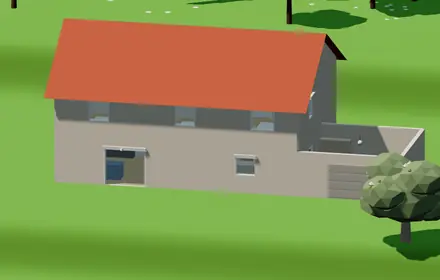<br><b>Rolety</b><br>Podążają za położeniem Twoich rolet.</td>
<td width="50%" valign="top">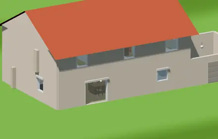<br><b>Okna</b><br>Okna i drzwi tarasowe otwierają się razem ze swoimi czujnikami.</td>
</tr>
<tr>
<td width="50%" valign="top">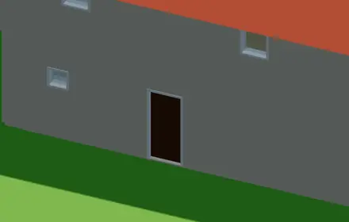<br><b>Drzwi</b><br>Drzwi również, każde na swój sposób.</td>
<td width="50%" valign="top">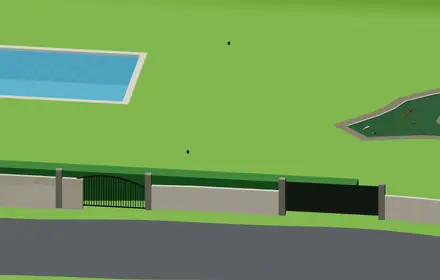<br><b>Bramy</b><br>Skrzydłowe lub przesuwne, jedno- lub dwuskrzydłowe, ażurowe lub pełne, na dowolnym ogrodzeniu.</td>
</tr>
<tr>
<td width="50%" valign="top">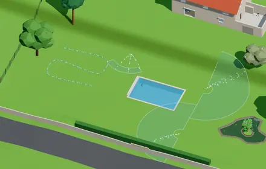<br><b>Podlewanie</b><br>Linie kroplujące i zraszacze (turbinowe, dysze rotacyjne, statyczne) działają razem z zaworami; grunt wilgotnieje.</td>
<td width="50%" valign="top">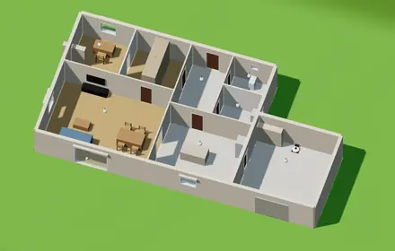<br><b>Robot odkurzający</b><br>Robot jeździ po planie, a pomieszczenia zabarwiają się w miarę sprzątania (w przyspieszeniu).</td>
</tr>
<tr>
<td width="50%" valign="top">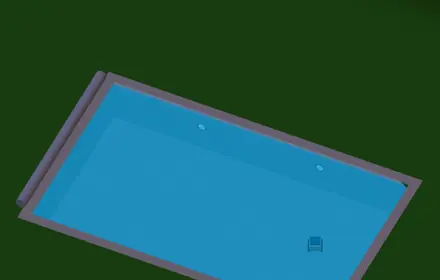<br><b>Basen</b><br>Robot czyszczący przy pracy, reflektory, roleta basenowa.</td>
<td width="50%" valign="top">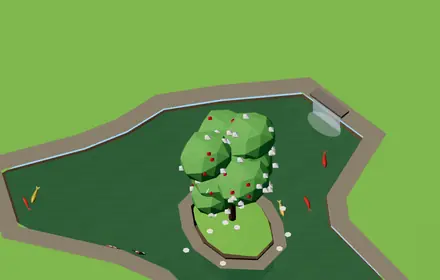<br><b>Staw</b><br>Karpie koi kilku odmian, wyspa, wodospad.</td>
</tr>
<tr>
<td colspan="2">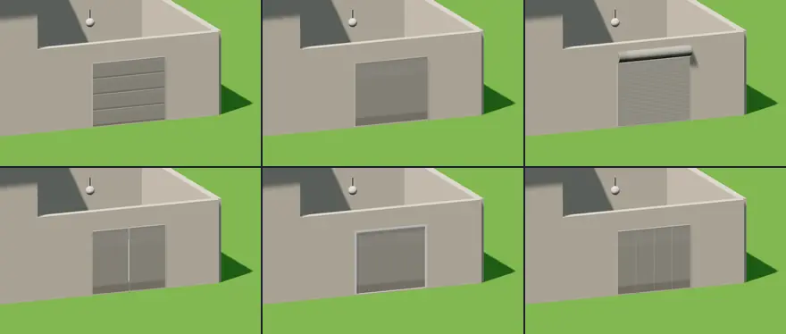<br><b>Bramy garażowe</b><br>Sześć sposobów otwierania: segmentowa, uchylna, rolowana, skrzydłowa, przesuwna, składana (w przyspieszeniu).</td>
</tr>
</table>

### Wszystko, co potrafi

- **Lekka z założenia** : żadnego ciężkiego eksportu 3D do wczytywania ani scalania: ściany, meble, drzewa, woda i bryły światła są generowane z planu i niewielkiego katalogu, a renderowanie zatrzymuje się, gdy karta jest niewidoczna, z opcją `fps_cap` dla tabletów ściennych. Cienie są przeliczane tylko wtedy, gdy porusza się słońce lub jakiś obiekt, obraz staje się lżejszy podczas ruchu kamery na słabym ekranie (`quality`), a scena pozostaje gotowa przez kilka minut po otwarciu innego pulpitu (`keep_scene`).
- **Twój dom na prawdziwym terenie** : plan Sweet Home 3D (lub IFC, SVG) leży na cyfrowym modelu terenu działki (IGN LiDAR HD i kataster we Francji — ogrodzenia można rysować na podstawie działek —, otwarty LiDAR i OpenStreetMap gdzie indziej), z rzeźbą terenu, drogami, sąsiednimi drzewami i Twoimi ogrodzeniami.
- **Prawdziwe słońce, pory roku i pogoda** : światło podąża za słońcem Twojej szerokości geograficznej, drzewa i trawa zmieniają się wraz z porami roku, a deszcz, śnieg, mgła, burze i wiatr (deszcz pada ukośnie zgodnie z wiatrem) podążają za Twoją encją pogody lub czujnikami. Tryb symulacji odtwarza dowolny dzień lub cały rok w kilka sekund.
- **Każde pomieszczenie żyje** : prawdziwy stan, kolor i jasność świateł, temperatury pomieszczeń, jedno dotknięcie przybliża pomieszczenie, drugie przełącza jego światła; światła ustawione gdziekolwiek stają się prawdziwymi źródłami światła.
- **Twoje encje tam, gdzie są** : czujniki, przełączniki i listy wyboru umieszczone na planie, panel ogólny, centralna plakietka alarmów (dym, wyciek wody, włamanie…), strefy do dotknięcia (odtwarzacz na meblu, akwarium reeftank pokazane na żywo na swoim zbiorniku).
- **Drzwi, okna, rolety i bramy w ruchu** : powiązane z Twoimi stykami i roletami otwierają się i zamykają w widoku; brama (skrzydłowa lub przesuwna, 1 lub 2 skrzydła, z prętów lub pełna, prosta lub łukowa) podąża za swoim cover lub stykiem.
- **Robot sprzątający** : sprzątanie pomieszczeń jednym dotknięciem, robot 3D poruszający się po planie, pomieszczenia barwione według postępu, wiele robotów, obsługa pozycji Roborock.
- **Ogród, który pracuje** : linie kroplujące i zraszacze animowane przez swoje zawory (plamy wilgoci, strumienie), ogrodzenia każdego rodzaju (siatka, drewno, mur, kute żelazo, mata trzcinowa, gabiony i dziewięć żywopłotów: laurowiśnia, tuja, cyprys Leylanda…), tarasy z drewna, płytek lub kamienia, murki tynkowane, kamienne lub ceglane, schody zewnętrzne między poziomami ogrodu, rabaty kwiatowe, których liczbę i kolory kwiatów wybierasz, baseny i oczka wodne z rybami.
- **Żywe morze** : dla domu nad brzegiem morza — poruszające się morze z falami napędzanymi wiatrem, pływem zgodnym z kalendarzem (ustawionym na prawdziwy przypływ w Twoim porcie), plażami z piasku, otoczaków, koralowców lub skał oraz szumem fal (sekcja *Sea* edytora).
- **Rosnący katalog** : drzewa, z maksymalnie czterema wyglądami w roku i odmianami kolorystycznymi (jabłonie z czerwonymi, żółtymi lub zielonymi owocami, wiśnia, wierzba, eukaliptus…) oraz obiekty pochodzą z otwartego [house-catalog](https://github.com/Elwinmage/house-catalog), aktualizowanego w tle, działającego offline i rozszerzalnego za pomocą [edytora katalogu](https://github.com/Elwinmage/catalog-editor). Stamtąd pochodzą też nawierzchnie ścieżek i tarasów, okładziny murków i rodzaje ogrodzeń.
- **Pokaż to, nie pokazując swojego domu** : przycisk *Load the demo* dodaje fikcyjny dom w dowolnym miejscu, aby nagrać, zaprezentować lub wypróbować kartę (domyślnie ukryty: włącza się w opcjach integracji).
- **Do zainstalowania tylko integracja** : kartę serwuje integracja (bez zasobu Lovelace), wszystko edytuje się w samej karcie (✎), można mieć kilka domów, Twoje poprawki są trzymane osobno od planu (ponowny import nic nie gubi), a interfejs mówi w ośmiu językach (angielski, francuski, hiszpański, niemiecki, włoski, polski, portugalski, niderlandzki).

## Instalacja

1. Zainstaluj z Marketplace: otwórz repozytorium bezpośrednio tym przyciskiem i kliknij „Zainstaluj” [](https://my.home-assistant.io/redirect/hacs_repository/?owner=Elwinmage&repository=ha-house-view-component&category=integration) albo wyszukaj „House View” w *Ustawienia → Marketplace*. W Home Assistant starszym niż 2026.11 te same kroki działają w HACS, a po nich potrzebne jest ponowne uruchomienie. Ręcznie: rozpakuj `house_view.zip` z najnowszego wydania do `config/custom_components/house_view/`, a następnie uruchom ponownie Home Assistant.
2. Dodaj integrację *House View*: nadaj domowi nazwę i położenie (domyślnie położenie Home Assistant). Każdy dom to osobny wpis: dodaj integrację ponownie dla drugiego domu (domku letniskowego…), z własnym planem, terenem i edycjami; karta pokazuje jeden dom, wybrany jej opcją `home`.
3. Dodaj kartę do pulpitu (`type: custom:house-view-card`).
4. Otwórz ⚙ w karcie (tylko administratorzy), aby zaimportować plan (Sweet Home 3D, IFC lub SVG) albo narysować prosty, a potem pobierz teren (cartes.gouv.fr we Francji, światowe otwarte dane gdzie indziej: zobacz [Źródła terenu według kraju](#źródła-terenu-według-kraju)) albo wczytaj teren z pliku `.json`.

Wersja karty jest wypisywana w konsoli przeglądarki przy ładowaniu (`🏠 HOUSE VIEW v0.x.y`). Sprzątanie według pomieszczeń i ikona integracji wymagają Home Assistant 2026.3 lub nowszego.

Zbudowana karta nie jest przechowywana w repozytorium: `release.yml` buduje ją przy każdym wydaniu i publikuje `house_view.zip`, który instaluje Marketplace. Do pracy nad kodem: `cd card && npm install && npm run build`. Karta zbudowana ponownie (albo wydanie zmieniające tylko kartę) jest podawana przy następnym odświeżeniu przeglądarki, bez restartu Home Assistant: pulpity ładują mały loader, który nazywa bundle jego aktualnym odciskiem, a otwarte strony są o tym powiadamiane (przycisk przeładowania albo automatyczne przeładowanie z `auto_reload`). Zmiana w Pythonie integracji nadal wymaga restartu.

## Konfiguracja karty

Opcje ustawia się w wizualnym edytorze karty (edytuj pulpit, potem *Edytuj* na karcie), w czterech sekcjach: czas i pogoda, wyświetlanie, światła, robot odkurzający. Plan, teren i wszystko, co umieszczono w widoku, ustawia się w samej karcie (✎ i ⚙). W YAML:

```yaml
type: custom:house-view-card
home: 01JXYZ…                         # opcjonalnie, kilka domów: wyświetlany wpis (wybierany w edytorze wizualnym); domyślnie pierwszy
weather_entity: weather.dom           # pogoda na żywo (opcjonalnie)
rain_entity: binary_sensor.deszcz     # opcjonalnie: czujnik deszczu lub czujnik natężenia opadu (mm/h) Twojej stacji
wind_speed_entity: sensor.wiatr_predk   # opcjonalnie: czujnik prędkości wiatru (stacja pogodowa lub internetowy serwis pogodowy)
wind_bearing_entity: sensor.wiatr_kier  # opcjonalnie: czujnik kierunku wiatru (stopnie lub kierunki świata)
mode: live                            # live (czas rzeczywisty) | simulation (suwaki godziny / daty / pogody)
view: Vue générale                    # widok początkowy (opcjonalnie): nazwa widoczna na jego przycisku
show_views: true                      # przyciski widoków kamery
show_levels: true                     # przyciski dach / kondygnacje (+ 🌡, gdy znane są temperatury pomieszczeń)
tap_action: zoom                      # dotknięcie pomieszczenia: zoom (drugie dotknięcie = światła) | toggle_lights | none
show_entities: true                   # encje umieszczone w edytorze
show_alarms: true                     # centralny znacznik alarmów (w prawym górnym rogu)
vacuum_entity: vacuum.robot           # opcjonalnie: domyślnie pierwszy znaleziony vacuum.*
vacuum_poll: 15                       # sekundy między dwoma odczytami pozycji (Roborock: akcja w chmurze, min. 5)
vacuum_show_floor: false              # true = podczas sprzątania pokazuje kondygnację robota z góry
vacuum_rate: 1                        # m²/min, dla szacowanej trasy robota bez pozycji
vacuum_progress_entity: sensor.xxx    # opcjonalnie: postęp (%); dla Roborock wykrywany automatycznie
movable_camera: true                  # ruchoma kamera (obrót, zoom, przesuwanie); false = unieruchomiona na widokach
height: fill                          # fill (wysokość ekranu poniżej górnej krawędzi karty) | aspect (16/10) | 600 | "70vh"
min_height: 320                       # minimalna wysokość w trybie fill (px)
fps_cap: 30                           # limit klatek na sekundę (ekrany ścienne, tablety)
quality: auto                         # auto (lżejszy podczas ruchu kamery, gdy ekran nie nadąża) | low (Raspberry Pi, tablet ścienny) | high (nigdy nie obniżany)
keep_scene: 10                        # minuty, przez które scena pozostaje gotowa po zniknięciu karty z ekranu (inny pulpit): powrót jest natychmiastowy; 0 = zwalniana od razu
auto_reload: false                    # true = strona przeładowuje się sama po aktualizacji karty (ekran ścienny); w przeciwnym razie proponuje to przycisk
year_seconds: 10                      # 📅 : odtwarza pory roku całego roku w tylu sekundach (od 5 do 60)
toolbar_buttons: [preview]            # narzędzia zostawione na pasku (preview, year, camera, sim, edit, setup); pozostałe są w menu ⋮
hide_menu: false                      # true: brak menu ⋮ dla użytkowników niebędących administratorami (ekran ścienny)
light_entities: [light.salon, ...]    # opcjonalnie: ogranicza uwzględniane światła
```

## Widok na żywo

- **Pasek** (w prawym górnym rogu): znaczek alarmów, roboty sprzątające i menu ⋮, które grupuje rzadziej używane narzędzia (podgląd pory roku / pogody / godziny, symulacja roku, blokada kamery, symulacja, demo) oraz, dla administratorów, edytor ✎ i konfigurację ⚙. Opcja `toolbar_buttons` zostawia część z nich na pasku; `hide_menu` ukrywa menu przed użytkownikami niebędącymi administratorami.
- **Szerokość, długość geograficzna, strefa czasowa**: te domu (wybierane przy jego dodaniu; domyślnie z konfiguracji Home Assistant). Pory roku roślinności i trawy zależą od klimatu szerokości: cztery pory roku w strefie umiarkowanej; od 50° w stronę biegunów coraz dłuższa zima i krótkie lato (przy 68° pod koniec kwietnia wciąż zima); między zwrotnikami nie ma zimy, jest pora deszczowa i pora sucha (drzewa zachowują liście, trawa trochę żółknie w porze suchej, mniej przy równiku), które podgląd proponuje zamiast czterech pór roku. Na półkuli południowej wszystko jest odwrócone.
- **Pomieszczenia ↔ obszary**: pomieszczenie z planu jest powiązane z obszarem Home Assistant o tej samej nazwie (bez rozróżniania akcentów i wielkości liter). ⚙ wypisuje pomieszczenia bez pasującego obszaru; ✎ → *Rooms ↔ Home Assistant areas* pozwala wybrać inny obszar albo żaden, pomieszczenie po pomieszczeniu.
- **Światła**: stan, kolor i jasność encji `light.*` z obszaru każdego pomieszczenia.
- **Pogoda**: encja pogody `weather_entity` decyduje o wyświetlanej pogodzie: deszcz (`rainy`, `pouring`, `hail`), śnieg (`snowy`, `snowy-rainy`), burza (`lightning`, `lightning-rainy`), mgła, chmury; jej temperatura, wiatr i zachmurzenie są używane, jeśli są dostępne. Z `rain_entity` (czujnik deszczu `binary_sensor` albo czujnik natężenia opadu w mm/h) deszcz odpowiada temu, co naprawdę pada u Ciebie: pada na czujnik → deszcz, gęstszy lub rzadszy zależnie od zmierzonego natężenia; serwis pogodowy zapowiada deszcz, ale czujnik jest suchy → pochmurne niebo bez deszczu (burza: błyskawice bez deszczu). O śniegu i burzy nadal decyduje serwis pogodowy, bo deszczomierz ich nie rozróżnia; suma opadu („deszcz dzisiaj” w mm) jest pomijana, ponieważ nie mówi, czy pada teraz.
- **Wiatr i natężenie deszczu**: przy wietrze deszcz i śnieg padają ukośnie, w stronę, w którą wieje wiatr: im silniejszy wiatr, tym bardziej są pochylone (cisza → pionowo, 60 km/h i więcej → około 50°). Kierunek uwzględnia północ planu: wiatr zachodni spycha więc deszcz na wschodnią stronę domu. Prędkość i kierunek pochodzą z encji pogody (`wind_speed`, `wind_bearing`) albo z własnych czujników: `wind_speed_entity` (km/h, m/s, mph, kn, ft/s, Beaufort) i `wind_bearing_entity` (stopnie albo kierunki świata, np. `NW`): stacja pogodowa lub czujniki internetowego serwisu pogodowego. Ilość deszczu decyduje o jego wyglądzie: mżawka jest rzadka, powolna i krótka, ulewa gęsta, szybka i długa. Pochodzi z natężenia `rain_entity` (mm/h; od 8 mm/h ulewa), a gdy go brak, z encji pogody (`pouring` jest silniejszy niż `rainy`). Gdy czujnik jest niedostępny, decyduje encja pogody.
- **Zoom na pomieszczenie**: dotknięcie przybliża pomieszczenie (dach i wyższe kondygnacje ukryte); drugie dotknięcie tego samego pomieszczenia przełącza jego światła; *← pomieszczenie* wraca do poprzedniego widoku.
- **Podgląd** (przycisk pogody): wymusza porę roku (wiosna, lato, jesień, zima), pogodę (bezchmurnie, pochmurno, deszcz, burza, śnieg, mgła) lub porę dnia (rano, południe, zmierzch, noc), które można łączyć; powrót do widoku na żywo przyciskiem *Preview … ✕* albo automatycznie po 3 minutach. W trybie symulacji są to skróty do suwaków.
- **Kamera**: przycisk w prawym górnym rogu odblokowuje lub blokuje kamerę bez zmiany konfiguracji.
- **Temperatury**: czujnik temperatury obszaru (ustawienie obszaru w Home Assistant), a jeśli go nie ma, pierwszy `sensor.*` z `device_class: temperature` w obszarze; wyświetlane po najechaniu oraz jako warstwa (🌡).
- **Tryb symulacji**: ☀ otwiera godzinę (z odtwarzaniem), datę, ustawienie pogody, chmury, opady, wiatr (siłę i kierunek), temperaturę i śnieg.
- **Drogi**: rysowane jako asfalt na rzeźbie terenu (można je wyłączyć w ⚙).
- **Wydajność**: renderowanie zatrzymuje się, gdy karta nie jest widoczna; bryły światła są przeliczane tylko wtedy, gdy zmienia się istotny stan.

## Robot odkurzający

- **Sprzątanie według pomieszczeń**: jeśli istnieje encja `vacuum.*`, jej ikona pojawia się w prawym górnym rogu. Dotknięcie otwiera wybór pomieszczeń (kondygnacja robota jest pokazana z góry): każde dotknięte pomieszczenie, jeśli jest powiązane z obszarem, zostaje podświetlone, a *Clean* wywołuje `vacuum.clean_area` z wybranymi obszarami (ogólna akcja Home Assistant 2026.3+; przypisanie pomieszczeń robota do obszarów wykonuje się raz w ustawieniach encji odkurzacza). Dostępne są też *Start*, *Pause* i *Dock*.
- **Śledzenie sprzątania** (✎ → *Robot vacuum*): robot 3D (kolor do wyboru, domyślnie biały) porusza się po planie, sprzątane pomieszczenie jest zabarwione (kolor do wyboru) i pokazuje swój procent, pomieszczenia oczekujące są zabarwione jaśniej, ukończone pomieszczenie migocze przez minutę, a okrągły wskaźnik wokół ikony robota pokazuje łączny postęp. Przy błędzie (`error`) pomieszczenie i robot migają na czerwono ze znakiem ⚠.
- **Stacja dokująca**: *Place the dock*, a potem dotknięcie podłogi; to punkt odniesienia między mapą robota a planem. Jej **kierunek** ustawia się w stopniach (0° = przodem do góry planu, 90° w prawo, wartość domyślna), ćwierćobrotami (⟲ / ⟳) albo przez *Aim with a tap*: dotknij miejsca przed stacją, tam, gdzie robot z niej wyjeżdża. Robot w spoczynku parkuje przed stacją, w tym samym kierunku.
- **Pozycja robota**: *Roborock* (oficjalna akcja `roborock.get_vacuum_current_position`, stacja w punkcie 25500 / 25500; działa przez chmurę, stąd odczyt co `vacuum_poll` sekund, spowalniany po błędzie), *atrybuty encji* (`vacuum_position {x, y}` i `charger`, jakie udostępniają ekstraktory map) albo *brak*: robot porusza się wtedy po szacowanej trasie (tam i z powrotem, pomieszczenie po pomieszczeniu), oznaczonej jako „estimated position”.
- **Kalibracja**: obrót, odbicie lustrzane i skala; *Calibrate with a tap* oblicza obrót po dotknięciu rzeczywistej pozycji robota, gdy wyjedzie ze stacji; *remember* zapisuje współrzędne stacji dla innych marek.
- **Dopasowanie do mapy robota**: *Show the map of the robot over the plan* kładzie obraz podłogi rysowany przez robota (encja `image.*` lub `camera.*` jego urządzenia) na podłodze stacji dokującej, półprzezroczysty, przy ukrytych wyższych kondygnacjach. Stacja jest punktem stałym: obracaj obraz suwakiem obrotu, aż jego ściany pokryją się ze ścianami planu; znaleziony obrót jest stosowany do robota. Jeśli encja podaje `calibration_points` (ekstraktory map, *Roborock Custom Map*), obraz ustawia się sam. W przeciwnym razie (encje obrazu oficjalnej integracji Roborock) dotknij miejsca, w którym obraz rysuje stację (*The dock is here on the map*), przesuwaj go krokami po 5 cm i ustaw rozmiar piksela, jeśli pomieszczenia są za duże lub za małe (domyślnie 12,5 mm dla Roborock, 50 mm w pozostałych przypadkach).
- **Procent pomieszczenia**: część podłogi przejechana przez robota (szacunek: zakłada się, że dostępne jest 80 % podłogi); łączny postęp pochodzi z czujnika robota, jeśli istnieje (Roborock: `cleaning_progress`).
- *Test the animation* odtwarza przyspieszone sprzątanie (z błędem lub bez) bez uruchamiania robota.
- **Kilka robotów**: każdy `vacuum.*` ma swój przycisk na pasku narzędzi, swój wybór pomieszczeń, swojego robota 3D, ślad i kolory pomieszczeń. W ✎ → *Robot vacuum* lista *Robot* wybiera ustawianego robota (stacja, położenie, kalibracja i mapa są osobne dla każdego); *Show this robot* usuwa go z widoku i paska (np. robota z innego domu).

## Katalog: drzewa i obiekty

Drzewa i meble nie są zaszyte w karcie: pochodzą z [katalogu domu](https://github.com/Elwinmage/house-catalog), w którym dodanie gatunku lub obiektu to pull request, a nie nowa wersja tej integracji.

- **Drzewa**: każdy gatunek ma do czterech wyglądów, po jednym na porę roku: kolor i gęstość listowia, kwitnienie, owoce, liście na ziemi. Widok przechodzi dzień po dniu z jednej pory roku w następną (na początek dąb, sosna, cis, czereśnia i morela, potem wiśnia japońska, bez czarny, jabłoń, grusza, eukaliptus i wierzba płacząca, potem palma daktylowa, palma kanaryjska i palma kokosowa, jodła pospolita i świerk pospolity). Gatunek może mieć **odmiany** barwne (jabłka czerwone, żółte lub zielone), oferowane jako `Jabłoń - Gala (red)` na liście sadzenia. To gatunki oferowane przy sadzeniu drzewa w edytorze, w granicach wysokości podanych przez katalog.
- **Obiekty**: mebel z planu, którego nazwa zawiera słowo kluczowe obiektu z katalogu (`Chaise`, `Chair`, `Krzesło`…), jest rysowany tym obiektem, w miejscu i w rozmiarze mebla, zamiast zwykłego prostopadłościanu; gdy plan nadaje meblowi kolor, obiekt przyjmuje go na częściach przeznaczonych do barwienia. Podobnie roślina z planu nazwana jak drzewo z katalogu (`Czereśnia`, `Yew`) jest rysowana jako to drzewo.
- **Ryby**: ryby stawów (na początek karp koi), każda ze swoimi odmianami barwnymi; karta rysuje je sama, widziane z góry.
- **Ścieżki, tarasy, mury i ogrodzenia**: nawierzchnia ścieżki lub tarasu, okładzina murku i rodzaje ogrodzeń to także wpisy katalogu. Każdy z nich jest malowaną powierzchnią opisaną kilkoma liczbami (kolor, ziarno, wymiary desek, płytek lub kamieni, fugi), którą karta maluje sama: nawierzchnia, okładzina lub ogrodzenie dodane do katalogu pojawia się w edytorze wraz z podglądem, bez aktualizacji karty. Kilka z nich karta ma wbudowanych, aby działać przed odczytaniem katalogu.
- **Aktualizacje**: integracja pobiera katalog z GitHuba w tle (karta nigdy nie łączy się z siecią) i działa bez połączenia na dołączonej kopii. Urządzenie *House view catalog* ma encję aktualizacji dla każdej sekcji (drzewa, obiekty, ryby, ścieżki, tarasy, mury, ogrodzenia), przełącznik *Automatyczna aktualizacja* (domyślnie włączony) i przycisk *Aktualizuj teraz*.
- **Własne wpisy**: dzięki [edytorowi katalogów](https://github.com/Elwinmage/catalog-editor) zapisane drzewo lub obiekt jest od razu używane w widoku, zanim zaproponujesz je do katalogu (albo bez proponowania).

## Edytor (✎)

Tylko dla administratorów. Edytor to menu sekcji: sekcja otwiera się we własnym oknie nad menu, a element listy (linia nawadniania, strefa, encja panelu ogólnego, drzwi…) otwiera swoje okno edycji nad sekcją; strzałka ← okna wraca do okna pod spodem. Krzyżyk ✕, zawsze widoczny u góry menu i każdego okna, zamyka edytor od razu. Otwarty podczas zbliżenia na pokój, basen lub oczko wodne, edytor trafia prosto tam: do warstwy encji pokoju albo do ustawień basenu lub oczka wodnego. Wszystko zapisuje się w pliku edycji, osobno od planu i terenu; Escape anuluje trwające rysowanie.

- **Umieszczone encje** (czujniki, światła, przełączniki, listy wyboru…): stawiane dotknięciem, a potem przesuwane przez przeciąganie etykiety (przy otwartym edytorze). Mocowanie do podłogi (domyślnie: etykieta pozostaje w swoim pomieszczeniu niezależnie od kąta), do ściany (od strony pomieszczenia, ukryta, gdy ściana jest widziana od tyłu) albo swobodnie na wysokości; etykieta zasłonięta przez wyższą kondygnację lub dach nie jest wyświetlana, z wyjątkiem etykiety z opcją *Shown over the roof*; gdy w edytorze otwarte jest *Placed entities*, wyświetlane są wszystkie etykiety (przygaszone, gdy zasłania je dom), aby można było umieścić i przeciągnąć encję w dowolnym miejscu, również w pomieszczeniach. Plakietka (ikona + wartość) albo sama ikona; kolor, podpis, ikona (selektor ikon Home Assistant z podglądem); widoczna w widoku ogólnym (zawsze albo w widoku swojej kondygnacji; *Shown over the roof* pozwala odczytać z daleka temperaturę pomieszczenia); dotknięcie = okno szczegółów, przełączenie albo nic. W edytorze lista jest zwinięta: rozwinięta jest tylko wybrana encja. Encje wybiera się spośród encji bieżącego pomieszczenia, pogrupowanych według urządzeń (cały dom po zaznaczeniu pola, z wyszukiwarką); ikony pojawiają się podczas wpisywania ich nazwy.
- **Panel ogólny** (po lewej, pod przyciskami poziomów): czujniki i elementy wykonawcze całego domu (temperatura zewnętrzna, centrala alarmowa…), w wybranej kolejności, z etykietą i ikoną; dotknięcie przełącza to, co da się przełączyć, a dla pozostałych otwiera okno (lub do wyboru: przełącz, okno, nic).
- **Alarmy**: znacznik w prawym górnym rogu, zielony z ptaszkiem, gdy wszystko jest w porządku, czerwony z dzwonkiem i liczbą w nawiasie, gdy alarmy są aktywne; dotknięcie otwiera ich listę (dotknięcie jednego = jego okno). Wykrywane automatycznie: czujniki problemu, dymu, gazu, tlenku węgla, wycieku wody, ciepła, zimna i sabotażu oraz wyzwolone centrale alarmowe (w tym alarmy reeftank); encje można dodać ręcznie, a alarm pominąć z samej listy (przekreślony dzwonek) lub z edytora. Każde pomieszczenie z aktywnymi alarmami (powiązane z obszarem Home Assistant) pokazuje też czerwony dzwonek z ich liczbą; dotknięcie otwiera listę tego pomieszczenia (*All* wraca do całego domu); te znaczniki pomieszczeń można wyłączyć w edytorze. Opcja `show_alarms`.
- **Strefy do dotknięcia**: odtwarzacz multimedialny na meblu z planu (dotyka się go w edytorze) albo na prostokącie położonym na ścianie lub podłodze; akwarium reeftank na prostokącie o rozmiarze zbiornika (przód na ścianie, góra na podłodze). Dotknięcie otwiera odtwarzacz albo widok akwarium z ha-reef-card w oknie; prostokąt akwarium pokazuje ten widok na żywo, z poruszającymi się rybami (opcja dla każdej strefy), w widoku akwarium wybranym dla strefy (w przeciwnym razie w jego widoku domyślnym). Podczas umieszczania ściana lub podłoga pod wskaźnikiem podświetla się, a prostokąt jest na niej rysowany; strefę przesuwa się, przeciągając ją po jej powierzchni. Można regulować szerokość, wysokość, wysokość środka (ściana) lub obrót (podłoga). **Łącze** (*Add a link*) otwiera w takim samym oknie pulpit Home Assistant (ścieżkę, np. `/lovelace/cameras`, lub pełny adres, pokazany w ramce) albo dowolną kartę Lovelace (jej konfigurację w JSON, np. `{"type": "picture-entity", "entity": "camera.garden"}`); na prostokącie widać je jako kafelek z ikoną i nazwą (ikona i kafelek opcjonalne).
- **Umieszczone światła**: umieszczona encja `light.*` staje się źródłem światła w tym miejscu pomieszczenia (reflektor, lampa wisząca, lampa, listwa albo niewidoczne; regulowana wysokość i zasięg; na ścianie: kinkiet na wskazanej wysokości), sterowanym własnym stanem i kolorem. Pozostałe światła obszaru nadal oświetlają całe pomieszczenie.
- **Encje pomieszczenia**: przy zoomie na pomieszczenie wyświetlane są tylko jego encje; encje widoku ogólnego znikają (robot sprzątający nadal się porusza, jeśli tam jest). W edytorze dotknięcie pomieszczenia przybliża je, a edycja staje się edycją pomieszczenia (czerwony pasek u góry): dodane wtedy encje umieszcza się na jego podłodze, na ścianie lub w powietrzu i należą tylko do tego pomieszczenia. Znikają po wybraniu innego pomieszczenia lub powrocie do widoku ogólnego. Encja widoku ogólnego umieszczona w pomieszczeniu przechodzi do tego pomieszczenia ustawieniem *Its room only*.
- **Drzwi i okna** (*Doors and windows*): otwory planu (Sweet Home 3D, IFC), według kondygnacji i pomieszczeń, albo wybierane dotknięciem w widoku (otwór pod wskaźnikiem się podświetla). Każdy można powiązać z czujnikiem otwarcia (`binary_sensor`), napędem otwierania (`cover` okna) oraz, dla okien i drzwi przesuwnych, z roletą (`cover`). Pomieszczenie z jednym oknem wiąże się samo z czujnikiem okna, napędem i roletą swojego obszaru, gdy jest po jednym z każdego; pomieszczenie z jednymi drzwiami z czujnikiem drzwi; powiązanie wybrane ręcznie ma pierwszeństwo, a automatyczne można usunąć. W widoku skrzydła (jedno, dwa powyżej 1,10 m) otwierają się do środka, drzwi przesuwne się przesuwają, skrzydło drzwi się obraca (drzwi wewnętrzne dostają skrzydło po powiązaniu), a roleta zjeżdża po stronie zewnętrznej do położenia `cover` (`current_position`, płynnie).
- **Baseny i stawy** (*Pools and ponds*): rysowane z góry, jako prostokąt (dwa przeciwległe narożniki) albo dowolny kształt (punkt po punkcie, *Finish*), z nazwą, kolorem wody i głębokością (od 0,2 do 6 m). Teren zostaje wykopany: basen ma pionowe ściany, płaskie dno i obrzeże, staw opadające dno i brzeg z otoczaków; grunt wokół jest wyrównany, a woda się porusza. Robota czyszczącego można powiązać z encją (`binary_sensor`, `switch`, `input_boolean`, `vacuum`, `light`, `fan`, `sensor` albo dowolna inna encja wpisana przez jej identyfikator): jeździ po dnie, gdy jest włączona, w przeciwnym razie stoi zaparkowany. W ścianę wybranego boku można wpuścić **lampy** (położenie wzdłuż boku, głębokość, każda z własną encją): kolorowe światło daje własny kolor, gniazdko kolor wybrany w edytorze, a zapalone lampy barwią wodę i nieckę, tym bardziej nocą. **Roleta basenowa** rozwija lamele nad wodą od wybranego boku, ze zwijaczem na obrzeżu albo zanurzonym, zgodnie z encją `cover` (jej położenie) albo z czymkolwiek, co mówi otwarte lub zamknięte; klik na pokrywie w widoku otwiera ją lub zamyka. Gdy roleta jest zwinięta, na klik odpowiada zwijacz. Basen z zaimportowanego planu pozostaje bez zmian. Staw może mieć **wyspy** (rysowane jak obrys: grunt zostaje nieco nad wodą, z brzegiem z kamyków; można na nich sadzić drzewa i umieszczać encje) oraz **ryby** z katalogu domu: grupy jednej ryby (na początek karp koi), odmiany (kohaku czerwono-biały, benigoi czerwony, yamabuki ogon żółty, showa…) lub własnych kolorów (ciało, plamy, wzór, błyszczące łuski), z liczbą i rozmiarem: 3 czerwone, 1 czerwono-biały i 2 żółte to trzy grupy. Każda ryba ma własny wzór, pływa wokół wysp, im głębiej, tym bardziej przybiera kolor wody, a gdy woda jest zimna, zostaje przy dnie.
- **Widok pomieszczenia**: przy zoomie na pomieszczenie i otwartym edytorze *📷 Room view* zapisuje kamerę i widoczne kondygnacje; dotknięcie tego pomieszczenia otwiera potem ten widok zamiast automatycznego zoomu. *Automatic view* do niego wraca.
- **Ogrodzenia** (*Fences*): każdy bok ma swój typ (siatka, drewno, mur, kute żelazo, panele sztywne, mata trzcinowa, deski kompozytowe, gabiony, dziewięć żywopłotów według gatunku — laurowiśnia, tuja, cyprysik Leylanda, grab, fotinia, ligustr, bambus, bukszpan, mieszany żywopłot wiejski — albo otwarty tam, gdzie nie ma ogrodzenia) i swoją wysokość. Typy pochodzą z [house-catalog](https://github.com/Elwinmage/house-catalog) (wraz z nim doszły mur kamienny, mur ceglany i płot sztachetowy): paleta pokazuje podgląd każdego z nich obok koloru, który oznacza jego boki w widoku podczas edycji, a siatka, panele sztywne lub krata są rysowane z drutami lub prętami, ogrodzenie drewniane lub kamienne — z deskami lub kamieniami. Dwa sposoby utworzenia: *Fence from the cadastre* (działki domu są wstępnie zaznaczone, dotknięcie dodaje lub usuwa sąsiednie działki tej samej posesji; ogradzany jest obrys całości) albo *Draw a fence* (kolejne dotknięcia, zalecany widok z góry „Dessus”; każdy bok przyjmuje typ wybrany w palecie, jeden kolor na typ). *Edit the sides*: zmiana typu boku dotknięciem, przecięcie boku na dwa (jedna część jako mur, druga jako siatka), usunięcie punktu. **Mur** lub **mur ceglany** może dostać **zwieńczenie** (płyty kamienne, cegły na rąb, dachówki, łupek, gięta blacha…), w swoim kolorze albo w Twoim: wybiera się je w palecie, pod wysokością, i układa bok po boku, tak jak typ; przykrywa narożnik między dwoma zwieńczonymi bokami i nieco wystaje na końcach muru.
- **Bramy** (*Gates*): *Add a gate*, potem dotknij ogrodzenia tam, gdzie ma być brama: ogrodzenie samo się pod nią otwiera. Dowolna liczba bram, na dowolnym ogrodzeniu; *Move* i dotknięcie innego miejsca przesuwa jedną, *Delete* ją usuwa (ogrodzenie się zamyka). Ustawienia: otwieranie (uchylne z 1 lub 2 skrzydłami, przesuwne z 1 lub 2 skrzydłami), wypełnienie (pręty, pełne, mieszane), góra (prosta lub łukowa), szerokość, wysokość, kolor, słupki, **strona ogrodzenia, w którą się otwiera** oraz, przy jednym skrzydle, koniec, na którym jest zawieszone lub po którym się przesuwa. Encja `cover` (pozycja) lub `binary_sensor` (on = otwarte) porusza nią w 6 s; *Try the animation* pokazuje ją otwartą bez żadnej encji.
- **Rabaty kwiatowe** (*Flower beds*): narysuj obszar punkt po punkcie, potem wybierz **liczbę kwiatów** i **listę kolorów z wagami** (3 czerwone na 1 białe daje trzy czerwone kwiaty na każdy biały). Kwiaty są sadzone losowo, ale zawsze tak samo (*Plant again* losuje inny układ); kwitnienie zależy od pory roku: brak zimą, trzy czwarte wiosną, wszystkie latem, jedna trzecia jesienią.
- **Podjazdy i ścieżki** (*Drives and paths*): *Draw a drive or path*, potem dotykaj wzdłuż jej środka; pas jest zaokrąglany między punktami i podąża za rzeźbą terenu. Wybierz **szerokość** i **nawierzchnię** (asfalt, żwir, beton, kostka brukowa, ziemia, koleiny z trawą pośrodku), z **krawężnikami** lub bez; *Extend* kontynuuje od ostatniego punktu, *Draw again* zaczyna od nowa. Śnieg i deszcz pokrywają ją jak drogi. Ścieżka narysowana wzdłuż muru oporowego kończy się przy licu muru: to, co jej szerokość zajmuje poza linią muru, jest odcinane, a koniec narysowany nieco przez mur urywa się przy nim, więc pas nigdy nie wspina się na mur. Zaznacz *As a flight of steps*, aby zamienić ścieżkę w **schody zewnętrzne**: stopnie wznoszą się od poziomu terenu w pierwszym punkcie linii do poziomu w ostatnim, w tylu stopniach, ilu wymaga wysokość (po 16 cm), albo w liczbie, którą wpiszesz, z nawierzchnią ścieżki na stopniach i murkiem policzkowym po każdej stronie. Grunt pod schodami jest otwierany: schody wcinają się w skarpę albo stoją przed murem, a mur oporowy, przez który przechodzą, zostaje w tym miejscu przerwany. Stopnie liczy się od tego, po czym się chodzi na każdym końcu — od wierzchu tarasu tak samo jak od gruntu — a najwyższy stopień biegnie 30 cm dalej jako spocznik, który przykrywa grubość muru, na którym schody się kończą.
- **Tarasy** (*Terraces*): *Draw a terrace* jako **prostokąt** (dwa przeciwległe narożniki) lub **dowolny kształt** (punkt po punkcie, *Finish*). Taras to płaska płyta o pewnej grubości, położona na wysokości, którą można zmienić: grunt pod nim jest wyrównywany i łączy się z rzeźbą terenu na podanej odległości, a narysowany w nim basen zostaje wycięty. Wybierz **nawierzchnię** na podstawie podglądów (deski drewniane, z drewna egzotycznego lub kompozytowe, płytki gresowe, beżowe lub z terakoty, płyty trawertynowe lub łupkowe, płyty nieregularne, kostka brukowa, płyta betonowa albo jednolity kolor), własny **kolor** na niej (słoje i fugi pozostają) oraz **kierunek układania** desek lub płytek. Obrys pozostaje edytowalny: ✥ *Move* przeciąga punkt lub cały taras, *Add a point* i *Remove a point* działają po dotknięciu boku lub punktu, prostokąt przyjmuje wpisaną długość, szerokość i orientację, a *Draw the outline again* zaczyna go od nowa. Nawierzchnie pochodzą z [house-catalog](https://github.com/Elwinmage/house-catalog); śnieg i deszcz pokrywają taras tak jak ścieżkę.
- **Podlewanie** (*Watering*):
  - **Linie kroplujące** (*Drip lines*): jedna linia na zawór (`switch`, `valve`, `input_boolean`), rysowana punkt po punkcie i zaokrąglana przy wyświetlaniu; wąż czarny, brązowy, zielony albo ukryty. Przy otwartym zaworze linia robi się niebieska, biegną po niej refleksy, pod każdym kroplownikiem kropla rośnie i maleje w pętli (domyślnie co 30 cm, z lekkim przesunięciem między kroplownikami: linia migocze), a mokra plama rośnie, aż utworzy pas. Szerokość plamy wynika z modelu Schwartzmana i Zura (1986), zależnie od wydatku kroplownika, czasu otwarcia i rodzaju gleby; znika w ciągu 30 minut po zamknięciu.
  - **Zraszacze** (*Sprinklers*): jeden obwód na zawór, z jednym lub kilkoma zraszaczami (model z katalogu: Hunter Pro-Spray PSU-04 od 8A do 17A, SRM-04, PGJ-04, PGP Ultra, MP Rotator albo ogólny; zasięg minimalny / maksymalny, kierunek i kąt wypełnione wstępnie i edytowalne; *Aim* dotknięciem). Przy otwartym zaworze pokazywany jest szacowany podlewany sektor, a strumień jest animowany (przemiatanie dla zraszacza rotacyjnego, wachlarz dla dyszy).
  - *Test the animation* odtwarza 30 sekund przyspieszonego podlewania (30 s = 1 h 30) na wszystkich liniach i obwodach, bez otwierania żadnego zaworu: mokra plama rośnie, strumienie się obracają, po czym wszystko wraca do stanu rzeczywistego. Przycisk *Test* przy linii lub obwodzie robi to samo tylko dla tego elementu; zamknięcie edytora przerywa test.
- **Dachy z LiDAR-u** (*Roofs from the LiDAR*): dach zbyt złożony, by narysować go na planie (naroża, kosze, kilka połaci), jest odczytywany z modelu powierzchni terenu, jeśli źródło go dostarcza (LiDAR HD IGN we Francji). Podaj jego obrys widziany z góry — *Draw the outline of a roof* punkt po punkcie, *Take the outline of the house (plan)* dla zewnętrznego lica ścian odsuniętego o podany **okap** (tam, gdzie ściany cofają się pod dachem — wejście wnękowe, ganek — obrys biegnie prosto, tak jak dach), albo *Take the outline of the building (map)*, poszerzony o ściany planu tam, gdzie poza niego wystają — a karta znajdzie w nim połacie: każda jest płaszczyzną dopasowaną do pomiarów, ich granice to linie przecięcia dwóch płaszczyzn (kalenice, naroża, kosze), a dach jest przycięty dokładnie do obrysu. Panel podaje liczbę znalezionych połaci, ich średnie nachylenie i wysokość kalenicy nad krawędziami. Punkty obrysu przeciąga się w widoku, dodaje lub usuwa, więc dach może przykrywać tylko część domu: dach z planu ustępuje pod nim i zostaje wszędzie indziej (na przykład płaski dach nad tarasem). Dach stoi na zmierzonej wysokości, ściany tam, gdzie umieszcza je plan: pod dachem ściany są przedłużane aż do niego, więc nigdy nie unosi się nad nimi; *Seat on the walls* opuszcza go na najwyższą z nich, a *Height correction* ustawia go ręcznie; kolor jest taki jak na planie, chyba że wybierzesz inny. Jest pokazywany, ukrywany, pokrywany śniegiem i moczony deszczem razem z resztą dachu.
- **Poprawki gruntu** (*Ground corrections*): narysuj rzeźbę terenu na nowo tam, gdzie LiDAR się myli lub gdzie ogród został przekształcony. *Select* obrysowuje w widoku wszystkie istniejące poprawki, każdą z jej nazwą, a dotknięcie jednej z nich zaznacza ją na liście poniżej, gotową do dostosowania, przesunięcia (✥) lub usunięcia; mur pokazuje też krótką kreskę po swojej wysokiej stronie. *Retaining wall* i *Platform* (wyrównany, niepokryty obszar: dla pokrytego zobacz *Terraces*) rysuje się punkt po punkcie, a odcinek do zamknięcia podąża za wskaźnikiem wraz ze swoją długością. Mur ma **okładzinę** wybieraną na podstawie podglądów (tynk gładki, tynk barankowy, kamień na sucho, kamień ciosany, kamień łamany, kamień nieregularny układany na sucho lub spoinowany, cegła, bloczki betonowe, beton szalunkowy, podkłady drewniane, stal kortenowska, gabiony — z [house-catalog](https://github.com/Elwinmage/house-catalog) — albo zwykły mur), własny kolor oraz, z opcją *Top and foot differ between the start and the end*, własne wysokości w pierwszym punkcie (A) i w ostatnim (B): mur i grunt po obu stronach biegną wtedy ze spadkiem od jednego do drugiego. Trzy pędzle (wyrównanie do wysokości, podniesienie / obniżenie, wygładzenie) pokazują przed kliknięciem okrąg swojego promienia i rzeźbę, jaką by zostawiły: na zielono tam, gdzie grunt się podnosi, na pomarańczowo tam, gdzie opada, z wysokością odczytaną pod wskaźnikiem i zmianą, jaką by wprowadziły. **Shift + kółko myszy** nad widokiem ustawia rozmiar pędzla. *Terrain cross-section* rysuje profil gruntu między dwoma punktami (pierwotny NMT, grunt po poprawkach, model powierzchni). Narzędzie rysujące jeden rodzaj poprawki pokazuje tylko poprawki tego rodzaju, bo pozostałe przeszkadzają na gęsto opracowanym terenie; *Shown on the view* przywraca je albo zostawia jeden rodzaj na czas wybierania. Poprawki są stosowane w kolejności, w jakiej zostały narysowane: tam, gdzie dwie się spotykają, ostatnie słowo ma ostatnia. Mur nie wpływa na grunt za innym murem, przejście wokół platformy kończy się na murze — a gdy obrys platformy, narysowany ręcznie wzdłuż muru, wychodzi nieco poza jego linię, ten pasek pozostaje przy murze — a ziemia nigdy nie wychodzi przez taras, z wyjątkiem wysokiej strony stojącego na nim muru (donica). Mur ma **zwieńczenie** swojej okładziny, jeśli ta je ma, albo wybrane przez Ciebie (*Coping of the wall*): brak, płyty kamienne, cegły na rąb, dachówki ceramiczne, daszek betonowy, łupek, deska drewniana albo gięta blacha z aluminium, cynku lub stali corten — z katalogu domu —, w dowolnym kolorze.
- **Przesuwanie punktów**: punkty tego, co jest właśnie edytowane — ścieżki, tarasu, rabaty, linii kroplującej, basenu lub poprawki gruntu rozwiniętych w swojej sekcji, ogrodzenia, którego boki są edytowane — pojawiają się w widoku jako kropki i można je **od razu przeciągać**, bez wybierania narzędzia; dotknięcie punktu nadal trafia do używanego narzędzia (usunięcie punktu, zmiana boku). *✥ Move* dodaje uchwyt przesuwający cały obiekt oraz tryb „dotknij, potem dotknij” dla ekranów dotykowych. *＋ Add a point* i *− Remove a point*, u góry sekcji, wstawiają punkt na klikniętym boku albo usuwają kliknięty punkt: na ścieżce, rabacie, linii kroplującej, basenie (＋ i − obok wyspy dla jej własnego obrysu) lub poprawce gruntu. Ogrodzenie i taras mają do tego własne narzędzia.
- **Cofnij i ponów**: **Ctrl+Z** cofa ostatnią zmianę zrobioną w edytorze, w dowolnej sekcji (bok ogrodzenia, przesunięty punkt, usunięty taras, posadzone drzewo…), a **Ctrl+Y** (lub Ctrl+Shift+Z) ją ponawia; podczas rysowania Ctrl+Z najpierw zabiera ostatni punkt. Na ekranie dotykowym to samo robią dwie strzałki ↶ ↷ u góry każdego okna edytora. Ma je również edytor prostego planu. W polu, w którym właśnie się pisze, Ctrl+Z pozostaje skrótem pola; historia zaczyna się od nowa, gdy dokumenty są czytane ponownie (przeładowanie strony, import, dopasowanie).
- **Pozostałe narzędzia**: obiekty zewnętrzne (ukrycie, wysokość, przesunięcie, obrót), poziom wody w basenie, drzewa (usuwanie, dodawanie z gatunkiem i wysokością, cofnięcie, przywrócenie wszystkich), widoki.

## Konfiguracja (⚙)

- **Demo** (aby nagrać lub zaprezentować widok bez pokazywania swojego domu ani jego położenia; domyślnie ukryte, zob. *Pokazanie dema* poniżej): *Load the demo* dodaje dom „Démo” z fikcyjnym domem piętrowym (plik Sweet Home 3D `custom_components/house_view/demo/demo-maison.sh3d` można otworzyć i przerobić), terenem w trzech tarasach z sadem, basenem, stawem, ogrodzeniem, nawadnianiem, robotem sprzątającym i roletami, w fikcyjnym miejscu (45° N). Twoje domy pozostają nietknięte. Jego encje symuluje karta (w Home Assistant nic nie jest tworzone i nic z Twojego domu się nie pojawia): scenariusz dnia, 1 h co 2 s, otwiera i zamyka rolety, włącza światła, podlewa o świcie, uruchamia odkurzacz rano, a robota basenowego po południu, wywołuje wyciek wody przed kolacją… Przycisk 🎬 na pasku wstrzymuje go, ustawia godzinę i ręcznie wywołuje zdarzenie (rolety, światła, odkurzacz, nawadnianie, roboty, wyciek, dym); dotknięcie symulowanej encji ją przełącza. *Reset the demo* przywraca ją do stanu z wydania, *Leave the demo* wraca do Twojego domu; dom demonstracyjny usuwa się jak każdy inny wpis. Można w nim umieścić swoje prawdziwe akwaria (reeftank). Pliki generuje `npm run demo` w `card/`. Dom demonstracyjny zaczyna się pusty i płaski, aby nagrywać od początku: zaimportuj `demo-maison.sh3d` (*Download demo-maison.sh3d* w ⚙) przez *Import a .sh3d*, a następnie pobierz teren: pobieranie przechodzi przez swoje etapy i przynosi teren demo, bez żadnego dostępu do sieci.
- **Plan**: *Import a plan* odczytuje w przeglądarce plik Sweet Home 3D (`.sh3d`), plik IFC (`.ifc`, BIM: ArchiCAD, Revit, FreeCAD, BlenderBIM: kondygnacje, przestrzenie, ściany, drzwi i okna) lub plan SVG (`.svg`, rysowany dla ha-floorplan lub w Inkscape: każdy nazwany kształt to pomieszczenie, każda warstwa Inkscape to poziom; *Scale: SVG units per meter* poprawia rozmiar) i wypisuje, co znaleziono. Bez pliku: *Create a simple plan* otwiera edytor prostokątnych pomieszczeń, poziom po poziomie (przeciągnij pomieszczenie, aby je przesunąć, jego uchwyty, aby zmienić rozmiar; krawędzie przyklejają się do sąsiednich pomieszczeń; nazwa i obszar Home Assistant, drzwi, okna i drzwi przesuwne klikane na ścianie z szerokością, wysokością i parapetem; wysokość każdego poziomu, nowy poziom kopiuje obrys niższego; dach automatyczny, dwuspadowy lub płaski), a widok 3D aktualizuje się za nim. *Plan from the robot's map* zaczyna od pomieszczeń mapy robota sprzątającego (ekstraktory map podające `rooms`). SVG z prostokątów i pomieszczenia robota otwierają się w prostym planie, aby dodać drzwi i okna. Każde pomieszczenie dostaje lampę sufitową zapalaną przez światła jego obszaru. Meble z planu Sweet Home 3D są rysowane z ich własnymi modelami 3D (modele OBJ z pliku, odchudzone: najwyżej kilka tysięcy trójkątów, jeden kolor na materiał, średni kolor tekstury), w swoim rozmiarze, obrócone i odbite jak w planie; *Furniture drawn with the 3D models of the plan* przywraca proste kształty.
- **Pobieranie terenu** (*Terrain (DTM)*): integracja sama pobiera rzeźbę terenu i jej otoczenie wokół współrzędnych Home Assistant (można je zmienić). Źródło zależy od kraju z konfiguracji Home Assistant (*Automatic*) albo jest narzucane w formularzu:
  - **France: cartes.gouv.fr (IGN)**: grunt LiDAR HD 0,5 m (w razie braku RGE ALTI 1 m), model powierzchni (automatyczne dopasowanie, drzewa), budynki, drogi i kataster (BD TOPO, działki), zdjęcie lotnicze lub mapa IGN nałożone na grunt. Jeśli IGN nie ma danych dla tego miejsca, zastępują je źródła światowe;
  - **World: Mapterhorn + OpenStreetMap**: rzeźba z kafli [Mapterhorn](https://mapterhorn.com) (otwarte dane LiDAR wielu krajów, gdzie indziej 30 m; w razie braku mniej dokładne Terrain Tiles firmy Mapzen hostowane przez AWS), budynki i drogi z OpenStreetMap. Bez modelu powierzchni, katastru i zdjęcia lotniczego: drzewa stawia się w edytorze, ogrodzenie rysuje się ręcznie.

  W obu przypadkach: opcjonalne dociągnięcie do najbliższego budynku (położenie w Home Assistant jest często przybliżone), automatyczne dopasowanie planu na końcu oraz źródło wyświetlane pod formularzem.
- **Skorygowany teren**: ⚙ → *Edits file* → *Export the corrected terrain* zapisuje rzeźbę terenu taką, jaką pokazuje widok — poprawki gruntu z edytora, wyrównanie pod tarasami i wokół basenów zastosowane w każdym punkcie siatki — jako plik terenu (`.json`, format *Load a terrain .json*), dla innego narzędzia lub do archiwum. Uzupełnia eksport edycji i kopię w GitHub, które się nie zmieniają: poprawki pozostają w edycjach, gdzie nadal można je przesuwać lub cofać, a plik jest oznaczony, aby karta ostrzegła, gdy zostanie ponownie wczytany jako teren domu (jego poprawki zostałyby zastosowane po raz drugi). Uskok przy murze oporowym nie jest w nim ostrzejszy niż siatka, a same baseny nie są wykopane.
- **Kopia w GitHub**: opcje integracji, menu *Kopia w GitHub* (prywatne repozytorium `właściciel/nazwa`, token fine-grained z *Contents: read and write*, gałąź, folder); przyciski *Back up to GitHub* / *Restore from GitHub* w ⚙. Zatwierdzane są tylko zmienione pliki; repozytorium publiczne jest odrzucane (zawiera plan Twojego domu). Nic nie jest wysyłane ani przywracane samoczynnie: tylko po naciśnięciu przycisku. Pomarańczowa chmura na pasku (administratorzy) i kropka przy *GitHub backup* pokazują, że dom różni się od kopii, dokument po dokumencie (↻ porównuje ponownie). *Backups…* wymienia kopie według daty: *Restore* przywraca wszystkie dokumenty w stanie z tamtej chwili (dokument, którego ta kopia nie zawierała, zostaje zachowany); drugie kliknięcie potwierdza.
- **Ochrona edycji**: widok mogą zmieniać tylko administratorzy Home Assistant. Aby dodatkowo uniknąć przypadkowych zmian (wspólny ekran pozostawiony z zalogowanym kontem administratora), przed otwarciem edytora ✎ i konfiguracji ⚙ można wymagać hasła:
  - ustawia się je w opcjach integracji (Ustawienia → Urządzenia oraz usługi → House View → Konfiguruj → *Ochrona edycji*): co najmniej 4 znaki, puste pole, aby zachować obecne, pole wyboru, aby usunąć ochronę. Jest przechowywane jako skrót z solą, nigdy jawnym tekstem;
  - karta prosi o nie przy otwarciu ✎ lub ⚙ (ołówek ma wtedy kłódkę), a potem ponownie po 10 minutach bez zmian, po przeładowaniu strony lub ponownym uruchomieniu Home Assistant. Przycisk 🔒 w nagłówku panelu blokuje od razu;
  - sprawdzenie wykonuje integracja: bez prawidłowego hasła każdy zapis jest odrzucany (kod HTTP 423), także poza kartą. Po 5 błędnych hasłach trzeba odczekać 1 minutę;
  - zapomniane hasło: zmień je lub usuń w opcjach integracji;
  - oglądanie widoku, zoom, sterowanie światłami lub odkurzaczem oraz podgląd pory roku / pogody pozostają dostępne bez hasła.
- **Pokazanie dema**: domyślnie jest ukryte. Opcje integracji → *Demo* → odznaczyć *Hide the demo*, aby w konfiguracji karty pojawiła się sekcja *Load the demo* (już załadowany dom demonstracyjny w obu przypadkach zachowuje własne przyciski).

## Źródła terenu według kraju

Francja korzysta z usług IGN. Wszędzie indziej rzeźba pochodzi z [Mapterhorn](https://mapterhorn.com), który nakłada otwarte krajowe dane LiDAR na światowy model 30 m, a budynki i drogi pochodzą z [OpenStreetMap](https://www.openstreetmap.org). Podana rozdzielczość to wartość ogłoszona przez Mapterhorn w listopadzie 2026 r.; poprawia się z każdą wersją projektu (aktualna mapa pokrycia na mapterhorn.com).

| | Kraj | Rzeźba terenu | Budynki, drogi | Kataster, zdjęcie lotnicze | Przetestowano |
|---|---|---|---|---|---|
| 🇫🇷 | Francja | IGN LiDAR HD 0,5 m (w razie braku RGE ALTI 1 m) | IGN BD TOPO | IGN (działki, zdjęcie lotnicze lub mapa) | ✅ |
| 🇦🇹 | Austria | Mapterhorn: 1 m | OpenStreetMap | — | ❌ |
| 🇧🇪 | Belgia | Mapterhorn: 0,5 m (Walonia) | OpenStreetMap | — | ❌ |
| 🇩🇰 | Dania | Mapterhorn: 0,4 m | OpenStreetMap | — | ❌ |
| 🇪🇪 | Estonia | Mapterhorn: 1 m | OpenStreetMap | — | ❌ |
| 🇪🇸 | Hiszpania | Mapterhorn: 0,5 m (pokrycie częściowe) | OpenStreetMap | — | ❌ |
| 🇳🇱 | Holandia | Mapterhorn: krajowy LiDAR | OpenStreetMap | — | ❌ |
| 🇱🇺 | Luksemburg | Mapterhorn: 0,5 m | OpenStreetMap | — | ❌ |
| 🇩🇪 | Niemcy | Mapterhorn: 0,25 m (Badenia-Wirtembergia), 1 m (większość krajów związkowych) | OpenStreetMap | — | ❌ |
| 🇳🇴 | Norwegia | Mapterhorn: 1 m | OpenStreetMap | — | ❌ |
| 🇵🇱 | Polska | Mapterhorn: krajowy LiDAR | OpenStreetMap | — | ❌ |
| 🇵🇹 | Portugalia | Mapterhorn: 0,5 m (pokrycie częściowe) | OpenStreetMap | — | ❌ |
| 🇷🇴 | Rumunia | Mapterhorn: 0,5 m (pokrycie częściowe) | OpenStreetMap | — | ❌ |
| 🇸🇰 | Słowacja | Mapterhorn: 1 m | OpenStreetMap | — | ❌ |
| 🇸🇮 | Słowenia | Mapterhorn: 0,5 m | OpenStreetMap | — | ❌ |
| 🇨🇭 | Szwajcaria | Mapterhorn: 0,25 m (kanton Zurych), 0,5 m (pokrycie częściowe) | OpenStreetMap | — | ❌ |
| 🇸🇪 | Szwecja | Mapterhorn: 1 m | OpenStreetMap | — | ❌ |
| 🇮🇹 | Włochy | Mapterhorn: LiDAR na Sycylii i w części Sardynii | OpenStreetMap | — | ❌ |
| 🇬🇧 | Wielka Brytania | Mapterhorn: 1 m (Anglia, Szkocja, Walia) | OpenStreetMap | — | ❌ |
| 🌍 | Reszta świata | Mapterhorn: 30 m (Copernicus GLO-30); w razie braku Terrain Tiles (Mapzen / AWS) | OpenStreetMap | — | ❌ |

> **Nie przetestowano poza Francją.** Źródła światowe zostały napisane na podstawie ich dokumentacji i sprawdzone na danych symulowanych, bez możliwości wypróbowania ich w rzeczywistych warunkach. Jeśli pobieranie się nie powiedzie albo da u Ciebie niespójną rzeźbę terenu, [zgłoś problem](https://github.com/elwinmage/ha-house-view-component/issues), podając kraj, wybrane źródło i komunikat wyświetlony pod formularzem. Dobra wiadomość też jest mile widziana: pozwoli oznaczyć kraj jako przetestowany.

Przy modelu 30 m teren jest tylko pochyloną płaszczyzną: poprawki gruntu w edytorze (✎) pozwalają narysować tarasy i skarpy. Kataster i zdjęcia lotnicze istnieją tylko dla poszczególnych krajów; można je dodać na życzenie, jedno zgłoszenie na kraj.

## API HTTP (używane przez kartę)

| Trasa | GET | POST | DELETE |
|---|---|---|---|
| `/api/house_view/homes` | skonfigurowane domy: `[{id, title}]` | | |
| `/api/house_view/demo` | plan domu demonstracyjnego (admin) | tworzy dom demonstracyjny lub przywraca go do stanu z wydania → `{home}` (admin) | |
| `/api/house_view/info` | stan, nazwa i położenie domu | | |
| `/api/house_view/scene` | plan | zastępuje (admin) | |
| `/api/house_view/terrain` | siatka wysokości | zastępuje (admin) | usuwa (admin) |
| `/api/house_view/edits` | poprawki | zastępuje (admin) | usuwa (admin) |
| `/api/house_view/ortho` | zdjęcie / mapa gruntu | zastępuje (admin) | usuwa (admin) |
| `/api/house_view/fetch` | stan pobierania | uruchamia pobieranie terenu, `provider`: `auto` \| `ign` \| `world` (admin) | |
| `/api/house_view/github` | | `{"action": "backup" \| "restore"}` (admin) | |
| `/api/house_view/unlock` | `{locked, unlocked}` | `{"password"}` → token (admin) | blokuje ponownie |

Przy kilku domach każda ścieżka przyjmuje `?home=<id wpisu>` (bez niego pierwszy dom).

Gdy ustawiono hasło edycji, zapisy (POST / DELETE powyżej) wymagają dodatkowo nagłówka `X-House-View-Unlock` z tokenem zwróconym przez `/unlock`; w przeciwnym razie odpowiadają kodem 423.

Każdy dokument jest sprawdzany (`validate.py`) i przechowywany w `.storage/house_view.<klucz>` (dom utworzony przed wersją 0.2) lub `.storage/house_view.<id domu>.<klucz>`; każdy zapis wywołuje zdarzenie `house_view_updated` (`key`, `updated`, `home`). Usunięcie domu usuwa jego dokumenty. Dokumenty są duże (teren zajmuje kilka MB): przesyłane są przez HTTP (limit Home Assistant 16 MB na żądanie), a nie przez websocket.

## Rozwój i testy

```bash
pip install pre-commit
# (opcjonalnie) cd card && npm install, aby ręcznie uruchamiać budowanie i testy
pre-commit install            # ruff, prettier, vitest, tłumaczenia, pytest (100 % pokrycia); pre-commit zarządza zależnościami hooków
pre-commit run --all-files
```

- **Integracja**: `pytest` (prawdziwy serwer HTTP Home Assistant przez `pytest-homeassistant-custom-component`, wymagane 100 % pokrycia).
- **Karta**: `cd card && npm test` (vitest); `npm run build` zapisuje `custom_components/house_view/frontend/house-view-card.js`; `npm run format` (prettier).
- **Tłumaczenia**: `scripts/check_translations.py` sprawdza, czy każdy język integracji (en, fr, it, de, es, pl, pt, nl) i karty (`card/src/i18n.js`) ma dokładnie te same klucze co angielski. Ten README istnieje w tych samych ośmiu językach (`doc/<język>/README.<język>.md`).
- **Strona testowa bez Home Assistant**: `python3 card/test/harness/server.py` (atrapa serwera API), a potem http://localhost:8765/card/test/harness/index.html
- **Grafiki marki**: `custom_components/house_view/brand/` (ikona i logo, jasne i ciemne), udostępniane przez Home Assistant 2026.3+ bez pośrednictwa repozytorium `home-assistant/brands`. Źródła wektorowe w `assets/brand/`; `scripts/build_brand.sh` odtwarza pliki PNG (`rsvg-convert`, ImageMagick, czcionka Inter).
- **CI** (`.github/workflows/`): `validate.yml` (hassfest + HACS), `tests.yml` (pre-commit, pytest, vitest + budowanie), `release.yml` (uruchamiany ręcznie z numerem wersji: aktualizuje `manifest.json` i `card/package.json`, buduje kartę, dodaje tag, publikuje wydanie z `house_view.zip`).
- **Klient katalogu**: `catalog_pack.py` i `catalog_runtime.py` to kopie `reeftech-catalog/client/` (klient zna tylko własne sekcje: `catalog.py` zgłasza mu sekcje domu); `house_catalog_sections.py` i `catalog_builtin*/` to kopie opisu i wpisów z `house-catalog`. Wszystkie zapisuje `scripts/sync_client.py` tych repozytoriów: zmienia się je tam, nigdy tutaj.

`card/src/engine.js` to silnik 3D (jedna instancja na kartę, bez zależności od Home Assistant); `card/src/ha-bridge.js` zamienia stan Home Assistant na dane dla silnika; `card/src/engine/` zawiera moduły prototypu (geometria, roślinność, teren, światła…). To, co tworzy Home Assistant, jest cienką powłoką (`card/src/card-shell.js`): sama karta żyje w jej wnętrzu i czeka w rezerwie (`card/src/scene-reserve.js`), gdy opuszcza się pulpit, aż przejmie ją następna karta skonfigurowana tak samo. Edytory zapamiętują stan poprawek po każdej zmianie (`card/src/history.js`): cofnięcie przywraca poprzedni stan w żywym dokumencie, w miejscu.

## Plan rozwoju

1. ✅ Etap 1: integracja + karta, import planu, teren, dopasowanie, światła i pogoda na żywo.
2. ✅ Edytory w karcie: obiekty zewnętrzne, drzewa, poprawki gruntu, własne widoki.
3. ✅ Pobieranie terenu przez integrację dla Francji (IGN), drogi, zdjęcie gruntu, ogrodzenia, umieszczone encje, robot odkurzający, zoom na pomieszczenie, podgląd pory roku / pogody, kopia w GitHub.
4. ✅ Inne kraje: rzeźba z Mapterhorn, budynki i drogi z OpenStreetMap (do potwierdzenia kraj po kraju). Następnie: kataster i zdjęcia lotnicze krajów, które publikują je jako otwarte dane.
5. ✅ Katalog (drzewa w czterech porach roku, obiekty) czytany z `house-catalog` i edytowany przez `catalog_editor`. Dalej: więcej gatunków i obiektów, modele zraszaczy.
6. ✅ Kilka domów, kilka robotów sprzątających, encje pomieszczenia przy zoomie, drzwi / okna / rolety powiązane z Home Assistant, baseny i stawy wykopane w terenie, edytor w oknach.

## Licencja

Kod na licencji [MIT](../../LICENSE) © Elwinmage. Ikona i logo (`assets/brand/`) są oryginalnymi dziełami projektu, na tej samej licencji.

- **Biblioteki dołączone do zbudowanej karty**: [three.js](https://threejs.org) (MIT), [Lit](https://lit.dev) (BSD-3-Clause) i [fflate](https://github.com/101arrowz/fflate) (MIT); ich informacje licencyjne są zachowane na końcu zbudowanego pliku.
- **Dane**: repozytorium nie zawiera żadnych danych kartograficznych; każdy użytkownik pobiera dane własnej posesji, a źródło jest przypominane w ⚙ → *Terrain (DTM)*. Publikując zrzut ekranu, podaj to źródło:
  - Francja: usługi IGN (cartes.gouv.fr), na licencji [Licence Ouverte Etalab 2.0](https://www.etalab.gouv.fr/licence-ouverte-open-licence/);
  - rzeźba poza Francją: [Mapterhorn](https://mapterhorn.com/attribution) i otwarte zbiory danych, które łączy, albo [Terrain Tiles](https://registry.opendata.aws/terrain-tiles) firmy Mapzen;
  - budynki i drogi poza Francją: © autorzy [OpenStreetMap](https://www.openstreetmap.org/copyright), na licencji ODbL.
- Nazwy marek (Hunter, Roborock, Sweet Home 3D…) należą do ich właścicieli i są wymieniane wyłącznie w celu opisania zgodności.
