# House View: guia de instalação, configuração e utilização

O House View mostra a sua casa em 3D no Home Assistant. A planta desenhada no Sweet Home 3D assenta no relevo real do terreno e é iluminada pelo sol do momento. A vista mostra também o tempo, as estações da vegetação, as luzes de cada divisão e o estado dos seus aparelhos (estores, janelas, robô aspirador, rega, piscina, alarmes…).

Todas as imagens deste guia foram tiradas na **habitação de demonstração** fornecida com a integração: uma casa, um terreno e entidades fictícios. Mostram a interface francesa do cartão. O cartão existe em francês e em inglês: os textos do cartão citados abaixo são os da interface inglesa; os do Home Assistant, em português.


## Índice

1. [O que é preciso](#1-o-que-é-preciso)
2. [Instalação](#2-instalação)
3. [Adicionar o cartão a um painel](#3-adicionar-o-cartão-a-um-painel)
4. [Primeira configuração: a planta e o terreno](#4-primeira-configuração-a-planta-e-o-terreno)
5. [Utilizar a vista](#5-utilizar-a-vista)
6. [O editor](#6-o-editor)
7. [A configuração (⚙)](#7-a-configuração-)
8. [Várias habitações](#8-várias-habitações)
9. [O modo demo](#9-o-modo-demo)
10. [Opções do cartão](#10-opções-do-cartão)
11. [Perguntas frequentes](#11-perguntas-frequentes)

---

## 1. O que é preciso

- **Home Assistant 2026.3 ou mais recente**. A limpeza por divisões e o ícone da integração precisam dele; o resto funciona com versões anteriores.
- **Uma planta da casa**. A mais completa é uma planta do **Sweet Home 3D** (`.sh3d`, gravada com a versão 5.3 ou mais recente); um ficheiro **IFC** (ArchiCAD, Revit, FreeCAD…) ou uma planta **SVG** também servem, e sem qualquer ficheiro o cartão desenha uma simples ([4.2](#42-criar-uma-planta-simples)). Numa planta do Sweet Home 3D, o que conta:
  - um **nível por piso** (rés-do-chão, primeiro andar, cave…);
  - as **paredes**;
  - as **divisões**, desenhadas com a ferramenta *Criar divisões* e **com nome**: o nome serve para as ligar às áreas do Home Assistant;
  - as **portas e janelas** do catálogo (recortam as paredes e podem ser animadas);
  - a **bússola** ajustada à sua latitude e ao norte (o sol e as estações dependem dela);
  - opcional: móveis, luzes, árvores e objetos do jardim (arrecadação, portão, piscina…).
- **Áreas no Home Assistant** para as suas divisões, com as luzes, sensores e estores atribuídos a elas: é assim que a vista sabe o que mostrar e onde.

Não precisa de fornecer o terreno (relevo, edifícios vizinhos, estradas, cadastro, fotografia aérea): a integração descarrega-o sozinha (ver [4.4](#44-obter-o-terreno)).

## 2. Instalação

### 2.1 Instalar a integração

**Com o HACS** (recomendado):

1. HACS → menu ⋮ → *Repositórios personalizados* → adicione `https://github.com/elwinmage/ha-house-view-component`, tipo *Integração*.
2. Procure **House View** no HACS e instale-o.
3. Reinicie o Home Assistant.

**À mão**: descompacte `house_view.zip` da versão mais recente (contém o cartão compilado) em `config/custom_components/house_view/` e reinicie.

> O cartão (o ficheiro JavaScript) vem com a integração e é carregado sozinho em todos os painéis: **não há recurso Lovelace a adicionar** à mão.

### 2.2 Adicionar a habitação

1. *Definições → Dispositivos e Serviços → Adicionar Integração →* **House View**.
2. Dê um **nome** à habitação (por exemplo «Casa») e verifique a sua **localização** no mapa: por omissão é a do Home Assistant. Mova o marcador para a casa se necessário: serve para o sol, as estações e a descarga do terreno.
3. Confirme.

Cada habitação é uma entrada da integração; para uma segunda casa, ver [Várias habitações](#8-várias-habitações).

## 3. Adicionar o cartão a um painel

1. Abra um painel, passe ao modo de edição, *Adicionar cartão* e procure **House View**.
2. As opções ajustam-se no editor visual do cartão (ver [Opções do cartão](#10-opções-do-cartão)). No início, só a entidade meteorológica é útil.

Em YAML, o mínimo é:

```yaml
type: custom:house-view-card
weather_entity: weather.casa
```

**Para o ver em grande**, coloque o cartão numa vista do tipo **Secções** e ponha-o em **largura total**: no editor do cartão, separador *Disposição*, ative a largura total. Com a opção `height: fill` (por omissão), ocupa então toda a largura e altura disponíveis. Uma vista do tipo *Painel* (um só cartão) também dá o ecrã inteiro.

Enquanto nenhuma planta for importada, o cartão mostra uma mensagem e um botão **⚙ Setup** (visível apenas para os administradores).

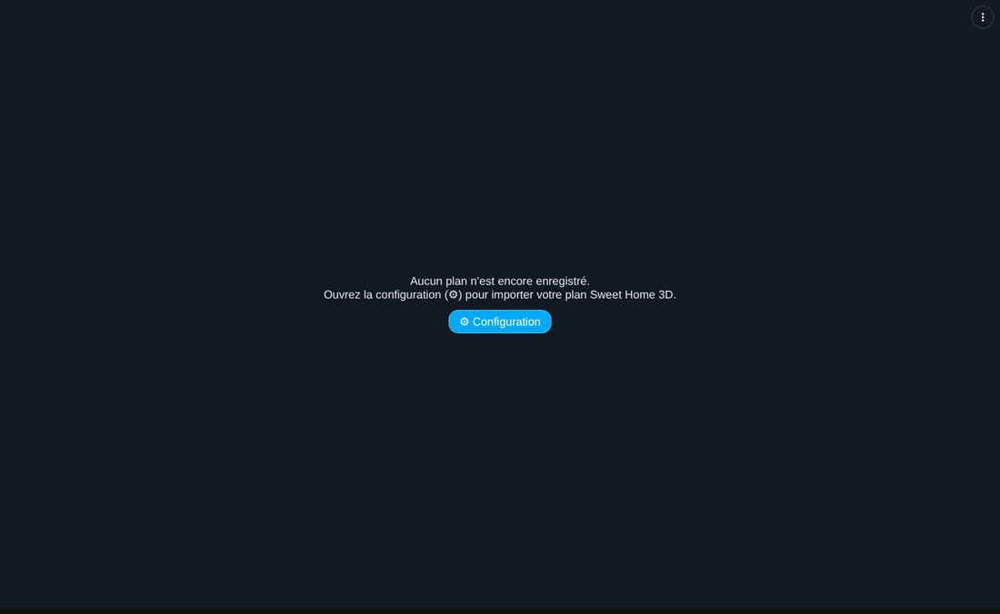

## 4. Primeira configuração: a planta e o terreno

Abra ⚙ **Setup** (botão do cartão vazio, ou **menu ⋮ → Setup**).


### 4.1 Importar a planta

Em **Plan of the house**, clique em *Import a plan* e escolha o seu ficheiro: Sweet Home 3D (`.sh3d`), IFC (`.ifc`) ou SVG (`.svg`). A planta é lida no navegador (só a estrutura é guardada: níveis, paredes, divisões, aberturas, luzes, móveis, vegetação) e um **relatório** lista o que foi encontrado, com eventuais observações (nível sem divisões, bússola não ajustada…).

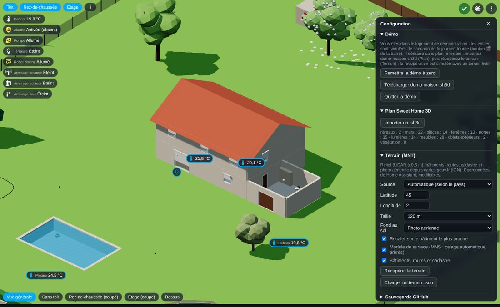

A casa aparece logo sobre um chão plano. Os móveis são desenhados com os seus **próprios modelos 3D**, os do ficheiro do Sweet Home 3D (aligeirados, uma cor por material, a cor média de uma textura); a caixa *Furniture drawn with the 3D models of the plan* volta às formas simples. Um móvel cujo modelo está noutro formato que não OBJ fica uma caixa, ou o objeto do catálogo com o seu nome.

> **Conselho**: se uma divisão não tiver uma área do Home Assistant com o mesmo nome, a configuração assinala-o. Poderá ligá-la à mão no editor ([6.5](#65-divisões--áreas-do-home-assistant)).

**Os formatos**:

- **Sweet Home 3D**: níveis, paredes, divisões, portas e janelas, luzes, móveis e vegetação.
- **IFC** (exportado pelo ArchiCAD, Revit, FreeCAD, BlenderBIM…): os pisos tornam-se níveis e os espaços (`IfcSpace`) divisões, com as paredes, as portas e as janelas. Lembre-se de exportar os espaços: sem eles não há divisões, e portanto nem luzes nem ligação às áreas.
- **SVG** (planta desenhada para o ha-floorplan, ou com o Inkscape): cada forma fechada com um nome (o seu id, a sua etiqueta do Inkscape ou um `<title>`) é uma divisão; o id `area.sala` dá «Sala». As camadas do Inkscape que contêm divisões tornam-se níveis. Corrija a **escala** (*Scale: SVG units per meter*) se o tamanho indicado não corresponder. Um SVG feito de retângulos abre-se na planta simples, para acrescentar portas e janelas.

Com uma planta IFC, SVG ou simples, cada divisão recebe uma luz de teto acesa pelas luzes da sua área.

### 4.2 Criar uma planta simples

Não tem planta? *Create a simple plan* (em **Plan of the house**) abre um editor de divisões retangulares; a vista 3D atualiza-se por trás.


- **Divisões**: *＋ Room* acrescenta uma ao lado da anterior, com o nome de uma área do Home Assistant ainda não usada. Arraste uma divisão para a mover e as suas pegas para a redimensionar: as arestas colam-se às divisões vizinhas, que partilham então a parede. Os campos da divisão selecionada ajustam o nome, a **área do HA**, a largura, a profundidade e a posição.
- **Portas e janelas**: escolha *＋ Window*, *＋ Patio door* ou *＋ Door* e depois clique na parede da divisão onde fica. Arraste-a ao longo da parede e ajuste a largura, a altura e o peitoril.
- **Níveis**: *＋ Level* acrescenta um piso que copia o contorno das divisões de baixo, para mudar o nome e voltar a dividir; o pé-direito ajusta-se por nível. O contorno do nível de baixo continua visível a tracejado.
- **Telhado e orientação**: telhado automático, de duas águas ou plano; ângulo do norte (o ajuste ao terreno corrige-o depois).

A planta grava-se sozinha e volta a abrir-se com *Edit the simple plan*. Uma planta simples substitui uma planta importada, após confirmação; as entidades colocadas, a rega, as vedações… são mantidas.

### 4.3 Partir do mapa do robô

Se um robô aspirador mapeou a casa e um extrator de mapa (Xiaomi Cloud Map Extractor, Roborock Custom Map…) dá as suas divisões (atributo `rooms`), o botão *Plan from the robot's map* cria uma planta simples com essas divisões, no seu tamanho e lugar. São retângulos aproximados, e só os do nível do robô: ajuste-os e depois acrescente portas, janelas e outros níveis na planta simples.

### 4.4 Obter o terreno

Em **Terrain (DTM)**:

1. **Source**: *Automatic (by country)* escolhe os serviços do IGN em França e os dados abertos mundiais noutros locais (Mapterhorn para o relevo, OpenStreetMap para os edifícios e as estradas).
2. **Latitude / longitude**: tiradas da localização da habitação, ou seja, da configuração do Home Assistant (*Definições → Sistema → Geral*), a menos que a tenha alterado ao adicionar a habitação. Pode alterá-las aqui.
3. **Size**: tamanho do terreno à volta da casa (120 m por omissão).
4. Opções (França): modelo de superfície (árvores e ajuste automático), edifícios, estradas e cadastro, fotografia aérea ou mapa do IGN sobre o chão; ajuste ao edifício mais próximo (a localização do Home Assistant é muitas vezes aproximada).
5. Clique em **Fetch the terrain**. Os passos aparecem por baixo do formulário (localização, relevo, superfície, edifícios e estradas, fotografia).


No fim, a planta é **ajustada automaticamente** ao terreno (rotação, deslocamento, altura), as árvores detetadas são plantadas e aparecem o relevo, as estradas e a fotografia.

Também pode carregar um ficheiro de terreno (*Load a terrain .json*) ou retocar o ajuste à mão (rotação, deslocamento, altura) na mesma secção.

## 5. Utilizar a vista


### 5.1 Deslocar-se

- **Arrastar** para rodar, **roda ou beliscar** para fazer zoom, **clique direito / dois dedos** para deslocar.
- As **vistas** em baixo (General view, Without roof, Ground floor (cut), First floor (cut), Top) reposicionam a câmara. Pode gravar as suas no editor ([6.11](#611-árvores-objetos-exteriores-e-correções-do-chão)).
- Os **níveis** no canto superior esquerdo (Roof, Ground floor, First floor) mostram ou escondem o telhado e cada piso; 🌡 colore as divisões segundo a sua temperatura.


| Corte do rés-do-chão | Vista de cima |
|---|---|
| 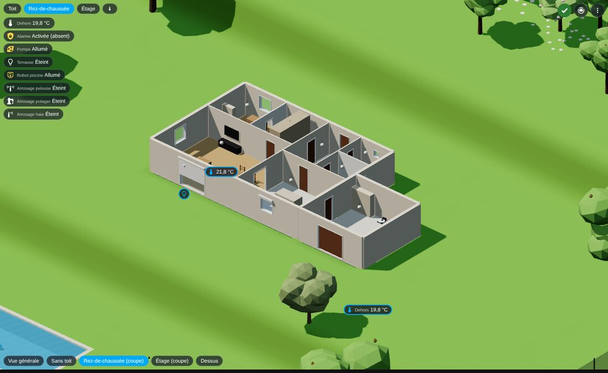 |  |

### 5.2 As divisões

- Um **toque numa divisão** faz zoom sobre ela (o telhado e os pisos acima desaparecem). Um **segundo toque** acende ou apaga as suas luzes. O botão **← Room** volta à vista anterior.
- Com o zoom numa divisão, só aparecem **as entidades dessa divisão** (as da vista geral desaparecem); o robô aspirador continua visível se lá estiver.


### 5.3 A coluna da esquerda: o painel geral

Por baixo dos níveis, o **painel geral** reúne os sensores e comandos de toda a casa (temperatura exterior, alarme, bomba, rega…). Um toque alterna o que pode ser alternado e abre a ficha dos restantes.

### 5.4 A barra e o menu ⋮

No canto superior direito:

- o **distintivo de alarme**: verde quando está tudo bem, vermelho com o número de alarmes ativos;
- um botão por **robô aspirador**;
- o menu **⋮**, que reúne as ferramentas ocasionais e a administração.

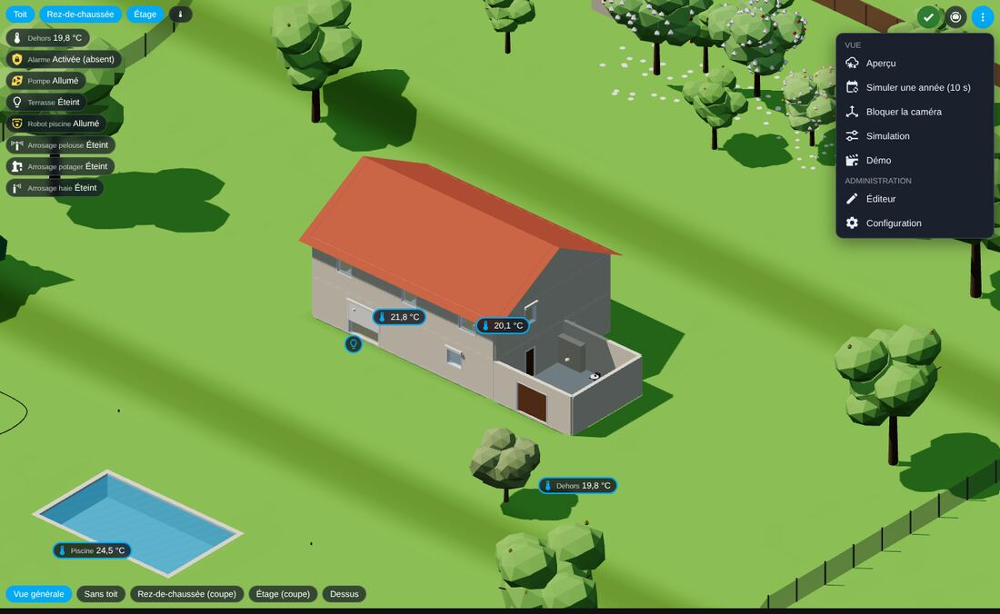

| Entrada | Função |
|---|---|
| Preview | Forçar uma estação, um tempo ou um momento do dia |
| Simulate a year | Passar as estações de um ano em poucos segundos |
| Lock the camera | Fixar a câmara nas vistas (ecrã de parede) |
| Simulation | Ajustes do modo de simulação (se o cartão estiver em modo de simulação) |
| Demo | Painel da habitação de demonstração |
| Editor ✎ | Colocar entidades, rega, vedações… (administradores) |
| Setup ⚙ | Planta, terreno, cópia de segurança, proteção (administradores) |

As ferramentas que usa muitas vezes podem ficar na barra (opção *Buttons in the toolbar*), e o menu pode ser escondido de quem não é administrador (opção *Hide the ⋮ menu*).

### 5.5 Os alarmes

Os sensores de fumo, gás, monóxido de carbono, fuga de água, problema, calor, frio e sabotagem, e as centrais de alarme disparadas, são detetados sozinhos. Quando um alarme dispara, o distintivo fica vermelho e a **divisão em causa** mostra um sino vermelho com o número de alarmes. Um toque abre a lista; um toque num alarme abre a sua ficha; o sino riscado ignora-o.


### 5.6 Tempo, sol e estações

- O **sol** segue a hora e a data da habitação; as **sombras** rodam ao longo do dia.
- O **tempo** vem da entidade meteorológica (chuva, neve, trovoada, nevoeiro, nuvens, vento). Um pluviómetro ou sensores de vento próprios podem corrigi-lo (ver as opções).
- A **vegetação** e a **relva** seguem as estações do clima da latitude: quatro estações em zona temperada, inverno longo e verão curto perto dos polos, estação das chuvas e estação seca entre os trópicos. Tudo se inverte no hemisfério sul.
- **Preview** (menu ⋮): force uma estação, um tempo ou um momento, combináveis; regresso ao direto com *Preview… ✕* ou ao fim de 3 minutos.

| Preview: inverno com neve | Simulate a year: o outono |
|---|---|
|  |  |

**Simulate a year** passa um ano inteiro (10 s por omissão, de 5 a 60 s) a partir da data mostrada; uma etiqueta indica a data. No fim, a vista volta à data anterior.

### 5.7 Luzes, estores e janelas

As luzes de cada divisão iluminam a divisão e as suas janelas. Os **estores** descem até à sua posição real, as **janelas** abrem-se, as **portas de correr** deslizam, as **portas** rodam.

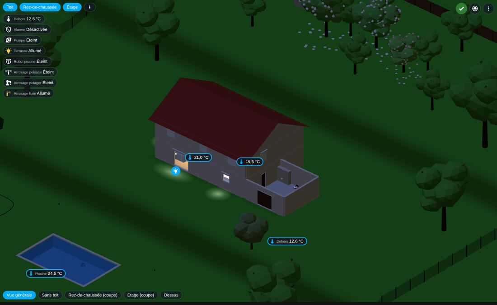

### 5.8 O robô aspirador

Um toque no botão do robô abre a seleção das divisões: escolha-as na planta e depois *Clean* (também *Start*, *Pause*, *Dock*). Durante a limpeza, um robô 3D desloca-se, a divisão em curso é colorida com a sua percentagem, as divisões por fazer ficam tingidas, uma divisão terminada cintila e um anel à volta do botão dá o progresso global. Em caso de erro, a divisão e o robô piscam a vermelho.

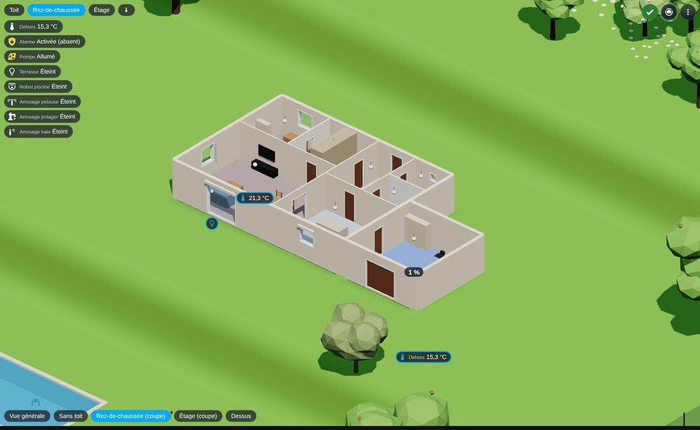

### 5.9 Rega, piscina e lago

Quando uma válvula abre, os **gotejadores** acendem-se a azul e cresce uma mancha húmida; os **aspersores** mostram o jato e o setor. O robô da piscina percorre o fundo enquanto a sua entidade está ativa; a água mexe-se.

| Aspersores ao amanhecer | Piscina e lago |
|---|---|
|  | 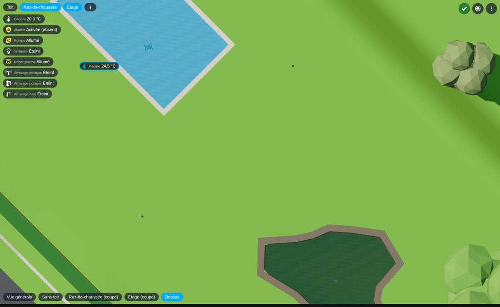 |

## 6. O editor

Apenas para administradores: **menu ⋮ → Editor**. O editor é um **menu de secções**. Uma secção abre-se na sua própria janela, por cima do menu; um elemento de uma lista (uma linha de gota-a-gota, uma zona, uma entidade…) abre-se por cima da secção. A seta **←** volta à janela de baixo. Tudo é gravado sozinho; **Esc** cancela o traçado em curso.


### 6.1 Entidades colocadas

Para colocar uma entidade na vista (temperatura, luz, interruptor, estore…):

1. *Add an entity*: a lista propõe primeiro as entidades da divisão atual, agrupadas por dispositivo (a casa inteira com um toque, com pesquisa).
2. Toque no local pretendido na vista. A etiqueta **desloca-se depois arrastando-a** (com o editor aberto).
3. Ajuste: **Mount** (no chão, numa parede, livre em altura), **Display** (pastilha com o valor, ou só o ícone), etiqueta, ícone, cor, ação ao toque (ficha, alternar, nada).

As entidades estão arrumadas em **camadas**:

- **Vista geral**: mostradas na vista geral (ou só na vista do seu piso). A caixa *Shown over the roof* permite ler ao longe, por exemplo, a temperatura de uma divisão.
- **Divisão**: mostradas só com o zoom na sua divisão.

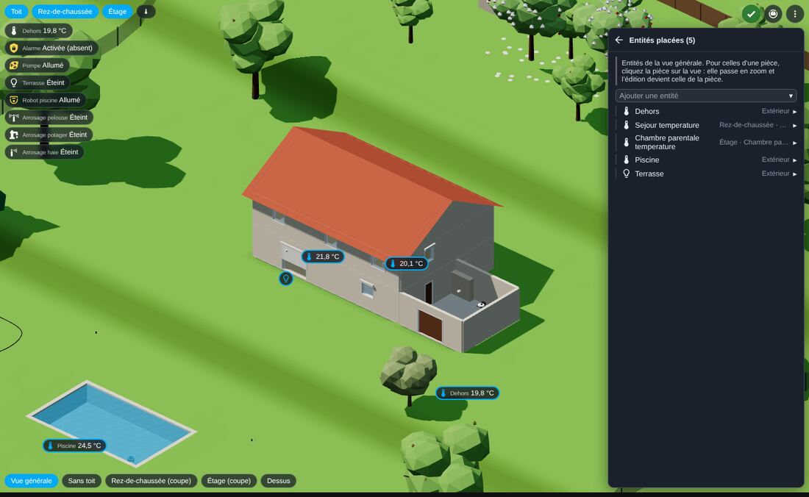

Para editar **as entidades de uma divisão**, toque na divisão na vista com o editor aberto: faz-se zoom sobre ela e uma **faixa vermelha** indica que está a editar essa divisão. As entidades então adicionadas pertencem apenas a essa divisão; coloque-as no chão, numa parede ou no ar.


> Uma entidade da vista geral já colocada numa divisão passa para essa divisão com *Visible → Its room only*.

Uma **luz** colocada torna-se uma verdadeira fonte de luz nesse ponto (foco, suspensão, candeeiro, fita ou invisível; altura e alcance ajustáveis; numa parede: um aplique).

### 6.2 Painel geral

Os sensores e comandos da coluna da esquerda, pela ordem que quiser, com a sua etiqueta, ícone e ação ao toque (automática, alternar, ficha, nada).


### 6.3 Alarmes

Deteção automática ativada ou não, sinos nas divisões, entidades adicionadas à mão, entidades ignoradas.


### 6.4 Zonas clicáveis

Um **leitor multimédia** colocado num móvel da planta (toque nele) ou num retângulo encostado a uma parede ou ao chão; um **aquário** da integração [reeftank](https://github.com/Elwinmage/ha-reeftank-component) num retângulo do tamanho do tanque. Um toque abre o leitor, ou a vista do aquário do cartão [ha-reef-card](https://github.com/Elwinmage/ha-reef-card); o retângulo de um aquário mostra essa vista em direto, peixes incluídos, nunca deformada. Durante a colocação, a superfície apontada acende-se; uma zona desloca-se arrastando-a.

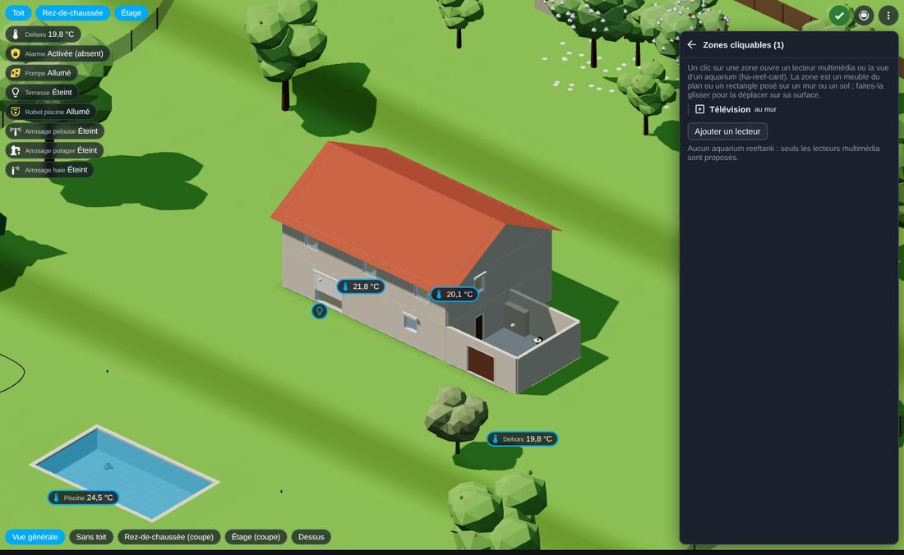

### 6.5 Divisões ↔ áreas do Home Assistant

Cada divisão da planta é ligada à área do Home Assistant **com o mesmo nome** (ignorando acentos e maiúsculas). Esta secção permite escolher outra área, ou nenhuma, divisão a divisão.


### 6.6 Portas e janelas

As aberturas da planta, por nível e por divisão; **Pick on the view** permite tocar diretamente numa janela (acende-se ao passar por cima). Cada uma pode ser ligada a:

- um **sensor aberto / fechado** (`binary_sensor`);
- um **abridor motorizado** (`cover` da janela);
- um **estore** (`cover`), para janelas e portas de correr.

Uma divisão que **só tem uma janela** liga-se sozinha ao sensor de janela, ao abridor e ao estore da sua área (quando há um de cada); uma divisão que só tem uma porta, ao seu sensor de porta. Uma ligação escolhida à mão prevalece; uma ligação automática pode ser removida.


### 6.7 Piscinas e lagos

*＋ Pool* ou *＋ Pond*, e depois desenhe o contorno visto de cima: **Rectangle** (dois cantos opostos) ou **Free shape** (ponto a ponto, e depois *Finish*). Ajuste o nome, a cor da água, a profundidade (0,2 a 6 m) e, se tiver um, o **robô de limpeza** (`binary_sensor`, `switch`, `input_boolean` ou `vacuum`). O terreno é escavado: paredes verticais, fundo plano e bordadura para uma piscina; fundo inclinado e margem de seixos para um lago.


> A piscina desenhada no Sweet Home 3D, se existir, é mantida tal como está.

**Ilhas** (lago): *＋ Island (Rectangle)* ou *＋ Island (Free shape)*, e depois desenhe-a na água como o contorno. O chão mantém-se ali, um pouco acima da água, com uma margem de seixos: pode plantar-se uma árvore (secção **Árvores**) e colocar entidades.

**Peixes** (lago): os peixes vêm do catálogo da casa (a carpa koi para começar). Acrescente um **grupo** por variedade, com o seu número e tamanho: para 3 carpas vermelhas, 1 vermelha e branca e 2 amarelas, faça três grupos (Benigoi × 3, Kohaku × 1, Yamabuki ogon × 2). *Colours of my own* permite escolher a cor do corpo, a das manchas, o padrão (liso, manchas grandes, médias ou pequenas) e escamas brilhantes. Cada peixe tem o seu próprio padrão, sempre o mesmo; nada na água evitando as margens e as ilhas, ganha a cor da água quando desce e fica no fundo, quase imóvel, quando está frio (menos de 8 °C).


### 6.8 Robô aspirador

Para cada robô (lista *Robot*):

- **Place the dock** e toque no chão; ajuste a sua **direção** (ou *Aim with a tap*);
- **Robot position**: Roborock (ação oficial), atributos de uma entidade (extratores de mapa), ou nenhuma (trajeto estimado);
- **Calibração**: rotação, espelho, escala; *Calibrate with a tap* quando o robô saiu da base;
- **Mapa do robô** colocado sobre a planta para o alinhar: com um extrator de mapa (pontos de calibração) coloca-se sozinho; com a integração oficial Roborock, indique a base com um toque (*The dock is here on the map*);
- cores do robô e da divisão em curso, *Show this robot on the view*, *Test the animation*.


### 6.9 Rega

- **Drip lines** (gota-a-gota): uma linha por válvula (`switch`, `valve`, `input_boolean`), traçada ponto a ponto, com a cor do tubo, o caudal e o espaçamento dos gotejadores.
- **Sprinklers** (aspersores): um circuito por válvula, com um ou vários aspersores do catálogo (Hunter PSU, SRM, PGJ, PGP, MP Rotator ou genérico), o seu alcance, direção e ângulo (*Aim* com um toque).
- Uma mesma válvula pode comandar **várias linhas ou circuitos**: escolha a mesma entidade para cada um; acendem-se juntos.
- **Test the animation**: 30 s de rega acelerada sem abrir nenhuma válvula.


### 6.10 Vedações

*Fence from the cadastre* (os lotes da casa vêm pré-selecionados; **só em França**, pois o cadastro vem dos serviços do IGN: noutros locais, trace a vedação à mão) ou *Draw a fence* ponto a ponto. Cada lado tem o seu tipo (rede, madeira, muro, sebe, ou aberto onde não há vedação; um portão acrescenta-se em *Gates* e abre a vedação sozinho) e a sua altura; *Edit the sides* muda um lado, corta-o em dois ou remove um ponto.

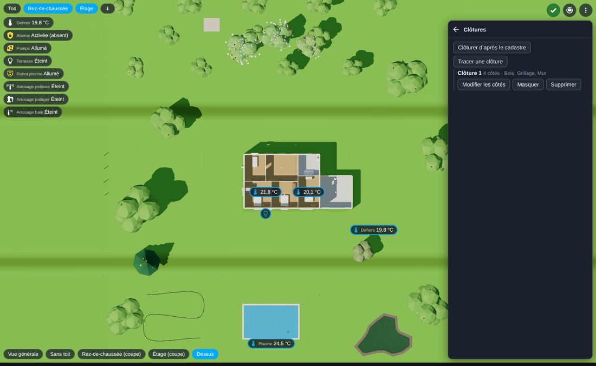

### 6.11 Árvores, objetos exteriores e correções do chão

- **Árvores**: apagar as detetadas por engano, plantar outras (espécie do catálogo e altura), anular, repor todas.
- **Objetos exteriores** (arrecadação, portão…): esconder, altura, deslocamento, rotação.
- **Correções do chão**: muro baixo, terraço, pincéis (subir, escavar, alisar), corte do terreno.
- **Vistas**: gravar a câmara atual como vista, mudar o nome, apagar.


### 6.12 O catálogo de árvores e objetos

As espécies de árvores (com o seu aspeto em cada estação), os objetos do jardim ou os móveis desenhados em vez de simples caixas, e os peixes dos lagos vêm do [catálogo da casa](https://github.com/Elwinmage/house-catalog). A integração atualiza-o sozinha a partir do GitHub (dispositivo *House view catalog*: uma entidade de atualização por secção, um interruptor de atualização automática, um botão para atualizar já) e funciona sem ligação com a cópia que traz.

Para criar **a sua própria árvore ou objeto**, use o [editor de catálogo](https://github.com/Elwinmage/catalog-editor): um cartão do Home Assistant onde se ajustam a forma, as cores e as estações vendo o resultado. O que gravar é usado logo pela vista, e depois pode propô-lo ao catálogo comum (um pull request no GitHub), para que todos beneficiem.

## 7. A configuração (⚙)

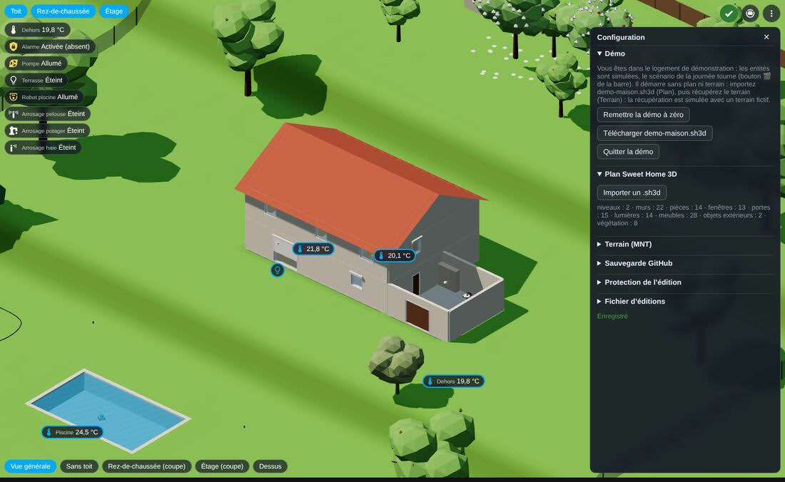

- **Demo**: ver [O modo demo](#9-o-modo-demo).
- **Planta** e **terreno**: ver [a primeira configuração](#4-primeira-configuração-a-planta-e-o-terreno).
- **GitHub backup**: configure um repositório **privado** nas opções da integração (*Definições → Dispositivos e Serviços → House View → Configurar → cópia de segurança no GitHub*: repositório `dono/nome`, token *fine-grained* com *Contents: read and write*, ramo, pasta), e depois *Back up to GitHub* / *Restore from GitHub*. Um repositório público é recusado: conteria a planta da sua casa.
- **Edit protection**: pode ser pedida uma palavra-passe antes de abrir o editor e a configuração (opções da integração → proteção da edição). O cartão volta a pedi-la após 10 minutos sem alterações; o botão 🔒 bloqueia de imediato. Ver a vista, fazer zoom, comandar as luzes ou o aspirador continuam livres.
- **Edits file**: exportar ou importar todas as suas edições (entidades, rega, vedações…) num ficheiro JSON.

## 8. Várias habitações

Uma casa de férias, um chalé… Cada habitação é uma **entrada** da integração, com a sua própria planta, terreno e edições.

1. *Definições → Dispositivos e Serviços → House View → Adicionar entrada*.
2. Dê-lhe um nome (diferente dos outros) e a sua localização.
3. No cartão (editor visual), escolha a **habitação** mostrada: a lista aparece assim que houver duas. Em YAML: `home: <id da entrada>`.
4. Importe a sua planta e obtenha o seu terreno como no [capítulo 4](#4-primeira-configuração-a-planta-e-o-terreno).

Apagar uma entrada apaga os seus documentos; as outras habitações não são tocadas.

## 9. O modo demo

Para filmar ou apresentar a vista **sem mostrar a sua casa nem a sua localização**.

A demo está **oculta por predefinição**. Ative-a primeiro: *Definições → Dispositivos e Serviços → House View → Configurar → Demo*, desmarque *Ocultar a demo*; a secção **Demo** aparece então em ⚙.

1. ⚙ → **Demo** → *Load the demo*: é adicionada uma habitação «Démo», com uma localização fictícia (45° N); as suas habitações não são tocadas. Começa **vazia e plana**, para ser filmada desde o início.

   

2. Importe `demo-maison.sh3d` (*Download demo-maison.sh3d* em ⚙) com *Import a plan*.
3. *Fetch the terrain*: a obtenção passa pelos seus passos e traz um terreno fictício em três patamares (pomar, casa, jardim com piscina e lago), sem qualquer acesso à rede.

As entidades da demo são **simuladas pelo cartão**: nada é criado no Home Assistant e nada da sua casa aparece. Um **cenário do dia** (1 h a cada 2 s) dá vida à casa: estores abertos de manhã, rega ao amanhecer, aspirador de manhã, robô da piscina à tarde, janelas abertas para arejar, fuga de água antes do jantar, luzes acesas e estores fechados à noite.

O botão **🎬 Demo** (menu ⋮) pausa o cenário, ajusta a hora e dispara um evento à mão (estores, luzes, aspirador, rega, robô da piscina, fuga, fumo). Um toque numa entidade simulada alterna-a; essa alteração dura até ao próximo movimento do cenário.


*Reset the demo* repõe-na como foi entregue; *Leave the demo* volta à sua habitação. A habitação Démo apaga-se como qualquer outra entrada da integração.

## 10. Opções do cartão

Ajustam-se no editor visual do cartão (painel em modo de edição → *Editar* no cartão), por secções.

| Opção | Função | Por omissão |
|---|---|---|
| `home` | Habitação mostrada (várias habitações) | a primeira |
| `mode` | `live` (tempo real) ou `simulation` (cursores de hora, data e tempo) | `live` |
| `weather_entity` | Entidade meteorológica | — |
| `rain_entity` | Detetor de chuva ou sensor de intensidade de chuva (mm/h) | — |
| `wind_speed_entity`, `wind_bearing_entity` | Sensores de vento próprios | — |
| `view` | Vista inicial (o seu nome) | — |
| `show_views`, `show_levels` | Botões das vistas, dos níveis | sim |
| `show_entities` | Entidades colocadas | sim |
| `show_alarms` | Distintivo de alarme | sim |
| `tap_action` | Toque numa divisão: `zoom`, `toggle_lights`, `none` | `zoom` |
| `movable_camera` | Câmara móvel | sim |
| `height`, `min_height` | Altura do cartão (`fill`, `aspect`, em px ou `vh`) | `fill`, 320 |
| `fps_cap` | Máximo de imagens por segundo (tablet de parede) | 30 |
| `year_seconds` | Duração de «Simulate a year» (5 a 60 s) | 10 |
| `toolbar_buttons` | Ferramentas que ficam na barra (`preview`, `year`, `camera`, `sim`, `edit`, `setup`) | nenhuma |
| `hide_menu` | Esconder o menu ⋮ de quem não é administrador | não |
| `light_entities` | Limitar as luzes tidas em conta | todas |
| `vacuum_entity`, `vacuum_poll`, `vacuum_rate`, `vacuum_show_floor`, `vacuum_progress_entity` | Robô aspirador | — |

Em modo de **simulação**, o painel *Simulation* (menu ⋮) ajusta a hora (com reprodução), a data, o tempo, as nuvens, a chuva, o vento, a temperatura e a neve.


## 11. Perguntas frequentes

**Uma divisão fica às escuras, as suas luzes não aparecem.**
Verifique se está ligada a uma área do Home Assistant ([6.5](#65-divisões--áreas-do-home-assistant)) e se as suas luzes estão atribuídas a essa área.

**O sol ou as estações não batem certo.**
A bússola da planta do Sweet Home 3D tem de estar ajustada (latitude e norte), e a localização da habitação tem de estar correta (opções da entrada House View).

**A casa flutua ou afunda-se no terreno.**
Retoque a altura em ⚙ → *Terrain (DTM)*, ou volte a lançar o ajuste automático.

**Uma etiqueta não aparece.**
Uma etiqueta tapada pelo telhado ou por um piso não é mostrada (exceto com *Shown over the roof*), e uma etiqueta de divisão só aparece com o zoom na sua divisão. Com o editor aberto em *Placed entities*, todas as etiquetas da camada são mostradas (esbatidas quando tapadas).

**O mapa do robô não está alinhado.**
Com a integração oficial Roborock, indique a base no mapa com um toque e depois ajuste a rotação. Com um extrator de mapa (Roborock Custom Map, Xiaomi Cloud Map Extractor), escolha a sua entidade: o mapa coloca-se sozinho.

**Não há fotografia aérea no chão.**
Em ⚙ → *Terrain (DTM)*, verifique se *Aerial photo on the ground* está assinalada. Se a obtenção indicar «ground texture unavailable», o motivo entre parênteses vem do serviço do IGN; tente de novo mais tarde.

**Quero mostrar a vista sem mostrar a minha casa.**
Use o [modo demo](#9-o-modo-demo).
